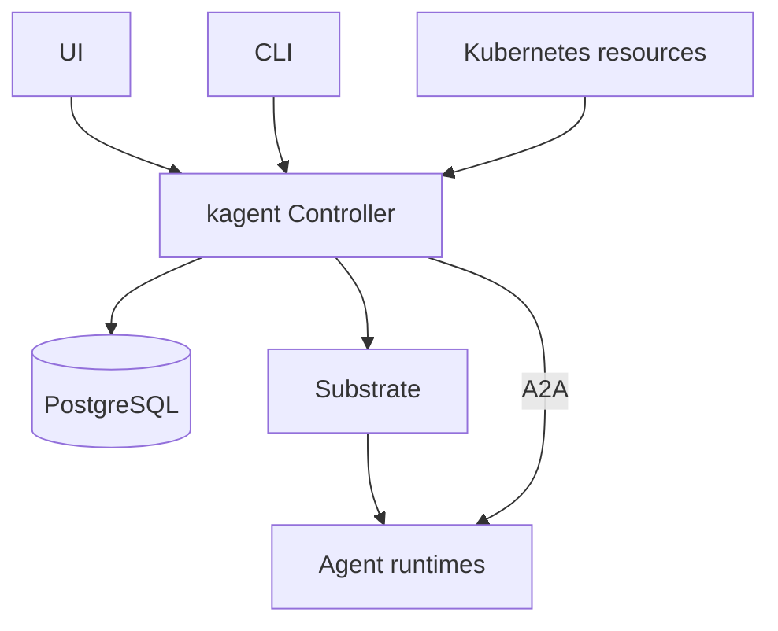

# Architecture and CRDs

kagent is a Kubernetes-native control plane for defining, compiling, running, and invoking AI agents, with standalone sandboxes for isolated process and file execution.

## Resource ownership

| Resource | Owner | Purpose |
| --- | --- | --- |
| `Agent` | Kubernetes (`api.kagent.dev/v1alpha3`) | Pairs inline-or-reference behavior with a referenced Harness, readiness, and revision selection |
| `Harness` | Kubernetes (`api.kagent.dev/v1alpha3`) | Runtime implementation, workload, credentials, capacity, and snapshot policy |
| `AgentTemplate` | Kubernetes (`api.kagent.dev/v1alpha3`) | Portable agent behavior: models, prompts, tools, skills, and subagents |
| `SandboxTemplate` | Kubernetes (`api.kagent.dev/v1alpha3`) | Tools image, environment, and preparation policy for standalone sandboxes |
| `EgressPolicy` | Kubernetes (`api.kagent.dev/v1alpha3`) | Additional HTTP(S) origins and gateway credentials selected by Agents and SandboxTemplates |
| prepared revision | PostgreSQL and ate-api | Immutable compiled runtime input and its Substrate ActorTemplate |
| `Session` | PostgreSQL, exposed by gRPC | Stable conversation identity and runtime lifecycle |
| `Sandbox` | PostgreSQL, exposed by gRPC and MCP | Owner-scoped scratch environment with process/file access and expiration |
| A2A context, task, events | PostgreSQL, exposed by A2A | Durable interaction and audit history |
| checkpoint | PostgreSQL plus Substrate snapshot tag | Immutable, named restart boundary |
| Actor and durable directory | Substrate | Process lifecycle and private runtime state |

`Session` is not a Kubernetes custom resource. A2A owns public interaction semantics; kagent does not maintain a parallel session or task API.

## Public surfaces

| Surface | Role |
| --- | --- |
| Kubernetes API | Author Agents, Harnesses, AgentTemplates, SandboxTemplates, models, prompts, and remote MCP servers |
| gRPC / gRPC-Web | Manage Sessions, sharing, checkpoints, sandboxes, and control-plane reads |
| A2A | Invoke agents and manage durable tasks and streams |
| MCP | Discover, invoke, checkpoint, and fork Sessions; create and use standalone sandboxes |

Public control-plane contracts use `kagent.api.v1`. Runtime contracts use `kagent.runtime.v1`. CLI, controller, and ADK configuration use `kagent.config.v1`.

## End-to-end flow



- **Controller**: Watches kagent custom resources, prepares agents to run, and manages their sessions. Exposes gRPC, A2A, and MCP APIs.
- **UI**: Web interface to manage agents, tools, and chat.
- **Agent Runtimes**: Go or Python ADK, Codex, Claude, or custom runtimes, selected by Harness.
- **Substrate**: Runs the agents and manages their lifecycle, including suspension, resumption, and snapshots.
- **PostgreSQL**: Stores sessions, tasks, and conversation history persisting independently of running agents.
- **CLI**: Command-line tool for agent and sandbox management and invocation.

## CRD definitions (`api.kagent.dev/v1alpha3`)

### 1. Agent
```yaml
apiVersion: api.kagent.dev/v1alpha3
kind: Agent
metadata:
  name: cluster-debugger
  namespace: default
spec:
  harnessRef:
    name: kagent-default-harness
  templateRef:
    name: cluster-debugger-template
```

### 2. AgentTemplate
```yaml
apiVersion: api.kagent.dev/v1alpha3
kind: AgentTemplate
metadata:
  name: cluster-debugger-template
  namespace: default
spec:
  prompt: "You are an expert Kubernetes cluster diagnostic agent."
  modelConfig:
    provider: anthropic
    model: claude-3-7-sonnet-20250219
  tools:
    - mcp:
        server:
          kind: RemoteMCPServer
          name: k8s-tools
        tools:
          - list_pods
          - get_pod_logs
```

### 3. Harness
```yaml
apiVersion: api.kagent.dev/v1alpha3
kind: Harness
metadata:
  name: kagent-default-harness
  namespace: default
spec:
  adapter: kagent
  workload:
    image: ghcr.io/kagent-dev/kagent-runtime:v1.0.1
```

### 4. SandboxTemplate
```yaml
apiVersion: api.kagent.dev/v1alpha3
kind: SandboxTemplate
metadata:
  name: python-runner
  namespace: default
spec:
  workload:
    image: python:3.11-slim
  resources:
    limits:
      cpu: "2"
      memory: 4Gi
```

## Guidance rules

1. Inspect available tool schemas for the connected deployment. When repository source is available, use `docs/architecture` and the implementation to verify behavior.
2. Verify CRDs from `go/api/v1alpha3` and generated manifests, protobuf APIs from `proto`, MCP inputs from `go/core/internal/mcp`, and CLI behavior from command help or source.
3. Describe planned behavior as planned until its implementation has landed.
4. Do not invent compatibility paths, migration procedures, fields, commands, or endpoints that are absent from the v1alpha3 API.
5. Use upstream A2A operations for agent interaction and history, Session/Checkpoint APIs for conversation lifecycle, and Sandbox tools for standalone commands and files.

## Stable design constraints

- One Session pins a compiled revision of one Agent, including its template tree.
- AgentTemplate references are same-namespace.
- Shared children (`subAgent.templateRef`) run inside their parent runtime. Dedicated bindings (`subAgent.agentRef`) are accepted by the API but currently rejected during compilation.
- Runtime state lives in DurableDir and must survive suspend/resume.
- Harness and SandboxTemplate own their respective runtime configuration. AgentTemplate describes behavior; do not add infrastructure fields to it.
- Actor identities and private runtime endpoints are implementation details.
