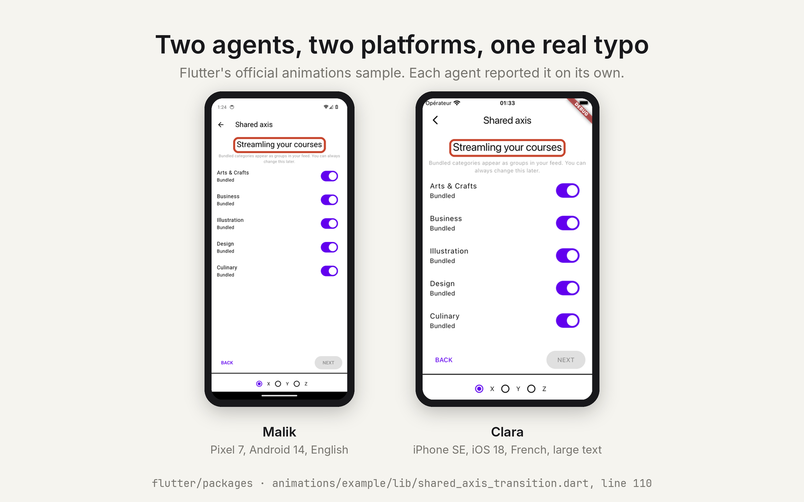

# 应用实例

[English](examples.md) · 简体中文 · [日本語](examples.ja.md) · [Español](examples.es.md) · [Português](examples.pt-BR.md)

在开源应用上的真实运行，没有预先埋入任何缺陷。 所有数字都来自[运行记录](runs/)，那里逐台设备列出了每一份报告。

## 不只是无障碍

大字号的截图最醒目，但这只是智能体报告内容的一小部分。每个角色都有自己的目标（“不靠英语完成一项任务”“在每个输入框里填土耳其语字符、表情符号和超长文本”“用到一半离开应用，再回来”），像新用户一样去完成，所以一路上挡路的问题都会被报告出来：

- **流程中断和静默失败**：设备列表一直加载，从不提示没找到设备（20 台手机中有 12 台遇到）；手动发送失败只显示“Error”；地址没有响应时对话框一直等待；文字对话框里误点一下外面，已输入的内容就没了。
- **引导和权限**：AnkiDroid 必须先在系统页面授予“所有文件访问权限”才能继续设置，而且没有任何解释（10 个智能体中有 8 个遇到）。
- **翻译**：葡萄牙语、西班牙语和日语设备上的“Get started”仍是英文；葡萄牙语里 # 标签页被翻成“Jogo da velha”（井字棋）；阿拉伯语里文件大小写成“B 14”；日期用 ISO 格式而不是手机的格式；隐私政策只有英文。
- **文案**：Flutter 官方示例里的拼写错误；一条文字消息被算成“Files: 1”；主屏幕上出现“#16 #15”却没有任何说明。
- **设备**：平板上显示手机布局，挤在中间一窄列；键盘挡住“取消”和“确认”；Android 导航栏盖住列表最后几项；应用不支持深色模式。
- **数据**：重新打开后什么都没保存（演示应用）。

在 LocalSend 上，46 个缺陷中有 34 个与字号和无障碍都无关。每份报告最后还有角色自己的看法和 10 分制评分（会不会继续用这个应用？），所以一次运行不仅告诉你哪里坏了，也告诉你新用户在哪里卡住。

## LocalSend：20 个智能体，20 台设备，14 种语言

<p align="center"></p>

[LocalSend](https://github.com/localsend/localsend) 是一个 10 万星的 Flutter 应用。智能体发现了：

- 瑞典语、iOS 最大字号的 iPhone SE：消息对话框溢出 149 px，输入框和“确认”按钮都在屏幕外，根本无法发送文字。
- Android 字体 200% 的 Pixel 7：六个“发送”按钮全部溢出，标签被切掉一半。意大利语、第一档辅助功能字号的 iPhone 16 Plus 上也一样。
- 德语、大字号的 iPad Air：“Hinzufügen”超出卡片 114 px，设置里的值在单词中间断行。
- 法语、默认字号的 iPhone SE：“Recevoir via un lien”溢出 28 px，挡住了一个复选框。
- 西班牙语的 Pixel Tablet：键盘挡住了地址对话框的“取消”和“确认”。
- 手动发送失败时只显示“Error”“Erreur”“Fehler”“エラー”“Hata”或“Erro”，不给任何原因。在 iOS 上，地址没有响应时对话框会一直等待，看不到任何进度（三个智能体各自发现）。

共 103 份报告（1 个阻断级，15 个严重）。人工归并后是 46 个不同的缺陷，其中大多数只被一台手机发现：

<picture>
  <source media="(prefers-color-scheme: dark)" srcset="../assets/bugs-per-phone-dark.svg">
  
</picture>

从开始到最后一份报告用时 69 分钟（免费计划同时只能运行 5 个 macOS 任务），20 个智能体的模型用量共 4.62 美元。每份报告、每台设备：[docs/runs/localsend-20.md](runs/localsend-20.md)。自己运行：

```bash
gh workflow run agent-testers.yml -f source_repo=localsend/localsend -f app_dir=app \
  -f app_id=org.localsend.localsend_app -f android_personas=all -f ios_personas=all -f record_video=true
```

## AnkiDroid：10 个智能体，直接使用发布版 APK

<p align="center"></p>

[AnkiDroid](https://github.com/ankidroid/Anki-Android) 是一个 1.2 万星的 Kotlin 应用。10 个智能体在 10 台 Android 模拟器上，直接使用其 GitHub 发布页上的 APK，无需构建：

- Android 字体 200% 的 Pixel 7：Again / Hard / Good / Easy 按钮被切掉一半，统计页的文字超出右边缘。另一个智能体发现 2.26 alpha 上按钮依然被截断，打开“Show large answer buttons”后两排都是如此。
- 在设为葡萄牙语、西班牙语和日语的设备上，欢迎页的“Get started”仍是英文，而页面其余部分都已翻译（三个智能体各自发现）。

83 份报告，归并为 43 个不同的问题（其中两个来自 Android 10 和 11 模拟器镜像里过旧的系统 WebView，与应用无关）。从开始到最后一份报告不到 10 分钟，10 个智能体的模型用量共 4.69 美元。每份报告：[docs/runs/ankidroid-10.md](runs/ankidroid-10.md)。自己运行：

```bash
gh workflow run agent-testers.yml -f app_dir=. -f app_id=com.ichi2.anki -f brief=briefs/ankidroid.md \
  -f android_build="curl -fsSL -o anki.apk https://github.com/ankidroid/Anki-Android/releases/download/v2.25.3/AnkiDroid-2.25.3-full-universal.apk" \
  -f apk_path=anki.apk -f android_personas=all -f ios_personas=none -f block_hosts="ankiweb.net www.google-analytics.com"
```

## Flutter 官方动画示例

<p align="center"></p>

在 [flutter/packages 的示例应用](https://github.com/flutter/packages/tree/main/packages/animations/example)中，Pixel 7 上的一个智能体和法语 iPhone SE 上的另一个智能体各自报告了同一个拼写错误“Streamling your courses”（[第 110 行](https://github.com/flutter/packages/blob/main/packages/animations/example/lib/shared_axis_transition.dart#L110)），Android 上的那个还注意到应用不支持深色模式。用时 19 分钟，模型用量 0.47 美元。

在你的应用上跑过了？[分享它的发现](https://github.com/pierridotite/mobile-agent-testers/issues/new?title=Finding:%20)，它会被加入[运行记录](runs/)。如果你维护其中某个应用，并认为某个发现有误，请提 issue，我们会修正并重新运行。
