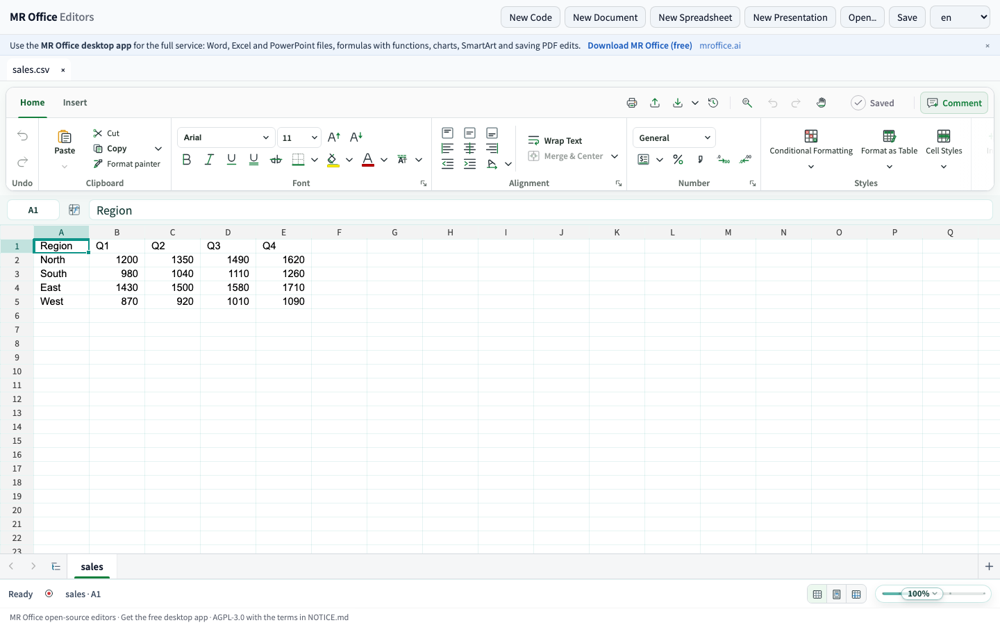
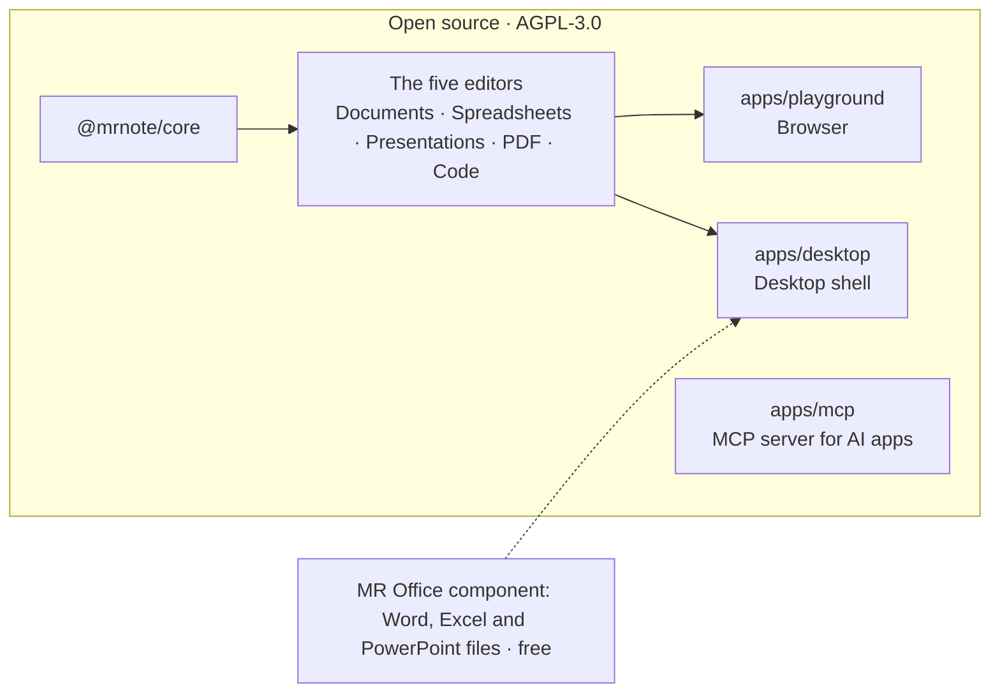

# MR Office

<p align="center"><sub>🌐 <a href="README.md">English</a> · <a href="i18n/README.en-GB.md">English (UK)</a> · <a href="i18n/README.zh.md">简体中文</a> · <a href="i18n/README.zh-TW.md">繁體中文</a> · <a href="i18n/README.ja.md">日本語</a> · <a href="i18n/README.ko.md">한국어</a> · <a href="i18n/README.de.md">Deutsch</a> · <a href="i18n/README.fr.md">Français</a> · <a href="i18n/README.es.md">Español</a> · <a href="i18n/README.es-419.md">Español (Latinoamérica)</a> · <a href="i18n/README.pt-BR.md">Português (Brasil)</a> · <a href="i18n/README.it.md">Italiano</a> · <a href="i18n/README.nl.md">Nederlands</a> · <a href="i18n/README.sv.md">Svenska</a> · <a href="i18n/README.da.md">Dansk</a> · <a href="i18n/README.no.md">Norsk</a> · <a href="i18n/README.fi.md">Suomi</a> · <a href="i18n/README.id.md">Bahasa Indonesia</a> · <a href="i18n/README.th.md">ไทย</a> · <a href="i18n/README.vi.md">Tiếng Việt</a></sub></p>

<p align="center"><b>The open-source editors of MR Office, the AI office suite closest to Microsoft Office: documents, spreadsheets, presentations, PDF and code in the browser, and an AI that edits real Word, Excel and PowerPoint files with you.</b></p>

<p align="center"><a href="https://mroffice.ai/en"><b>▶ Try online</b></a> · <a href="https://mroffice.ai/en/office/download"><b>⬇ Download</b></a> · <a href="https://mroffice.ai">🌐 mroffice.ai</a><br><a href="https://mroffice.ai/en/developers">🧑‍💻 Developers</a> · <a href="https://mroffice.ai/en/developers/embed">🧩 Embed</a> · <a href="https://mroffice.ai/en/developers/mcp">🤖 MCP for AI apps</a> · <a href="https://www.npmjs.com/package/mroffice-embed">📦 npm SDK</a> · <a href="https://mroffice.ai/en/developers/oauth">🔑 Sign in with MR Office</a></p>

<p align="center"><a href="LICENSE"></a> <a href="https://github.com/XinaTian/MROffice/releases"></a> <a href="https://github.com/XinaTian/MROffice/actions/workflows/ci.yml"></a> <a href="https://github.com/XinaTian/MROffice/stargazers"></a></p>

<p align="center"><a href="https://mroffice.ai/en"></a></p>

<p align="center"><a href="https://demo.mroffice.ai/media/mr-office-demo.mp4">🔊 Watch the 50-second tour with sound</a></p>

<table>
<tr>
<td align="center" width="50%"><a href="https://mroffice.ai/en"></a><br><b>Documents</b></td>
<td align="center" width="50%"><a href="https://mroffice.ai/en"></a><br><b>Spreadsheets</b></td>
</tr>
<tr>
<td align="center" width="50%"><a href="https://mroffice.ai/en"></a><br><b>Presentations</b></td>
<td align="center" width="50%"><a href="https://mroffice.ai/en"></a><br><b>PDF</b></td>
</tr>
<tr>
<td align="center" width="50%"><a href="https://mroffice.ai/en"></a><br><b>Code</b></td>
</tr>
</table>

MR Office is an AI office suite for real files: Word, Excel, PowerPoint and PDF, on the web and in a free desktop app, with an AI beside every document and live co-editing. This repository publishes the source code of its editors: the same editors MR Office runs, which you can build, run and embed on your own.

## Free for individuals and small teams

- **MR Office online and the desktop app** — free: real Word, Excel, PowerPoint and PDF editing, live co-editing and sharing, on the web, on phones and offline on your computer. The AI comes with a free daily allowance; heavier AI use is an optional paid plan.
- **The embed, for your own app** — free to start, with everything included: the full formula engine, real Office files, co-editing, every export format and the automation API (1,000 sessions a month on localhost, 100 on your own domains, up to 2 apps, no card).
- **Businesses with heavier use** — pay as you go on a fully hosted service: Starter at US$29 a month with 5,000 sessions, Pro at US$149 a month with 40,000 sessions, white-label and priority support. No annual license, no servers to run, no upgrades to manage: updates, scaling and backups are ours.

For comparison, ONLYOFFICE Docs Developer Edition is listed from about US$6,000 a year for 250 simultaneous connections on servers you run yourself (reseller list price, November 2026); Univer Pro's price is not published. [Pricing and limits →](https://mroffice.ai/en/developers/pricing)

## AI that works inside your files

In MR Office the AI works on the document itself, not on text pasted into a chat. It reads the file, makes the change in the file's own objects, and shows you what it touched before you keep it.

- **Copilot in every editor** — documents, spreadsheets, presentations, PDF and code. Select or circle what you mean and say what you want: it edits paragraphs, tables, cells and formulas, shapes and slides in place, asks when the request is unclear, previews the change before it lands, and every change can be undone.
- **Changes you review** — what the AI proposes is applied only when you confirm it; if the file changed in the meantime, the proposal is void and nothing you wrote is overwritten.
- **An AI window that knows your workspace** — ask about your files, notes and canvas and get answers that cite their sources; it drafts new documents, sheets and decks, and builds a small tool on the canvas when you need one.
- **Memory** — a memory graph keeps the people, projects and decisions that matter, so the AI does not start from zero in every conversation.
- **Leading models** — pick the model for each conversation from today's leading AI models; your files stay in your workspace, or on your own computer with the desktop app.

**[Try the AI in MR Office, free →](https://mroffice.ai/en)**

### Let your AI agent edit Office files (MCP)

Claude, ChatGPT, Cursor, Codex, VS Code and any other MCP client can create, open, edit, read back, picture and export documents and spreadsheets through MR Office's MCP server (`create_document`, `open_document`, `update_document`, `get_document`, `render_page`, `export_document` to docx, xlsx, pptx, pdf, md, html or csv). In apps that show MCP Apps the editor appears right in the conversation; elsewhere the tools answer with a link to the same editor and a picture of the page. You and the AI edit the same document: the assistant reads your edits back before it goes on, and an update made on top of edits it has not seen is refused rather than lost.

```bash
# Claude Code
claude mcp add mroffice -- npx -y mroffice-mcp
# Codex
codex mcp add mroffice -- npx -y mroffice-mcp
```

Claude Desktop, Cursor and other apps that take a JSON configuration:

```json
{ "mcpServers": { "mroffice": { "command": "npx", "args": ["-y", "mroffice-mcp"] } } }
```

No install: connect the hosted endpoint `https://mcp.mroffice.ai/mcp` and sign in with your MR Office account. Word, Excel and PowerPoint files go through MR Office's Office engine as your own account; the MCP server's source is in `apps/mcp`. [MCP guide →](https://mroffice.ai/en/developers/mcp)

## For developers

Everything for developers is at **[MR Office Developers](https://mroffice.ai/en/developers)** — self-serve, no application: sign in with any MR Office account and start.

### Embed the editors in your web app (recommended)

MR Office hosts the editors; your server signs a short-lived session token and your page opens the editor. It edits real Word, Excel, PowerPoint and PDF files (.docx, .xlsx, .pptx, .pdf), with the full formula engine, co-editing, uploads, every export format, printing, the automation API (document object model, macros, plugins) and saves sent back to your server in a signed callback. All of it is in the Free plan: 1,000 sessions a month on localhost, 100 on your own domains, up to 2 apps, no card needed. As a hosted service, it puts no AGPL obligations on your own app.

1. In your project's folder run `npx mroffice-embed init` (or create an app in the developer console): one "Allow" in the browser, and the app's keys are written to `.env.local` / `.env`.
2. Your server mints a session token with `createSessionToken` from `mroffice-embed/server`; the secret key never leaves the server.
3. Your page opens the editor with `open()` from `mroffice-embed` (or the script `https://mroffice.ai/embed/v1/embed.js`).

```js
// server: GET /api/mroffice/session (check who is signed in first)
import { createSessionToken } from "mroffice-embed/server";
const token = await createSessionToken({
  appId: process.env.MROFFICE_APP_ID,
  secretKey: process.env.MROFFICE_SECRET_KEY, // mro_sk_..., server only
  file: { key: "contract-42", name: "contract.docx", url: signedUrlToTheFile },
  user: { id: user.id, name: user.name },
  mode: "edit",
});

// page
import { open } from "mroffice-embed";
open({ container: "#editor", token: () => fetch("/api/mroffice/session").then((r) => r.json()).then((b) => b.token) });
```

[Embed guide](https://mroffice.ai/en/developers/embed) · [The guide as Markdown (for AI agents)](https://mroffice.ai/developers/embed.md) · [Pricing and limits](https://mroffice.ai/en/developers/pricing) · [Developer console](https://mroffice.ai/en/developers/console) · [Live demo](https://mroffice.ai/en/developers/embed/demo)

### AI apps: the MCP server

The MCP server above is also how your own AI features can open, read, edit and export documents in the real MR Office editor: the hosted endpoint `https://mcp.mroffice.ai/mcp` (OAuth sign-in, no key) or `npx -y mroffice-mcp` on your own computer. [MCP guide →](https://mroffice.ai/en/developers/mcp)

### Sign in with MR Office (OAuth)

MR Office is an OAuth 2.1 authorization server (PKCE, client ID metadata documents, dynamic registration): your app can sign people in with their MR Office account and act with the scopes they allow. [OAuth guide →](https://mroffice.ai/en/developers/oauth)

### Self-host the open-source editors

The five editors in this repository can be built into your own product under the AGPL-3.0: if people use a modified version over a network, you must offer them its complete source code, and keep the "MR Office" attribution (NOTICE.md). They open their own formats, CSV, HTML, Markdown and PDF; Word, Excel and PowerPoint files come with the hosted embed above, Free plan included. A commercial license is available from support@mr-note.com. [Open-source guide →](https://mroffice.ai/en/developers/open-source)

The editors are on npm as React components: `npm i mroffice-docs mroffice-core` (and `mroffice-sheets`, `mroffice-slides`, `mroffice-pdf`, `mroffice-code`); each package's README shows how to embed it.

## The editors

What each editor does in this repository:

- **Documents** — a paged word processor: fonts, paragraph formatting, lists and styles on Home; cover and blank pages, page breaks, tables, pictures, shapes, SmartArt, charts, links, bookmarks, comments, headers, footers and page numbers, equations, symbols, text boxes and WordArt on Insert. Saves its own format (.mrdoc); opens HTML, Markdown and plain text.
- **Spreadsheets** — cells and formulas with fonts, alignment, number formats, conditional formatting, cell styles and inserting or deleting cells on Home; tables, pictures, shapes, icons, checkboxes, charts and sparklines on Insert; several sheets, with sums and averages of the selection. Arithmetic between cells (=A1*B1+10) calculates live in the browser as you type, and every formula a file holds is kept intact; the full formula engine (SUM, IF, VLOOKUP and hundreds more) runs free in the MR Office desktop app and in the hosted embed's Free plan. Saves its own format (.mrsheet); opens and saves CSV and TSV.
- **Presentations** — slides with layouts and sections, text, fonts and paragraphs, and shapes with their arrangement on Home; tables, pictures, icons, SmartArt, charts, text boxes, WordArt, headers and footers, equations, symbols and video on Insert; speaker notes, comments and presenting. Saves its own format (.mrslides).
- **PDF** — read, present and print PDF files: single and two-page views, continuous scrolling, rotation, thumbnails and read mode, search and copy of their text, and comments; editing a PDF's own text and saving it back into the file is free in the MR Office desktop app and the hosted embed.
- **Code** — a fast code editor with syntax highlighting for many languages, an outline, find, quick open, a file explorer and a problems list.

Formulas with functions (SUM, IF, VLOOKUP and hundreds more), Word, Excel and PowerPoint files, charts, SmartArt and the automation API are free to use: in the free MR Office desktop app, and in your own app through the hosted embed's Free plan. Files keep every formula, chart and SmartArt intact in the open-source editors too.

## Run the editors

**▶ [Try the live demo — no install](https://mroffice.ai/en)**

The five editors are in `packages/` (`@mrnote/docs`, `sheets`, `slides`, `pdf`, `code`, sharing `@mrnote/core`) and run together in `apps/playground`:

```bash
npm install
npm run fonts     # the open substitutes for Office's fonts
npm run build
npm run preview   # http://localhost:5178
```

`npm run dev` starts a development server at the same address, and `npm run smoke` checks a build. Each package's README lists what it does in detail and shows how to embed it.

## Desktop app

[`apps/desktop`](apps/desktop) holds **MR Office Editors**: the source of the MR Office desktop app's shell (Electron), under an identity of its own. With the free MR Office component from Releases, it is the MR Office desktop app, with Word, Excel, PowerPoint and PDF files, sign-in and AI. Without the component, it runs the open-source editors on their own, which open .mrdoc, .mrsheet and .mrslides files, CSV, HTML, Markdown and PDF. The shell and the editors are AGPL source code; the component is a free download from Releases. After `npm run build`, start it with:

```bash
npm run desktop
```

## For the full experience, install the MR Office desktop app (free)

The MR Office desktop app is free, has these editors and the full service, and works offline on your own computer. It also brings:

- Opening and saving Word, Excel and PowerPoint files (.docx, .xlsx, .pptx)
- Formulas with functions (SUM, IF, VLOOKUP …), calculated by the full formula engine
- Charts calculated and drawn from your data
- SmartArt editing
- Saving PDF edits back into the file
- The automation API: the document object model, macros and plugins

**[Download MR Office (free) →](https://mroffice.ai/en/office/download)**

## How the pieces fit



## License

Open source under the GNU Affero General Public License v3.0 (LICENSE), with the additional terms in NOTICE.md: keep the "MR Office" attribution and link to https://mroffice.ai, and no rights to the MR Office name or logo. A commercial license is available from support@mr-note.com. Third-party software and data are listed in THIRD_PARTY_NOTICES.md. Contributions: see CONTRIBUTING.md.

## More

Website and the full product: **https://mroffice.ai** · Questions and feedback: support@mr-note.com

<p align="center">If MR Office is useful to you, a ⭐ on GitHub helps other people find it.</p>