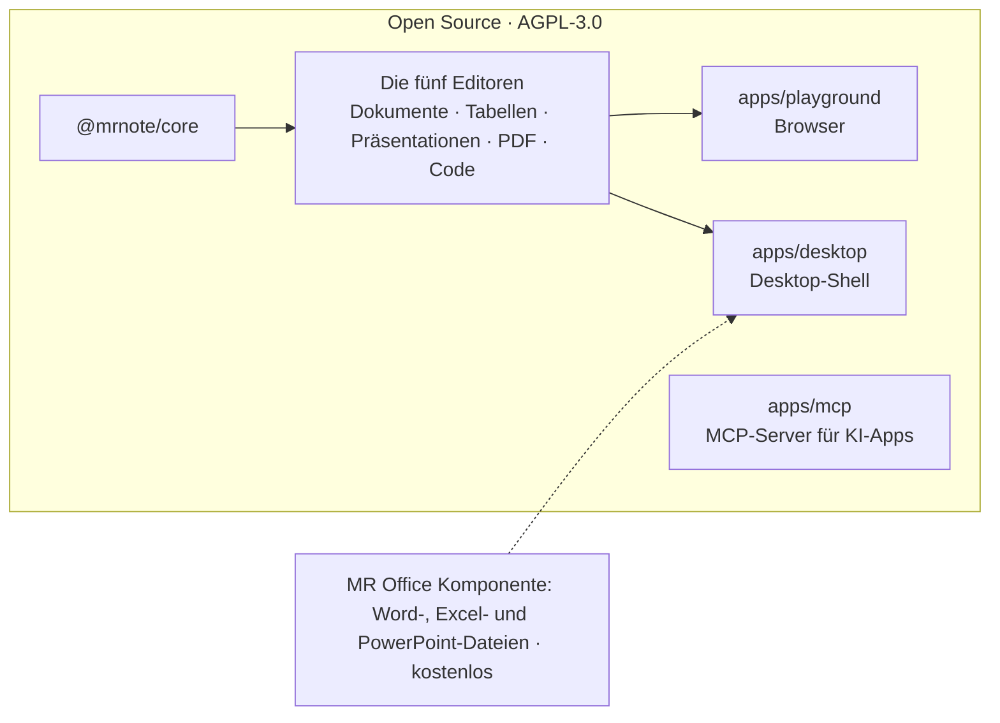

# MR Office — Deutsch

<p align="center"><sub>🌐 <a href="../README.md">English</a> · <a href="../i18n/README.en-GB.md">English (UK)</a> · <a href="../i18n/README.zh.md">简体中文</a> · <a href="../i18n/README.zh-TW.md">繁體中文</a> · <a href="../i18n/README.ja.md">日本語</a> · <a href="../i18n/README.ko.md">한국어</a> · <a href="../i18n/README.de.md">Deutsch</a> · <a href="../i18n/README.fr.md">Français</a> · <a href="../i18n/README.es.md">Español</a> · <a href="../i18n/README.es-419.md">Español (Latinoamérica)</a> · <a href="../i18n/README.pt-BR.md">Português (Brasil)</a> · <a href="../i18n/README.it.md">Italiano</a> · <a href="../i18n/README.nl.md">Nederlands</a> · <a href="../i18n/README.sv.md">Svenska</a> · <a href="../i18n/README.da.md">Dansk</a> · <a href="../i18n/README.no.md">Norsk</a> · <a href="../i18n/README.fi.md">Suomi</a> · <a href="../i18n/README.id.md">Bahasa Indonesia</a> · <a href="../i18n/README.th.md">ไทย</a> · <a href="../i18n/README.vi.md">Tiếng Việt</a></sub></p>

<p align="center"><b>Die Open-Source-Editoren von MR Office, der KI-Office-Suite, die Microsoft Office am nächsten kommt: Dokumente, Tabellen, Präsentationen, PDF und Code im Browser – und eine KI, die echte Word-, Excel- und PowerPoint-Dateien gemeinsam mit dir bearbeitet.</b></p>

<p align="center"><a href="https://mroffice.ai/de"><b>▶ Online testen</b></a> · <a href="https://mroffice.ai/de/office/download"><b>⬇ Download</b></a> · <a href="https://mroffice.ai">🌐 mroffice.ai</a><br><a href="https://mroffice.ai/de/developers">🧑‍💻 Entwickler</a> · <a href="https://mroffice.ai/de/developers/embed">🧩 Einbetten</a> · <a href="https://mroffice.ai/de/developers/mcp">🤖 MCP für KI-Apps</a> · <a href="https://www.npmjs.com/package/mroffice-embed">📦 npm-SDK</a> · <a href="https://mroffice.ai/de/developers/oauth">🔑 Mit MR Office anmelden</a></p>

<p align="center"><a href="../LICENSE"></a> <a href="https://github.com/XinaTian/MROffice/releases"></a> <a href="https://github.com/XinaTian/MROffice/actions/workflows/ci.yml"></a> <a href="https://github.com/XinaTian/MROffice/stargazers"></a></p>

<p align="center"><a href="https://mroffice.ai/de"></a></p>

<p align="center"><a href="https://demo.mroffice.ai/media/mr-office-demo.mp4">🔊 Die 50-Sekunden-Tour mit Ton ansehen</a></p>

<table>
<tr>
<td align="center" width="50%"><a href="https://mroffice.ai/de"></a><br><b>Dokumente</b></td>
<td align="center" width="50%"><a href="https://mroffice.ai/de"></a><br><b>Tabellen</b></td>
</tr>
<tr>
<td align="center" width="50%"><a href="https://mroffice.ai/de"></a><br><b>Präsentationen</b></td>
<td align="center" width="50%"><a href="https://mroffice.ai/de"></a><br><b>PDF</b></td>
</tr>
<tr>
<td align="center" width="50%"><a href="https://mroffice.ai/de"></a><br><b>Code</b></td>
</tr>
</table>

MR Office ist eine KI-Office-Suite für echte Dateien: Word, Excel, PowerPoint und PDF, im Web und in einer kostenlosen Desktop-App, mit einer KI neben jedem Dokument und Live-Co-Editing. Dieses Repository veröffentlicht den Quellcode der Editoren: dieselben Editoren, die MR Office ausführt und die du selbst bauen, betreiben und einbetten kannst.

## Kostenlos für Einzelpersonen und kleine Teams

- **MR Office online und die Desktop-App** — kostenlos: echtes Bearbeiten von Word-, Excel-, PowerPoint- und PDF-Dateien, Live-Co-Editing und Freigabe, im Web, auf dem Smartphone und offline auf Ihrem Computer. Die KI kommt mit einem kostenlosen Tageskontingent; intensivere KI-Nutzung ist ein optionaler kostenpflichtiger Tarif.
- **Das Embed für Ihre eigene App** — kostenlos zum Starten, mit allem inklusive: die vollständige Formel-Engine, echte Office-Dateien, Co-Editing, jedes Exportformat und die Automatisierungs-API (1.000 Sitzungen pro Monat auf localhost, 100 auf Ihren eigenen Domains, bis zu 2 Apps, keine Karte).
- **Unternehmen mit intensiverer Nutzung** — Pay as you go auf einem vollständig gehosteten Service: Starter für US$29 pro Monat mit 5.000 Sitzungen, Pro für US$149 pro Monat mit 40.000 Sitzungen, White-Label und Priority-Support. Keine Jahreslizenz, keine Server zu betreiben, keine Upgrades zu verwalten: Updates, Skalierung und Backups übernehmen wir.

Zum Vergleich: ONLYOFFICE Docs Developer Edition ist ab etwa US$6.000 pro Jahr für 250 gleichzeitige Verbindungen auf Servern gelistet, die Sie selbst betreiben (Reseller-Listenpreis, November 2026); der Preis von Univer Pro ist nicht veröffentlicht. [Preise und Limits →](https://mroffice.ai/de/developers/pricing)

## Eine KI, die in deinen Dateien arbeitet

In MR Office arbeitet die KI am Dokument selbst, nicht an Text, der in einen Chat eingefügt wurde. Sie liest die Datei, nimmt die Änderung an den Objekten der Datei selbst vor und zeigt dir, was sie angefasst hat, bevor du es übernimmst.

- **Copilot in jedem Editor** — Dokumente, Tabellen, Präsentationen, PDF und Code. Markiere oder umkreise, was du meinst, und sag, was du willst: Die KI bearbeitet Absätze, Tabellen, Zellen und Formeln, Formen und Folien direkt an Ort und Stelle, fragt nach, wenn die Anfrage unklar ist, zeigt eine Vorschau der Änderung, bevor sie übernommen wird, und jede Änderung lässt sich rückgängig machen.
- **Änderungen, die du prüfst** — Was die KI vorschlägt, wird erst angewendet, wenn du es bestätigst; hat sich die Datei in der Zwischenzeit geändert, ist der Vorschlag hinfällig und nichts, was du geschrieben hast, wird überschrieben.
- **Ein KI-Fenster, das deinen Workspace kennt** — Stelle Fragen zu deinen Dateien, Notizen und deinem Canvas und erhalte Antworten mit Quellenangaben; die KI entwirft neue Dokumente, Tabellen und Präsentationen und baut bei Bedarf ein kleines Tool auf dem Canvas.
- **Gedächtnis** — Ein Memory-Graph hält die Menschen, Projekte und Entscheidungen fest, die zählen – so startet die KI nicht in jeder Unterhaltung bei null.
- **Führende Modelle** — Wähle das Modell für jede Unterhaltung aus den führenden KI-Modellen von heute; deine Dateien bleiben in deinem Workspace oder mit der Desktop-App auf deinem eigenen Rechner.

**[Probiere die KI in MR Office kostenlos aus →](https://mroffice.ai/de)**

### Lass deinen KI-Agenten Office-Dateien bearbeiten (MCP)

Claude, ChatGPT, Cursor, Codex, VS Code und jeder andere MCP-Client können über den MCP-Server von MR Office Dokumente und Tabellen erstellen, öffnen, bearbeiten, zurücklesen, abbilden und exportieren (`create_document`, `open_document`, `update_document`, `get_document`, `render_page`, `export_document` nach docx, xlsx, pptx, pdf, md, html oder csv). In Apps, die MCP Apps anzeigen, erscheint der Editor direkt in der Unterhaltung; andernorts antworten die Tools mit einem Link zum selben Editor und einem Bild der Seite. Du und die KI bearbeiten dasselbe Dokument: Der Assistent liest deine Änderungen zurück, bevor er fortfährt, und ein Update auf Basis von Änderungen, die er nicht gesehen hat, wird abgelehnt statt verloren.

```bash
# Claude Code
claude mcp add mroffice -- npx -y mroffice-mcp
# Codex
codex mcp add mroffice -- npx -y mroffice-mcp
```

Claude Desktop, Cursor und andere Apps, die eine JSON-Konfiguration akzeptieren:

```json
{ "mcpServers": { "mroffice": { "command": "npx", "args": ["-y", "mroffice-mcp"] } } }
```

Ohne Installation: Verbinde den gehosteten Endpoint `https://mcp.mroffice.ai/mcp` und melde dich mit deinem MR Office-Konto an. Word-, Excel- und PowerPoint-Dateien laufen über die Office-Engine von MR Office als dein eigenes Konto; der Quellcode des MCP-Servers liegt in `apps/mcp`. [MCP-Leitfaden →](https://mroffice.ai/de/developers/mcp)

## Für Entwickler

Alles für Entwickler finden Sie bei **[MR Office Developers](https://mroffice.ai/de/developers)** – Self-Service, ohne Antrag: mit einem beliebigen MR Office-Konto anmelden und loslegen.

### Die Editoren in Ihre Web-App einbetten (empfohlen)

MR Office hostet die Editoren; Ihr Server signiert ein kurzlebiges Sitzungstoken und Ihre Seite öffnet den Editor. Er bearbeitet echte Word-, Excel-, PowerPoint- und PDF-Dateien (.docx, .xlsx, .pptx, .pdf), mit der vollständigen Formel-Engine, Co-Editing, Uploads, jedem Exportformat, Drucken, der Automatisierungs-API (Dokumentobjektmodell, Makros, Plugins) und Speicherungen, die per signiertem Callback an Ihren Server zurückgehen. All das ist im Free-Plan enthalten: 1.000 Sitzungen pro Monat auf localhost, 100 auf Ihren eigenen Domains, bis zu 2 Apps, keine Karte nötig. Als gehosteter Dienst erlegt er Ihrer eigenen App keine AGPL-Pflichten auf.

1. Führen Sie im Ordner Ihres Projekts `npx mroffice-embed init` aus (oder legen Sie eine App in der Entwicklerkonsole an): ein Klick auf „Erlauben“ im Browser, und die Schlüssel der App stehen in `.env.local` / `.env`.
2. Ihr Server erzeugt ein Sitzungstoken mit `createSessionToken` aus `mroffice-embed/server`; der geheime Schlüssel verlässt den Server nie.
3. Ihre Seite öffnet den Editor mit `open()` aus `mroffice-embed` (oder dem Skript `https://mroffice.ai/embed/v1/embed.js`).

```js
// server: GET /api/mroffice/session (check who is signed in first)
import { createSessionToken } from "mroffice-embed/server";
const token = await createSessionToken({
  appId: process.env.MROFFICE_APP_ID,
  secretKey: process.env.MROFFICE_SECRET_KEY, // mro_sk_..., server only
  file: { key: "contract-42", name: "contract.docx", url: signedUrlToTheFile },
  user: { id: user.id, name: user.name },
  mode: "edit",
});

// page
import { open } from "mroffice-embed";
open({ container: "#editor", token: () => fetch("/api/mroffice/session").then((r) => r.json()).then((b) => b.token) });
```

[Einbettungsleitfaden](https://mroffice.ai/de/developers/embed) · [Der Leitfaden als Markdown (für KI-Agenten)](https://mroffice.ai/developers/embed.md) · [Preise und Limits](https://mroffice.ai/de/developers/pricing) · [Entwicklerkonsole](https://mroffice.ai/de/developers/console) · [Live-Demo](https://mroffice.ai/de/developers/embed/demo)

### KI-Apps: der MCP-Server

Über den obigen MCP-Server können auch deine eigenen KI-Funktionen Dokumente im echten MR Office-Editor öffnen, lesen, bearbeiten und exportieren: über den gehosteten Endpoint `https://mcp.mroffice.ai/mcp` (OAuth-Anmeldung, kein Key) oder `npx -y mroffice-mcp` auf deinem eigenen Rechner. [MCP-Leitfaden →](https://mroffice.ai/de/developers/mcp)

### Mit MR Office anmelden (OAuth)

MR Office ist ein OAuth-2.1-Autorisierungsserver (PKCE, Client-ID-Metadatendokumente, dynamische Registrierung): Ihre App kann Personen mit ihrem MR Office-Konto anmelden und mit den erlaubten Scopes handeln. [OAuth-Leitfaden →](https://mroffice.ai/de/developers/oauth)

### Die Open-Source-Editoren selbst hosten

Die fünf Editoren in diesem Repository können unter der AGPL-3.0 in Ihr eigenes Produkt eingebaut werden: Wenn Personen eine geänderte Version über ein Netzwerk nutzen, müssen Sie ihnen den vollständigen Quellcode anbieten und die Namensnennung "MR Office" (NOTICE.md) beibehalten. Sie öffnen ihre eigenen Formate, CSV, HTML, Markdown und PDF; Word-, Excel- und PowerPoint-Dateien kommen mit dem oben genannten gehosteten Embed, Free-Plan inklusive. Eine kommerzielle Lizenz ist unter support@mr-note.com erhältlich. [Open-Source-Leitfaden →](https://mroffice.ai/de/developers/open-source)

Die Editoren sind als React-Komponenten auf npm verfügbar: `npm i mroffice-docs mroffice-core` (sowie `mroffice-sheets`, `mroffice-slides`, `mroffice-pdf`, `mroffice-code`); die README jedes Pakets zeigt, wie man es einbettet.

## Die Editoren

Was jeder Editor in diesem Repository kann:

- **Dokumente** — eine seitenbasierte Textverarbeitung: Schriftarten, Absatzformatierung, Listen und Formatvorlagen unter Start; Deckblatt und leere Seiten, Seitenumbrüche, Tabellen, Bilder, Formen, SmartArt, Diagramme, Links, Lesezeichen, Kommentare, Kopf- und Fußzeilen und Seitenzahlen, Gleichungen, Symbole, Textfelder und WordArt unter Einfügen. Speichert das eigene Format (.mrdoc); öffnet HTML, Markdown und reinen Text.
- **Tabellen** — Zellen und Formeln mit Schriftarten, Ausrichtung, Zahlenformaten, bedingter Formatierung, Zellvorlagen sowie Einfügen oder Löschen von Zellen unter Start; Tabellen, Bilder, Formen, Symbole, Kontrollkästchen, Diagramme und Sparklines unter Einfügen; mehrere Tabellenblätter mit Summen und Mittelwerten der Auswahl. Arithmetik zwischen Zellen (=A1*B1+10) wird beim Tippen live im Browser berechnet, und jede in einer Datei enthaltene Formel bleibt unverändert erhalten; die vollständige Formel-Engine (SUM, IF, VLOOKUP und Hunderte mehr) läuft kostenlos in der MR Office Desktop-App und im Free-Plan des gehosteten Embeds. Speichert das eigene Format (.mrsheet); öffnet und speichert CSV und TSV.
- **Präsentationen** — Folien mit Layouts und Abschnitten, Text, Schriftarten und Absätzen sowie Formen mit ihrer Anordnung unter Start; Tabellen, Bilder, Symbole, SmartArt, Diagramme, Textfelder, WordArt, Kopf- und Fußzeilen, Gleichungen, Symbole und Video unter Einfügen; Notizen, Kommentare und Präsentieren. Speichert das eigene Format (.mrslides).
- **PDF** — PDF-Dateien lesen, präsentieren und drucken: Einzel- und Doppelseitenansicht, fortlaufendes Scrollen, Drehen, Miniaturansichten und Lesemodus, Suchen und Kopieren des Textes sowie Kommentare; das Bearbeiten des eigenen Textes einer PDF und das Zurückspeichern in die Datei ist kostenlos in der MR Office Desktop-App und im gehosteten Embed.
- **Code** — ein schneller Code-Editor mit Syntaxhervorhebung für viele Sprachen, einer Gliederung, Suchen, Schnellöffnen, einem Datei-Explorer und einer Problemliste.

Formeln mit Funktionen (SUM, IF, VLOOKUP und Hunderte mehr), Word-, Excel- und PowerPoint-Dateien, Diagramme, SmartArt und die Automatisierungs-API sind kostenlos nutzbar: in der kostenlosen MR Office Desktop-App und in Ihrer eigenen App über den Free-Plan des gehosteten Embeds. Dateien behalten jede Formel, jedes Diagramm und jedes SmartArt auch in den Open-Source-Editoren unverändert.

## Die Editoren ausführen

**▶ [Live-Demo ausprobieren – ohne Installation](https://mroffice.ai/de)**

Die fünf Editoren liegen in `packages/` (`@mrnote/docs`, `sheets`, `slides`, `pdf`, `code`, gemeinsam genutzt wird `@mrnote/core`) und laufen zusammen in `apps/playground`:

```bash
npm install
npm run fonts     # the open substitutes for Office's fonts
npm run build
npm run preview   # http://localhost:5178
```

`npm run dev` startet einen Entwicklungsserver unter derselben Adresse, `npm run smoke` prüft einen Build. Die README jedes Pakets beschreibt im Einzelnen, was es kann und wie man es einbettet.

## Desktop-App

[`apps/desktop`](../apps/desktop) enthält **MR Office Editors**: den Quellcode der Shell der MR Office Desktop-App (Electron), unter eigener Identität. Mit der kostenlosen MR Office-Komponente aus Releases ist es die MR Office Desktop-App, mit Word-, Excel-, PowerPoint- und PDF-Dateien, Anmeldung und KI. Ohne die Komponente laufen die Open-Source-Editoren eigenständig und öffnen .mrdoc-, .mrsheet- und .mrslides-Dateien, CSV, HTML, Markdown und PDF. Die Shell und die Editoren sind AGPL-Quellcode; die Komponente ist ein kostenloser Download aus Releases. Nach `npm run build` startest du sie mit:

```bash
npm run desktop
```

## Für den vollen Funktionsumfang: die MR Office Desktop-App installieren (kostenlos)

Die MR Office Desktop-App ist kostenlos, enthält diese Editoren und den vollen Funktionsumfang und funktioniert offline auf Ihrem eigenen Computer. Sie bringt außerdem mit:

- Word-, Excel- und PowerPoint-Dateien (.docx, .xlsx, .pptx) öffnen und speichern
- Formeln mit Funktionen (SUM, IF, VLOOKUP …), berechnet von der vollständigen Formel-Engine
- Diagramme, berechnet und gezeichnet aus Ihren Daten
- SmartArt bearbeiten
- PDF-Änderungen in die Datei zurückschreiben
- Die Automatisierungs-API: das Dokumentobjektmodell, Makros und Plugins

**[MR Office herunterladen (kostenlos) →](https://mroffice.ai/de/office/download)**

## Wie die Teile zusammenpassen



## Lizenz

Open Source unter der GNU Affero General Public License v3.0 (LICENSE) mit den zusätzlichen Bedingungen in NOTICE.md: Die Nennung „MR Office“ und der Link auf https://mroffice.ai bleiben erhalten, Rechte am Namen und Logo von MR Office werden nicht eingeräumt. Eine kommerzielle Lizenz ist über support@mr-note.com erhältlich. Software und Daten Dritter stehen in THIRD_PARTY_NOTICES.md. Beiträge: siehe CONTRIBUTING.md.

## Mehr

Website und das vollständige Produkt: **https://mroffice.ai** · Fragen und Feedback: support@mr-note.com

<p align="center">Wenn dir MR Office nützt, hilft ein ⭐ auf GitHub anderen, es zu finden.</p>
