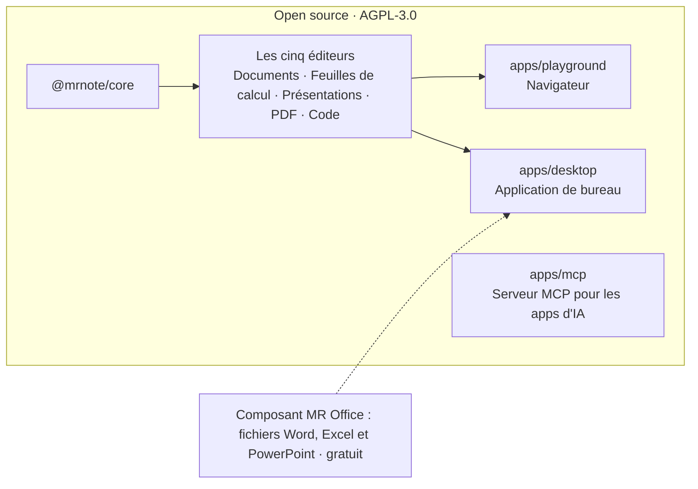

# MR Office — Français

<p align="center"><sub>🌐 <a href="../README.md">English</a> · <a href="../i18n/README.en-GB.md">English (UK)</a> · <a href="../i18n/README.zh.md">简体中文</a> · <a href="../i18n/README.zh-TW.md">繁體中文</a> · <a href="../i18n/README.ja.md">日本語</a> · <a href="../i18n/README.ko.md">한국어</a> · <a href="../i18n/README.de.md">Deutsch</a> · <a href="../i18n/README.fr.md">Français</a> · <a href="../i18n/README.es.md">Español</a> · <a href="../i18n/README.es-419.md">Español (Latinoamérica)</a> · <a href="../i18n/README.pt-BR.md">Português (Brasil)</a> · <a href="../i18n/README.it.md">Italiano</a> · <a href="../i18n/README.nl.md">Nederlands</a> · <a href="../i18n/README.sv.md">Svenska</a> · <a href="../i18n/README.da.md">Dansk</a> · <a href="../i18n/README.no.md">Norsk</a> · <a href="../i18n/README.fi.md">Suomi</a> · <a href="../i18n/README.id.md">Bahasa Indonesia</a> · <a href="../i18n/README.th.md">ไทย</a> · <a href="../i18n/README.vi.md">Tiếng Việt</a></sub></p>

<p align="center"><b>Les éditeurs open source de MR Office, la suite bureautique IA la plus proche de Microsoft Office : documents, feuilles de calcul, présentations, PDF et code dans le navigateur, et une IA qui modifie avec vous de vrais fichiers Word, Excel et PowerPoint.</b></p>

<p align="center"><a href="https://mroffice.ai/fr"><b>▶ Essayer en ligne</b></a> · <a href="https://mroffice.ai/fr/office/download"><b>⬇ Télécharger</b></a> · <a href="https://mroffice.ai">🌐 mroffice.ai</a><br><a href="https://mroffice.ai/fr/developers">🧑‍💻 Développeurs</a> · <a href="https://mroffice.ai/fr/developers/embed">🧩 Intégrer</a> · <a href="https://mroffice.ai/fr/developers/mcp">🤖 MCP pour les applis d’IA</a> · <a href="https://www.npmjs.com/package/mroffice-embed">📦 SDK npm</a> · <a href="https://mroffice.ai/fr/developers/oauth">🔑 Se connecter avec MR Office</a></p>

<p align="center"><a href="../LICENSE"></a> <a href="https://github.com/XinaTian/MROffice/releases"></a> <a href="https://github.com/XinaTian/MROffice/actions/workflows/ci.yml"></a> <a href="https://github.com/XinaTian/MROffice/stargazers"></a></p>

<p align="center"><a href="https://mroffice.ai/fr"></a></p>

<p align="center"><a href="https://demo.mroffice.ai/media/mr-office-demo.mp4">🔊 Voir la visite de 50 secondes avec le son</a></p>

<table>
<tr>
<td align="center" width="50%"><a href="https://mroffice.ai/fr"></a><br><b>Documents</b></td>
<td align="center" width="50%"><a href="https://mroffice.ai/fr"></a><br><b>Feuilles de calcul</b></td>
</tr>
<tr>
<td align="center" width="50%"><a href="https://mroffice.ai/fr"></a><br><b>Présentations</b></td>
<td align="center" width="50%"><a href="https://mroffice.ai/fr"></a><br><b>PDF</b></td>
</tr>
<tr>
<td align="center" width="50%"><a href="https://mroffice.ai/fr"></a><br><b>Code</b></td>
</tr>
</table>

MR Office est une suite bureautique IA pour de vrais fichiers : Word, Excel, PowerPoint et PDF, sur le web et dans une application de bureau gratuite, avec une IA à côté de chaque document et l'édition collaborative en direct. Ce dépôt publie le code source de ses éditeurs : les mêmes éditeurs que fait tourner MR Office, que vous pouvez compiler, exécuter et intégrer chez vous.

## Gratuit pour les particuliers et les petites équipes

- **MR Office en ligne et l'application de bureau** — gratuit : édition réelle de Word, Excel, PowerPoint et PDF, coédition en direct et partage, sur le web, sur mobile et hors ligne sur votre ordinateur. L'IA est incluse avec une allocation quotidienne gratuite ; un usage plus intensif de l'IA est un forfait payant en option.
- **L'intégration, pour votre propre application** — gratuit pour démarrer, tout est inclus : le moteur de formules complet, de vrais fichiers Office, la coédition, tous les formats d'export et l'API d'automatisation (1 000 sessions par mois sur localhost, 100 sur vos propres domaines, jusqu'à 2 applications, sans carte).
- **Les entreprises à usage intensif** — payez à l'usage sur un service entièrement hébergé : Starter à US$29 par mois avec 5 000 sessions, Pro à US$149 par mois avec 40 000 sessions, marque blanche et support prioritaire. Pas de licence annuelle, pas de serveurs à gérer, pas de mises à jour à administrer : les mises à jour, la mise à l'échelle et les sauvegardes sont de notre ressort.

À titre de comparaison, ONLYOFFICE Docs Developer Edition est affiché à partir d'environ US$6 000 par an pour 250 connexions simultanées sur des serveurs que vous hébergez vous-même (prix public revendeur, novembre 2026) ; le prix d'Univer Pro n'est pas publié. [Tarifs et limites →](https://mroffice.ai/fr/developers/pricing)

## Une IA qui travaille dans vos fichiers

Dans MR Office, l'IA travaille sur le document lui-même, pas sur du texte collé dans un chat. Elle lit le fichier, effectue la modification dans les objets propres au fichier et vous montre ce qu'elle a touché avant que vous ne validiez.

- **Copilot dans chaque éditeur** — documents, feuilles de calcul, présentations, PDF et code. Sélectionnez ou entourez ce que vous visez et dites ce que vous voulez : elle modifie sur place les paragraphes, tableaux, cellules et formules, formes et diapositives, demande une précision quand la demande est floue, prévisualise la modification avant qu'elle ne soit appliquée, et chaque changement peut être annulé.
- **Des modifications que vous validez** — ce que l'IA propose n'est appliqué qu'après votre confirmation ; si le fichier a changé entre-temps, la proposition est annulée et rien de ce que vous avez écrit n'est écrasé.
- **Une fenêtre IA qui connaît votre espace de travail** — posez des questions sur vos fichiers, notes et canvas et obtenez des réponses qui citent leurs sources ; elle rédige de nouveaux documents, feuilles et présentations, et construit un petit outil sur le canvas quand vous en avez besoin.
- **Mémoire** — un graphe de mémoire conserve les personnes, projets et décisions qui comptent, pour que l'IA ne reparte pas de zéro à chaque conversation.
- **Modèles de pointe** — choisissez le modèle de chaque conversation parmi les meilleurs modèles d'IA actuels ; vos fichiers restent dans votre espace de travail, ou sur votre propre ordinateur avec l'application de bureau.

**[Essayez l'IA dans MR Office, gratuitement →](https://mroffice.ai/fr)**

### Laissez votre agent IA modifier des fichiers Office (MCP)

Claude, ChatGPT, Cursor, Codex, VS Code et tout autre client MCP peuvent créer, ouvrir, modifier, relire, illustrer et exporter des documents et des feuilles de calcul via le serveur MCP de MR Office (`create_document`, `open_document`, `update_document`, `get_document`, `render_page`, `export_document` vers docx, xlsx, pptx, pdf, md, html ou csv). Dans les applications qui affichent les MCP Apps, l'éditeur apparaît directement dans la conversation ; ailleurs, les outils répondent avec un lien vers le même éditeur et une image de la page. Vous et l'IA modifiez le même document : l'assistant relit vos modifications avant de poursuivre, et une mise à jour effectuée par-dessus des modifications qu'il n'a pas vues est refusée plutôt que perdue.

```bash
# Claude Code
claude mcp add mroffice -- npx -y mroffice-mcp
# Codex
codex mcp add mroffice -- npx -y mroffice-mcp
```

Claude Desktop, Cursor et les autres applications qui acceptent une configuration JSON :

```json
{ "mcpServers": { "mroffice": { "command": "npx", "args": ["-y", "mroffice-mcp"] } } }
```

Aucune installation : connectez le point de terminaison hébergé `https://mcp.mroffice.ai/mcp` et connectez-vous avec votre compte MR Office. Les fichiers Word, Excel et PowerPoint passent par le moteur Office de MR Office avec votre propre compte ; le code source du serveur MCP se trouve dans `apps/mcp`. [Guide MCP →](https://mroffice.ai/fr/developers/mcp)

## Pour les développeurs

Tout ce qu’il faut aux développeurs est sur **[MR Office Developers](https://mroffice.ai/fr/developers)** — en libre-service, sans demande : connectez-vous avec n’importe quel compte MR Office et commencez.

### Intégrer les éditeurs dans votre application web (recommandé)

MR Office héberge les éditeurs ; votre serveur signe un jeton de session à durée limitée et votre page ouvre l'éditeur. Il modifie de vrais fichiers Word, Excel, PowerPoint et PDF (.docx, .xlsx, .pptx, .pdf), avec le moteur de formules complet, la co-édition, les téléversements, tous les formats d'export, l'impression, l'API d'automatisation (modèle objet de document, macros, plugins) et les enregistrements renvoyés à votre serveur dans un callback signé. Tout cela est inclus dans le plan Free : 1 000 sessions par mois sur localhost, 100 sur vos propres domaines, jusqu'à 2 applications, sans carte requise. En tant que service hébergé, il n'impose aucune obligation AGPL à votre propre application.

1. Dans le dossier de votre projet, lancez `npx mroffice-embed init` (ou créez une application dans la console développeur) : un clic sur « Autoriser » dans le navigateur, et les clés de l’application sont écrites dans `.env.local` / `.env`.
2. Votre serveur crée un jeton de session avec `createSessionToken` de `mroffice-embed/server` ; la clé secrète ne quitte jamais le serveur.
3. Votre page ouvre l’éditeur avec `open()` de `mroffice-embed` (ou le script `https://mroffice.ai/embed/v1/embed.js`).

```js
// server: GET /api/mroffice/session (check who is signed in first)
import { createSessionToken } from "mroffice-embed/server";
const token = await createSessionToken({
  appId: process.env.MROFFICE_APP_ID,
  secretKey: process.env.MROFFICE_SECRET_KEY, // mro_sk_..., server only
  file: { key: "contract-42", name: "contract.docx", url: signedUrlToTheFile },
  user: { id: user.id, name: user.name },
  mode: "edit",
});

// page
import { open } from "mroffice-embed";
open({ container: "#editor", token: () => fetch("/api/mroffice/session").then((r) => r.json()).then((b) => b.token) });
```

[Guide d’intégration](https://mroffice.ai/fr/developers/embed) · [Le guide en Markdown (pour les agents IA)](https://mroffice.ai/developers/embed.md) · [Tarifs et limites](https://mroffice.ai/fr/developers/pricing) · [Console développeur](https://mroffice.ai/fr/developers/console) · [Démo en direct](https://mroffice.ai/fr/developers/embed/demo)

### Applications d’IA : le serveur MCP

Le serveur MCP ci-dessus est aussi le moyen pour vos propres fonctionnalités IA d'ouvrir, lire, modifier et exporter des documents dans le véritable éditeur MR Office : le point de terminaison hébergé `https://mcp.mroffice.ai/mcp` (connexion OAuth, sans clé) ou `npx -y mroffice-mcp` sur votre propre ordinateur. [Guide MCP →](https://mroffice.ai/fr/developers/mcp)

### Se connecter avec MR Office (OAuth)

MR Office est un serveur d’autorisation OAuth 2.1 (PKCE, documents de métadonnées d’ID client, enregistrement dynamique) : votre application peut connecter les personnes avec leur compte MR Office et agir dans les portées qu’elles autorisent. [Guide OAuth →](https://mroffice.ai/fr/developers/oauth)

### Héberger vous-même les éditeurs open source

Les cinq éditeurs de ce dépôt peuvent être intégrés à votre propre produit sous AGPL-3.0 : si des personnes utilisent une version modifiée sur un réseau, vous devez leur offrir son code source complet, et conserver l'attribution « MR Office » (NOTICE.md). Ils ouvrent leurs propres formats, CSV, HTML, Markdown et PDF ; les fichiers Word, Excel et PowerPoint sont fournis avec l'embed hébergé ci-dessus, plan Free inclus. Une licence commerciale est disponible auprès de support@mr-note.com. [Guide open source →](https://mroffice.ai/fr/developers/open-source)

Les éditeurs sont disponibles sur npm en tant que composants React : `npm i mroffice-docs mroffice-core` (et `mroffice-sheets`, `mroffice-slides`, `mroffice-pdf`, `mroffice-code`) ; le README de chaque package montre comment l'intégrer.

## Les éditeurs

Ce que fait chaque éditeur dans ce dépôt :

- **Documents** — un traitement de texte paginé : polices, mise en forme des paragraphes, listes et styles dans l'onglet Accueil ; pages de garde et vierges, sauts de page, tableaux, images, formes, SmartArt, graphiques, liens, signets, commentaires, en-têtes, pieds de page et numéros de page, équations, symboles, zones de texte et WordArt dans l'onglet Insertion. Enregistre son propre format (.mrdoc) ; ouvre HTML, Markdown et texte brut.
- **Feuilles de calcul** — cellules et formules avec polices, alignement, formats de nombre, mise en forme conditionnelle, styles de cellule et insertion ou suppression de cellules dans l'onglet Accueil ; tableaux, images, formes, icônes, cases à cocher, graphiques et graphiques sparkline dans l'onglet Insertion ; plusieurs feuilles, avec sommes et moyennes de la sélection. L'arithmétique entre cellules (=A1*B1+10) se calcule en direct dans le navigateur au fil de la frappe, et chaque formule contenue dans un fichier est conservée intacte ; le moteur de formules complet (SUM, IF, VLOOKUP et des centaines d'autres) fonctionne gratuitement dans l'application de bureau MR Office et dans le plan Free de l'embed hébergé. Enregistre son propre format (.mrsheet) ; ouvre et enregistre CSV et TSV.
- **Présentations** — diapositives avec dispositions et sections, texte, polices et paragraphes, et formes avec leur agencement dans l'onglet Accueil ; tableaux, images, icônes, SmartArt, graphiques, zones de texte, WordArt, en-têtes et pieds de page, équations, symboles et vidéo dans l'onglet Insertion ; notes du présentateur, commentaires et présentation. Enregistre son propre format (.mrslides).
- **PDF** — lire, présenter et imprimer des fichiers PDF : vues simple page et double page, défilement continu, rotation, vignettes et mode lecture, recherche et copie de leur texte, et commentaires ; la modification du texte propre d'un PDF et son enregistrement dans le fichier sont gratuits dans l'application de bureau MR Office et dans l'embed hébergé.
- **Code** — un éditeur de code rapide avec coloration syntaxique pour de nombreux langages, un plan, la recherche, l'ouverture rapide, un explorateur de fichiers et une liste de problèmes.

Les formules avec fonctions (SUM, IF, VLOOKUP et des centaines d'autres), les fichiers Word, Excel et PowerPoint, les graphiques, SmartArt et l'API d'automatisation sont gratuits : dans l'application de bureau MR Office gratuite, et dans votre propre application via le plan Free de l'embed hébergé. Les fichiers conservent chaque formule, graphique et SmartArt intacts dans les éditeurs open source également.

## Lancer les éditeurs

**▶ [Essayer la démo en ligne — sans installation](https://mroffice.ai/fr)**

Les cinq éditeurs se trouvent dans `packages/` (`@mrnote/docs`, `sheets`, `slides`, `pdf`, `code`, partageant `@mrnote/core`) et s'exécutent ensemble dans `apps/playground` :

```bash
npm install
npm run fonts     # the open substitutes for Office's fonts
npm run build
npm run preview   # http://localhost:5178
```

`npm run dev` lance un serveur de développement à la même adresse, et `npm run smoke` vérifie une compilation. Le README de chaque paquet détaille ce qu'il fait et comment l'intégrer.

## Application de bureau

[`apps/desktop`](../apps/desktop) contient **MR Office Editors** : le code source de la coque de l'application de bureau MR Office (Electron), sous sa propre identité. Avec le composant gratuit MR Office des Releases, c'est l'application de bureau MR Office, avec les fichiers Word, Excel, PowerPoint et PDF, la connexion et l'IA. Sans le composant, il exécute les éditeurs open source seuls, qui ouvrent les fichiers .mrdoc, .mrsheet et .mrslides, CSV, HTML, Markdown et PDF. La coque et les éditeurs sont du code source AGPL ; le composant est un téléchargement gratuit depuis les Releases. Après `npm run build`, démarrez-le avec :

```bash
npm run desktop
```

## Pour toutes les fonctionnalités, installez l'application de bureau MR Office (gratuite)

L'application de bureau MR Office est gratuite, intègre ces éditeurs et le service complet, et fonctionne hors ligne sur votre propre ordinateur. Elle apporte aussi :

- Ouvrir et enregistrer des fichiers Word, Excel et PowerPoint (.docx, .xlsx, .pptx)
- Les formules avec fonctions (SUM, IF, VLOOKUP …), calculées par le moteur de formules complet
- Graphiques calculés et dessinés à partir de vos données
- Modification des SmartArt
- Réenregistrer dans le fichier les modifications d'un PDF
- L'API d'automatisation : le modèle objet de document, les macros et les plugins

**[Télécharger MR Office (gratuit) →](https://mroffice.ai/fr/office/download)**

## Comment les éléments s'articulent



## Licence

Open source sous la GNU Affero General Public License v3.0 (LICENSE), avec les conditions supplémentaires de NOTICE.md : conserver la mention « MR Office » et le lien vers https://mroffice.ai, et aucun droit sur le nom ni le logo MR Office. Une licence commerciale est disponible auprès de support@mr-note.com. Les logiciels et données tiers sont listés dans THIRD_PARTY_NOTICES.md. Contributions : voir CONTRIBUTING.md.

## En savoir plus

Site web et produit complet : **https://mroffice.ai** · Questions et retours : support@mr-note.com

<p align="center">Si MR Office vous est utile, une ⭐ sur GitHub aide d'autres personnes à le découvrir.</p>
