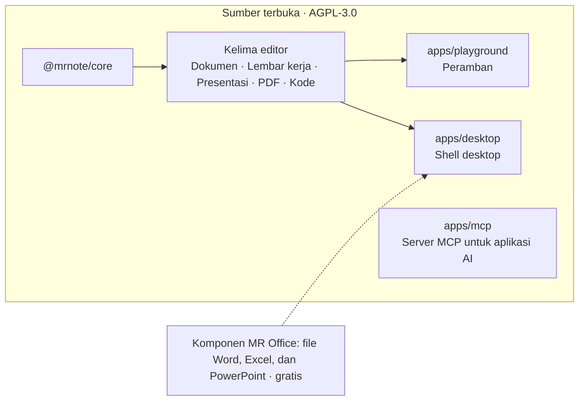

# MR Office — Bahasa Indonesia

<p align="center"><sub>🌐 <a href="../README.md">English</a> · <a href="../i18n/README.en-GB.md">English (UK)</a> · <a href="../i18n/README.zh.md">简体中文</a> · <a href="../i18n/README.zh-TW.md">繁體中文</a> · <a href="../i18n/README.ja.md">日本語</a> · <a href="../i18n/README.ko.md">한국어</a> · <a href="../i18n/README.de.md">Deutsch</a> · <a href="../i18n/README.fr.md">Français</a> · <a href="../i18n/README.es.md">Español</a> · <a href="../i18n/README.es-419.md">Español (Latinoamérica)</a> · <a href="../i18n/README.pt-BR.md">Português (Brasil)</a> · <a href="../i18n/README.it.md">Italiano</a> · <a href="../i18n/README.nl.md">Nederlands</a> · <a href="../i18n/README.sv.md">Svenska</a> · <a href="../i18n/README.da.md">Dansk</a> · <a href="../i18n/README.no.md">Norsk</a> · <a href="../i18n/README.fi.md">Suomi</a> · <a href="../i18n/README.id.md">Bahasa Indonesia</a> · <a href="../i18n/README.th.md">ไทย</a> · <a href="../i18n/README.vi.md">Tiếng Việt</a></sub></p>

<p align="center"><b>Editor open-source dari MR Office, suite kantor AI yang paling dekat dengan Microsoft Office: dokumen, spreadsheet, presentasi, PDF, dan kode di browser, serta AI yang mengedit file Word, Excel, dan PowerPoint asli bersama Anda.</b></p>

<p align="center"><a href="https://mroffice.ai/id"><b>▶ Coba online</b></a> · <a href="https://mroffice.ai/id/office/download"><b>⬇ Unduh</b></a> · <a href="https://mroffice.ai">🌐 mroffice.ai</a><br><a href="https://mroffice.ai/id/developers">🧑‍💻 Pengembang</a> · <a href="https://mroffice.ai/id/developers/embed">🧩 Sematkan</a> · <a href="https://mroffice.ai/id/developers/mcp">🤖 MCP untuk aplikasi AI</a> · <a href="https://www.npmjs.com/package/mroffice-embed">📦 SDK npm</a> · <a href="https://mroffice.ai/id/developers/oauth">🔑 Masuk dengan MR Office</a></p>

<p align="center"><a href="../LICENSE"></a> <a href="https://github.com/XinaTian/MROffice/releases"></a> <a href="https://github.com/XinaTian/MROffice/actions/workflows/ci.yml"></a> <a href="https://github.com/XinaTian/MROffice/stargazers"></a></p>

<p align="center"><a href="https://mroffice.ai/id"></a></p>

<p align="center"><a href="https://demo.mroffice.ai/media/mr-office-demo.mp4">🔊 Tonton tur 50 detik dengan suara</a></p>

<table>
<tr>
<td align="center" width="50%"><a href="https://mroffice.ai/id"></a><br><b>Dokumen</b></td>
<td align="center" width="50%"><a href="https://mroffice.ai/id"></a><br><b>Lembar kerja</b></td>
</tr>
<tr>
<td align="center" width="50%"><a href="https://mroffice.ai/id"></a><br><b>Presentasi</b></td>
<td align="center" width="50%"><a href="https://mroffice.ai/id"></a><br><b>PDF</b></td>
</tr>
<tr>
<td align="center" width="50%"><a href="https://mroffice.ai/id"></a><br><b>Kode</b></td>
</tr>
</table>

MR Office adalah suite kantor AI untuk file asli: Word, Excel, PowerPoint, dan PDF, di web dan di aplikasi desktop gratis, dengan AI di samping setiap dokumen dan pengeditan bersama secara langsung. Repositori ini menerbitkan kode sumber editornya: editor yang sama dengan yang dijalankan MR Office, yang dapat Anda bangun, jalankan, dan sematkan sendiri.

## Gratis untuk individu dan tim kecil

- **MR Office online dan aplikasi desktop** — gratis: pengeditan Word, Excel, PowerPoint, dan PDF sungguhan, pengeditan bersama langsung dan berbagi, di web, di ponsel, dan offline di komputer Anda. AI hadir dengan kuota harian gratis; penggunaan AI yang lebih berat tersedia sebagai paket berbayar opsional.
- **Embed, untuk aplikasi Anda sendiri** — gratis untuk memulai, dengan semua yang disertakan: mesin formula lengkap, file Office asli, pengeditan bersama, semua format ekspor, dan API otomasi (1.000 sesi per bulan di localhost, 100 di domain Anda sendiri, hingga 2 aplikasi, tanpa kartu).
- **Bisnis dengan penggunaan lebih berat** — bayar sesuai pemakaian pada layanan yang sepenuhnya terkelola: Starter seharga US$29 per bulan dengan 5.000 sesi, Pro seharga US$149 per bulan dengan 40.000 sesi, white-label dan dukungan prioritas. Tanpa lisensi tahunan, tanpa server yang harus dijalankan, tanpa upgrade yang harus dikelola: pembaruan, penskalaan, dan pencadangan adalah tanggung jawab kami.

Sebagai perbandingan, ONLYOFFICE Docs Developer Edition tercantum mulai sekitar US$6.000 per tahun untuk 250 koneksi simultan di server yang Anda jalankan sendiri (harga daftar reseller, November 2026); harga Univer Pro tidak dipublikasikan. [Harga dan batas →](https://mroffice.ai/id/developers/pricing)

## AI yang bekerja di dalam file Anda

Di MR Office, AI bekerja pada dokumen itu sendiri, bukan pada teks yang ditempel ke dalam chat. AI membaca file, melakukan perubahan pada objek milik file itu, dan menunjukkan apa yang diubahnya sebelum Anda menyimpannya.

- **Copilot di setiap editor** — dokumen, spreadsheet, presentasi, PDF, dan kode. Pilih atau lingkari yang Anda maksud dan katakan keinginan Anda: AI mengedit paragraf, tabel, sel dan formula, bentuk dan slide langsung di tempatnya, bertanya bila permintaan kurang jelas, menampilkan pratinjau perubahan sebelum diterapkan, dan setiap perubahan dapat dibatalkan.
- **Perubahan yang Anda tinjau** — yang diusulkan AI hanya diterapkan setelah Anda mengonfirmasinya; jika file berubah di sementara itu, usulan dibatalkan dan tidak ada tulisan Anda yang tertimpa.
- **Jendela AI yang mengenal ruang kerja Anda** — tanyakan tentang file, catatan, dan kanvas Anda dan dapatkan jawaban yang menyebutkan sumbernya; AI menyusun dokumen, sheet, dan deck baru, serta membuat alat kecil di kanvas saat Anda membutuhkannya.
- **Memori** — grafik memori menyimpan orang, proyek, dan keputusan yang penting, sehingga AI tidak memulai dari nol di setiap percakapan.
- **Model terdepan** — pilih model untuk setiap percakapan dari model AI terdepan saat ini; file Anda tetap di ruang kerja Anda, atau di komputer Anda sendiri dengan aplikasi desktop.

**[Coba AI di MR Office, gratis →](https://mroffice.ai/id)**

### Biarkan agen AI Anda mengedit file Office (MCP)

Claude, ChatGPT, Cursor, Codex, VS Code, dan klien MCP lainnya dapat membuat, membuka, mengedit, membaca kembali, menggambarkan, dan mengekspor dokumen dan spreadsheet melalui server MCP MR Office (`create_document`, `open_document`, `update_document`, `get_document`, `render_page`, `export_document` ke docx, xlsx, pptx, pdf, md, html, atau csv). Di aplikasi yang menampilkan MCP Apps, editor muncul langsung di dalam percakapan; di tempat lain, alat menjawab dengan tautan ke editor yang sama dan gambar halaman. Anda dan AI mengedit dokumen yang sama: asisten membaca kembali editan Anda sebelum melanjutkan, dan pembaruan yang dibuat di atas editan yang belum dilihatnya ditolak alih-alih hilang.

```bash
# Claude Code
claude mcp add mroffice -- npx -y mroffice-mcp
# Codex
codex mcp add mroffice -- npx -y mroffice-mcp
```

Claude Desktop, Cursor, dan aplikasi lain yang menerima konfigurasi JSON:

```json
{ "mcpServers": { "mroffice": { "command": "npx", "args": ["-y", "mroffice-mcp"] } } }
```

Tanpa instalasi: hubungkan endpoint terkelola `https://mcp.mroffice.ai/mcp` dan masuk dengan akun MR Office Anda. File Word, Excel, dan PowerPoint diproses melalui mesin Office MR Office sebagai akun Anda sendiri; kode sumber server MCP ada di `apps/mcp`. [Panduan MCP →](https://mroffice.ai/id/developers/mcp)

## Untuk pengembang

Semua untuk pengembang ada di **[MR Office Developers](https://mroffice.ai/id/developers)** — layanan mandiri, tanpa pengajuan: masuk dengan akun MR Office mana pun dan mulai.

### Sematkan editor di aplikasi web Anda (disarankan)

MR Office menghosting editor; server Anda menandatangani token sesi berumur pendek dan halaman Anda membuka editor. Editor ini mengedit file Word, Excel, PowerPoint, dan PDF asli (.docx, .xlsx, .pptx, .pdf), dengan mesin rumus lengkap, pengeditan bersama, unggahan, semua format ekspor, pencetakan, API otomasi (document object model, makro, plugin), dan penyimpanan yang dikirim kembali ke server Anda melalui callback bertanda tangan. Semuanya ada di paket Free: 1.000 sesi per bulan di localhost, 100 di domain Anda sendiri, hingga 2 aplikasi, tanpa perlu kartu. Sebagai layanan terkelola, ini tidak menimbulkan kewajiban AGPL pada aplikasi Anda sendiri.

1. Di folder proyek Anda, jalankan `npx mroffice-embed init` (atau buat aplikasi di konsol pengembang): satu klik "Izinkan" di browser, dan kunci aplikasi ditulis ke `.env.local` / `.env`.
2. Server Anda membuat token sesi dengan `createSessionToken` dari `mroffice-embed/server`; kunci rahasia tidak pernah meninggalkan server.
3. Halaman Anda membuka editor dengan `open()` dari `mroffice-embed` (atau skrip `https://mroffice.ai/embed/v1/embed.js`).

```js
// server: GET /api/mroffice/session (check who is signed in first)
import { createSessionToken } from "mroffice-embed/server";
const token = await createSessionToken({
  appId: process.env.MROFFICE_APP_ID,
  secretKey: process.env.MROFFICE_SECRET_KEY, // mro_sk_..., server only
  file: { key: "contract-42", name: "contract.docx", url: signedUrlToTheFile },
  user: { id: user.id, name: user.name },
  mode: "edit",
});

// page
import { open } from "mroffice-embed";
open({ container: "#editor", token: () => fetch("/api/mroffice/session").then((r) => r.json()).then((b) => b.token) });
```

[Panduan penyematan](https://mroffice.ai/id/developers/embed) · [Panduan dalam Markdown (untuk agen AI)](https://mroffice.ai/developers/embed.md) · [Harga dan batas](https://mroffice.ai/id/developers/pricing) · [Konsol pengembang](https://mroffice.ai/id/developers/console) · [Demo langsung](https://mroffice.ai/id/developers/embed/demo)

### Aplikasi AI: server MCP

Server MCP di atas juga menjadi cara fitur AI Anda sendiri dapat membuka, membaca, mengedit, dan mengekspor dokumen di editor MR Office yang asli: endpoint terkelola `https://mcp.mroffice.ai/mcp` (masuk OAuth, tanpa kunci) atau `npx -y mroffice-mcp` di komputer Anda sendiri. [Panduan MCP →](https://mroffice.ai/id/developers/mcp)

### Masuk dengan MR Office (OAuth)

MR Office adalah server otorisasi OAuth 2.1 (PKCE, dokumen metadata ID klien, pendaftaran dinamis): aplikasi Anda dapat memasukkan orang dengan akun MR Office mereka dan bertindak dalam cakupan yang mereka izinkan. [Panduan OAuth →](https://mroffice.ai/id/developers/oauth)

### Host sendiri editor sumber terbuka

Kelima editor di repositori ini dapat dibangun ke dalam produk Anda sendiri di bawah AGPL-3.0: jika orang menggunakan versi modifikasi melalui jaringan, Anda harus menawarkan kode sumber lengkapnya kepada mereka, dan mempertahankan atribusi "MR Office" (NOTICE.md). Mereka membuka formatnya sendiri, CSV, HTML, Markdown, dan PDF; file Word, Excel, dan PowerPoint disertakan dengan hosted embed di atas, termasuk paket Free. Lisensi komersial tersedia dari support@mr-note.com. [Panduan sumber terbuka →](https://mroffice.ai/id/developers/open-source)

Editor tersedia di npm sebagai komponen React: `npm i mroffice-docs mroffice-core` (dan `mroffice-sheets`, `mroffice-slides`, `mroffice-pdf`, `mroffice-code`); README setiap paket menunjukkan cara menyematkannya.

## Editor

Yang dilakukan setiap editor di repositori ini:

- **Dokumen** — pengolah kata berhalaman: font, pemformatan paragraf, daftar dan gaya di Home; halaman sampul dan kosong, pemisah halaman, tabel, gambar, bentuk, SmartArt, bagan, tautan, penanda, komentar, header, footer dan nomor halaman, persamaan, simbol, kotak teks dan WordArt di Insert. Menyimpan formatnya sendiri (.mrdoc); membuka HTML, Markdown dan teks biasa.
- **Lembar kerja** — sel dan formula dengan font, perataan, format angka, pemformatan bersyarat, gaya sel, serta menyisipkan atau menghapus sel di Home; tabel, gambar, bentuk, ikon, kotak centang, bagan, dan sparkline di Insert; beberapa lembar kerja, dengan jumlah dan rata-rata dari pilihan. Aritmetika antar sel (=A1*B1+10) dihitung langsung di browser saat Anda mengetik, dan setiap formula yang dimiliki file tetap utuh; mesin formula lengkap (SUM, IF, VLOOKUP dan ratusan lainnya) berjalan gratis di aplikasi desktop MR Office dan di paket Free dari hosted embed. Menyimpan formatnya sendiri (.mrsheet); membuka dan menyimpan CSV dan TSV.
- **Presentasi** — slide dengan tata letak dan bagian, teks, font dan paragraf, serta bentuk dengan penataannya di Home; tabel, gambar, ikon, SmartArt, bagan, kotak teks, WordArt, header dan footer, persamaan, simbol dan video di Insert; catatan pembicara, komentar dan presentasi. Menyimpan formatnya sendiri (.mrslides).
- **PDF** — membaca, menyajikan, dan mencetak file PDF: tampilan satu dan dua halaman, gulir berkelanjutan, rotasi, thumbnail, dan mode baca, pencarian dan salin teksnya, serta komentar; mengedit teks PDF itu sendiri dan menyimpannya kembali ke file gratis di aplikasi desktop MR Office dan hosted embed.
- **Kode** — editor kode cepat dengan penyorotan sintaks untuk banyak bahasa, outline, find, quick open, file explorer, dan daftar masalah.

Formula dengan fungsi (SUM, IF, VLOOKUP dan ratusan lainnya), file Word, Excel, dan PowerPoint, bagan, SmartArt, dan API otomasi gratis digunakan: di aplikasi desktop MR Office gratis, dan di aplikasi Anda sendiri melalui paket Free dari hosted embed. File tetap menjaga setiap formula, bagan, dan SmartArt utuh di editor sumber terbuka juga.

## Menjalankan editor

**▶ [Coba demo langsung — tanpa instalasi](https://mroffice.ai/id)**

Kelima editor berada di `packages/` (`@mrnote/docs`, `sheets`, `slides`, `pdf`, `code`, berbagi `@mrnote/core`) dan berjalan bersama di `apps/playground`:

```bash
npm install
npm run fonts     # the open substitutes for Office's fonts
npm run build
npm run preview   # http://localhost:5178
```

`npm run dev` memulai server pengembangan di alamat yang sama, dan `npm run smoke` memeriksa hasil build. README setiap paket menjelaskan secara rinci apa yang dilakukannya dan cara menyematkannya.

## Aplikasi desktop

[`apps/desktop`](../apps/desktop) berisi **MR Office Editors**: sumber shell aplikasi desktop MR Office (Electron), dengan identitasnya sendiri. Dengan komponen MR Office gratis dari Releases, ia menjadi aplikasi desktop MR Office, dengan file Word, Excel, PowerPoint, dan PDF, masuk akun, dan AI. Tanpa komponen tersebut, ia menjalankan editor open-source secara mandiri, yang membuka file .mrdoc, .mrsheet, dan .mrslides, CSV, HTML, Markdown, dan PDF. Shell dan editor adalah kode sumber AGPL; komponennya adalah unduhan gratis dari Releases. Setelah `npm run build`, jalankan dengan:

```bash
npm run desktop
```

## Untuk semua fitur, pasang aplikasi desktop MR Office (gratis)

Aplikasi desktop MR Office gratis, memiliki editor ini dan layanan lengkap, serta bekerja offline di komputer Anda sendiri. Ini juga menghadirkan:

- Membuka dan menyimpan file Word, Excel, dan PowerPoint (.docx, .xlsx, .pptx)
- Rumus dengan fungsi (SUM, IF, VLOOKUP …), dihitung oleh mesin rumus lengkap
- Bagan dihitung dan digambar dari data Anda
- Pengeditan SmartArt
- Menyimpan hasil edit PDF kembali ke file
- API otomasi: document object model, makro, dan plugin

**[Unduh MR Office (gratis) →](https://mroffice.ai/id/office/download)**

## Bagaimana bagian-bagiannya terhubung



## Lisensi

Sumber terbuka di bawah GNU Affero General Public License v3.0 (LICENSE), dengan ketentuan tambahan di NOTICE.md: pertahankan atribusi "MR Office" dan tautan ke https://mroffice.ai, dan tidak ada hak atas nama atau logo MR Office. Lisensi komersial tersedia melalui support@mr-note.com. Perangkat lunak dan data pihak ketiga tercantum di THIRD_PARTY_NOTICES.md. Kontribusi: lihat CONTRIBUTING.md.

## Selengkapnya

Situs web dan produk lengkap: **https://mroffice.ai** · Pertanyaan dan masukan: support@mr-note.com

<p align="center">Jika MR Office bermanfaat bagi Anda, ⭐ di GitHub membantu orang lain menemukannya.</p>
