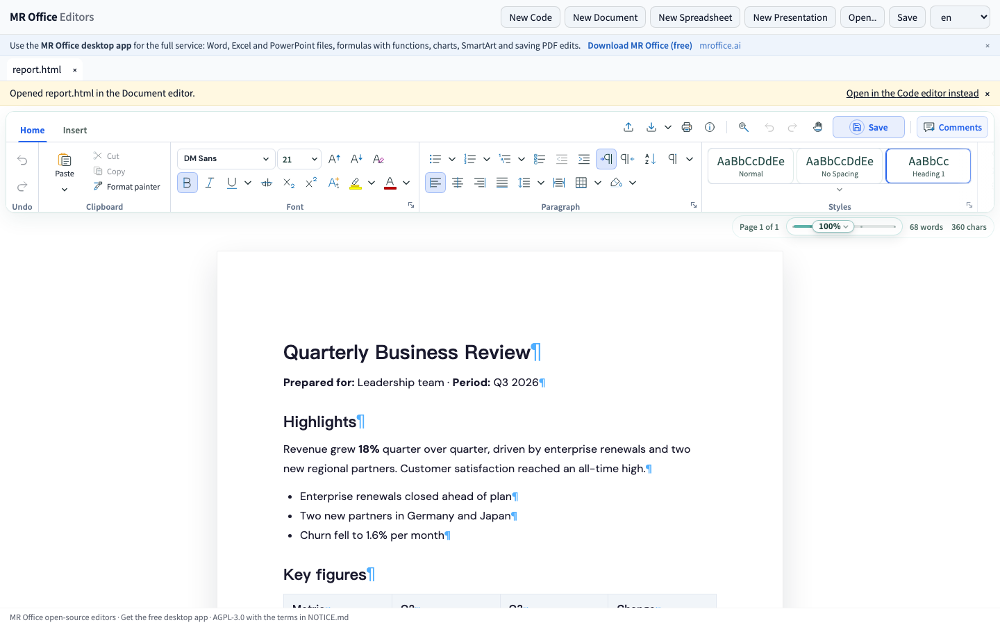
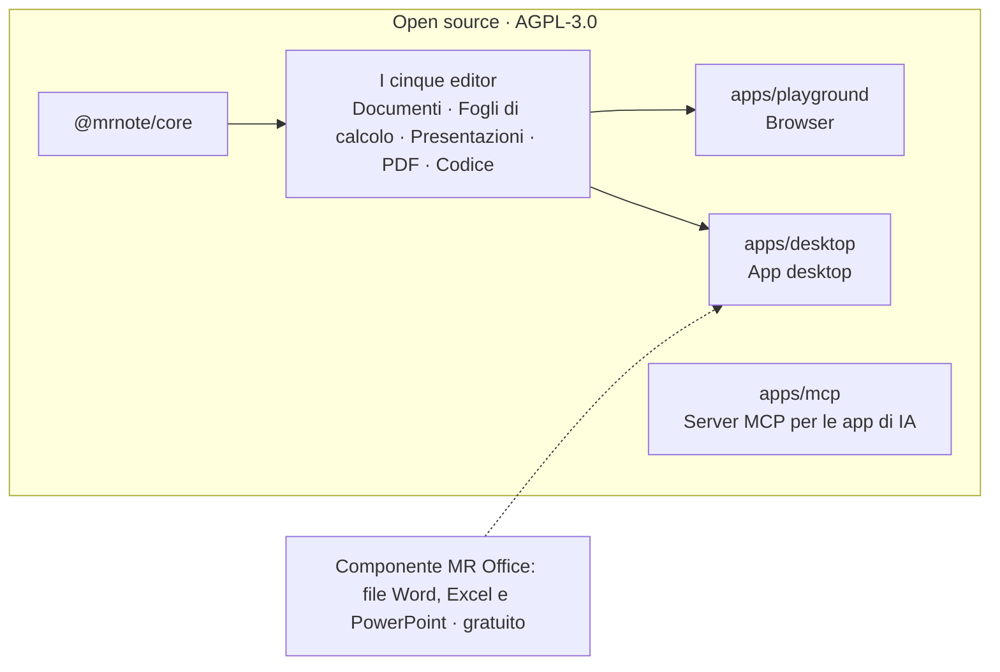

# MR Office — Italiano

<p align="center"><sub>🌐 <a href="../README.md">English</a> · <a href="../i18n/README.en-GB.md">English (UK)</a> · <a href="../i18n/README.zh.md">简体中文</a> · <a href="../i18n/README.zh-TW.md">繁體中文</a> · <a href="../i18n/README.ja.md">日本語</a> · <a href="../i18n/README.ko.md">한국어</a> · <a href="../i18n/README.de.md">Deutsch</a> · <a href="../i18n/README.fr.md">Français</a> · <a href="../i18n/README.es.md">Español</a> · <a href="../i18n/README.es-419.md">Español (Latinoamérica)</a> · <a href="../i18n/README.pt-BR.md">Português (Brasil)</a> · <a href="../i18n/README.it.md">Italiano</a> · <a href="../i18n/README.nl.md">Nederlands</a> · <a href="../i18n/README.sv.md">Svenska</a> · <a href="../i18n/README.da.md">Dansk</a> · <a href="../i18n/README.no.md">Norsk</a> · <a href="../i18n/README.fi.md">Suomi</a> · <a href="../i18n/README.id.md">Bahasa Indonesia</a> · <a href="../i18n/README.th.md">ไทย</a> · <a href="../i18n/README.vi.md">Tiếng Việt</a></sub></p>

<p align="center"><b>Gli editor open source di MR Office, la suite office con AI più vicina a Microsoft Office: documenti, fogli di calcolo, presentazioni, PDF e codice nel browser, e un'AI che modifica con te file Word, Excel e PowerPoint reali.</b></p>

<p align="center"><a href="https://mroffice.ai/it"><b>▶ Prova online</b></a> · <a href="https://mroffice.ai/it/office/download"><b>⬇ Scarica</b></a> · <a href="https://mroffice.ai">🌐 mroffice.ai</a><br><a href="https://mroffice.ai/it/developers">🧑‍💻 Sviluppatori</a> · <a href="https://mroffice.ai/it/developers/embed">🧩 Incorpora</a> · <a href="https://mroffice.ai/it/developers/mcp">🤖 MCP per app di IA</a> · <a href="https://www.npmjs.com/package/mroffice-embed">📦 SDK npm</a> · <a href="https://mroffice.ai/it/developers/oauth">🔑 Accedi con MR Office</a></p>

<p align="center"><a href="../LICENSE"></a> <a href="https://github.com/XinaTian/MROffice/releases"></a> <a href="https://github.com/XinaTian/MROffice/actions/workflows/ci.yml"></a> <a href="https://github.com/XinaTian/MROffice/stargazers"></a></p>

<p align="center"><a href="https://mroffice.ai/it"></a></p>

<p align="center"><a href="https://demo.mroffice.ai/media/mr-office-demo.mp4">🔊 Guarda il tour di 50 secondi con l'audio</a></p>

<table>
<tr>
<td align="center" width="50%"><a href="https://mroffice.ai/it"></a><br><b>Documenti</b></td>
<td align="center" width="50%"><a href="https://mroffice.ai/it"></a><br><b>Fogli di calcolo</b></td>
</tr>
<tr>
<td align="center" width="50%"><a href="https://mroffice.ai/it"></a><br><b>Presentazioni</b></td>
<td align="center" width="50%"><a href="https://mroffice.ai/it"></a><br><b>PDF</b></td>
</tr>
<tr>
<td align="center" width="50%"><a href="https://mroffice.ai/it"></a><br><b>Codice</b></td>
</tr>
</table>

MR Office è una suite office con AI per file reali: Word, Excel, PowerPoint e PDF, sul web e in un'app desktop gratuita, con un'AI accanto a ogni documento e co-editing live. Questo repository pubblica il codice sorgente dei suoi editor: gli stessi editor che esegue MR Office, che puoi compilare, eseguire e integrare per conto tuo.

## Gratuito per privati e piccoli team

- **MR Office online e l'app desktop** — gratis: modifica reale di Word, Excel, PowerPoint e PDF, co-editing live e condivisione, sul web, su telefono e offline sul tuo computer. L'AI include una quota giornaliera gratuita; un uso più intenso dell'AI è un piano a pagamento opzionale.
- **L'embed, per la tua app** — gratis per iniziare, con tutto incluso: il motore di formule completo, file Office reali, co-editing, tutti i formati di esportazione e l'API di automazione (1000 sessioni al mese su localhost, 100 sui tuoi domini, fino a 2 app, senza carta).
- **Aziende con un uso più intenso** — paghi a consumo su un servizio completamente gestito: Starter a US$29 al mese con 5.000 sessioni, Pro a US$149 al mese con 40.000 sessioni, white-label e supporto prioritario. Nessuna licenza annuale, nessun server da gestire, nessun aggiornamento da amministrare: aggiornamenti, scalabilità e backup sono a nostro carico.

Per confronto, ONLYOFFICE Docs Developer Edition parte da circa US$6.000 all'anno per 250 connessioni simultanee su server gestiti da te (prezzo di listino rivenditori, novembre 2026); il prezzo di Univer Pro non è pubblicato. [Prezzi e limiti →](https://mroffice.ai/it/developers/pricing)

## Un'AI che lavora dentro i tuoi file

In MR Office l'AI lavora sul documento stesso, non su testo incollato in una chat. Legge il file, applica la modifica sugli oggetti propri del file e ti mostra cosa ha toccato prima che tu la confermi.

- **Copilot in ogni editor** — documenti, fogli di calcolo, presentazioni, PDF e codice. Seleziona o cerchia ciò che intendi e di' cosa vuoi: modifica paragrafi, tabelle, celle e formule, forme e slide sul posto, chiede quando la richiesta non è chiara, mostra l'anteprima della modifica prima che venga applicata e ogni modifica può essere annullata.
- **Modifiche che rivedi tu** — ciò che l'AI propone viene applicato solo quando lo confermi; se nel frattempo il file è cambiato, la proposta decade e nulla di ciò che hai scritto viene sovrascritto.
- **Una finestra AI che conosce il tuo workspace** — chiedi dei tuoi file, note e canvas e ottieni risposte che citano le fonti; crea nuovi documenti, fogli e presentazioni e costruisce un piccolo strumento sul canvas quando ti serve.
- **Memoria** — un grafo di memoria conserva le persone, i progetti e le decisioni che contano, così l'AI non riparte da zero a ogni conversazione.
- **Modelli leader** — scegli il modello per ogni conversazione tra i principali modelli AI di oggi; i tuoi file restano nel tuo workspace, o sul tuo computer con l'app desktop.

**[Prova l'AI in MR Office, gratis →](https://mroffice.ai/it)**

### Lascia che il tuo agente AI modifichi i file Office (MCP)

Claude, ChatGPT, Cursor, Codex, VS Code e qualsiasi altro client MCP possono creare, aprire, modificare, rileggere, visualizzare ed esportare documenti e fogli di calcolo tramite il server MCP di MR Office (`create_document`, `open_document`, `update_document`, `get_document`, `render_page`, `export_document` in docx, xlsx, pptx, pdf, md, html o csv). Nelle app che mostrano MCP Apps l'editor compare direttamente nella conversazione; altrove gli strumenti rispondono con un link allo stesso editor e un'immagine della pagina. Tu e l'AI modificate lo stesso documento: l'assistente rilegge le tue modifiche prima di proseguire, e un aggiornamento basato su modifiche che non ha visto viene rifiutato anziché perso.

```bash
# Claude Code
claude mcp add mroffice -- npx -y mroffice-mcp
# Codex
codex mcp add mroffice -- npx -y mroffice-mcp
```

Claude Desktop, Cursor e altre app che accettano una configurazione JSON:

```json
{ "mcpServers": { "mroffice": { "command": "npx", "args": ["-y", "mroffice-mcp"] } } }
```

Nessuna installazione: collega l'endpoint ospitato `https://mcp.mroffice.ai/mcp` e accedi con il tuo account MR Office. I file Word, Excel e PowerPoint passano attraverso il motore Office di MR Office con il tuo account; il codice sorgente del server MCP è in `apps/mcp`. [Guida MCP →](https://mroffice.ai/it/developers/mcp)

## Per gli sviluppatori

Tutto per gli sviluppatori è su **[MR Office Developers](https://mroffice.ai/it/developers)**: self-service, senza richiesta. Accedi con qualsiasi account MR Office e inizia.

### Incorpora gli editor nella tua app web (consigliato)

MR Office ospita gli editor; il tuo server firma un token di sessione a breve scadenza e la tua pagina apre l'editor. Modifica file Word, Excel, PowerPoint e PDF reali (.docx, .xlsx, .pptx, .pdf), con il motore di formule completo, co-editing, caricamenti, tutti i formati di esportazione, stampa, l'API di automazione (document object model, macro, plugin) e salvataggi inviati al tuo server in un callback firmato. Tutto è incluso nel piano Free: 1000 sessioni al mese su localhost, 100 sui tuoi domini, fino a 2 app, senza carta di credito. In quanto servizio ospitato, non impone obblighi AGPL alla tua app.

1. Nella cartella del progetto esegui `npx mroffice-embed init` (oppure crea un'app nella console sviluppatori): un clic su "Consenti" nel browser e le chiavi dell'app vengono scritte in `.env.local` / `.env`.
2. Il tuo server crea un token di sessione con `createSessionToken` di `mroffice-embed/server`; la chiave segreta non lascia mai il server.
3. La tua pagina apre l'editor con `open()` di `mroffice-embed` (o lo script `https://mroffice.ai/embed/v1/embed.js`).

```js
// server: GET /api/mroffice/session (check who is signed in first)
import { createSessionToken } from "mroffice-embed/server";
const token = await createSessionToken({
  appId: process.env.MROFFICE_APP_ID,
  secretKey: process.env.MROFFICE_SECRET_KEY, // mro_sk_..., server only
  file: { key: "contract-42", name: "contract.docx", url: signedUrlToTheFile },
  user: { id: user.id, name: user.name },
  mode: "edit",
});

// page
import { open } from "mroffice-embed";
open({ container: "#editor", token: () => fetch("/api/mroffice/session").then((r) => r.json()).then((b) => b.token) });
```

[Guida all'incorporamento](https://mroffice.ai/it/developers/embed) · [La guida in Markdown (per agenti IA)](https://mroffice.ai/developers/embed.md) · [Prezzi e limiti](https://mroffice.ai/it/developers/pricing) · [Console sviluppatori](https://mroffice.ai/it/developers/console) · [Demo dal vivo](https://mroffice.ai/it/developers/embed/demo)

### App di IA: il server MCP

Il server MCP qui sopra è anche il modo in cui le tue funzionalità AI possono aprire, leggere, modificare ed esportare documenti nel vero editor di MR Office: l'endpoint ospitato `https://mcp.mroffice.ai/mcp` (accesso OAuth, nessuna chiave) oppure `npx -y mroffice-mcp` sul tuo computer. [Guida MCP →](https://mroffice.ai/it/developers/mcp)

### Accedi con MR Office (OAuth)

MR Office è un server di autorizzazione OAuth 2.1 (PKCE, documenti di metadati dell'ID client, registrazione dinamica): la tua app può far accedere le persone con il loro account MR Office e agire con gli ambiti che consentono. [Guida OAuth →](https://mroffice.ai/it/developers/oauth)

### Ospita tu stesso gli editor open source

I cinque editor di questo repository possono essere integrati nel tuo prodotto con licenza AGPL-3.0: se le persone usano una versione modificata tramite rete, devi offrire loro il codice sorgente completo e mantenere l'attribuzione "MR Office" (NOTICE.md). Aprono i propri formati, CSV, HTML, Markdown e PDF; i file Word, Excel e PowerPoint sono disponibili con l'embed ospitato sopra, piano Free incluso. Una licenza commerciale è disponibile scrivendo a support@mr-note.com. [Guida open source →](https://mroffice.ai/it/developers/open-source)

Gli editor sono su npm come componenti React: `npm i mroffice-docs mroffice-core` (e `mroffice-sheets`, `mroffice-slides`, `mroffice-pdf`, `mroffice-code`); il README di ogni pacchetto mostra come integrarlo.

## Gli editor

Cosa fa ogni editor in questo repository:

- **Documenti** — un elaboratore di testi a pagine: caratteri, formattazione dei paragrafi, elenchi e stili in Home; copertine e pagine vuote, interruzioni di pagina, tabelle, immagini, forme, SmartArt, grafici, link, segnalibri, commenti, intestazioni, piè di pagina e numeri di pagina, equazioni, simboli, caselle di testo e WordArt in Inserisci. Salva il proprio formato (.mrdoc); apre HTML, Markdown e testo semplice.
- **Fogli di calcolo** — celle e formule con caratteri, allineamento, formati numerici, formattazione condizionale, stili di cella e inserimento o eliminazione di celle in Home; tabelle, immagini, forme, icone, caselle di controllo, grafici e sparkline in Inserisci; più fogli, con somme e medie della selezione. L'aritmetica tra celle (=A1*B1+10) viene calcolata in tempo reale nel browser mentre digiti e ogni formula contenuta in un file resta intatta; il motore di formule completo (SUM, IF, VLOOKUP e centinaia di altre) funziona gratuitamente nell'app desktop MR Office e nel piano Free dell'embed ospitato. Salva il proprio formato (.mrsheet); apre e salva CSV e TSV.
- **Presentazioni** — diapositive con layout e sezioni, testo, caratteri e paragrafi, e forme con la loro disposizione in Home; tabelle, immagini, icone, SmartArt, grafici, caselle di testo, WordArt, intestazioni e piè di pagina, equazioni, simboli e video in Inserisci; note del relatore, commenti e presentazione. Salva il proprio formato (.mrslides).
- **PDF** — leggi, presenta e stampa file PDF: viste a pagina singola e doppia, scorrimento continuo, rotazione, miniature e modalità lettura, ricerca e copia del testo e commenti; la modifica del testo di un PDF e il suo salvataggio nel file sono gratuiti nell'app desktop MR Office e nell'embed ospitato.
- **Codice** — un editor di codice veloce con evidenziazione della sintassi per molti linguaggi, una struttura, ricerca, apertura rapida, un esploratore di file e un elenco dei problemi.

Formule con funzioni (SUM, IF, VLOOKUP e centinaia di altre), file Word, Excel e PowerPoint, grafici, SmartArt e l'API di automazione sono gratuiti: nell'app desktop MR Office gratuita e nella tua app tramite il piano Free dell'embed ospitato. I file mantengono intatte ogni formula, grafico e SmartArt anche negli editor open source.

## Eseguire gli editor

**▶ [Prova la demo online, senza installare nulla](https://mroffice.ai/it)**

I cinque editor sono in `packages/` (`@mrnote/docs`, `sheets`, `slides`, `pdf`, `code`, con `@mrnote/core` in comune) e funzionano insieme in `apps/playground`:

```bash
npm install
npm run fonts     # the open substitutes for Office's fonts
npm run build
npm run preview   # http://localhost:5178
```

`npm run dev` avvia un server di sviluppo allo stesso indirizzo e `npm run smoke` verifica una build. Il README di ogni pacchetto descrive nel dettaglio cosa fa e come incorporarlo.

## App desktop

[`apps/desktop`](../apps/desktop) contiene **MR Office Editors**: il codice sorgente della shell dell'app desktop di MR Office (Electron), con un'identità propria. Con il componente gratuito di MR Office da Releases, è l'app desktop di MR Office, con file Word, Excel, PowerPoint e PDF, accesso e AI. Senza il componente, esegue gli editor open source da soli, che aprono file .mrdoc, .mrsheet e .mrslides, CSV, HTML, Markdown e PDF. La shell e gli editor sono codice sorgente AGPL; il componente è un download gratuito da Releases. Dopo `npm run build`, avvialo con:

```bash
npm run desktop
```

## Per tutte le funzioni, installa l'app desktop di MR Office (gratuita)

L'app desktop MR Office è gratuita, include questi editor e il servizio completo e funziona offline sul tuo computer. Inoltre offre:

- Aprire e salvare file Word, Excel e PowerPoint (.docx, .xlsx, .pptx)
- Formule con funzioni (SUM, IF, VLOOKUP …), calcolate dal motore di formule completo
- Grafici calcolati e disegnati dai tuoi dati
- Modifica degli SmartArt
- Salvare nel file le modifiche a un PDF
- L'API di automazione: il document object model, le macro e i plugin

**[Scarica MR Office (gratis) →](https://mroffice.ai/it/office/download)**

## Come si combinano le parti



## Licenza

Open source con la GNU Affero General Public License v3.0 (LICENSE), con i termini aggiuntivi di NOTICE.md: mantenere l'attribuzione "MR Office" e il link a https://mroffice.ai, nessun diritto sul nome o sul logo MR Office. Una licenza commerciale è disponibile scrivendo a support@mr-note.com. Software e dati di terze parti sono elencati in THIRD_PARTY_NOTICES.md. Contributi: vedi CONTRIBUTING.md.

## Altro

Sito web e prodotto completo: **https://mroffice.ai** · Domande e feedback: support@mr-note.com

<p align="center">Se MR Office ti è utile, una ⭐ su GitHub aiuta altre persone a trovarlo.</p>
