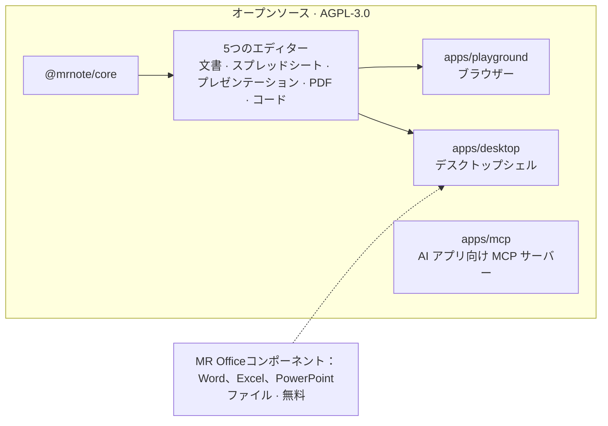

# MR Office — 日本語

<p align="center"><sub>🌐 <a href="../README.md">English</a> · <a href="../i18n/README.en-GB.md">English (UK)</a> · <a href="../i18n/README.zh.md">简体中文</a> · <a href="../i18n/README.zh-TW.md">繁體中文</a> · <a href="../i18n/README.ja.md">日本語</a> · <a href="../i18n/README.ko.md">한국어</a> · <a href="../i18n/README.de.md">Deutsch</a> · <a href="../i18n/README.fr.md">Français</a> · <a href="../i18n/README.es.md">Español</a> · <a href="../i18n/README.es-419.md">Español (Latinoamérica)</a> · <a href="../i18n/README.pt-BR.md">Português (Brasil)</a> · <a href="../i18n/README.it.md">Italiano</a> · <a href="../i18n/README.nl.md">Nederlands</a> · <a href="../i18n/README.sv.md">Svenska</a> · <a href="../i18n/README.da.md">Dansk</a> · <a href="../i18n/README.no.md">Norsk</a> · <a href="../i18n/README.fi.md">Suomi</a> · <a href="../i18n/README.id.md">Bahasa Indonesia</a> · <a href="../i18n/README.th.md">ไทย</a> · <a href="../i18n/README.vi.md">Tiếng Việt</a></sub></p>

<p align="center"><b>Microsoft Officeに最も近いAIオフィススイート、MR Officeのオープンソースエディタ。ブラウザで文書、表計算、プレゼンテーション、PDF、コードを扱い、AIが実際のWord、Excel、PowerPointファイルをあなたと一緒に編集します。</b></p>

<p align="center"><a href="https://mroffice.ai/ja"><b>▶ オンラインで試す</b></a> · <a href="https://mroffice.ai/ja/office/download"><b>⬇ ダウンロード</b></a> · <a href="https://mroffice.ai">🌐 mroffice.ai</a><br><a href="https://mroffice.ai/ja/developers">🧑‍💻 開発者</a> · <a href="https://mroffice.ai/ja/developers/embed">🧩 埋め込み</a> · <a href="https://mroffice.ai/ja/developers/mcp">🤖 AI アプリ向け MCP</a> · <a href="https://www.npmjs.com/package/mroffice-embed">📦 npm SDK</a> · <a href="https://mroffice.ai/ja/developers/oauth">🔑 MR Office でサインイン</a></p>

<p align="center"><a href="../LICENSE"></a> <a href="https://github.com/XinaTian/MROffice/releases"></a> <a href="https://github.com/XinaTian/MROffice/actions/workflows/ci.yml"></a> <a href="https://github.com/XinaTian/MROffice/stargazers"></a></p>

<p align="center"><a href="https://mroffice.ai/ja"></a></p>

<p align="center"><a href="https://demo.mroffice.ai/media/mr-office-demo.mp4">🔊 50 秒の紹介動画を見る（音声あり）</a></p>

<table>
<tr>
<td align="center" width="50%"><a href="https://mroffice.ai/ja"></a><br><b>文書</b></td>
<td align="center" width="50%"><a href="https://mroffice.ai/ja"></a><br><b>スプレッドシート</b></td>
</tr>
<tr>
<td align="center" width="50%"><a href="https://mroffice.ai/ja"></a><br><b>プレゼンテーション</b></td>
<td align="center" width="50%"><a href="https://mroffice.ai/ja"></a><br><b>PDF</b></td>
</tr>
<tr>
<td align="center" width="50%"><a href="https://mroffice.ai/ja"></a><br><b>コード</b></td>
</tr>
</table>

MR Officeは、Word、Excel、PowerPoint、PDFといった実際のファイルを扱うAIオフィススイートです。Webと無料のデスクトップアプリで利用でき、すべての文書のそばにAIがいて、リアルタイムの共同編集も可能です。このリポジトリでは、そのエディタのソースコードを公開しています。MR Officeが実際に動かしているのと同じエディタを、ビルドし、実行し、自分の環境に組み込むことができます。

## 個人・小規模チームは無料

- **MR Office オンライン版とデスクトップアプリ** — 無料：本物の Word、Excel、PowerPoint、PDF の編集、リアルタイム共同編集と共有を、ウェブでもスマホでも、オフラインでもお使いのコンピューターで。AI は毎日無料枠付き。より多く使いたい場合は任意の有料プランをご用意しています。
- **自社アプリへの組み込み** — 無料で開始、すべて込み：完全な数式エンジン、本物の Office ファイル、共同編集、すべてのエクスポート形式、自動化 API（localhost で月 1,000 セッション、自社ドメインで 100、アプリは最大 2 個、カード登録不要）。
- **より多く使うビジネス向け** — フルホスティングサービスの従量課金：Starter は月額 US$29 で 5,000 セッション、Pro は月額 US$149 で 40,000 セッション、ホワイトラベルと優先サポート付き。年間ライセンス不要、サーバー運用不要、アップグレード管理も不要：更新、スケーリング、バックアップはすべて当社が対応します。

参考までに、ONLYOFFICE Docs Developer Edition は、自社運用サーバーで同時接続 250 の場合、年間約 US$6,000 からとされています（リセラーの定価、2026年11月）。Univer Pro の価格は公開されていません。 [料金と上限 →](https://mroffice.ai/ja/developers/pricing)

## ファイルの中で働くAI

MR Officeでは、AIはチャットに貼り付けたテキストではなく、文書そのものを操作します。ファイルを読み取り、ファイル自身のオブジェクトを変更し、確定する前に何を触ったかを表示します。

- **すべてのエディタにCopilot** — 文書、表計算、プレゼンテーション、PDF、コード。対象を選択するか丸で囲んで、してほしいことを伝えるだけ。段落、表、セルと数式、図形、スライドをその場で編集し、指示が不明確なときは確認し、反映前に変更をプレビューし、すべての変更を元に戻せます。
- **確認してから反映される変更** — AIの提案は、あなたが確認したときにだけ適用されます。その間にファイルが変更されていた場合、提案は無効になり、あなたが書いた内容が上書きされることはありません。
- **ワークスペースを把握するAIウィンドウ** — ファイル、ノート、キャンバスについて質問すると、出典を示した回答が得られます。新しい文書、シート、デッキの下書きを作成し、必要ならキャンバス上に小さなツールを構築します。
- **メモリ** — メモリグラフが重要な人物、プロジェクト、決定事項を保持するので、AIは会話のたびにゼロから始めることはありません。
- **最先端のモデル** — 会話ごとに、今日の主要なAIモデルから選べます。ファイルはワークスペース内、またはデスクトップアプリなら自分のコンピュータ上に保持されます。

**[MR OfficeのAIを無料で試す →](https://mroffice.ai/ja)**

### AIエージェントにOfficeファイルを編集させる（MCP）

Claude、ChatGPT、Cursor、Codex、VS Code、その他のMCPクライアントは、MR OfficeのMCPサーバーを通じて文書や表計算を作成、開く、編集、読み戻し、画像化、エクスポートできます（`create_document`、`open_document`、`update_document`、`get_document`、`render_page`、`export_document`でdocx、xlsx、pptx、pdf、md、html、csvに出力）。MCP Appsを表示するアプリではエディタが会話の中に現れ、それ以外ではツールが同じエディタへのリンクとページの画像を返します。あなたとAIは同じ文書を編集します。アシスタントは続行前にあなたの編集を読み戻し、未確認の編集の上に加えられた更新は失われずに拒否されます。

```bash
# Claude Code
claude mcp add mroffice -- npx -y mroffice-mcp
# Codex
codex mcp add mroffice -- npx -y mroffice-mcp
```

Claude Desktop、Cursor、その他JSON設定を受け付けるアプリ:

```json
{ "mcpServers": { "mroffice": { "command": "npx", "args": ["-y", "mroffice-mcp"] } } }
```

インストール不要: ホストされたエンドポイント`https://mcp.mroffice.ai/mcp`に接続し、MR Officeアカウントでサインインします。Word、Excel、PowerPointファイルは、あなた自身のアカウントとしてMR OfficeのOfficeエンジンを通ります。MCPサーバーのソースは`apps/mcp`にあります。 [MCP ガイド →](https://mroffice.ai/ja/developers/mcp)

## 開発者向け

開発者向けのすべては **[MR Office Developers](https://mroffice.ai/ja/developers)** にあります。セルフサービスで申請は不要です。MR Office アカウントでサインインすればすぐ始められます。

### Web アプリにエディターを埋め込む（推奨）

MR Officeがエディタをホストし、サーバーが短命のセッショントークンに署名し、ページがエディタを開きます。実際のWord、Excel、PowerPoint、PDFファイル（.docx、.xlsx、.pptx、.pdf）を編集でき、完全な数式エンジン、共同編集、アップロード、すべてのエクスポート形式、印刷、自動化API（ドキュメントオブジェクトモデル、マクロ、プラグイン）、署名付きコールバックでサーバーに返送される保存を備えています。すべてFreeプランに含まれます：localhostで月1,000セッション、独自ドメインで100、最大2アプリ、カード不要。ホスト型サービスとして、独自アプリにAGPLの義務を課しません。

1. プロジェクトのフォルダーで `npx mroffice-embed init` を実行します（または開発者コンソールでアプリを作成）。ブラウザーで「許可」を 1 回押すと、アプリのキーが `.env.local` / `.env` に書き込まれます。
2. サーバーは `mroffice-embed/server` の `createSessionToken` でセッショントークンを発行します。シークレットキーはサーバーの外に出ません。
3. ページは `mroffice-embed` の `open()`（またはスクリプト `https://mroffice.ai/embed/v1/embed.js`）でエディターを開きます。

```js
// server: GET /api/mroffice/session (check who is signed in first)
import { createSessionToken } from "mroffice-embed/server";
const token = await createSessionToken({
  appId: process.env.MROFFICE_APP_ID,
  secretKey: process.env.MROFFICE_SECRET_KEY, // mro_sk_..., server only
  file: { key: "contract-42", name: "contract.docx", url: signedUrlToTheFile },
  user: { id: user.id, name: user.name },
  mode: "edit",
});

// page
import { open } from "mroffice-embed";
open({ container: "#editor", token: () => fetch("/api/mroffice/session").then((r) => r.json()).then((b) => b.token) });
```

[埋め込みガイド](https://mroffice.ai/ja/developers/embed) · [Markdown 版ガイド（AI エージェント向け）](https://mroffice.ai/developers/embed.md) · [料金と上限](https://mroffice.ai/ja/developers/pricing) · [開発者コンソール](https://mroffice.ai/ja/developers/console) · [ライブデモ](https://mroffice.ai/ja/developers/embed/demo)

### AI アプリ: MCP サーバー

上記のMCPサーバーは、あなた自身のAI機能が実際のMR Officeエディタで文書を開く、読む、編集する、エクスポートする手段でもあります。ホストされたエンドポイント`https://mcp.mroffice.ai/mcp`（OAuthサインイン、キー不要）または自分のコンピュータで`npx -y mroffice-mcp`を使います。 [MCP ガイド →](https://mroffice.ai/ja/developers/mcp)

### MR Office でサインイン（OAuth）

MR Office は OAuth 2.1 認可サーバーです（PKCE、クライアント ID メタデータドキュメント、動的登録）。あなたのアプリは MR Office アカウントでユーザーをサインインさせ、許可されたスコープで操作できます。 [OAuth ガイド →](https://mroffice.ai/ja/developers/oauth)

### オープンソースのエディターをセルフホストする

このリポジトリの5つのエディタは、AGPL-3.0の下で自身の製品に組み込むことができます。ネットワーク経由で改変版を利用させる場合は、完全なソースコードを提供し、「MR Office」の表示（NOTICE.md）を保持する必要があります。独自形式、CSV、HTML、Markdown、PDFを開くことができ、Word、Excel、PowerPointファイルは上記のホスト型埋め込み（Freeプランを含む）で利用可能です。商用ライセンスはsupport@mr-note.comから入手できます。 [オープンソースガイド →](https://mroffice.ai/ja/developers/open-source)

エディターはReactコンポーネントとしてnpmで公開されています: `npm i mroffice-docs mroffice-core`（および`mroffice-sheets`、`mroffice-slides`、`mroffice-pdf`、`mroffice-code`）。各パッケージのREADMEに埋め込み方法が記載されています。

## エディター

このリポジトリで各エディターができること：

- **文書** — ページ単位のワープロ:ホームタブにはフォント、段落書式、リスト、スタイル。挿入タブには表紙と空白ページ、改ページ、表、画像、図形、SmartArt、グラフ、リンク、ブックマーク、コメント、ヘッダー、フッター、ページ番号、数式、記号、テキストボックス、WordArt。独自形式（.mrdoc）で保存し、HTML、Markdown、プレーンテキストを開きます。
- **スプレッドシート** — セルと数式（フォント、配置、表示形式、条件付き書式、セルのスタイル、セルの挿入と削除）はホームタブで、表、画像、図形、アイコン、チェックボックス、グラフ、スパークラインは挿入タブで操作できます。複数のシートを扱え、選択範囲の合計や平均も表示します。セル間の四則演算（=A1*B1+10）は入力と同時にブラウザ上でリアルタイムに計算され、ファイル内のすべての数式はそのまま保持されます。完全な数式エンジン（SUM、IF、VLOOKUPなど数百の関数）は、MR Officeデスクトップアプリおよびホスト型埋め込みのFreeプランで無料で利用できます。独自形式（.mrsheet）で保存し、CSVとTSVの開閉・保存にも対応します。
- **プレゼンテーション** — スライド:ホームタブにはレイアウトとセクション、テキスト、フォントと段落、図形とその配置。挿入タブには表、画像、アイコン、SmartArt、グラフ、テキストボックス、WordArt、ヘッダーとフッター、数式、記号、動画。発表者メモ、コメント、プレゼンテーションに対応。独自形式（.mrslides）で保存します。
- **PDF** — PDFファイルの閲覧、プレゼンテーション、印刷が可能です。単一ページ表示と見開き表示、連続スクロール、回転、サムネイル、閲覧モード、テキストの検索とコピー、コメント機能を備えています。PDF自体のテキスト編集とファイルへの保存は、MR Officeデスクトップアプリおよびホスト型埋め込みで無料です。
- **コード** — 多くの言語に対応したシンタックスハイライト付きの高速コードエディタで、アウトライン、検索、クイックオープン、ファイルエクスプローラー、問題リストを備えています。

関数を使った数式（SUM、IF、VLOOKUPなど数百）、Word、Excel、PowerPointファイル、グラフ、SmartArt、自動化APIは無料で利用できます。無料のMR Officeデスクトップアプリでも、ホスト型埋め込みのFreeプランを通じて自身のアプリ内でも同様です。オープンソースのエディタでも、ファイル内のすべての数式、グラフ、SmartArtはそのまま保持されます。

## エディターを動かす

**▶ [ライブデモを試す（インストール不要）](https://mroffice.ai/ja)**

5つのエディターは`packages/`（`@mrnote/docs`、`sheets`、`slides`、`pdf`、`code`、共通の`@mrnote/core`）にあり、`apps/playground`で一緒に動作します:

```bash
npm install
npm run fonts     # the open substitutes for Office's fonts
npm run build
npm run preview   # http://localhost:5178
```

`npm run dev` は同じアドレスで開発サーバーを起動し、`npm run smoke` はビルドを確認します。各パッケージの README に、できることの詳細と組み込み方を載せています。

## デスクトップアプリ

[`apps/desktop`](../apps/desktop)には**MR Office Editors**があります。これはMR Officeデスクトップアプリのシェル（Electron）のソースであり、独自のアイデンティティを持ちます。Releasesの無料MR Officeコンポーネントと組み合わせると、Word、Excel、PowerPoint、PDFファイル、サインイン、AIを備えたMR Officeデスクトップアプリになります。コンポーネントなしでは、オープンソースエディターを単独で実行し、.mrdoc、.mrsheet、.mrslidesファイル、CSV、HTML、Markdown、PDFを開きます。シェルとエディターはAGPLソースコードです。コンポーネントはReleasesから無料でダウンロードできます。`npm run build`の後、次のコマンドで起動します:

```bash
npm run desktop
```

## すべての機能を使うには MR Office デスクトップ版（無料）をインストールしてください

MR Officeデスクトップアプリは無料で、これらのエディタとフルサービスを備え、お使いのコンピュータ上でオフラインでも動作します。さらに以下を提供します：

- Word・Excel・PowerPoint ファイル（.docx、.xlsx、.pptx）を開いて保存
- 関数を使った数式（SUM、IF、VLOOKUPなど）を完全な数式エンジンで計算
- データから計算・描画されるグラフ
- SmartArt の編集
- PDF の編集内容をファイルに書き戻す
- 自動化API：ドキュメントオブジェクトモデル、マクロ、プラグイン

**[MR Office をダウンロード（無料） →](https://mroffice.ai/ja/office/download)**

## 構成



## ライセンス

GNU Affero General Public License v3.0（LICENSE）のもとで、NOTICE.md の追加条項とともに公開しています。「MR Office」の表示と https://mroffice.ai へのリンクを残すこと、MR Office の名称とロゴの権利は付与されないことが条件です。商用ライセンスは support@mr-note.com までお問い合わせください。サードパーティのソフトウェアとデータは THIRD_PARTY_NOTICES.md に記載しています。コントリビューションについては CONTRIBUTING.md をご覧ください。

## 詳しく

Web サイトと製品版：**https://mroffice.ai** · ご質問・ご意見：support@mr-note.com

<p align="center">MR Office が役に立ったら、GitHub で ⭐ を付けてください。ほかの人が見つけやすくなります。</p>
