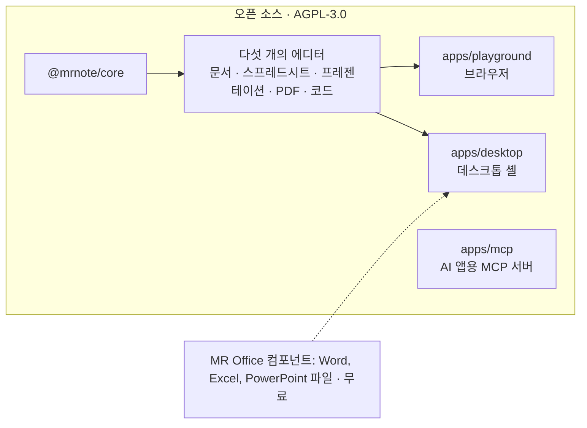

# MR Office — 한국어

<p align="center"><sub>🌐 <a href="../README.md">English</a> · <a href="../i18n/README.en-GB.md">English (UK)</a> · <a href="../i18n/README.zh.md">简体中文</a> · <a href="../i18n/README.zh-TW.md">繁體中文</a> · <a href="../i18n/README.ja.md">日本語</a> · <a href="../i18n/README.ko.md">한국어</a> · <a href="../i18n/README.de.md">Deutsch</a> · <a href="../i18n/README.fr.md">Français</a> · <a href="../i18n/README.es.md">Español</a> · <a href="../i18n/README.es-419.md">Español (Latinoamérica)</a> · <a href="../i18n/README.pt-BR.md">Português (Brasil)</a> · <a href="../i18n/README.it.md">Italiano</a> · <a href="../i18n/README.nl.md">Nederlands</a> · <a href="../i18n/README.sv.md">Svenska</a> · <a href="../i18n/README.da.md">Dansk</a> · <a href="../i18n/README.no.md">Norsk</a> · <a href="../i18n/README.fi.md">Suomi</a> · <a href="../i18n/README.id.md">Bahasa Indonesia</a> · <a href="../i18n/README.th.md">ไทย</a> · <a href="../i18n/README.vi.md">Tiếng Việt</a></sub></p>

<p align="center"><b>Microsoft Office에 가장 가까운 AI 오피스 제품군, MR Office의 오픈소스 편집기: 브라우저에서 문서, 스프레드시트, 프레젠테이션, PDF, 코드를 다루고, 실제 Word, Excel, PowerPoint 파일을 함께 편집하는 AI까지.</b></p>

<p align="center"><a href="https://mroffice.ai/ko"><b>▶ 온라인 체험</b></a> · <a href="https://mroffice.ai/ko/office/download"><b>⬇ 다운로드</b></a> · <a href="https://mroffice.ai">🌐 mroffice.ai</a><br><a href="https://mroffice.ai/ko/developers">🧑‍💻 개발자</a> · <a href="https://mroffice.ai/ko/developers/embed">🧩 임베드</a> · <a href="https://mroffice.ai/ko/developers/mcp">🤖 AI 앱용 MCP</a> · <a href="https://www.npmjs.com/package/mroffice-embed">📦 npm SDK</a> · <a href="https://mroffice.ai/ko/developers/oauth">🔑 MR Office로 로그인</a></p>

<p align="center"><a href="../LICENSE"></a> <a href="https://github.com/XinaTian/MROffice/releases"></a> <a href="https://github.com/XinaTian/MROffice/actions/workflows/ci.yml"></a> <a href="https://github.com/XinaTian/MROffice/stargazers"></a></p>

<p align="center"><a href="https://mroffice.ai/ko"></a></p>

<p align="center"><a href="https://demo.mroffice.ai/media/mr-office-demo.mp4">🔊 50초 소개 영상 보기 (소리 포함)</a></p>

<table>
<tr>
<td align="center" width="50%"><a href="https://mroffice.ai/ko"></a><br><b>문서</b></td>
<td align="center" width="50%"><a href="https://mroffice.ai/ko"></a><br><b>스프레드시트</b></td>
</tr>
<tr>
<td align="center" width="50%"><a href="https://mroffice.ai/ko"></a><br><b>프레젠테이션</b></td>
<td align="center" width="50%"><a href="https://mroffice.ai/ko"></a><br><b>PDF</b></td>
</tr>
<tr>
<td align="center" width="50%"><a href="https://mroffice.ai/ko"></a><br><b>코드</b></td>
</tr>
</table>

MR Office는 실제 파일을 위한 AI 오피스 제품군입니다. 웹과 무료 데스크톱 앱에서 Word, Excel, PowerPoint, PDF를 다루며, 모든 문서 옆에 AI가 있고 실시간 공동 편집도 지원합니다. 이 저장소는 MR Office가 실제로 구동하는 편집기의 소스 코드를 공개합니다. 직접 빌드하고 실행하고 임베드할 수 있습니다.

## 개인과 소규모 팀을 위한 무료

- **MR Office 온라인 및 데스크톱 앱** — 무료: 웹, 휴대폰, 컴퓨터 오프라인에서 실제 Word, Excel, PowerPoint, PDF 편집과 실시간 공동 편집 및 공유를 제공합니다. AI는 무료 일일 사용량과 함께 제공되며, 더 많은 AI 사용은 선택형 유료 플랜입니다.
- **자체 앱을 위한 임베드** — 무료로 시작하며 모든 것이 포함됩니다: 전체 수식 엔진, 실제 Office 파일, 공동 편집, 모든 내보내기 형식, 자동화 API(로컬호스트에서 월 1,000 세션, 자체 도메인에서 100, 최대 2개 앱, 카드 불필요).
- **사용량이 많은 기업** — 완전 호스팅 서비스에서 종량제로 이용하세요: 월 US$29의 Starter(5,000 세션), 월 US$149의 Pro(40,000 세션), 화이트라벨 및 우선 지원. 연간 라이선스도, 운영할 서버도, 관리할 업그레이드도 없습니다: 업데이트, 확장, 백업은 저희가 담당합니다.

비교하자면, ONLYOFFICE Docs Developer Edition은 직접 운영하는 서버에서 동시 연결 250개 기준 연 약 US$6,000부터로 책정되어 있으며(리셀러 정가, 2026년 11월), Univer Pro의 가격은 공개되지 않았습니다. [가격 및 한도 →](https://mroffice.ai/ko/developers/pricing)

## 파일 안에서 작동하는 AI

MR Office에서 AI는 채팅에 붙여넣은 텍스트가 아니라 문서 자체를 다룹니다. 파일을 읽고, 파일 고유의 객체를 직접 수정하며, 반영하기 전에 무엇을 바꿨는지 보여줍니다.

- **모든 편집기에 있는 Copilot** — 문서, 스프레드시트, 프레젠테이션, PDF, 코드까지. 원하는 부분을 선택하거나 동그라미로 표시하고 원하는 것을 말하세요. 문단, 표, 셀과 수식, 도형과 슬라이드를 제자리에서 편집하고, 요청이 불분명하면 되묻고, 반영 전에 변경 사항을 미리 보여주며, 모든 변경은 되돌릴 수 있습니다.
- **검토하는 변경 사항** — AI가 제안한 내용은 확인했을 때만 적용됩니다. 그 사이 파일이 변경되었다면 제안은 무효가 되며, 작성한 내용이 덮어써지지 않습니다.
- **워크스페이스를 아는 AI 창** — 파일, 노트, 캔버스에 대해 질문하고 출처를 인용한 답변을 받으세요. 새 문서, 시트, 덱을 초안으로 만들고, 필요하면 캔버스 위에 작은 도구를 만들어 줍니다.
- **메모리** — 메모리 그래프가 중요한 사람, 프로젝트, 결정을 기억하므로 AI가 매 대화마다 처음부터 시작하지 않습니다.
- **최고의 모델** — 오늘날 최고의 AI 모델 중에서 대화마다 모델을 선택하세요. 파일은 워크스페이스에, 또는 데스크톱 앱을 쓰면 내 컴퓨터에 그대로 남습니다.

**[MR Office에서 AI를 무료로 사용해 보세요 →](https://mroffice.ai/ko)**

### AI 에이전트가 Office 파일을 편집하게 하세요 (MCP)

Claude, ChatGPT, Cursor, Codex, VS Code 및 기타 모든 MCP 클라이언트가 MR Office의 MCP 서버를 통해 문서와 스프레드시트를 생성, 열기, 편집, 다시 읽기, 이미지화, 내보내기할 수 있습니다 (`create_document`, `open_document`, `update_document`, `get_document`, `render_page`, `export_document`로 docx, xlsx, pptx, pdf, md, html, csv로 내보내기). MCP Apps를 표시하는 앱에서는 편집기가 대화 안에 바로 나타나고, 그 외 환경에서는 도구가 같은 편집기 링크와 페이지 이미지로 응답합니다. 사용자와 AI가 같은 문서를 편집합니다. 어시스턴트는 계속하기 전에 사용자의 편집 내용을 다시 읽고, 보지 못한 편집 위에 덮어쓰는 업데이트는 유실되지 않도록 거부됩니다.

```bash
# Claude Code
claude mcp add mroffice -- npx -y mroffice-mcp
# Codex
codex mcp add mroffice -- npx -y mroffice-mcp
```

Claude Desktop, Cursor 및 JSON 설정을 지원하는 기타 앱:

```json
{ "mcpServers": { "mroffice": { "command": "npx", "args": ["-y", "mroffice-mcp"] } } }
```

설치 불필요: 호스팅 엔드포인트 `https://mcp.mroffice.ai/mcp`에 연결하고 MR Office 계정으로 로그인하세요. Word, Excel, PowerPoint 파일은 사용자 본인의 계정으로 MR Office의 Office 엔진을 거쳐 처리됩니다. MCP 서버의 소스는 `apps/mcp`에 있습니다. [MCP 가이드 →](https://mroffice.ai/ko/developers/mcp)

## 개발자용

개발자에게 필요한 모든 것은 **[MR Office Developers](https://mroffice.ai/ko/developers)**에 있습니다. 셀프 서비스이며 신청이 필요 없습니다. MR Office 계정으로 로그인하고 바로 시작하세요.

### 웹 앱에 편집기 임베드하기(권장)

MR Office가 편집기를 호스팅합니다. 서버에서 짧은 수명의 세션 토큰을 서명하면 페이지에서 편집기가 열립니다. 실제 Word, Excel, PowerPoint, PDF 파일(.docx, .xlsx, .pptx, .pdf)을 편집하며, 전체 수식 엔진, 공동 편집, 업로드, 모든 내보내기 형식, 인쇄, 자동화 API(문서 객체 모델, 매크로, 플러그인)를 지원하고 저장 내용은 서명된 콜백으로 서버에 전송됩니다. 이 모든 기능이 Free 플랜에 포함됩니다: localhost에서 월 1,000 세션, 자체 도메인에서 100 세션, 최대 2개 앱, 카드 등록 불필요. 호스팅 서비스이므로 자체 앱에 AGPL 의무가 없습니다.

1. 프로젝트 폴더에서 `npx mroffice-embed init`를 실행하세요(또는 개발자 콘솔에서 앱을 만드세요). 브라우저에서 "허용"을 한 번 누르면 앱의 키가 `.env.local` / `.env`에 기록됩니다.
2. 서버는 `mroffice-embed/server`의 `createSessionToken`으로 세션 토큰을 발급합니다. 시크릿 키는 서버를 떠나지 않습니다.
3. 페이지는 `mroffice-embed`의 `open()`(또는 스크립트 `https://mroffice.ai/embed/v1/embed.js`)으로 편집기를 엽니다.

```js
// server: GET /api/mroffice/session (check who is signed in first)
import { createSessionToken } from "mroffice-embed/server";
const token = await createSessionToken({
  appId: process.env.MROFFICE_APP_ID,
  secretKey: process.env.MROFFICE_SECRET_KEY, // mro_sk_..., server only
  file: { key: "contract-42", name: "contract.docx", url: signedUrlToTheFile },
  user: { id: user.id, name: user.name },
  mode: "edit",
});

// page
import { open } from "mroffice-embed";
open({ container: "#editor", token: () => fetch("/api/mroffice/session").then((r) => r.json()).then((b) => b.token) });
```

[임베드 가이드](https://mroffice.ai/ko/developers/embed) · [Markdown 가이드(AI 에이전트용)](https://mroffice.ai/developers/embed.md) · [가격 및 한도](https://mroffice.ai/ko/developers/pricing) · [개발자 콘솔](https://mroffice.ai/ko/developers/console) · [라이브 데모](https://mroffice.ai/ko/developers/embed/demo)

### AI 앱: MCP 서버

위의 MCP 서버는 자체 AI 기능이 실제 MR Office 편집기에서 문서를 열고, 읽고, 편집하고, 내보내는 방법이기도 합니다. 호스팅 엔드포인트 `https://mcp.mroffice.ai/mcp`(OAuth 로그인, 키 불필요) 또는 내 컴퓨터에서 `npx -y mroffice-mcp`를 사용하세요. [MCP 가이드 →](https://mroffice.ai/ko/developers/mcp)

### MR Office로 로그인(OAuth)

MR Office는 OAuth 2.1 인가 서버입니다(PKCE, 클라이언트 ID 메타데이터 문서, 동적 등록). 여러분의 앱은 사용자를 MR Office 계정으로 로그인시키고 허용된 범위 안에서 동작할 수 있습니다. [OAuth 가이드 →](https://mroffice.ai/ko/developers/oauth)

### 오픈 소스 편집기 직접 호스팅하기

이 저장소의 다섯 편집기는 AGPL-3.0에 따라 자체 제품에 빌드할 수 있습니다. 수정된 버전을 네트워크로 사용하게 하는 경우 전체 소스 코드를 제공해야 하며 "MR Office" 저작자 표시(NOTICE.md)를 유지해야 합니다. 자체 형식, CSV, HTML, Markdown, PDF를 열며, Word, Excel, PowerPoint 파일은 위의 호스팅 임베드에서 Free 플랜과 함께 제공됩니다. 상용 라이선스는 support@mr-note.com에서 문의할 수 있습니다. [오픈 소스 가이드 →](https://mroffice.ai/ko/developers/open-source)

에디터는 React 컴포넌트로 npm에 있습니다: `npm i mroffice-docs mroffice-core`(및 `mroffice-sheets`, `mroffice-slides`, `mroffice-pdf`, `mroffice-code`). 각 패키지의 README에서 임베드 방법을 확인하세요.

## 편집기

이 저장소에서 각 편집기가 하는 일:

- **문서** — 페이지 기반 워드 프로세서: 홈 탭에서 글꼴, 단락 서식, 목록, 스타일을, 삽입 탭에서 표지 및 빈 페이지, 페이지 나누기, 표, 그림, 도형, SmartArt, 차트, 링크, 책갈피, 메모, 머리글, 바닥글, 페이지 번호, 수식, 기호, 텍스트 상자, WordArt를 다룹니다. 자체 형식(.mrdoc)으로 저장하며 HTML, Markdown, 일반 텍스트를 엽니다.
- **스프레드시트** — Home에서 글꼴, 맞춤, 표시 형식, 조건부 서식, 셀 스타일을 적용하고 셀을 삽입하거나 삭제한 셀과 수식, Insert에서 표, 그림, 도형, 아이콘, 확인란, 차트, 스파크라인, 선택 영역의 합계와 평균을 계산하는 여러 시트. 셀 간 산술 연산(=A1*B1+10)은 입력하는 대로 브라우저에서 실시간 계산되며, 파일에 담긴 모든 수식은 그대로 유지됩니다. 전체 수식 엔진(SUM, IF, VLOOKUP 및 수백 가지 함수)은 MR Office 데스크톱 앱과 호스팅 임베드의 Free 플랜에서 무료로 실행됩니다. 자체 형식(.mrsheet)으로 저장하며 CSV와 TSV를 열고 저장합니다.
- **프레젠테이션** — 홈 탭에서 레이아웃과 구역이 있는 슬라이드, 텍스트, 글꼴과 단락, 도형과 그 배치; 삽입 탭에서 표, 그림, 아이콘, SmartArt, 차트, 텍스트 상자, WordArt, 머리글과 바닥글, 수식, 기호, 동영상; 발표자 노트, 메모, 발표 기능. 자체 형식(.mrslides)으로 저장합니다.
- **PDF** — PDF 파일 읽기, 발표 및 인쇄: 단일 및 두 페이지 보기, 연속 스크롤, 회전, 썸네일과 읽기 모드, 텍스트 검색과 복사, 주석. PDF 자체 텍스트를 편집해 파일에 다시 저장하는 기능은 MR Office 데스크톱 앱과 호스팅 임베드에서 무료입니다.
- **코드** — 다양한 언어의 구문 강조, 개요, 찾기, 빠른 열기, 파일 탐색기, 문제 목록을 갖춘 빠른 코드 편집기.

함수가 포함된 수식(SUM, IF, VLOOKUP 및 수백 가지 함수), Word, Excel, PowerPoint 파일, 차트, SmartArt, 자동화 API를 무료로 사용할 수 있습니다. 무료 MR Office 데스크톱 앱에서, 그리고 호스팅 임베드의 Free 플랜을 통해 자체 앱에서도 사용할 수 있습니다. 오픈 소스 편집기에서도 파일의 모든 수식, 차트, SmartArt가 그대로 유지됩니다.

## 편집기 실행

**▶ [라이브 데모 체험 (설치 불필요)](https://mroffice.ai/ko)**

다섯 개의 에디터는 `packages/`(`@mrnote/docs`, `sheets`, `slides`, `pdf`, `code`, `@mrnote/core` 공유)에 있으며 `apps/playground`에서 함께 실행됩니다:

```bash
npm install
npm run fonts     # the open substitutes for Office's fonts
npm run build
npm run preview   # http://localhost:5178
```

`npm run dev`는 같은 주소에서 개발 서버를 시작하고, `npm run smoke`는 빌드를 점검합니다. 각 패키지의 README에 하는 일과 포함 방법을 자세히 적었습니다.

## 데스크톱 앱

[`apps/desktop`](../apps/desktop)에는 **MR Office Editors**가 있습니다. 이는 MR Office 데스크톱 앱 셸(Electron)의 소스로, 자체 아이덴티티를 가집니다. Releases의 무료 MR Office 구성 요소와 함께 사용하면 Word, Excel, PowerPoint, PDF 파일, 로그인, AI를 갖춘 MR Office 데스크톱 앱이 됩니다. 구성 요소 없이도 오픈소스 에디터만으로 실행되며, .mrdoc, .mrsheet, .mrslides 파일과 CSV, HTML, Markdown, PDF를 엽니다. 셸과 에디터는 AGPL 소스 코드이며, 구성 요소는 Releases에서 무료로 내려받을 수 있습니다. `npm run build` 후 다음으로 시작하세요:

```bash
npm run desktop
```

## 모든 기능을 사용하려면 MR Office 데스크톱 앱(무료)을 설치하세요

MR Office 데스크톱 앱은 무료이며, 이러한 편집기와 전체 서비스를 갖추고 자체 컴퓨터에서 오프라인으로 작동합니다. 또한 다음을 제공합니다:

- Word, Excel, PowerPoint 파일(.docx, .xlsx, .pptx) 열기와 저장
- 함수(SUM, IF, VLOOKUP …)가 포함된 수식으로, 전체 수식 엔진이 계산
- 데이터에서 계산하고 그리는 차트
- SmartArt 편집
- PDF 편집 내용을 파일에 다시 저장
- 자동화 API: 문서 객체 모델, 매크로 및 플러그인

**[MR Office 다운로드(무료) →](https://mroffice.ai/ko/office/download)**

## 구성



## 라이선스

GNU Affero General Public License v3.0(LICENSE)과 NOTICE.md의 추가 조건으로 공개합니다. "MR Office" 표시와 https://mroffice.ai 링크를 유지해야 하며, MR Office 이름과 로고에 대한 권리는 부여되지 않습니다. 상업용 라이선스는 support@mr-note.com으로 문의하세요. 서드파티 소프트웨어와 데이터는 THIRD_PARTY_NOTICES.md에 있습니다. 기여 방법은 CONTRIBUTING.md를 보세요.

## 더 보기

웹사이트와 전체 제품: **https://mroffice.ai** · 질문과 의견: support@mr-note.com

<p align="center">MR Office가 유용했다면 GitHub에서 ⭐를 눌러 주세요. 다른 사람들이 찾는 데 도움이 됩니다.</p>
