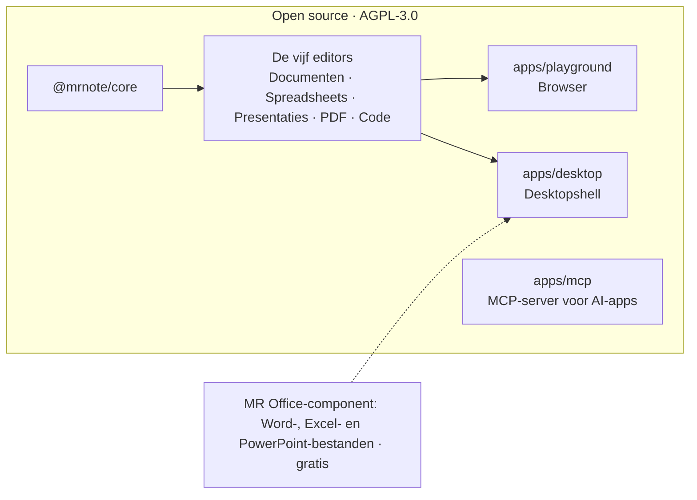

# MR Office — Nederlands

<p align="center"><sub>🌐 <a href="../README.md">English</a> · <a href="../i18n/README.en-GB.md">English (UK)</a> · <a href="../i18n/README.zh.md">简体中文</a> · <a href="../i18n/README.zh-TW.md">繁體中文</a> · <a href="../i18n/README.ja.md">日本語</a> · <a href="../i18n/README.ko.md">한국어</a> · <a href="../i18n/README.de.md">Deutsch</a> · <a href="../i18n/README.fr.md">Français</a> · <a href="../i18n/README.es.md">Español</a> · <a href="../i18n/README.es-419.md">Español (Latinoamérica)</a> · <a href="../i18n/README.pt-BR.md">Português (Brasil)</a> · <a href="../i18n/README.it.md">Italiano</a> · <a href="../i18n/README.nl.md">Nederlands</a> · <a href="../i18n/README.sv.md">Svenska</a> · <a href="../i18n/README.da.md">Dansk</a> · <a href="../i18n/README.no.md">Norsk</a> · <a href="../i18n/README.fi.md">Suomi</a> · <a href="../i18n/README.id.md">Bahasa Indonesia</a> · <a href="../i18n/README.th.md">ไทย</a> · <a href="../i18n/README.vi.md">Tiếng Việt</a></sub></p>

<p align="center"><b>De open-source editors van MR Office, de AI-kantoorsuite die het dichtst bij Microsoft Office staat: documenten, spreadsheets, presentaties, PDF en code in de browser, en een AI die samen met jou echte Word-, Excel- en PowerPoint-bestanden bewerkt.</b></p>

<p align="center"><a href="https://mroffice.ai/nl"><b>▶ Online proberen</b></a> · <a href="https://mroffice.ai/nl/office/download"><b>⬇ Downloaden</b></a> · <a href="https://mroffice.ai">🌐 mroffice.ai</a><br><a href="https://mroffice.ai/nl/developers">🧑‍💻 Ontwikkelaars</a> · <a href="https://mroffice.ai/nl/developers/embed">🧩 Insluiten</a> · <a href="https://mroffice.ai/nl/developers/mcp">🤖 MCP voor AI-apps</a> · <a href="https://www.npmjs.com/package/mroffice-embed">📦 npm-SDK</a> · <a href="https://mroffice.ai/nl/developers/oauth">🔑 Inloggen met MR Office</a></p>

<p align="center"><a href="../LICENSE"></a> <a href="https://github.com/XinaTian/MROffice/releases"></a> <a href="https://github.com/XinaTian/MROffice/actions/workflows/ci.yml"></a> <a href="https://github.com/XinaTian/MROffice/stargazers"></a></p>

<p align="center"><a href="https://mroffice.ai/nl"></a></p>

<p align="center"><a href="https://demo.mroffice.ai/media/mr-office-demo.mp4">🔊 Bekijk de rondleiding van 50 seconden met geluid</a></p>

<table>
<tr>
<td align="center" width="50%"><a href="https://mroffice.ai/nl"></a><br><b>Documenten</b></td>
<td align="center" width="50%"><a href="https://mroffice.ai/nl"></a><br><b>Spreadsheets</b></td>
</tr>
<tr>
<td align="center" width="50%"><a href="https://mroffice.ai/nl"></a><br><b>Presentaties</b></td>
<td align="center" width="50%"><a href="https://mroffice.ai/nl"></a><br><b>PDF</b></td>
</tr>
<tr>
<td align="center" width="50%"><a href="https://mroffice.ai/nl"></a><br><b>Code</b></td>
</tr>
</table>

MR Office is een AI-kantoorsuite voor echte bestanden: Word, Excel, PowerPoint en PDF, op het web en in een gratis desktopapp, met een AI naast elk document en live samen bewerken. Deze repository publiceert de broncode van de editors: dezelfde editors die MR Office gebruikt, die je zelf kunt bouwen, draaien en embedden.

## Gratis voor particulieren en kleine teams

- **MR Office online en de desktop-app** — gratis: echt Word-, Excel-, PowerPoint- en PDF-bewerken, live samen bewerken en delen, op het web, op telefoons en offline op je computer. De AI komt met een gratis daglimiet; zwaarder AI-gebruik is een optioneel betaald plan.
- **De embed, voor je eigen app** — gratis om te starten, met alles inbegrepen: de volledige formule-engine, echte Office-bestanden, samen bewerken, elk exportformaat en de automatiserings-API (1.000 sessies per maand op localhost, 100 op je eigen domeinen, tot 2 apps, geen kaart nodig).
- **Bedrijven met zwaarder gebruik** — betaal naar gebruik op een volledig gehoste service: Starter voor US$29 per maand met 5.000 sessies, Pro voor US$149 per maand met 40.000 sessies, white-label en prioriteitsondersteuning. Geen jaarlijkse licentie, geen servers om te draaien, geen upgrades om te beheren: updates, schaling en back-ups zijn aan ons.

Ter vergelijking: ONLYOFFICE Docs Developer Edition wordt vermeld vanaf ongeveer US$6.000 per jaar voor 250 gelijktijdige verbindingen op servers die je zelf draait (reseller-adviesprijs, november 2026); de prijs van Univer Pro is niet gepubliceerd. [Prijzen en limieten →](https://mroffice.ai/nl/developers/pricing)

## AI die in je bestanden werkt

In MR Office werkt de AI op het document zelf, niet op tekst die in een chat is geplakt. Hij leest het bestand, voert de wijziging door in de eigen objecten van het bestand en laat je zien wat hij heeft aangepast voordat je het overneemt.

- **Copilot in elke editor** — documenten, spreadsheets, presentaties, PDF en code. Selecteer of omcirkel wat je bedoelt en zeg wat je wilt: hij bewerkt alinea's, tabellen, cellen en formules, vormen en dia's ter plaatse, vraagt om verduidelijking als de opdracht onduidelijk is, toont een voorbeeld van de wijziging voordat die wordt toegepast, en elke wijziging kan ongedaan worden gemaakt.
- **Wijzigingen die je beoordeelt** — wat de AI voorstelt wordt pas toegepast als je het bevestigt; is het bestand intussen gewijzigd, dan vervalt het voorstel en wordt niets van wat je hebt geschreven overschreven.
- **Een AI-venster dat je werkruimte kent** — vraag naar je bestanden, notities en canvas en krijg antwoorden die hun bronnen citeren; hij stelt nieuwe documenten, spreadsheets en presentaties op, en bouwt een klein hulpmiddel op het canvas wanneer je er een nodig hebt.
- **Geheugen** — een geheugengraaf bewaart de mensen, projecten en beslissingen die ertoe doen, zodat de AI niet in elk gesprek vanaf nul begint.
- **Toonaangevende modellen** — kies per gesprek het model uit de toonaangevende AI-modellen van dit moment; je bestanden blijven in je werkruimte, of op je eigen computer met de desktopapp.

**[Probeer de AI in MR Office, gratis →](https://mroffice.ai/nl)**

### Laat je AI-agent Office-bestanden bewerken (MCP)

Claude, ChatGPT, Cursor, Codex, VS Code en elke andere MCP-client kunnen documenten en spreadsheets maken, openen, bewerken, teruglezen, weergeven en exporteren via de MCP-server van MR Office (`create_document`, `open_document`, `update_document`, `get_document`, `render_page`, `export_document` naar docx, xlsx, pptx, pdf, md, html of csv). In apps die MCP Apps tonen verschijnt de editor direct in het gesprek; elders antwoorden de tools met een link naar dezelfde editor en een afbeelding van de pagina. Jij en de AI bewerken hetzelfde document: de assistent leest je wijzigingen terug voordat hij verdergaat, en een update bovenop wijzigingen die hij niet heeft gezien wordt geweigerd in plaats van verloren te gaan.

```bash
# Claude Code
claude mcp add mroffice -- npx -y mroffice-mcp
# Codex
codex mcp add mroffice -- npx -y mroffice-mcp
```

Claude Desktop, Cursor en andere apps die een JSON-configuratie accepteren:

```json
{ "mcpServers": { "mroffice": { "command": "npx", "args": ["-y", "mroffice-mcp"] } } }
```

Geen installatie: verbind het gehoste endpoint `https://mcp.mroffice.ai/mcp` en log in met je MR Office-account. Word-, Excel- en PowerPoint-bestanden gaan via de Office-engine van MR Office als je eigen account; de broncode van de MCP-server staat in `apps/mcp`. [MCP-gids →](https://mroffice.ai/nl/developers/mcp)

## Voor ontwikkelaars

Alles voor ontwikkelaars staat op **[MR Office Developers](https://mroffice.ai/nl/developers)** — selfservice, geen aanvraag: log in met een willekeurig MR Office-account en begin.

### De editors in je webapp insluiten (aanbevolen)

MR Office host de editors; je server ondertekent een kortlevend sessietoken en je pagina opent de editor. Hij bewerkt echte Word-, Excel-, PowerPoint- en PDF-bestanden (.docx, .xlsx, .pptx, .pdf), met de volledige formule-engine, co-editing, uploads, elk exportformaat, afdrukken, de automatiserings-API (document object model, macro's, plugins) en opslagacties die via een ondertekende callback naar je server worden teruggestuurd. Alles zit in het Free-plan: 1.000 sessies per maand op localhost, 100 op je eigen domeinen, tot 2 apps, geen kaart nodig. Als hosted service legt het geen AGPL-verplichtingen op aan je eigen app.

1. Voer in de map van je project `npx mroffice-embed init` uit (of maak een app in de ontwikkelaarsconsole): één klik op "Toestaan" in de browser en de sleutels van de app staan in `.env.local` / `.env`.
2. Je server maakt een sessietoken met `createSessionToken` uit `mroffice-embed/server`; de geheime sleutel verlaat de server nooit.
3. Je pagina opent de editor met `open()` uit `mroffice-embed` (of het script `https://mroffice.ai/embed/v1/embed.js`).

```js
// server: GET /api/mroffice/session (check who is signed in first)
import { createSessionToken } from "mroffice-embed/server";
const token = await createSessionToken({
  appId: process.env.MROFFICE_APP_ID,
  secretKey: process.env.MROFFICE_SECRET_KEY, // mro_sk_..., server only
  file: { key: "contract-42", name: "contract.docx", url: signedUrlToTheFile },
  user: { id: user.id, name: user.name },
  mode: "edit",
});

// page
import { open } from "mroffice-embed";
open({ container: "#editor", token: () => fetch("/api/mroffice/session").then((r) => r.json()).then((b) => b.token) });
```

[Insluitgids](https://mroffice.ai/nl/developers/embed) · [De gids als Markdown (voor AI-agents)](https://mroffice.ai/developers/embed.md) · [Prijzen en limieten](https://mroffice.ai/nl/developers/pricing) · [Ontwikkelaarsconsole](https://mroffice.ai/nl/developers/console) · [Live demo](https://mroffice.ai/nl/developers/embed/demo)

### AI-apps: de MCP-server

De bovenstaande MCP-server is ook hoe je eigen AI-functies documenten kunnen openen, lezen, bewerken en exporteren in de echte MR Office-editor: het gehoste endpoint `https://mcp.mroffice.ai/mcp` (OAuth-inlog, geen sleutel) of `npx -y mroffice-mcp` op je eigen computer. [MCP-gids →](https://mroffice.ai/nl/developers/mcp)

### Inloggen met MR Office (OAuth)

MR Office is een OAuth 2.1-autorisatieserver (PKCE, client-ID-metadatadocumenten, dynamische registratie): je app kan mensen laten inloggen met hun MR Office-account en handelen met de scopes die zij toestaan. [OAuth-gids →](https://mroffice.ai/nl/developers/oauth)

### De open-source editors zelf hosten

De vijf editors in deze repository kunnen onder de AGPL-3.0 in je eigen product worden gebouwd: als mensen een gewijzigde versie via een netwerk gebruiken, moet je hun de volledige broncode aanbieden en de vermelding "MR Office" (NOTICE.md) behouden. Ze openen hun eigen formaten, CSV, HTML, Markdown en PDF; Word-, Excel- en PowerPoint-bestanden komen met de hosted embed hierboven, Free-plan inbegrepen. Een commerciële licentie is verkrijgbaar via support@mr-note.com. [Open-sourcegids →](https://mroffice.ai/nl/developers/open-source)

De editors staan op npm als React-componenten: `npm i mroffice-docs mroffice-core` (en `mroffice-sheets`, `mroffice-slides`, `mroffice-pdf`, `mroffice-code`); de README van elk pakket laat zien hoe je het insluit.

## De editors

Wat elke editor in deze repository doet:

- **Documenten** — een paginagebonden tekstverwerker: lettertypen, alinea-opmaak, lijsten en stijlen op Start; voorblad en lege pagina's, pagina-einden, tabellen, afbeeldingen, vormen, SmartArt, grafieken, koppelingen, bladwijzers, opmerkingen, kop- en voetteksten en paginanummers, vergelijkingen, symbolen, tekstvakken en WordArt op Invoegen. Slaat het eigen formaat op (.mrdoc); opent HTML, Markdown en platte tekst.
- **Spreadsheets** — cellen en formules met lettertypen, uitlijning, getalnotaties, voorwaardelijke opmaak, celstijlen en cellen invoegen of verwijderen op Start; tabellen, afbeeldingen, vormen, pictogrammen, selectievakjes, grafieken en sparklines op Invoegen; meerdere bladen, met sommen en gemiddelden van de selectie. Rekenkundige bewerkingen tussen cellen (=A1*B1+10) worden live in de browser berekend terwijl je typt, en elke formule in een bestand blijft intact; de volledige formule-engine (SUM, IF, VLOOKUP en honderden meer) werkt gratis in de MR Office desktop-app en in het Free-plan van de hosted embed. Slaat het eigen formaat op (.mrsheet); opent en slaat CSV en TSV op.
- **Presentaties** — dia's met lay-outs en secties, tekst, lettertypen en alinea's, en vormen met hun rangschikking op Start; tabellen, afbeeldingen, pictogrammen, SmartArt, grafieken, tekstvakken, WordArt, kop- en voetteksten, vergelijkingen, symbolen en video op Invoegen; sprekersnotities, opmerkingen en presenteren. Slaat het eigen formaat op (.mrslides).
- **PDF** — PDF-bestanden lezen, presenteren en afdrukken: weergaven met één en twee pagina's, continu scrollen, roteren, miniaturen en leesmodus, zoeken in en kopiëren van de tekst, en opmerkingen; de eigen tekst van een PDF bewerken en terug in het bestand opslaan is gratis in de MR Office desktop-app en de hosted embed.
- **Code** — een snelle code-editor met syntaxiskleuring voor vele talen, een overzicht, zoeken, snel openen, een bestandsverkenner en een problemenlijst.

Formules met functies (SUM, IF, VLOOKUP en honderden meer), Word-, Excel- en PowerPoint-bestanden, grafieken, SmartArt en de automatiserings-API zijn gratis te gebruiken: in de gratis MR Office desktop-app, en in je eigen app via het Free-plan van de hosted embed. Bestanden behouden elke formule, grafiek en SmartArt ook in de open-source editors.

## De editors draaien

**▶ [Probeer de live demo – zonder installatie](https://mroffice.ai/nl)**

De vijf editors staan in `packages/` (`@mrnote/docs`, `sheets`, `slides`, `pdf`, `code`, met gedeelde `@mrnote/core`) en draaien samen in `apps/playground`:

```bash
npm install
npm run fonts     # the open substitutes for Office's fonts
npm run build
npm run preview   # http://localhost:5178
```

`npm run dev` start een ontwikkelserver op hetzelfde adres en `npm run smoke` controleert een build. De README van elk pakket beschrijft in detail wat het doet en hoe je het insluit.

## Desktop-app

[`apps/desktop`](../apps/desktop) bevat **MR Office Editors**: de bron van de shell van de MR Office-desktopapp (Electron), onder een eigen identiteit. Met de gratis MR Office-component uit Releases is het de MR Office-desktopapp, met Word-, Excel-, PowerPoint- en PDF-bestanden, aanmelden en AI. Zonder de component draait het de open-source editors op zichzelf, die .mrdoc-, .mrsheet- en .mrslides-bestanden, CSV, HTML, Markdown en PDF openen. De shell en de editors zijn AGPL-broncode; de component is een gratis download uit Releases. Na `npm run build` start je het met:

```bash
npm run desktop
```

## Voor alle functies: installeer de desktop-app van MR Office (gratis)

De MR Office desktop-app is gratis, bevat deze editors en de volledige service, en werkt offline op je eigen computer. Hij brengt ook:

- Word-, Excel- en PowerPoint-bestanden (.docx, .xlsx, .pptx) openen en opslaan
- Formules met functies (SUM, IF, VLOOKUP …), berekend door de volledige formule-engine
- Grafieken berekend en getekend op basis van je gegevens
- SmartArt bewerken
- Bewerkingen van een pdf terugschrijven in het bestand
- De automatiserings-API: het document object model, macro's en plugins

**[MR Office downloaden (gratis) →](https://mroffice.ai/nl/office/download)**

## Hoe de onderdelen samenhangen



## Licentie

Open source onder de GNU Affero General Public License v3.0 (LICENSE), met de aanvullende voorwaarden in NOTICE.md: behoud de vermelding "MR Office" en de link naar https://mroffice.ai, en geen rechten op de naam of het logo van MR Office. Een commerciële licentie is verkrijgbaar via support@mr-note.com. Software en gegevens van derden staan in THIRD_PARTY_NOTICES.md. Bijdragen: zie CONTRIBUTING.md.

## Meer

Website en het volledige product: **https://mroffice.ai** · Vragen en feedback: support@mr-note.com

<p align="center">Heb je iets aan MR Office? Een ⭐ op GitHub helpt anderen het te vinden.</p>
