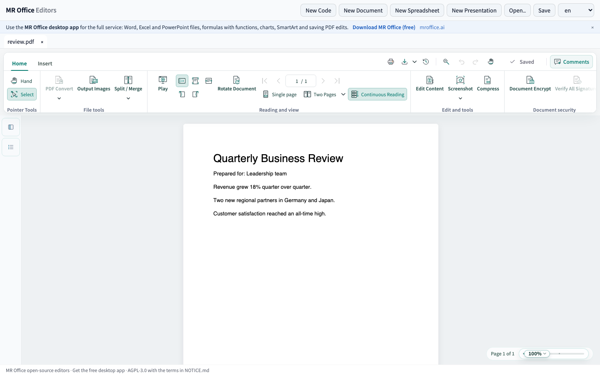
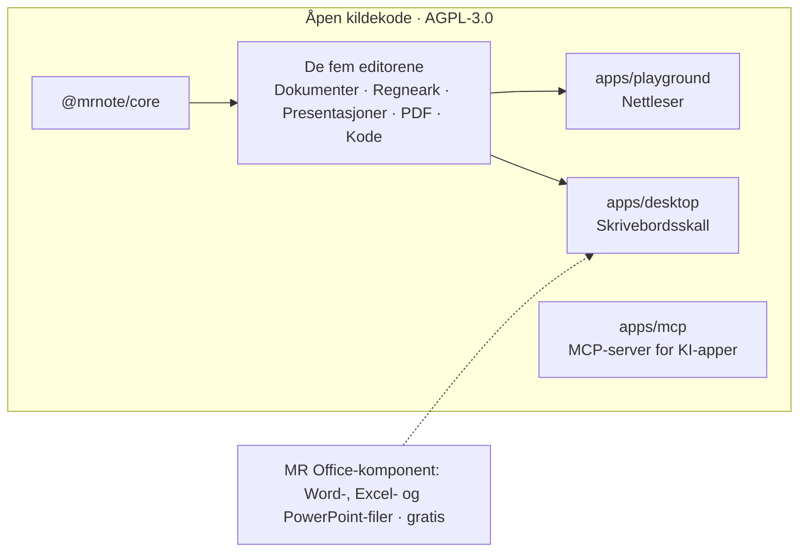

# MR Office — Norsk

<p align="center"><sub>🌐 <a href="../README.md">English</a> · <a href="../i18n/README.en-GB.md">English (UK)</a> · <a href="../i18n/README.zh.md">简体中文</a> · <a href="../i18n/README.zh-TW.md">繁體中文</a> · <a href="../i18n/README.ja.md">日本語</a> · <a href="../i18n/README.ko.md">한국어</a> · <a href="../i18n/README.de.md">Deutsch</a> · <a href="../i18n/README.fr.md">Français</a> · <a href="../i18n/README.es.md">Español</a> · <a href="../i18n/README.es-419.md">Español (Latinoamérica)</a> · <a href="../i18n/README.pt-BR.md">Português (Brasil)</a> · <a href="../i18n/README.it.md">Italiano</a> · <a href="../i18n/README.nl.md">Nederlands</a> · <a href="../i18n/README.sv.md">Svenska</a> · <a href="../i18n/README.da.md">Dansk</a> · <a href="../i18n/README.no.md">Norsk</a> · <a href="../i18n/README.fi.md">Suomi</a> · <a href="../i18n/README.id.md">Bahasa Indonesia</a> · <a href="../i18n/README.th.md">ไทย</a> · <a href="../i18n/README.vi.md">Tiếng Việt</a></sub></p>

<p align="center"><b>De åpen kildekode-redigeringsprogrammene til MR Office, AI-kontorpakken som ligger nærmest Microsoft Office: dokumenter, regneark, presentasjoner, PDF og kode i nettleseren, og en AI som redigerer ekte Word-, Excel- og PowerPoint-filer sammen med deg.</b></p>

<p align="center"><a href="https://mroffice.ai/no"><b>▶ Prøv på nett</b></a> · <a href="https://mroffice.ai/no/office/download"><b>⬇ Last ned</b></a> · <a href="https://mroffice.ai">🌐 mroffice.ai</a><br><a href="https://mroffice.ai/no/developers">🧑‍💻 Utviklere</a> · <a href="https://mroffice.ai/no/developers/embed">🧩 Bygg inn</a> · <a href="https://mroffice.ai/no/developers/mcp">🤖 MCP for KI-apper</a> · <a href="https://www.npmjs.com/package/mroffice-embed">📦 npm-SDK</a> · <a href="https://mroffice.ai/no/developers/oauth">🔑 Logg på med MR Office</a></p>

<p align="center"><a href="../LICENSE"></a> <a href="https://github.com/XinaTian/MROffice/releases"></a> <a href="https://github.com/XinaTian/MROffice/actions/workflows/ci.yml"></a> <a href="https://github.com/XinaTian/MROffice/stargazers"></a></p>

<p align="center"><a href="https://mroffice.ai/no"></a></p>

<p align="center"><a href="https://demo.mroffice.ai/media/mr-office-demo.mp4">🔊 Se den 50 sekunder lange omvisningen med lyd</a></p>

<table>
<tr>
<td align="center" width="50%"><a href="https://mroffice.ai/no"></a><br><b>Dokumenter</b></td>
<td align="center" width="50%"><a href="https://mroffice.ai/no"></a><br><b>Regneark</b></td>
</tr>
<tr>
<td align="center" width="50%"><a href="https://mroffice.ai/no"></a><br><b>Presentasjoner</b></td>
<td align="center" width="50%"><a href="https://mroffice.ai/no"></a><br><b>PDF</b></td>
</tr>
<tr>
<td align="center" width="50%"><a href="https://mroffice.ai/no"></a><br><b>Kode</b></td>
</tr>
</table>

MR Office er en AI-kontorpakke for ekte filer: Word, Excel, PowerPoint og PDF, på nettet og i en gratis skrivebordsapp, med en AI ved siden av hvert dokument og sanntids samredigering. Dette repositoriet publiserer kildekoden til redigeringsprogrammene: de samme redigeringsprogrammene som MR Office kjører, som du kan bygge, kjøre og bygge inn på egen hånd.

## Gratis for enkeltpersoner og små team

- **MR Office på nett og skrivebordsappen** — gratis: ekte redigering av Word, Excel, PowerPoint og PDF, sanntidssamredigering og deling, på nett, på mobil og offline på datamaskinen. AI-en kommer med en gratis daglig kvote; tyngre AI-bruk er en valgfri betalplan.
- **Innebyggingen, for din egen app** — gratis å starte, med alt inkludert: den fullstendige formelmotoren, ekte Office-filer, samredigering, alle eksportformater og automatiserings-API-et (1 000 økter i måneden på localhost, 100 på egne domener, opptil 2 apper, uten kort).
- **Virksomheter med tyngre bruk** — betal etter bruk på en fullt driftet tjeneste: Starter til US$29 i måneden med 5 000 økter, Pro til US$149 i måneden med 40 000 økter, white-label og prioritert støtte. Ingen årlig lisens, ingen servere å drifte, ingen oppgraderinger å håndtere: oppdateringer, skalering og sikkerhetskopier er vårt ansvar.

Til sammenligning er ONLYOFFICE Docs Developer Edition oppgitt fra omtrent US$6 000 i året for 250 samtidige tilkoblinger på servere du drifter selv (forhandlerens listepris, november 2026); prisen for Univer Pro er ikke offentliggjort. [Priser og grenser →](https://mroffice.ai/no/developers/pricing)

## AI som jobber inne i filene dine

I MR Office jobber AI-en på selve dokumentet, ikke på tekst som er limt inn i en chat. Den leser filen, gjør endringen i filens egne objekter og viser deg hva den har endret før du beholder det.

- **Copilot i hvert redigeringsprogram** — dokumenter, regneark, presentasjoner, PDF og kode. Merk eller ring rundt det du mener og si hva du vil: den redigerer avsnitt, tabeller, celler og formler, figurer og lysbilder på stedet, spør når forespørselen er uklar, forhåndsviser endringen før den trer i kraft, og hver endring kan angres.
- **Endringer du gjennomgår** — det AI-en foreslår, brukes bare når du bekrefter det; hvis filen er endret i mellomtiden, blir forslaget ugyldig og ingenting du har skrevet, overskrives.
- **Et AI-vindu som kjenner arbeidsområdet ditt** — spør om filene, notatene og lerretet ditt og få svar som viser til kildene; den utformer nye dokumenter, ark og presentasjoner, og bygger et lite verktøy på lerretet når du trenger det.
- **Minne** — en minnegraf holder på personene, prosjektene og beslutningene som betyr noe, slik at AI-en ikke starter på null i hver samtale.
- **Ledende modeller** — velg modell for hver samtale blant dagens ledende AI-modeller; filene dine blir i arbeidsområdet ditt, eller på din egen datamaskin med skrivebordsappen.

**[Prøv AI-en i MR Office, gratis →](https://mroffice.ai/no)**

### La AI-agenten din redigere Office-filer (MCP)

Claude, ChatGPT, Cursor, Codex, VS Code og enhver annen MCP-klient kan opprette, åpne, redigere, lese tilbake, avbilde og eksportere dokumenter og regneark gjennom MR Offices MCP-server (`create_document`, `open_document`, `update_document`, `get_document`, `render_page`, `export_document` til docx, xlsx, pptx, pdf, md, html eller csv). I apper som viser MCP Apps, vises redigeringsprogrammet rett i samtalen; ellers svarer verktøyene med en lenke til det samme redigeringsprogrammet og et bilde av siden. Du og AI-en redigerer det samme dokumentet: assistenten leser endringene dine tilbake før den går videre, og en oppdatering som gjøres oppå endringer den ikke har sett, avvises i stedet for å gå tapt.

```bash
# Claude Code
claude mcp add mroffice -- npx -y mroffice-mcp
# Codex
codex mcp add mroffice -- npx -y mroffice-mcp
```

Claude Desktop, Cursor og andre apper som tar en JSON-konfigurasjon:

```json
{ "mcpServers": { "mroffice": { "command": "npx", "args": ["-y", "mroffice-mcp"] } } }
```

Ingen installasjon: koble til det driftede endepunktet `https://mcp.mroffice.ai/mcp` og logg inn med MR Office-kontoen din. Word-, Excel- og PowerPoint-filer går gjennom MR Offices Office-motor som din egen konto; kildekoden til MCP-serveren ligger i `apps/mcp`. [MCP-veiledning →](https://mroffice.ai/no/developers/mcp)

## For utviklere

Alt for utviklere finnes på **[MR Office Developers](https://mroffice.ai/no/developers)** — selvbetjening, ingen søknad: logg på med en hvilken som helst MR Office-konto og sett i gang.

### Bygg inn redigeringsprogrammene i nettappen din (anbefalt)

MR Office er vert for redigeringsverktøyene; serveren din signerer et kortvarig sesjonstoken, og siden din åpner redigeringsverktøyet. Det redigerer ekte Word-, Excel-, PowerPoint- og PDF-filer (.docx, .xlsx, .pptx, .pdf), med den fulle formelmotoren, samredigering, opplastinger, alle eksportformater, utskrift, automatiserings-API-et (dokumentobjektmodell, makroer, programtillegg) og lagringer sendt tilbake til serveren din i en signert tilbakeringing. Alt dette er i Free-planen: 1 000 sesjoner i måneden på localhost, 100 på dine egne domener, opptil 2 apper, uten behov for kort. Som en hostet tjeneste pålegger den ingen AGPL-forpliktelser på din egen app.

1. Kjør `npx mroffice-embed init` i prosjektmappen (eller opprett en app i utviklerkonsollen): ett klikk på «Tillat» i nettleseren, så skrives appens nøkler til `.env.local` / `.env`.
2. Serveren din lager et økttoken med `createSessionToken` fra `mroffice-embed/server`; den hemmelige nøkkelen forlater aldri serveren.
3. Siden din åpner redigeringsprogrammet med `open()` fra `mroffice-embed` (eller skriptet `https://mroffice.ai/embed/v1/embed.js`).

```js
// server: GET /api/mroffice/session (check who is signed in first)
import { createSessionToken } from "mroffice-embed/server";
const token = await createSessionToken({
  appId: process.env.MROFFICE_APP_ID,
  secretKey: process.env.MROFFICE_SECRET_KEY, // mro_sk_..., server only
  file: { key: "contract-42", name: "contract.docx", url: signedUrlToTheFile },
  user: { id: user.id, name: user.name },
  mode: "edit",
});

// page
import { open } from "mroffice-embed";
open({ container: "#editor", token: () => fetch("/api/mroffice/session").then((r) => r.json()).then((b) => b.token) });
```

[Veiledning for innbygging](https://mroffice.ai/no/developers/embed) · [Veiledningen som Markdown (for KI-agenter)](https://mroffice.ai/developers/embed.md) · [Priser og grenser](https://mroffice.ai/no/developers/pricing) · [Utviklerkonsoll](https://mroffice.ai/no/developers/console) · [Live-demo](https://mroffice.ai/no/developers/embed/demo)

### KI-apper: MCP-serveren

MCP-serveren ovenfor er også måten dine egne AI-funksjoner kan åpne, lese, redigere og eksportere dokumenter i det ekte MR Office-redigeringsprogrammet: det driftede endepunktet `https://mcp.mroffice.ai/mcp` (OAuth-innlogging, ingen nøkkel) eller `npx -y mroffice-mcp` på din egen datamaskin. [MCP-veiledning →](https://mroffice.ai/no/developers/mcp)

### Logg på med MR Office (OAuth)

MR Office er en OAuth 2.1-autorisasjonsserver (PKCE, metadatadokumenter for klient-ID, dynamisk registrering): appen din kan logge folk på med MR Office-kontoen deres og handle med tillatelsene de gir. [OAuth-veiledning →](https://mroffice.ai/no/developers/oauth)

### Kjør redigeringsprogrammene med åpen kildekode selv

De fem redigererne i dette repositoriet kan bygges inn i ditt eget produkt under AGPL-3.0: hvis folk bruker en modifisert versjon over et nettverk, må du tilby dem den fullstendige kildekoden, og beholde "MR Office"-krediteringen (NOTICE.md). De åpner sine egne formater, CSV, HTML, Markdown og PDF; Word-, Excel- og PowerPoint-filer følger med den hostede innbyggingen ovenfor, Free-plan inkludert. En kommersiell lisens er tilgjengelig fra support@mr-note.com. [Veiledning for åpen kildekode →](https://mroffice.ai/no/developers/open-source)

Editorene finnes på npm som React-komponenter: `npm i mroffice-docs mroffice-core` (og `mroffice-sheets`, `mroffice-slides`, `mroffice-pdf`, `mroffice-code`); README-filen til hver pakke viser hvordan du bygger den inn.

## Redigeringsverktøyene

Hva hvert verktøy gjør i dette repositoriet:

- **Dokumenter** — en sidebasert tekstbehandler: skrifter, avsnittsformatering, lister og stiler på Hjem; forside og tomme sider, sideskift, tabeller, bilder, figurer, SmartArt, diagrammer, lenker, bokmerker, kommentarer, topptekst, bunntekst og sidetall, likninger, symboler, tekstbokser og WordArt på Sett inn. Lagrer sitt eget format (.mrdoc); åpner HTML, Markdown og ren tekst.
- **Regneark** — celler og formler med skrifttyper, justering, tallformater, betinget formatering, cellestiler og innsetting eller sletting av celler på Hjem; tabeller, bilder, figurer, ikoner, avmerkingsbokser, diagrammer og gnistlinjer på Sett inn; flere ark, med sum og gjennomsnitt av utvalget. Aritmetikk mellom celler (=A1*B1+10) beregnes live i nettleseren mens du skriver, og hver formel en fil inneholder, holdes intakt; den fulle formelmotoren (SUM, IF, VLOOKUP og hundrevis flere) kjører gratis i MR Office-skrivebordsappen og i den hostede innbyggingens Free-plan. Lagrer sitt eget format (.mrsheet); åpner og lagrer CSV og TSV.
- **Presentasjoner** — lysbilder med oppsett og seksjoner, tekst, skrifter og avsnitt, og figurer med plasseringen på Hjem; tabeller, bilder, ikoner, SmartArt, diagrammer, tekstbokser, WordArt, topptekst og bunntekst, likninger, symboler og video på Sett inn; notater til foredragsholder, kommentarer og presentasjon. Lagrer sitt eget format (.mrslides).
- **PDF** — les, presenter og skriv ut PDF-filer: enkeltside- og topagesvisning, kontinuerlig rulling, rotasjon, miniatyrbilder og lesemodus, søk og kopiering av teksten deres, og kommentarer; redigering av en PDFs egen tekst og lagring tilbake i filen er gratis i MR Office-skrivebordsappen og den hostede innbyggingen.
- **Kode** — en rask kodeeditor med syntaksutheving for mange språk, disposisjon, søk, hurtigåpning, en filutforsker og en problemliste.

Formler med funksjoner (SUM, IF, VLOOKUP og hundrevis flere), Word-, Excel- og PowerPoint-filer, diagrammer, SmartArt og automatiserings-API-et er gratis å bruke: i den gratis MR Office-skrivebordsappen, og i din egen app gjennom den hostede innbyggingens Free-plan. Filer beholder hver formel, diagram og SmartArt intakt også i de åpen kildekode-redigererne.

## Kjør redigeringsverktøyene

**▶ [Prøv live-demoen – ingen installasjon](https://mroffice.ai/no)**

De fem editorene ligger i `packages/` (`@mrnote/docs`, `sheets`, `slides`, `pdf`, `code`, som deler `@mrnote/core`) og kjører sammen i `apps/playground`:

```bash
npm install
npm run fonts     # the open substitutes for Office's fonts
npm run build
npm run preview   # http://localhost:5178
```

`npm run dev` starter en utviklingsserver på samme adresse, og `npm run smoke` kontrollerer et bygg. README-filen for hver pakke beskriver i detalj hva den gjør og hvordan den bygges inn.

## Skrivebordsapp

[`apps/desktop`](../apps/desktop) inneholder **MR Office Editors**: kildekoden til skallet i MR Office-skrivebordsappen (Electron), under egen identitet. Med den gratis MR Office-komponenten fra Releases er det MR Office-skrivebordsappen, med Word-, Excel-, PowerPoint- og PDF-filer, pålogging og AI. Uten komponenten kjører den de åpne kildekode-editorene på egen hånd, som åpner .mrdoc-, .mrsheet- og .mrslides-filer, CSV, HTML, Markdown og PDF. Skallet og editorene er AGPL-kildekode; komponenten er en gratis nedlasting fra Releases. Etter `npm run build` starter du den med:

```bash
npm run desktop
```

## For alle funksjoner: installer MR Offices skrivebordsapp (gratis)

MR Office-skrivebordsappen er gratis, har disse redigererne og hele tjenesten, og fungerer offline på din egen datamaskin. Den gir deg også:

- Åpne og lagre Word-, Excel- og PowerPoint-filer (.docx, .xlsx, .pptx)
- Formler med funksjoner (SUM, IF, VLOOKUP …), beregnet av den fulle formelmotoren
- Diagrammer beregnet og tegnet fra dine data
- Redigering av SmartArt
- Lagre endringer i en PDF tilbake i filen
- Automatiserings-API-et: dokumentobjektmodellen, makroer og programtillegg

**[Last ned MR Office (gratis) →](https://mroffice.ai/no/office/download)**

## Slik henger delene sammen



## Lisens

Åpen kildekode under GNU Affero General Public License v3.0 (LICENSE), med tilleggsvilkårene i NOTICE.md: behold navngivelsen «MR Office» og lenken til https://mroffice.ai, og ingen rettigheter til navnet eller logoen MR Office. En kommersiell lisens fås via support@mr-note.com. Programvare og data fra tredjeparter står i THIRD_PARTY_NOTICES.md. Bidrag: se CONTRIBUTING.md.

## Mer

Nettsted og hele produktet: **https://mroffice.ai** · Spørsmål og tilbakemeldinger: support@mr-note.com

<p align="center">Hvis MR Office er nyttig for deg, hjelper en ⭐ på GitHub andre å finne det.</p>
