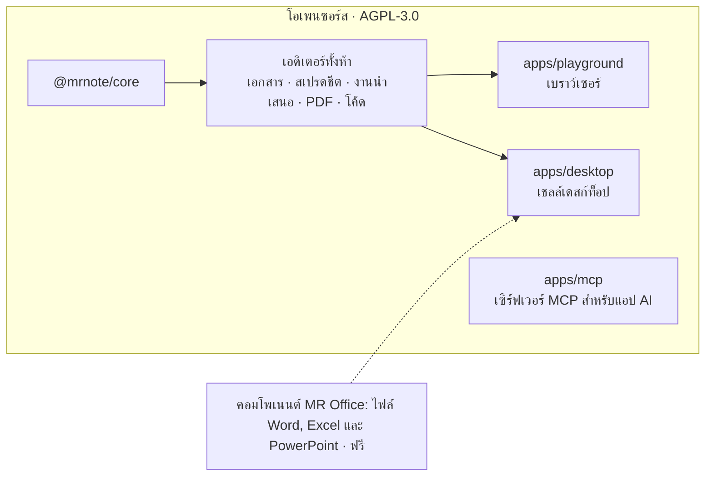

# MR Office — ไทย

<p align="center"><sub>🌐 <a href="../README.md">English</a> · <a href="../i18n/README.en-GB.md">English (UK)</a> · <a href="../i18n/README.zh.md">简体中文</a> · <a href="../i18n/README.zh-TW.md">繁體中文</a> · <a href="../i18n/README.ja.md">日本語</a> · <a href="../i18n/README.ko.md">한국어</a> · <a href="../i18n/README.de.md">Deutsch</a> · <a href="../i18n/README.fr.md">Français</a> · <a href="../i18n/README.es.md">Español</a> · <a href="../i18n/README.es-419.md">Español (Latinoamérica)</a> · <a href="../i18n/README.pt-BR.md">Português (Brasil)</a> · <a href="../i18n/README.it.md">Italiano</a> · <a href="../i18n/README.nl.md">Nederlands</a> · <a href="../i18n/README.sv.md">Svenska</a> · <a href="../i18n/README.da.md">Dansk</a> · <a href="../i18n/README.no.md">Norsk</a> · <a href="../i18n/README.fi.md">Suomi</a> · <a href="../i18n/README.id.md">Bahasa Indonesia</a> · <a href="../i18n/README.th.md">ไทย</a> · <a href="../i18n/README.vi.md">Tiếng Việt</a></sub></p>

<p align="center"><b>โปรแกรมแก้ไขโอเพนซอร์สของ MR Office ชุดสำนักงาน AI ที่ใกล้เคียง Microsoft Office ที่สุด: เอกสาร สเปรดชีต งานนำเสนอ PDF และโค้ดในเบราว์เซอร์ พร้อม AI ที่แก้ไขไฟล์ Word, Excel และ PowerPoint จริงไปพร้อมกับคุณ</b></p>

<p align="center"><a href="https://mroffice.ai/th"><b>▶ ลองใช้ออนไลน์</b></a> · <a href="https://mroffice.ai/th/office/download"><b>⬇ ดาวน์โหลด</b></a> · <a href="https://mroffice.ai">🌐 mroffice.ai</a><br><a href="https://mroffice.ai/th/developers">🧑‍💻 นักพัฒนา</a> · <a href="https://mroffice.ai/th/developers/embed">🧩 ฝัง</a> · <a href="https://mroffice.ai/th/developers/mcp">🤖 MCP สำหรับแอป AI</a> · <a href="https://www.npmjs.com/package/mroffice-embed">📦 npm SDK</a> · <a href="https://mroffice.ai/th/developers/oauth">🔑 ลงชื่อเข้าใช้ด้วย MR Office</a></p>

<p align="center"><a href="../LICENSE"></a> <a href="https://github.com/XinaTian/MROffice/releases"></a> <a href="https://github.com/XinaTian/MROffice/actions/workflows/ci.yml"></a> <a href="https://github.com/XinaTian/MROffice/stargazers"></a></p>

<p align="center"><a href="https://mroffice.ai/th"></a></p>

<p align="center"><a href="https://demo.mroffice.ai/media/mr-office-demo.mp4">🔊 ดูวิดีโอแนะนำ 50 วินาทีพร้อมเสียง</a></p>

<table>
<tr>
<td align="center" width="50%"><a href="https://mroffice.ai/th"></a><br><b>เอกสาร</b></td>
<td align="center" width="50%"><a href="https://mroffice.ai/th"></a><br><b>สเปรดชีต</b></td>
</tr>
<tr>
<td align="center" width="50%"><a href="https://mroffice.ai/th"></a><br><b>งานนำเสนอ</b></td>
<td align="center" width="50%"><a href="https://mroffice.ai/th"></a><br><b>PDF</b></td>
</tr>
<tr>
<td align="center" width="50%"><a href="https://mroffice.ai/th"></a><br><b>โค้ด</b></td>
</tr>
</table>

MR Office คือชุดสำนักงาน AI สำหรับไฟล์จริง: Word, Excel, PowerPoint และ PDF บนเว็บและในแอปเดสก์ท็อปฟรี พร้อม AI เคียงข้างทุกเอกสารและฟีเจอร์แก้ไขร่วมแบบเรียลไทม์ รีโพซิทอรีนี้เผยแพร่ซอร์สโค้ดของโปรแกรมแก้ไข: โปรแกรมแก้ไขชุดเดียวกับที่ MR Office ใช้งาน ซึ่งคุณสามารถบิลด์ รัน และฝังในระบบของคุณเองได้

## ฟรีสำหรับบุคคลและทีมขนาดเล็ก

- **MR Office ออนไลน์และแอปเดสก์ท็อป** — ฟรี: แก้ไข Word, Excel, PowerPoint และ PDF ได้จริง ร่วมแก้ไขแบบเรียลไทม์และแชร์ได้ ทั้งบนเว็บ บนมือถือ และออฟไลน์บนคอมพิวเตอร์ของคุณ AI มาพร้อมโควตารายวันฟรี หากใช้งาน AI หนักขึ้นมีแผนแบบชำระเงินเป็นตัวเลือกเสริม
- **ตัวฝังสำหรับแอปของคุณเอง** — เริ่มต้นฟรีพร้อมทุกอย่างครบ: เอนจินสูตรเต็มรูปแบบ ไฟล์ Office จริง การร่วมแก้ไข ทุกรูปแบบการส่งออก และ API สำหรับระบบอัตโนมัติ (1,000 เซสชันต่อเดือนบน localhost, 100 บนโดเมนของคุณเอง รองรับสูงสุด 2 แอป ไม่ต้องใช้บัตร)
- **ธุรกิจที่ใช้งานหนักขึ้น** — จ่ายตามการใช้งานบนบริการโฮสต์เต็มรูปแบบ: Starter ที่ US$29 ต่อเดือนพร้อม 5,000 เซสชัน, Pro ที่ US$149 ต่อเดือนพร้อม 40,000 เซสชัน รองรับไวท์เลเบลและบริการช่วยเหลือแบบเร่งด่วน ไม่มีค่าลิขสิทธิ์รายปี ไม่ต้องดูแลเซิร์ฟเวอร์ ไม่ต้องจัดการอัปเกรด การอัปเดต การขยายระบบ และการสำรองข้อมูลเป็นหน้าที่ของเรา

เพื่อเปรียบเทียบ ONLYOFFICE Docs Developer Edition มีราคาเริ่มต้นประมาณ US$6,000 ต่อปีสำหรับ 250 การเชื่อมต่อพร้อมกันบนเซิร์ฟเวอร์ที่คุณดูแลเอง (ราคาตามรายการของผู้จำหน่าย พฤศจิกายน 2026) ส่วนราคาของ Univer Pro ไม่ได้เปิดเผย [ราคาและขีดจำกัด →](https://mroffice.ai/th/developers/pricing)

## AI ที่ทำงานภายในไฟล์ของคุณ

ใน MR Office AI ทำงานบนเอกสารโดยตรง ไม่ใช่บนข้อความที่วางในแชท มันอ่านไฟล์ แก้ไขในออบเจกต์ของไฟล์เอง และแสดงให้คุณเห็นว่ามันแตะต้องอะไรบ้างก่อนที่คุณจะยืนยัน

- **Copilot ในทุกโปรแกรมแก้ไข** — เอกสาร สเปรดชีต งานนำเสนอ PDF และโค้ด เลือกหรือวงสิ่งที่คุณหมายถึงแล้วบอกว่าต้องการอะไร: มันแก้ไขย่อหน้า ตาราง เซลล์และสูตร รูปร่างและสไลด์ในตำแหน่งเดิม ถามเมื่อคำขอไม่ชัดเจน แสดงตัวอย่างการเปลี่ยนแปลงก่อนบันทึก และทุกการเปลี่ยนแปลงสามารถเลิกทำได้
- **การเปลี่ยนแปลงที่คุณตรวจสอบ** — สิ่งที่ AI เสนอจะถูกนำไปใช้เมื่อคุณยืนยันเท่านั้น หากไฟล์มีการเปลี่ยนแปลงในระหว่างนั้น ข้อเสนอจะเป็นโมฆะและไม่มีอะไรที่คุณเขียนถูกเขียนทับ
- **หน้าต่าง AI ที่รู้จักพื้นที่ทำงานของคุณ** — ถามเกี่ยวกับไฟล์ บันทึก และแคนวาสของคุณ แล้วรับคำตอบที่อ้างอิงแหล่งที่มา มันร่างเอกสาร ชีต และเด็คใหม่ และสร้างเครื่องมือเล็กๆ บนแคนวาสเมื่อคุณต้องการ
- **ความจำ** — กราฟความจำเก็บผู้คน โปรเจกต์ และการตัดสินใจที่สำคัญไว้ เพื่อให้ AI ไม่ต้องเริ่มจากศูนย์ในทุกบทสนทนา
- **โมเดลชั้นนำ** — เลือกโมเดลสำหรับแต่ละบทสนทนาจากโมเดล AI ชั้นนำในปัจจุบัน ไฟล์ของคุณอยู่ในพื้นที่ทำงานของคุณ หรือบนคอมพิวเตอร์ของคุณเองด้วยแอปเดสก์ท็อป

**[ลองใช้ AI ใน MR Office ฟรี →](https://mroffice.ai/th)**

### ให้ AI agent ของคุณแก้ไขไฟล์ Office (MCP)

Claude, ChatGPT, Cursor, Codex, VS Code และไคลเอนต์ MCP อื่นๆ สามารถสร้าง เปิด แก้ไข อ่านกลับ แสดงภาพ และส่งออกเอกสารและสเปรดชีตผ่านเซิร์ฟเวอร์ MCP ของ MR Office (`create_document`, `open_document`, `update_document`, `get_document`, `render_page`, `export_document` เป็น docx, xlsx, pptx, pdf, md, html หรือ csv) ในแอปที่แสดง MCP Apps โปรแกรมแก้ไขจะปรากฏในบทสนทนาโดยตรง ที่อื่นเครื่องมือจะตอบกลับพร้อมลิงก์ไปยังโปรแกรมแก้ไขเดียวกันและภาพของหน้า คุณและ AI แก้ไขเอกสารเดียวกัน: ผู้ช่วยจะอ่านการแก้ไขของคุณกลับก่อนดำเนินการต่อ และการอัปเดตที่ทำบนการแก้ไขที่มันยังไม่เห็นจะถูกปฏิเสธแทนที่จะสูญหาย

```bash
# Claude Code
claude mcp add mroffice -- npx -y mroffice-mcp
# Codex
codex mcp add mroffice -- npx -y mroffice-mcp
```

Claude Desktop, Cursor และแอปอื่นๆ ที่ใช้การกำหนดค่า JSON:

```json
{ "mcpServers": { "mroffice": { "command": "npx", "args": ["-y", "mroffice-mcp"] } } }
```

ไม่ต้องติดตั้ง: เชื่อมต่อปลายทางโฮสต์ `https://mcp.mroffice.ai/mcp` และลงชื่อเข้าใช้ด้วยบัญชี MR Office ของคุณ ไฟล์ Word, Excel และ PowerPoint ผ่านเอนจิน Office ของ MR Office ในฐานะบัญชีของคุณเอง ซอร์สของเซิร์ฟเวอร์ MCP อยู่ใน `apps/mcp` [คู่มือ MCP →](https://mroffice.ai/th/developers/mcp)

## สำหรับนักพัฒนา

ทุกอย่างสำหรับนักพัฒนาอยู่ที่ **[MR Office Developers](https://mroffice.ai/th/developers)** — บริการตนเอง ไม่ต้องสมัคร: ลงชื่อเข้าใช้ด้วยบัญชี MR Office ใดก็ได้แล้วเริ่มได้เลย

### ฝังโปรแกรมแก้ไขในเว็บแอปของคุณ (แนะนำ)

MR Office เป็นผู้โฮสต์ตัวแก้ไข เซิร์ฟเวอร์ของคุณลงนาม session token อายุสั้น และหน้าเว็บของคุณเปิดตัวแก้ไข ตัวแก้ไขแก้ไขไฟล์ Word, Excel, PowerPoint และ PDF จริง (.docx, .xlsx, .pptx, .pdf) พร้อมระบบสูตรเต็มรูปแบบ การแก้ไขร่วมกัน การอัปโหลด ทุกรูปแบบการส่งออก การพิมพ์ API สำหรับระบบอัตโนมัติ (document object model, มาโคร, ปลั๊กอิน) และบันทึกที่ส่งกลับไปยังเซิร์ฟเวอร์ของคุณผ่าน signed callback ทั้งหมดอยู่ในแผนฟรี: 1,000 เซสชันต่อเดือนบน localhost, 100 บนโดเมนของคุณเอง รองรับสูงสุด 2 แอป ไม่ต้องใช้บัตร ในฐานะบริการโฮสต์ จึงไม่มีข้อผูกพัน AGPL กับแอปของคุณเอง

1. ในโฟลเดอร์ของโปรเจกต์ ให้รัน `npx mroffice-embed init` (หรือสร้างแอปในคอนโซลนักพัฒนา): คลิก "อนุญาต" ในเบราว์เซอร์ครั้งเดียว แล้วคีย์ของแอปจะถูกเขียนลงใน `.env.local` / `.env`
2. เซิร์ฟเวอร์ของคุณสร้างโทเค็นเซสชันด้วย `createSessionToken` จาก `mroffice-embed/server` คีย์ลับไม่ออกจากเซิร์ฟเวอร์เลย
3. หน้าเว็บของคุณเปิดโปรแกรมแก้ไขด้วย `open()` จาก `mroffice-embed` (หรือสคริปต์ `https://mroffice.ai/embed/v1/embed.js`)

```js
// server: GET /api/mroffice/session (check who is signed in first)
import { createSessionToken } from "mroffice-embed/server";
const token = await createSessionToken({
  appId: process.env.MROFFICE_APP_ID,
  secretKey: process.env.MROFFICE_SECRET_KEY, // mro_sk_..., server only
  file: { key: "contract-42", name: "contract.docx", url: signedUrlToTheFile },
  user: { id: user.id, name: user.name },
  mode: "edit",
});

// page
import { open } from "mroffice-embed";
open({ container: "#editor", token: () => fetch("/api/mroffice/session").then((r) => r.json()).then((b) => b.token) });
```

[คู่มือการฝัง](https://mroffice.ai/th/developers/embed) · [คู่มือแบบ Markdown (สำหรับเอเจนต์ AI)](https://mroffice.ai/developers/embed.md) · [ราคาและขีดจำกัด](https://mroffice.ai/th/developers/pricing) · [คอนโซลนักพัฒนา](https://mroffice.ai/th/developers/console) · [เดโมสด](https://mroffice.ai/th/developers/embed/demo)

### แอป AI: เซิร์ฟเวอร์ MCP

เซิร์ฟเวอร์ MCP ข้างต้นยังเป็นช่องทางให้ฟีเจอร์ AI ของคุณเปิด อ่าน แก้ไข และส่งออกเอกสารในโปรแกรมแก้ไข MR Office จริงได้: ปลายทางโฮสต์ `https://mcp.mroffice.ai/mcp` (ลงชื่อเข้าใช้ OAuth ไม่ต้องใช้คีย์) หรือ `npx -y mroffice-mcp` บนคอมพิวเตอร์ของคุณเอง [คู่มือ MCP →](https://mroffice.ai/th/developers/mcp)

### ลงชื่อเข้าใช้ด้วย MR Office (OAuth)

MR Office เป็นเซิร์ฟเวอร์อนุญาต OAuth 2.1 (PKCE, เอกสารเมตาดาตาของ client ID, การลงทะเบียนแบบไดนามิก): แอปของคุณให้ผู้คนลงชื่อเข้าใช้ด้วยบัญชี MR Office และทำงานภายในขอบเขตที่พวกเขาอนุญาตได้ [คู่มือ OAuth →](https://mroffice.ai/th/developers/oauth)

### โฮสต์โปรแกรมแก้ไขโอเพนซอร์สเอง

โปรแกรมแก้ไขทั้งห้าในที่เก็บนี้สามารถสร้างเป็นผลิตภัณฑ์ของคุณเองภายใต้ AGPL-3.0: หากผู้คนใช้เวอร์ชันดัดแปลงผ่านเครือข่าย คุณต้องเสนอซอร์สโค้ดที่สมบูรณ์ให้พวกเขา และคงการระบุแหล่งที่มา "MR Office" (NOTICE.md) เปิดรูปแบบของตัวเอง, CSV, HTML, Markdown และ PDF; ไฟล์ Word, Excel และ PowerPoint มาพร้อมกับ hosted embed ข้างต้น รวมถึงแผนฟรี มีใบอนุญาตเชิงพาณิชย์จาก support@mr-note.com [คู่มือโอเพนซอร์ส →](https://mroffice.ai/th/developers/open-source)

เอดิเตอร์อยู่บน npm ในฐานะคอมโพเนนต์ React: `npm i mroffice-docs mroffice-core` (และ `mroffice-sheets`, `mroffice-slides`, `mroffice-pdf`, `mroffice-code`); README ของแต่ละแพ็กเกจแสดงวิธีฝัง

## ตัวแก้ไข

สิ่งที่ตัวแก้ไขแต่ละตัวทำได้ในที่เก็บนี้:

- **เอกสาร** — โปรแกรมประมวลผลคำแบบแบ่งหน้า: แบบอักษร การจัดรูปแบบย่อหน้า รายการ และสไตล์บนแท็บหน้าแรก; หน้าปกและหน้าว่าง ตัวแบ่งหน้า ตาราง รูปภาพ รูปร่าง SmartArt แผนภูมิ ลิงก์ บุ๊กมาร์ก ความคิดเห็น ส่วนหัว ส่วนท้าย และหมายเลขหน้าบนแท็บแทรก บันทึกในรูปแบบของตัวเอง (.mrdoc); เปิด HTML, Markdown และข้อความล้วน
- **สเปรดชีต** — เซลล์และสูตรพร้อมแบบอักษร การจัดตำแหน่ง รูปแบบตัวเลข การจัดรูปแบบตามเงื่อนไข สไตล์เซลล์ และการแทรกหรือลบเซลล์บนแท็บ Home; ตาราง รูปภาพ รูปร่าง ไอคอน ช่องทำเครื่องหมาย แผนภูมิ และสปาร์กไลน์บนแท็บ Insert; หลายชีต พร้อมผลรวมและค่าเฉลี่ยของส่วนที่เลือก การคำนวณทางคณิตศาสตร์ระหว่างเซลล์ (=A1*B1+10) คำนวณแบบสดในเบราว์เซอร์ขณะพิมพ์ และทุกสูตรที่ไฟล์มีจะคงอยู่ครบถ้วน; เอนจินสูตรเต็มรูปแบบ (SUM, IF, VLOOKUP และอื่นๆ อีกหลายร้อยรายการ) ทำงานฟรีในแอปเดสก์ท็อป MR Office และในแผนฟรีของ hosted embed บันทึกในรูปแบบของตัวเอง (.mrsheet); เปิดและบันทึก CSV และ TSV
- **งานนำเสนอ** — สไลด์พร้อมเลย์เอาต์และส่วน ข้อความ แบบอักษรและย่อหน้า และรูปร่างพร้อมการจัดวางบนแท็บหน้าแรก; ตาราง รูปภาพ ไอคอน SmartArt แผนภูมิ กล่องข้อความ WordArt ส่วนหัวและส่วนท้าย สมการ สัญลักษณ์ และวิดีโอบนแท็บแทรก; บันทึกผู้บรรยาย ความคิดเห็น และการนำเสนอ บันทึกในรูปแบบของตัวเอง (.mrslides)
- **PDF** — อ่าน นำเสนอ และพิมพ์ไฟล์ PDF: มุมมองหน้าเดียวและสองหน้า การเลื่อนต่อเนื่อง การหมุน รูปขนาดย่อ และโหมดอ่าน ค้นหาและคัดลอกข้อความ และความคิดเห็น; การแก้ไขข้อความของ PDF และบันทึกกลับลงในไฟล์นั้นฟรีในแอปเดสก์ท็อป MR Office และ hosted embed
- **โค้ด** — โปรแกรมแก้ไขโค้ดที่รวดเร็วพร้อมการไฮไลต์ไวยากรณ์สำหรับหลายภาษา โครงร่าง ค้นหา เปิดอย่างรวดเร็ว ตัวสำรวจไฟล์ และรายการปัญหา

สูตรพร้อมฟังก์ชัน (SUM, IF, VLOOKUP และอื่นๆ อีกหลายร้อยรายการ) ไฟล์ Word, Excel และ PowerPoint แผนภูมิ SmartArt และ API สำหรับระบบอัตโนมัติ ใช้งานได้ฟรี: ในแอปเดสก์ท็อป MR Office ฟรี และในแอปของคุณเองผ่านแผนฟรีของ hosted embed ไฟล์จะเก็บทุกสูตร แผนภูมิ และ SmartArt ไว้ครบถ้วนในโปรแกรมแก้ไขโอเพนซอร์สเช่นกัน

## รันตัวแก้ไข

**▶ [ลองใช้เดโมออนไลน์ ไม่ต้องติดตั้ง](https://mroffice.ai/th)**

เอดิเตอร์ทั้งห้าอยู่ใน `packages/` (`@mrnote/docs`, `sheets`, `slides`, `pdf`, `code` ใช้ร่วมกับ `@mrnote/core`) และทำงานร่วมกันใน `apps/playground`:

```bash
npm install
npm run fonts     # the open substitutes for Office's fonts
npm run build
npm run preview   # http://localhost:5178
```

`npm run dev` เริ่มเซิร์ฟเวอร์สำหรับพัฒนาที่ที่อยู่เดียวกัน และ `npm run smoke` ตรวจสอบผลการบิลด์ README ของแต่ละแพ็กเกจอธิบายโดยละเอียดว่าทำอะไรได้และฝังใช้งานอย่างไร

## แอปเดสก์ท็อป

[`apps/desktop`](../apps/desktop) เก็บ **MR Office Editors** ไว้: ซอร์สของเชลล์แอปเดสก์ท็อป MR Office (Electron) ภายใต้ตัวตนของตัวเอง เมื่อใช้กับคอมโพเนนต์ MR Office ฟรีจาก Releases จะกลายเป็นแอปเดสก์ท็อป MR Office ที่รองรับไฟล์ Word, Excel, PowerPoint และ PDF การลงชื่อเข้าใช้ และ AI หากไม่มีคอมโพเนนต์ จะรันเอดิเตอร์โอเพนซอร์สด้วยตัวเอง ซึ่งเปิดไฟล์ .mrdoc, .mrsheet และ .mrslides, CSV, HTML, Markdown และ PDF เชลล์และเอดิเตอร์เป็นซอร์สโค้ด AGPL ส่วนคอมโพเนนต์ดาวน์โหลดฟรีจาก Releases หลัง `npm run build` เริ่มได้ด้วย:

```bash
npm run desktop
```

## หากต้องการใช้งานครบทุกฟีเจอร์ โปรดติดตั้งแอปเดสก์ท็อป MR Office (ฟรี)

แอปเดสก์ท็อป MR Office ฟรี มีโปรแกรมแก้ไขเหล่านี้และบริการเต็มรูปแบบ และทำงานออฟไลน์บนคอมพิวเตอร์ของคุณเอง นอกจากนี้ยังมี:

- เปิดและบันทึกไฟล์ Word, Excel และ PowerPoint (.docx, .xlsx, .pptx)
- สูตรพร้อมฟังก์ชัน (SUM, IF, VLOOKUP …) คำนวณโดยระบบสูตรเต็มรูปแบบ
- แผนภูมิที่คำนวณและวาดจากข้อมูลของคุณ
- การแก้ไข SmartArt
- บันทึกการแก้ไข PDF กลับลงในไฟล์
- API สำหรับระบบอัตโนมัติ: document object model, มาโคร และปลั๊กอิน

**[ดาวน์โหลด MR Office (ฟรี) →](https://mroffice.ai/th/office/download)**

## ส่วนต่างๆ ทำงานร่วมกันอย่างไร



## สัญญาอนุญาต

เป็นโอเพนซอร์สภายใต้ GNU Affero General Public License v3.0 (LICENSE) พร้อมข้อกำหนดเพิ่มเติมใน NOTICE.md: คงการระบุ "MR Office" และลิงก์ไปยัง https://mroffice.ai ไว้ และไม่ได้ให้สิทธิ์ในชื่อหรือโลโก้ MR Office ขอสัญญาอนุญาตเชิงพาณิชย์ได้ที่ support@mr-note.com ซอฟต์แวร์และข้อมูลของบุคคลที่สามระบุไว้ใน THIRD_PARTY_NOTICES.md การมีส่วนร่วม: ดู CONTRIBUTING.md

## เพิ่มเติม

เว็บไซต์และผลิตภัณฑ์ฉบับเต็ม: **https://mroffice.ai** · คำถามและข้อเสนอแนะ: support@mr-note.com

<p align="center">ถ้า MR Office มีประโยชน์กับคุณ การกด ⭐ บน GitHub จะช่วยให้คนอื่นค้นพบได้</p>
