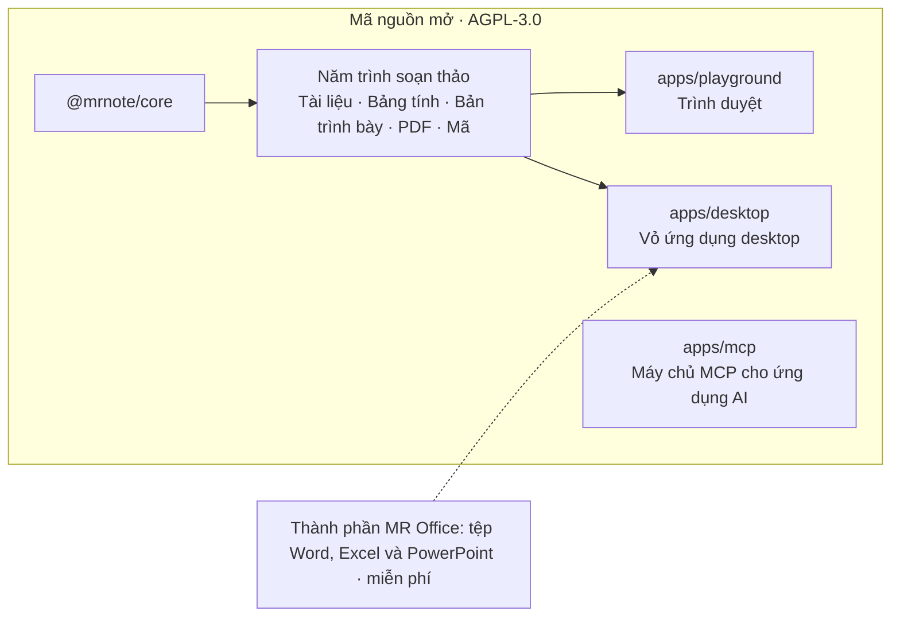

# MR Office — Tiếng Việt

<p align="center"><sub>🌐 <a href="../README.md">English</a> · <a href="../i18n/README.en-GB.md">English (UK)</a> · <a href="../i18n/README.zh.md">简体中文</a> · <a href="../i18n/README.zh-TW.md">繁體中文</a> · <a href="../i18n/README.ja.md">日本語</a> · <a href="../i18n/README.ko.md">한국어</a> · <a href="../i18n/README.de.md">Deutsch</a> · <a href="../i18n/README.fr.md">Français</a> · <a href="../i18n/README.es.md">Español</a> · <a href="../i18n/README.es-419.md">Español (Latinoamérica)</a> · <a href="../i18n/README.pt-BR.md">Português (Brasil)</a> · <a href="../i18n/README.it.md">Italiano</a> · <a href="../i18n/README.nl.md">Nederlands</a> · <a href="../i18n/README.sv.md">Svenska</a> · <a href="../i18n/README.da.md">Dansk</a> · <a href="../i18n/README.no.md">Norsk</a> · <a href="../i18n/README.fi.md">Suomi</a> · <a href="../i18n/README.id.md">Bahasa Indonesia</a> · <a href="../i18n/README.th.md">ไทย</a> · <a href="../i18n/README.vi.md">Tiếng Việt</a></sub></p>

<p align="center"><b>Các trình soạn thảo mã nguồn mở của MR Office, bộ ứng dụng văn phòng AI gần gũi nhất với Microsoft Office: văn bản, bảng tính, bài trình chiếu, PDF và mã trong trình duyệt, cùng một AI chỉnh sửa trực tiếp các tệp Word, Excel và PowerPoint cùng bạn.</b></p>

<p align="center"><a href="https://mroffice.ai/vi"><b>▶ Dùng thử trực tuyến</b></a> · <a href="https://mroffice.ai/vi/office/download"><b>⬇ Tải xuống</b></a> · <a href="https://mroffice.ai">🌐 mroffice.ai</a><br><a href="https://mroffice.ai/vi/developers">🧑‍💻 Nhà phát triển</a> · <a href="https://mroffice.ai/vi/developers/embed">🧩 Nhúng</a> · <a href="https://mroffice.ai/vi/developers/mcp">🤖 MCP cho ứng dụng AI</a> · <a href="https://www.npmjs.com/package/mroffice-embed">📦 SDK npm</a> · <a href="https://mroffice.ai/vi/developers/oauth">🔑 Đăng nhập bằng MR Office</a></p>

<p align="center"><a href="../LICENSE"></a> <a href="https://github.com/XinaTian/MROffice/releases"></a> <a href="https://github.com/XinaTian/MROffice/actions/workflows/ci.yml"></a> <a href="https://github.com/XinaTian/MROffice/stargazers"></a></p>

<p align="center"><a href="https://mroffice.ai/vi"></a></p>

<p align="center"><a href="https://demo.mroffice.ai/media/mr-office-demo.mp4">🔊 Xem video giới thiệu 50 giây có âm thanh</a></p>

<table>
<tr>
<td align="center" width="50%"><a href="https://mroffice.ai/vi"></a><br><b>Tài liệu</b></td>
<td align="center" width="50%"><a href="https://mroffice.ai/vi"></a><br><b>Bảng tính</b></td>
</tr>
<tr>
<td align="center" width="50%"><a href="https://mroffice.ai/vi"></a><br><b>Bản trình bày</b></td>
<td align="center" width="50%"><a href="https://mroffice.ai/vi"></a><br><b>PDF</b></td>
</tr>
<tr>
<td align="center" width="50%"><a href="https://mroffice.ai/vi"></a><br><b>Mã</b></td>
</tr>
</table>

MR Office là bộ ứng dụng văn phòng AI dành cho tệp thật: Word, Excel, PowerPoint và PDF, trên web và trong ứng dụng desktop miễn phí, với AI bên cạnh mọi tài liệu và khả năng đồng chỉnh sửa trực tiếp. Kho lưu trữ này công bố mã nguồn của các trình soạn thảo: chính những trình soạn thảo mà MR Office đang vận hành, để bạn có thể tự build, chạy và nhúng vào hệ thống của mình.

## Miễn phí cho cá nhân và nhóm nhỏ

- **MR Office trực tuyến và ứng dụng máy tính** — miễn phí: chỉnh sửa Word, Excel, PowerPoint và PDF thực thụ, đồng chỉnh sửa trực tiếp và chia sẻ, trên web, trên điện thoại và ngoại tuyến trên máy tính của bạn. AI đi kèm hạn mức miễn phí hàng ngày; dùng AI nhiều hơn là gói trả phí tùy chọn.
- **Nhúng vào ứng dụng của riêng bạn** — miễn phí để bắt đầu, với mọi thứ được bao gồm: toàn bộ công cụ công thức, tệp Office thực thụ, đồng chỉnh sửa, mọi định dạng xuất và API tự động hóa (1.000 phiên mỗi tháng trên localhost, 100 trên tên miền của bạn, tối đa 2 ứng dụng, không cần thẻ).
- **Doanh nghiệp sử dụng nhiều hơn** — trả theo mức dùng trên dịch vụ được lưu trữ hoàn toàn: Starter với US$29 mỗi tháng cho 5.000 phiên, Pro với US$149 mỗi tháng cho 40.000 phiên, white-label và hỗ trợ ưu tiên. Không giấy phép hàng năm, không máy chủ phải vận hành, không bản nâng cấp phải quản lý: cập nhật, mở rộng và sao lưu là việc của chúng tôi.

Để so sánh, ONLYOFFICE Docs Developer Edition được niêm yết từ khoảng US$6.000 mỗi năm cho 250 kết nối đồng thời trên máy chủ bạn tự vận hành (giá niêm yết của nhà phân phối, tháng 11 năm 2026); giá của Univer Pro không được công bố. [Giá và giới hạn →](https://mroffice.ai/vi/developers/pricing)

## AI làm việc ngay trong tệp của bạn

Trong MR Office, AI làm việc trên chính tài liệu, không phải trên đoạn văn bản dán vào khung chat. Nó đọc tệp, thực hiện thay đổi trên các đối tượng gốc của tệp và cho bạn xem những gì đã tác động trước khi bạn giữ lại.

- **Copilot trong mọi trình soạn thảo** — văn bản, bảng tính, bài trình chiếu, PDF và mã. Chọn hoặc khoanh vùng nội dung bạn muốn và nói điều bạn cần: nó chỉnh sửa đoạn văn, bảng, ô và công thức, hình khối và slide ngay tại chỗ, hỏi lại khi yêu cầu chưa rõ, xem trước thay đổi trước khi áp dụng, và mọi thay đổi đều có thể hoàn tác.
- **Thay đổi có kiểm duyệt** — những gì AI đề xuất chỉ được áp dụng khi bạn xác nhận; nếu tệp đã thay đổi trong lúc đó, đề xuất sẽ bị hủy và không có nội dung nào bạn viết bị ghi đè.
- **Cửa sổ AI hiểu không gian làm việc của bạn** — hỏi về tệp, ghi chú và canvas của bạn và nhận câu trả lời có trích dẫn nguồn; nó soạn tài liệu, bảng tính và bài trình chiếu mới, và dựng một công cụ nhỏ trên canvas khi bạn cần.
- **Bộ nhớ** — một đồ thị bộ nhớ lưu giữ những người, dự án và quyết định quan trọng, để AI không phải bắt đầu lại từ đầu trong mỗi cuộc trò chuyện.
- **Các mô hình hàng đầu** — chọn mô hình cho từng cuộc trò chuyện trong số các mô hình AI hàng đầu hiện nay; tệp của bạn ở lại trong không gian làm việc, hoặc trên chính máy bạn với ứng dụng desktop.

**[Dùng thử AI trong MR Office, miễn phí →](https://mroffice.ai/vi)**

### Để AI agent của bạn chỉnh sửa tệp Office (MCP)

Claude, ChatGPT, Cursor, Codex, VS Code và bất kỳ MCP client nào khác đều có thể tạo, mở, chỉnh sửa, đọc lại, hiển thị và xuất tài liệu cùng bảng tính thông qua MCP server của MR Office (`create_document`, `open_document`, `update_document`, `get_document`, `render_page`, `export_document` sang docx, xlsx, pptx, pdf, md, html hoặc csv). Trong các ứng dụng hỗ trợ MCP Apps, trình soạn thảo hiện ngay trong cuộc trò chuyện; ở nơi khác, các công cụ trả về liên kết tới cùng trình soạn thảo đó kèm hình ảnh của trang. Bạn và AI cùng chỉnh sửa một tài liệu: trợ lý đọc lại các thay đổi của bạn trước khi tiếp tục, và một cập nhật dựa trên những chỉnh sửa nó chưa thấy sẽ bị từ chối thay vì bị mất.

```bash
# Claude Code
claude mcp add mroffice -- npx -y mroffice-mcp
# Codex
codex mcp add mroffice -- npx -y mroffice-mcp
```

Claude Desktop, Cursor và các ứng dụng khác nhận cấu hình JSON:

```json
{ "mcpServers": { "mroffice": { "command": "npx", "args": ["-y", "mroffice-mcp"] } } }
```

Không cần cài đặt: kết nối tới endpoint được lưu trữ `https://mcp.mroffice.ai/mcp` và đăng nhập bằng tài khoản MR Office của bạn. Tệp Word, Excel và PowerPoint được xử lý qua Office engine của MR Office dưới chính tài khoản của bạn; mã nguồn của MCP server nằm trong `apps/mcp`. [Hướng dẫn MCP →](https://mroffice.ai/vi/developers/mcp)

## Dành cho nhà phát triển

Mọi thứ cho nhà phát triển có tại **[MR Office Developers](https://mroffice.ai/vi/developers)** — tự phục vụ, không cần đăng ký: đăng nhập bằng bất kỳ tài khoản MR Office nào và bắt đầu.

### Nhúng trình soạn thảo vào ứng dụng web của bạn (khuyên dùng)

MR Office lưu trữ các trình soạn thảo; máy chủ của bạn ký một session token ngắn hạn và trang của bạn mở trình soạn thảo. Trình soạn thảo chỉnh sửa tệp Word, Excel, PowerPoint và PDF thật (.docx, .xlsx, .pptx, .pdf), với đầy đủ công cụ tính công thức, đồng chỉnh sửa, tải lên, mọi định dạng xuất, in, API tự động hóa (document object model, macro, plugin) và lưu được gửi lại máy chủ của bạn qua callback có ký. Tất cả đều nằm trong gói Free: 1.000 phiên mỗi tháng trên localhost, 100 trên tên miền của bạn, tối đa 2 ứng dụng, không cần thẻ. Là dịch vụ được lưu trữ, nó không đặt nghĩa vụ AGPL nào lên ứng dụng của bạn.

1. Trong thư mục dự án, chạy `npx mroffice-embed init` (hoặc tạo ứng dụng trong bảng điều khiển nhà phát triển): bấm "Cho phép" một lần trong trình duyệt, khóa của ứng dụng sẽ được ghi vào `.env.local` / `.env`.
2. Máy chủ của bạn tạo token phiên bằng `createSessionToken` từ `mroffice-embed/server`; khóa bí mật không bao giờ rời máy chủ.
3. Trang của bạn mở trình soạn thảo bằng `open()` từ `mroffice-embed` (hoặc tập lệnh `https://mroffice.ai/embed/v1/embed.js`).

```js
// server: GET /api/mroffice/session (check who is signed in first)
import { createSessionToken } from "mroffice-embed/server";
const token = await createSessionToken({
  appId: process.env.MROFFICE_APP_ID,
  secretKey: process.env.MROFFICE_SECRET_KEY, // mro_sk_..., server only
  file: { key: "contract-42", name: "contract.docx", url: signedUrlToTheFile },
  user: { id: user.id, name: user.name },
  mode: "edit",
});

// page
import { open } from "mroffice-embed";
open({ container: "#editor", token: () => fetch("/api/mroffice/session").then((r) => r.json()).then((b) => b.token) });
```

[Hướng dẫn nhúng](https://mroffice.ai/vi/developers/embed) · [Hướng dẫn dạng Markdown (cho tác tử AI)](https://mroffice.ai/developers/embed.md) · [Giá và giới hạn](https://mroffice.ai/vi/developers/pricing) · [Bảng điều khiển nhà phát triển](https://mroffice.ai/vi/developers/console) · [Bản demo trực tiếp](https://mroffice.ai/vi/developers/embed/demo)

### Ứng dụng AI: máy chủ MCP

MCP server ở trên cũng là cách để các tính năng AI của riêng bạn có thể mở, đọc, chỉnh sửa và xuất tài liệu trong trình soạn thảo MR Office thật: endpoint được lưu trữ `https://mcp.mroffice.ai/mcp` (đăng nhập OAuth, không cần key) hoặc `npx -y mroffice-mcp` trên chính máy bạn. [Hướng dẫn MCP →](https://mroffice.ai/vi/developers/mcp)

### Đăng nhập bằng MR Office (OAuth)

MR Office là máy chủ ủy quyền OAuth 2.1 (PKCE, tài liệu siêu dữ liệu client ID, đăng ký động): ứng dụng của bạn có thể cho người dùng đăng nhập bằng tài khoản MR Office và hành động trong phạm vi họ cho phép. [Hướng dẫn OAuth →](https://mroffice.ai/vi/developers/oauth)

### Tự lưu trữ các trình soạn thảo mã nguồn mở

Năm trình soạn thảo trong kho lưu trữ này có thể được tích hợp vào sản phẩm của riêng bạn theo AGPL-3.0: nếu mọi người sử dụng phiên bản đã sửa đổi qua mạng, bạn phải cung cấp cho họ mã nguồn đầy đủ của nó và giữ ghi công "MR Office" (NOTICE.md). Chúng mở các định dạng riêng, CSV, HTML, Markdown và PDF; tệp Word, Excel và PowerPoint đi kèm với bản nhúng được lưu trữ ở trên, bao gồm gói Miễn phí. Giấy phép thương mại có sẵn từ support@mr-note.com. [Hướng dẫn mã nguồn mở →](https://mroffice.ai/vi/developers/open-source)

Các trình soạn thảo có trên npm dưới dạng thành phần React: `npm i mroffice-docs mroffice-core` (và `mroffice-sheets`, `mroffice-slides`, `mroffice-pdf`, `mroffice-code`); README của mỗi gói hướng dẫn cách nhúng nó.

## Các trình soạn thảo

Những gì mỗi trình soạn thảo làm được trong kho này:

- **Tài liệu** — một trình xử lý văn bản có phân trang: phông chữ, định dạng đoạn văn, danh sách và kiểu trên Home; trang bìa và trang trống, ngắt trang, bảng, hình ảnh, hình dạng, SmartArt, biểu đồ, liên kết, dấu trang, nhận xét, đầu trang, chân trang và số trang, phương trình, ký hiệu, hộp văn bản và WordArt trên Insert. Lưu định dạng riêng (.mrdoc); mở HTML, Markdown và văn bản thuần.
- **Bảng tính** — ô và công thức với phông chữ, căn chỉnh, định dạng số, định dạng có điều kiện, kiểu ô và chèn hoặc xóa ô trên Home; bảng, hình ảnh, hình dạng, biểu tượng, hộp kiểm, biểu đồ và sparkline trên Insert; nhiều trang tính, với tổng và trung bình của vùng chọn. Số học giữa các ô (=A1*B1+10) được tính trực tiếp trong trình duyệt khi bạn nhập, và mọi công thức trong tệp được giữ nguyên; công cụ công thức đầy đủ (SUM, IF, VLOOKUP và hàng trăm hàm khác) chạy miễn phí trong ứng dụng MR Office trên máy tính để bàn và trong gói Miễn phí của bản nhúng được lưu trữ. Lưu định dạng riêng (.mrsheet); mở và lưu CSV và TSV.
- **Bản trình bày** — trang chiếu với bố cục và phần, văn bản, phông chữ và đoạn văn, và hình dạng với cách sắp xếp của chúng trên Home; bảng, hình ảnh, biểu tượng, SmartArt, biểu đồ, hộp văn bản, WordArt, đầu trang và chân trang, phương trình, ký hiệu và video trên Insert; ghi chú diễn giả, nhận xét và trình chiếu. Lưu định dạng riêng (.mrslides).
- **PDF** — đọc, trình bày và in tệp PDF: chế độ xem một trang và hai trang, cuộn liên tục, xoay, hình thu nhỏ và chế độ đọc, tìm kiếm và sao chép văn bản, và nhận xét; chỉnh sửa văn bản của PDF và lưu lại vào tệp là miễn phí trong ứng dụng MR Office trên máy tính để bàn và bản nhúng được lưu trữ.
- **Mã** — trình soạn thảo mã nhanh với tô sáng cú pháp cho nhiều ngôn ngữ, dàn ý, tìm kiếm, mở nhanh, trình duyệt tệp và danh sách vấn đề.

Công thức với các hàm (SUM, IF, VLOOKUP và hàng trăm hàm khác), tệp Word, Excel và PowerPoint, biểu đồ, SmartArt và API tự động hóa được sử dụng miễn phí: trong ứng dụng MR Office miễn phí trên máy tính để bàn và trong ứng dụng của riêng bạn thông qua gói Miễn phí của bản nhúng được lưu trữ. Tệp giữ nguyên mọi công thức, biểu đồ và SmartArt trong các trình soạn thảo mã nguồn mở.

## Chạy các trình soạn thảo

**▶ [Dùng thử bản demo trực tuyến — không cần cài đặt](https://mroffice.ai/vi)**

Năm trình soạn thảo nằm trong `packages/` (`@mrnote/docs`, `sheets`, `slides`, `pdf`, `code`, dùng chung `@mrnote/core`) và chạy cùng nhau trong `apps/playground`:

```bash
npm install
npm run fonts     # the open substitutes for Office's fonts
npm run build
npm run preview   # http://localhost:5178
```

`npm run dev` khởi động máy chủ phát triển tại cùng địa chỉ, và `npm run smoke` kiểm tra một bản dựng. README của mỗi gói mô tả chi tiết gói làm được gì và cách nhúng.

## Ứng dụng máy tính

[`apps/desktop`](../apps/desktop) chứa **MR Office Editors**: mã nguồn của vỏ ứng dụng MR Office trên máy tính (Electron), dưới một danh tính riêng. Với thành phần MR Office miễn phí từ Releases, nó là ứng dụng MR Office trên máy tính, với các tệp Word, Excel, PowerPoint và PDF, đăng nhập và AI. Không có thành phần này, nó chạy các trình soạn thảo mã nguồn mở một mình, mở các tệp .mrdoc, .mrsheet và .mrslides, CSV, HTML, Markdown và PDF. Vỏ và các trình soạn thảo là mã nguồn AGPL; thành phần là bản tải xuống miễn phí từ Releases. Sau `npm run build`, khởi động nó với:

```bash
npm run desktop
```

## Để dùng đầy đủ tính năng, hãy cài ứng dụng máy tính MR Office (miễn phí)

Ứng dụng MR Office trên máy tính để bàn miễn phí, có các trình soạn thảo này và dịch vụ đầy đủ, và hoạt động ngoại tuyến trên máy tính của riêng bạn. Nó cũng mang lại:

- Mở và lưu tệp Word, Excel và PowerPoint (.docx, .xlsx, .pptx)
- Các công thức với hàm (SUM, IF, VLOOKUP …), được tính bởi công cụ tính công thức đầy đủ
- Biểu đồ được tính toán và vẽ từ dữ liệu của bạn
- Chỉnh sửa SmartArt
- Ghi các chỉnh sửa PDF trở lại tệp
- API tự động hóa: document object model, macro và plugin

**[Tải MR Office (miễn phí) →](https://mroffice.ai/vi/office/download)**

## Các phần kết hợp với nhau thế nào



## Giấy phép

Mã nguồn mở theo GNU Affero General Public License v3.0 (LICENSE), kèm các điều khoản bổ sung trong NOTICE.md: giữ ghi công "MR Office" và liên kết đến https://mroffice.ai, và không cấp quyền đối với tên hay biểu trưng MR Office. Giấy phép thương mại có tại support@mr-note.com. Phần mềm và dữ liệu của bên thứ ba được liệt kê trong THIRD_PARTY_NOTICES.md. Đóng góp: xem CONTRIBUTING.md.

## Thêm

Trang web và sản phẩm đầy đủ: **https://mroffice.ai** · Câu hỏi và góp ý: support@mr-note.com

<p align="center">Nếu MR Office hữu ích với bạn, một ⭐ trên GitHub sẽ giúp người khác tìm thấy nó.</p>
