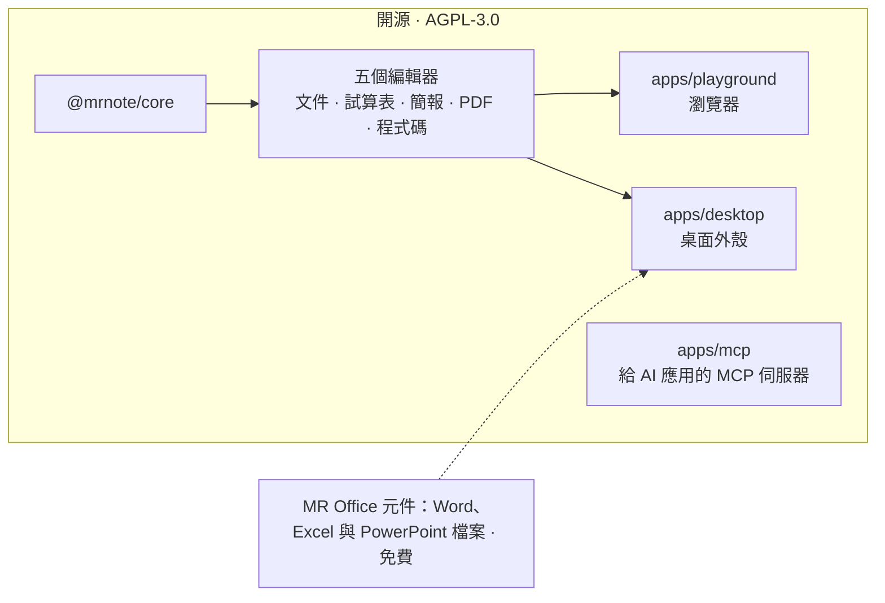

# MR Office — 繁體中文

<p align="center"><sub>🌐 <a href="../README.md">English</a> · <a href="../i18n/README.en-GB.md">English (UK)</a> · <a href="../i18n/README.zh.md">简体中文</a> · <a href="../i18n/README.zh-TW.md">繁體中文</a> · <a href="../i18n/README.ja.md">日本語</a> · <a href="../i18n/README.ko.md">한국어</a> · <a href="../i18n/README.de.md">Deutsch</a> · <a href="../i18n/README.fr.md">Français</a> · <a href="../i18n/README.es.md">Español</a> · <a href="../i18n/README.es-419.md">Español (Latinoamérica)</a> · <a href="../i18n/README.pt-BR.md">Português (Brasil)</a> · <a href="../i18n/README.it.md">Italiano</a> · <a href="../i18n/README.nl.md">Nederlands</a> · <a href="../i18n/README.sv.md">Svenska</a> · <a href="../i18n/README.da.md">Dansk</a> · <a href="../i18n/README.no.md">Norsk</a> · <a href="../i18n/README.fi.md">Suomi</a> · <a href="../i18n/README.id.md">Bahasa Indonesia</a> · <a href="../i18n/README.th.md">ไทย</a> · <a href="../i18n/README.vi.md">Tiếng Việt</a></sub></p>

<p align="center"><b>MR Office 的開源編輯器，最貼近 Microsoft Office 的 AI 辦公套件：在瀏覽器中處理文件、試算表、簡報、PDF 與程式碼，並由 AI 與你一同編輯真正的 Word、Excel 和 PowerPoint 檔案。</b></p>

<p align="center"><a href="https://mroffice.ai/zh-TW"><b>▶ 線上試用</b></a> · <a href="https://mroffice.ai/zh-TW/office/download"><b>⬇ 下載</b></a> · <a href="https://mroffice.ai">🌐 mroffice.ai</a><br><a href="https://mroffice.ai/zh-TW/developers">🧑‍💻 開發人員</a> · <a href="https://mroffice.ai/zh-TW/developers/embed">🧩 嵌入</a> · <a href="https://mroffice.ai/zh-TW/developers/mcp">🤖 AI 應用程式的 MCP</a> · <a href="https://www.npmjs.com/package/mroffice-embed">📦 npm SDK</a> · <a href="https://mroffice.ai/zh-TW/developers/oauth">🔑 使用 MR Office 登入</a></p>

<p align="center"><a href="../LICENSE"></a> <a href="https://github.com/XinaTian/MROffice/releases"></a> <a href="https://github.com/XinaTian/MROffice/actions/workflows/ci.yml"></a> <a href="https://github.com/XinaTian/MROffice/stargazers"></a></p>

<p align="center"><a href="https://mroffice.ai/zh-TW"></a></p>

<p align="center"><a href="https://demo.mroffice.ai/media/mr-office-demo.mp4">🔊 觀看 50 秒介紹影片（有聲）</a></p>

<table>
<tr>
<td align="center" width="50%"><a href="https://mroffice.ai/zh-TW"></a><br><b>文件</b></td>
<td align="center" width="50%"><a href="https://mroffice.ai/zh-TW"></a><br><b>試算表</b></td>
</tr>
<tr>
<td align="center" width="50%"><a href="https://mroffice.ai/zh-TW"></a><br><b>簡報</b></td>
<td align="center" width="50%"><a href="https://mroffice.ai/zh-TW"></a><br><b>PDF</b></td>
</tr>
<tr>
<td align="center" width="50%"><a href="https://mroffice.ai/zh-TW"></a><br><b>程式碼</b></td>
</tr>
</table>

MR Office 是專為真實檔案打造的 AI 辦公套件：Word、Excel、PowerPoint 與 PDF，可在網頁上及免費桌面應用程式中使用，每份文件旁都有 AI 相伴，並支援即時協同編輯。此儲存庫發佈其編輯器的原始碼：這些正是 MR Office 所運行的編輯器，你可以自行建置、運行並嵌入。

## 個人與小型團隊免費使用

- **MR Office 線上版與桌面應用程式** — 免費：真正的 Word、Excel、PowerPoint 與 PDF 編輯功能，支援即時共同編輯與分享，可在網頁、手機上使用，也能在電腦上離線操作。AI 提供每日免費額度；若需更大量使用 AI，可選購付費方案。
- **可嵌入自有應用程式的版本** — 免費起步，功能全數包含：完整的公式引擎、真實的 Office 檔案、共同編輯、所有匯出格式與自動化 API（本機環境每月 1,000 個工作階段，自有網域每月 100 個，最多 2 個應用程式，無需綁定信用卡）。
- **用量較大的企業** — 採用全代管服務，依用量付費：Starter 每月 US$29，含 5,000 個工作階段；Pro 每月 US$149，含 40,000 個工作階段，並提供白標與優先支援。無需年度授權、不必自行架設伺服器、也不用管理升級：更新、擴充與備份皆由我們負責。

相較之下，ONLYOFFICE Docs Developer Edition 的經銷商牌價約為每年 US$6,000，供自行架設的伺服器上 250 個同時連線使用（2026 年 11 月）；Univer Pro 的價格則未公開。 [價格與限制 →](https://mroffice.ai/zh-TW/developers/pricing)

## 在你的檔案內運作的 AI

在 MR Office 中，AI 直接作用於文件本身，而非貼到聊天中的文字。它會讀取檔案，在檔案自身的物件中進行變更，並在你保留變更前展示它觸及了哪些內容。

- **每個編輯器中的 Copilot** — 文件、試算表、簡報、PDF 與程式碼。選取或圈出你的目標並說出需求：它會就地編輯段落、表格、儲存格與公式、圖形與投影片，在請求不明確時提問，在變更生效前預覽，且每項變更皆可復原。
- **由你審閱的變更** — AI 提出的變更僅在你確認後才會套用；若檔案在此期間已變更，該提案即失效，你撰寫的內容不會被覆寫。
- **了解你工作區的 AI 視窗** — 詢問你的檔案、筆記與畫布並獲得附來源的答案；它會起草新文件、試算表與簡報，並在需要時於畫布上建構小型工具。
- **記憶** — 記憶圖譜會保留重要的人物、專案與決策，讓 AI 不必在每次對話中從零開始。
- **領先的模型** — 為每次對話從當今領先的 AI 模型中選擇；你的檔案保留在工作區中，或透過桌面應用程式留在你自己的電腦上。

**[免費試用 MR Office 中的 AI →](https://mroffice.ai/zh-TW)**

### 讓你的 AI 代理編輯 Office 檔案 (MCP)

Claude、ChatGPT、Cursor、Codex、VS Code 及任何其他 MCP 用戶端，皆可透過 MR Office 的 MCP 伺服器建立、開啟、編輯、讀回、描繪及匯出文件與試算表（`create_document`、`open_document`、`update_document`、`get_document`、`render_page`、`export_document` 可匯出為 docx、xlsx、pptx、pdf、md、html 或 csv）。在支援 MCP Apps 的應用程式中，編輯器會直接顯示於對話中；在其他地方，工具會以相同編輯器的連結及頁面圖像回應。你與 AI 編輯同一份文件：助理會先讀回你的編輯再繼續，而基於它未見過的編輯所做的更新會被拒絕而非遺失。

```bash
# Claude Code
claude mcp add mroffice -- npx -y mroffice-mcp
# Codex
codex mcp add mroffice -- npx -y mroffice-mcp
```

Claude Desktop、Cursor 及其他接受 JSON 設定的應用程式：

```json
{ "mcpServers": { "mroffice": { "command": "npx", "args": ["-y", "mroffice-mcp"] } } }
```

無需安裝：連接託管端點 `https://mcp.mroffice.ai/mcp` 並以你的 MR Office 帳戶登入。Word、Excel 與 PowerPoint 檔案會以你自己的帳戶身分透過 MR Office 的 Office 引擎處理；MCP 伺服器的原始碼位於 `apps/mcp`。 [MCP 指南 →](https://mroffice.ai/zh-TW/developers/mcp)

## 開發人員

開發人員需要的一切都在 **[MR Office Developers](https://mroffice.ai/zh-TW/developers)**——自助開通，無需申請：用任何 MR Office 帳號登入即可開始。

### 把編輯器嵌入你的網頁應用程式（建議）

MR Office 託管編輯器；您的伺服器簽發短效期工作階段權杖，您的頁面即可開啟編輯器。它能編輯真正的 Word、Excel、PowerPoint 和 PDF 檔案（.docx、.xlsx、.pptx、.pdf），具備完整的公式引擎、共同編輯、上傳、所有匯出格式、列印、自動化 API（文件物件模型、巨集、外掛），並透過簽署回呼將儲存結果傳回您的伺服器。這些全都包含在免費方案中：localhost 上每月 1,000 個工作階段、您自己的網域上 100 個、最多 2 個應用程式，無需信用卡。作為託管服務，它不會對您自己的應用程式施加任何 AGPL 義務。

1. 在你的專案資料夾執行 `npx mroffice-embed init`（或在開發人員主控台建立應用程式）：在瀏覽器按一次「允許」，應用程式的金鑰就會寫入 `.env.local` / `.env`。
2. 你的伺服器用 `mroffice-embed/server` 的 `createSessionToken` 簽發工作階段權杖；秘密金鑰只留在伺服器上。
3. 你的網頁用 `mroffice-embed` 的 `open()` 開啟編輯器（或用指令碼 `https://mroffice.ai/embed/v1/embed.js`）。

```js
// server: GET /api/mroffice/session (check who is signed in first)
import { createSessionToken } from "mroffice-embed/server";
const token = await createSessionToken({
  appId: process.env.MROFFICE_APP_ID,
  secretKey: process.env.MROFFICE_SECRET_KEY, // mro_sk_..., server only
  file: { key: "contract-42", name: "contract.docx", url: signedUrlToTheFile },
  user: { id: user.id, name: user.name },
  mode: "edit",
});

// page
import { open } from "mroffice-embed";
open({ container: "#editor", token: () => fetch("/api/mroffice/session").then((r) => r.json()).then((b) => b.token) });
```

[嵌入指南](https://mroffice.ai/zh-TW/developers/embed) · [Markdown 版指南（給 AI 程式設計助理）](https://mroffice.ai/developers/embed.md) · [價格與限制](https://mroffice.ai/zh-TW/developers/pricing) · [開發人員主控台](https://mroffice.ai/zh-TW/developers/console) · [線上展示](https://mroffice.ai/zh-TW/developers/embed/demo)

### AI 應用程式：MCP 伺服器

上述 MCP 伺服器也是你自己的 AI 功能在真實 MR Office 編輯器中開啟、讀取、編輯及匯出文件的方式：託管端點 `https://mcp.mroffice.ai/mcp`（OAuth 登入，無需金鑰）或在你自己的電腦上執行 `npx -y mroffice-mcp`。 [MCP 指南 →](https://mroffice.ai/zh-TW/developers/mcp)

### 使用 MR Office 帳號登入（OAuth）

MR Office 是 OAuth 2.1 授權伺服器（PKCE、用戶端 ID 中繼資料文件、動態註冊）：你的應用程式可以讓使用者用 MR Office 帳號登入，並在其允許的範圍內操作。 [OAuth 指南 →](https://mroffice.ai/zh-TW/developers/oauth)

### 自行架設開放原始碼編輯器

此存儲庫中的五個編輯器可以根據 AGPL-3.0 建置到您自己的產品中：如果人們透過網路使用修改後的版本，您必須向他們提供其完整的原始碼，並保留「MR Office」署名 (NOTICE.md)。它們可以開啟自己的格式、CSV、HTML、Markdown 和 PDF；Word、Excel 和 PowerPoint 檔案則隨上述託管嵌入提供，包括免費方案。可從 support@mr-note.com 取得商業授權。 [開放原始碼指南 →](https://mroffice.ai/zh-TW/developers/open-source)

編輯器以 React 元件形式發佈於 npm：`npm i mroffice-docs mroffice-core`（以及 `mroffice-sheets`、`mroffice-slides`、`mroffice-pdf`、`mroffice-code`）；各套件的 README 說明如何嵌入。

## 編輯器一覽

各編輯器在本儲存庫中能做的事：

- **文件** — 分頁文書處理器：在 [常用] 索引標籤中提供字型、段落格式、清單與樣式；在 [插入] 索引標籤中提供封面與空白頁、分頁符號、表格、圖片、圖案、SmartArt、圖表、連結、書籤、註解、頁首、頁尾與頁碼、方程式、符號、文字方塊與 文字藝術師。儲存自有格式（.mrdoc）；可開啟 HTML、Markdown 與純文字。
- **試算表** — 在 [常用] 索引標籤中，儲存格和公式支援字型、對齊、數字格式、條件化格式、儲存格樣式，以及插入或刪除儲存格；在 [插入] 索引標籤中，則有表格、圖片、圖案、圖示、核取方塊、圖表和走勢圖；還有多個工作表，以及對選取範圍進行加總和平均。儲存格之間的算術運算 (=A1*B1+10) 會在您輸入時於瀏覽器中即時計算，且檔案中的每個公式都會完整保留；完整的公式引擎 (SUM、IF、VLOOKUP 及數百種其他函數) 可在 MR Office 桌面應用程式和託管嵌入的免費方案中免費執行。可儲存其專屬格式 (.mrsheet)；可開啟和儲存 CSV 與 TSV。
- **簡報** — 在 [常用] 索引標籤中提供含版面配置與節的投影片、文字、字型與段落，以及圖案及其排列；在 [插入] 索引標籤中提供表格、圖片、圖示、SmartArt、圖表、文字方塊、文字藝術師、頁首與頁尾、方程式、符號與視訊；支援演講者備忘稿、註解與簡報播放。儲存自有格式（.mrslides）。
- **PDF** — 讀取、簡報和列印 PDF 檔案：單頁和雙頁檢視、連續捲動、旋轉、縮圖和閱讀模式、搜尋和複製其文字，以及註解；在 MR Office 桌面應用程式和託管嵌入中，編輯 PDF 本身的文字並將其儲存回檔案是免費的。
- **程式碼** — 快速的程式碼編輯器，支援多種語言的語法醒目提示、大綱、尋找、快速開啟、檔案總管和問題清單。

具有函數 (SUM、IF、VLOOKUP 及數百種其他函數) 的公式、Word、Excel 和 PowerPoint 檔案、圖表、SmartArt 和自動化 API 均可免費使用：在免費的 MR Office 桌面應用程式中，以及透過託管嵌入的免費方案在您自己的應用程式中。在開源編輯器中，檔案也會完整保留每個公式、圖表和 SmartArt。

## 執行編輯器

**▶ [線上試用，無需安裝](https://mroffice.ai/zh-TW)**

五個編輯器位於 `packages/`（`@mrnote/docs`、`sheets`、`slides`、`pdf`、`code`，共用 `@mrnote/core`），並在 `apps/playground` 中一起執行：

```bash
npm install
npm run fonts     # the open substitutes for Office's fonts
npm run build
npm run preview   # http://localhost:5178
```

`npm run dev` 在同一位址啟動開發伺服器，`npm run smoke` 檢查建置結果。各套件的 README 詳列了它能做的事和嵌入方式。

## 桌面應用程式

[`apps/desktop`](../apps/desktop) 包含 **MR Office Editors**：MR Office 桌面應用程式外殼（Electron）的原始碼，以自有身分發佈。搭配 Releases 中的免費 MR Office 元件，即為 MR Office 桌面應用程式，支援 Word、Excel、PowerPoint 與 PDF 檔案、登入與 AI。若無該元件，則獨立執行開源編輯器，可開啟 .mrdoc、.mrsheet 與 .mrslides 檔案、CSV、HTML、Markdown 與 PDF。外殼與編輯器皆為 AGPL 原始碼；元件可從 Releases 免費下載。執行 `npm run build` 後，以下列指令啟動：

```bash
npm run desktop
```

## 完整功能請安裝 MR Office 桌面版（免費）

MR Office 桌面應用程式是免費的，包含這些編輯器和完整服務，並可在您自己的電腦上離線工作。它還帶來：

- 開啟和儲存 Word、Excel、PowerPoint 檔案（.docx、.xlsx、.pptx）
- 支援函數的公式（SUM、IF、VLOOKUP …），由完整的公式引擎計算
- 根據您的資料計算並繪製的圖表
- SmartArt 編輯
- PDF 編輯後寫回檔案
- 自動化 API：文件物件模型、巨集和外掛

**[下載 MR Office（免費） →](https://mroffice.ai/zh-TW/office/download)**

## 各部分的關係



## 授權條款

依據 GNU Affero 通用公眾授權條款 v3.0（LICENSE）開源，並附加 NOTICE.md 中的條款：保留「MR Office」署名及指向 https://mroffice.ai 的連結，且不授予 MR Office 名稱與標誌的使用權。如需商業授權，請聯絡 support@mr-note.com。第三方軟體與資料見 THIRD_PARTY_NOTICES.md。貢獻程式碼請先閱讀 CONTRIBUTING.md。

## 更多

官網與完整產品：**https://mroffice.ai** · 問題與意見回饋：support@mr-note.com

<p align="center">如果 MR Office 對你有用，在 GitHub 上按個 ⭐，能讓更多人發現它。</p>
