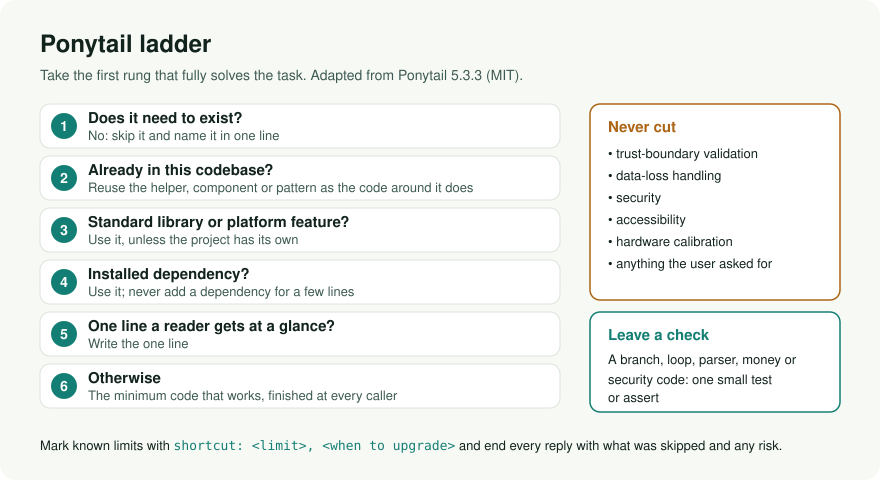

# ponytail

> The best code is the code you never wrote.

The lazy senior developer as an agent skill: the smallest change that fully
solves the task, the never-cut safety list, one small check where logic needs
it, and a reply that names what was skipped. Adapted from
[Ponytail 5.3.3](https://github.com/DietrichGebert/ponytail/tree/7801d061243d7b753bad0e0b3c057cd250b11755)
(MIT, Dietrich Gebert).



## Install

This catalog skill (instruction-only, every skills-compatible agent):

```bash
npx skills add https://github.com/akillness/jeo-skills --skill ponytail
npx skills add https://github.com/akillness/jeo-skills --skill ponytail -g -y   # global
```

The upstream plugin adds lifecycle hooks, persistent levels, subagent injection
and, in Claude Code, the cost/time/tests band:

```bash
bash .agent-skills/ponytail/scripts/install.sh                     # print the install for detected hosts
RUNTIME=codex APPLY=1 bash .agent-skills/ponytail/scripts/install.sh   # run one host's CLI steps
```

Keep one source per host: the upstream skills CLI install
(`npx skills add DietrichGebert/ponytail`) writes the same `ponytail` folder as
this skill. Every host, settings and uninstall:
[references/commands.md](references/commands.md).

## Use

| Command | What it does |
|---|---|
| `/ponytail [lite\|full\|ultra\|off]` | Set the level (default `full`); `ultra` also pushes back on the request. |
| `/ponytail-review` | Quality review of a change: correct, safe, load, tested, fast, lean. |
| `/ponytail-audit` | The same review for the whole repo, ranked, at most 20 findings. |
| `/ponytail-debt` | Ledger of `shortcut:` (and older `ponytail:`) comments. |
| `/ponytail-gain` | Upstream benchmark card: −53% code, −26% cost, −41% time. |
| `/ponytail-help` | Quick reference. |

The rules live in [SKILL.md](SKILL.md); history in [CHANGELOG.md](CHANGELOG.md).
