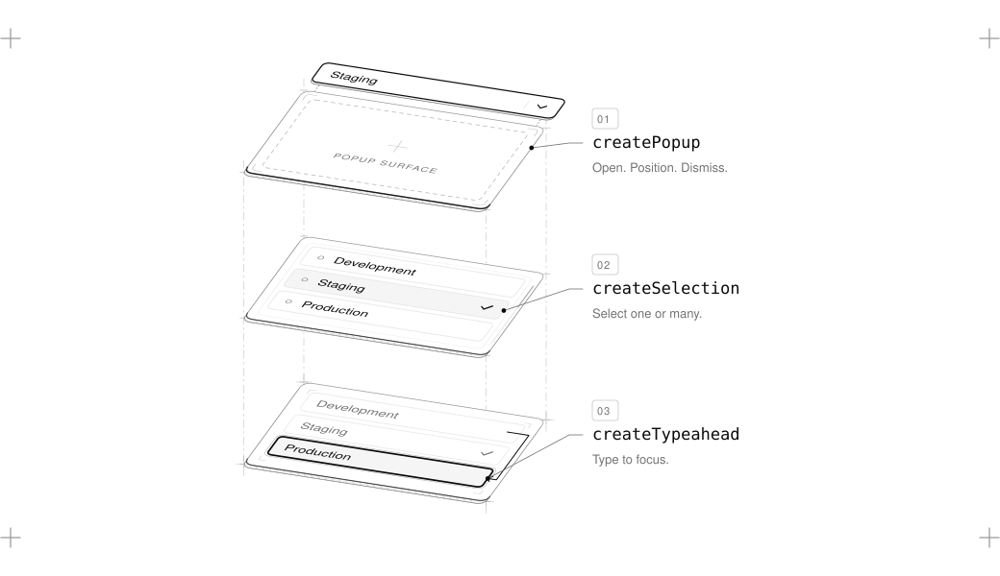

# UI SDK

A library of behaviors for agents to build and drive the next generation of user interfaces.

Keyboard navigation, focus, selection, dismissal, popups, drag and drop and the ARIA they need live in `@ui-sdk/core`, with adapters for React, Vue, Svelte, Solid and Web Components.

<picture>
  <source media="(prefers-color-scheme: dark)" srcset="./assets/behaviors-dark.svg">
  
</picture>

**[Read the docs](https://ui-sdk.dev/docs)**

## Install

UI SDK is in beta. Install core and the adapter for your framework:

```bash
npm install @ui-sdk/react @ui-sdk/core
```

For other frameworks, swap `@ui-sdk/react` for `@ui-sdk/vue`, `@ui-sdk/svelte`, `@ui-sdk/solid` or `@ui-sdk/web`.

Then give your agent the UI SDK skill:

```bash
npx skills@latest add vercel-labs/ui --skill ui-sdk
```

## Example

Every component in UI SDK is built from behaviors. You start by creating the primitive with behaviors.

Don't worry, you don't need to learn how to write this. Your agents will. And we made them really good at it.

```ts
import { createFocusRecovery, definePrimitive } from "@ui-sdk/core"

const searchField = definePrimitive({
  name: "search-field",
  state: () => ({ value: "" }),
  api: (context) => ({
    set: (value: string) => context.store.set({ value }),
    recovery: createFocusRecovery({ fallback: () => context.element("input") }),
  }),
  slots: (slot) => ({
    input: slot({
      attrs: (state) => ({ value: state.value }),
      on: {
        input: (event, { api }) =>
          api.set((event.target as HTMLInputElement).value),
      },
    }),
    clear: slot({
      present: (state) => state.value !== "",
      attrs: () => ({ type: "button" }),
      press: ({ api }) => api.set(""),
      bind: (el, part) => part.api.recovery.bind(el, part),
    }),
  }),
})

export { searchField }
```

Then render it in your framework with `createParts`. The parts are the same in all five.

### React

```tsx
import { createParts } from "@ui-sdk/react/primitive"
import { searchField } from "./search-field"

const parts = createParts(searchField, { input: "input", clear: "button" })

const SearchField = parts.Root
const SearchFieldInput = parts.Input
const SearchFieldClear = parts.Clear

function Search() {
  return (
    <SearchField>
      <SearchFieldInput placeholder="Search" />
      <SearchFieldClear>Clear</SearchFieldClear>
    </SearchField>
  )
}

export { Search }
```

### Vue

```vue
<script setup lang="ts">
import { createParts } from "@ui-sdk/vue/primitive"
import { searchField } from "./search-field"

const parts = createParts(searchField, { input: "input", clear: "button" })

const SearchField = parts.Root
const SearchFieldInput = parts.Input
const SearchFieldClear = parts.Clear
</script>

<template>
  <SearchField>
    <SearchFieldInput placeholder="Search" />
    <SearchFieldClear>Clear</SearchFieldClear>
  </SearchField>
</template>
```

### Svelte

```svelte
<script lang="ts">
  import { createParts } from "@ui-sdk/svelte/primitive"
  import { searchField } from "./search-field"

  const parts = createParts(searchField, { input: "input", clear: "button" })

  const SearchField = parts.Root
  const SearchFieldInput = parts.Input
  const SearchFieldClear = parts.Clear
</script>

<SearchField>
  <SearchFieldInput placeholder="Search" />
  <SearchFieldClear>Clear</SearchFieldClear>
</SearchField>
```

### Solid

```tsx
import { createParts } from "@ui-sdk/solid/primitive"
import { searchField } from "./search-field"

const parts = createParts(searchField, { input: "input", clear: "button" })

const SearchField = parts.Root
const SearchFieldInput = parts.Input
const SearchFieldClear = parts.Clear

function Search() {
  return (
    <SearchField>
      <SearchFieldInput placeholder="Search" />
      <SearchFieldClear>Clear</SearchFieldClear>
    </SearchField>
  )
}

export { Search }
```

### Web Components

Register a custom element for each part:

```ts
import { createParts, wrappedButton, wrappedChild } from "@ui-sdk/web"
import { searchField } from "./search-field"

createParts(searchField, {
  root: "search-field",
  input: { tag: "search-field-input", target: wrappedChild("input") },
  clear: { tag: "search-field-clear", target: wrappedButton },
})
```

Then use them in your HTML:

```html
<search-field>
  <search-field-input><input placeholder="Search" /></search-field-input>
  <search-field-clear><button>Clear</button></search-field-clear>
</search-field>
```

## Contributing

Contributions are welcome. See [CONTRIBUTING.md](CONTRIBUTING.md) to get the repo
running locally and land a change, and use
[issues](https://github.com/vercel-labs/ui/issues) to report bugs. By
participating, you agree to our [Code of Conduct](CODE_OF_CONDUCT.md).

## Security

Please do not open public issues for security vulnerabilities. Instead, follow
[SECURITY.md](SECURITY.md) and report responsibly to
[responsible.disclosure@vercel.com](mailto:responsible.disclosure@vercel.com).

## Beta terms

UI SDK is currently in beta and subject to the [Vercel beta terms](https://vercel.com/docs/release-phases/public-beta-agreement);
the framework, APIs, documentation, and behavior may change before general availability.
