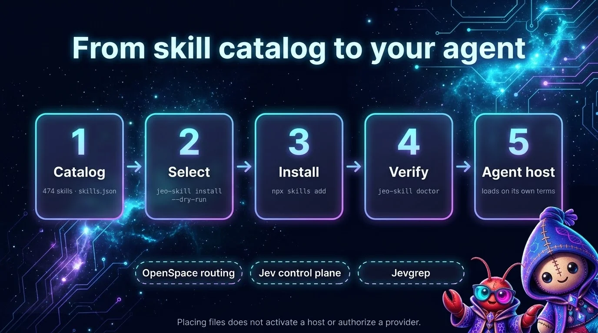
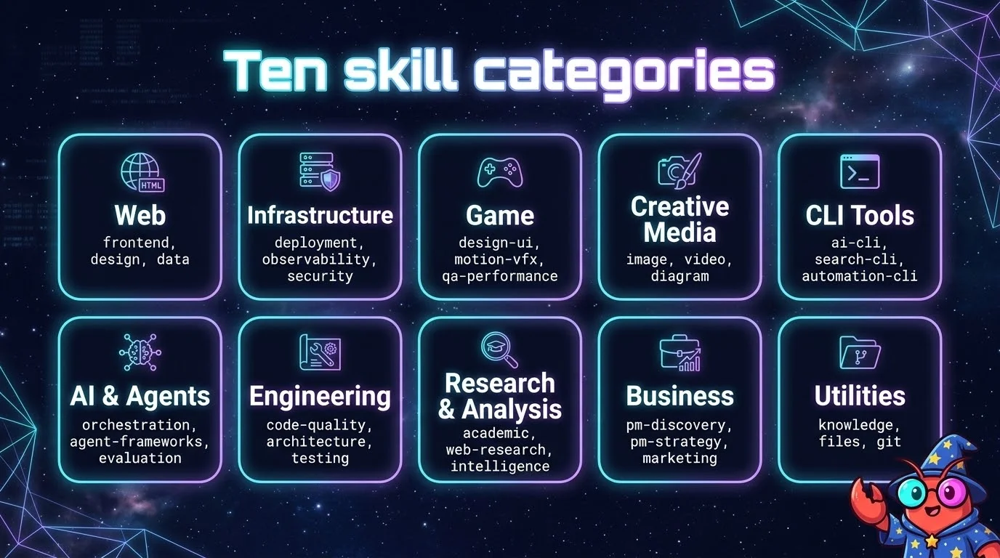
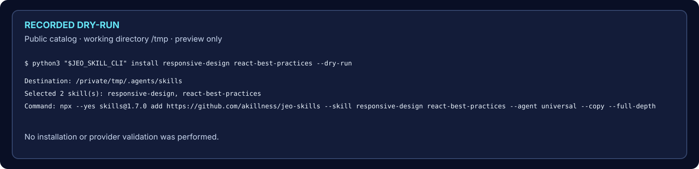
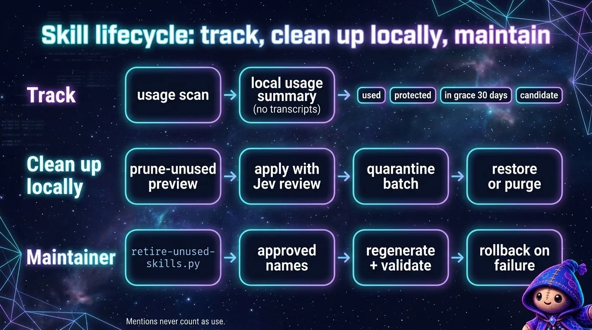

<div align="center">


# jeo-skills

**Una biblioteca de habilidades y una guía de configuración para agentes de distintos proveedores: descubre, elige y prepara lo que necesitas en tu propio entorno.**

[](#-lista-de-habilidades)
[](#-categorías)
[](https://agentskills.io/specification)
[](https://github.com/akillness/jeo-skills/actions/workflows/ci.yml)
[](LICENSE)
[](https://www.buymeacoffee.com/akillness3q)

[Inicio rápido](#-inicio-rápido) · [Cómo funciona](#-cómo-funciona) · [Categorías](#-categorías) · [Instalación](#-opciones-de-instalación) · [Entornos](#-entornos-compatibles) · [CLI](#-cli-del-enrutador) · [Ciclo de vida](#-seguimiento-de-uso-y-limpieza) · [Integraciones](#-integraciones-opcionales) · [Habilidades](#-lista-de-habilidades)

[English](README.md) · [한국어](README.ko.md) · **Español**

</div>

---

## Licencia y atribución

El material creado por el proyecto se distribuye bajo la [licencia MIT](LICENSE). Al distribuir copias o partes sustanciales, conserva los avisos de copyright y permiso. Los componentes de terceros pueden tener otras condiciones; consulta las [fuentes y licencias originales](docs/attribution.md) y sus archivos de licencia y avisos.

## ✨ A primera vista

| Área | Qué ofrece |
|---|---|
| **Catálogo** | Una carpeta por habilidad: `.agent-skills/<name>/SKILL.md`, el formato abierto Agent Skills |
| **Metadatos** | Los datos de categoría, subcategoría, interfaz, paquete y relación viven una sola vez en `.agent-skills/skills.json` |
| **Enrutador** | `jeo-skill` navega, busca y previsualiza selecciones; después instala solo lo que eliges |
| **Entornos** | Una raíz compartida para la mayoría de los agentes, además de raíces nativas para Claude Code, GJC, Antigravity y Aside |
| **Ciclo de vida** | El seguimiento local informa del uso observado; la cuarentena se previsualiza y puede revertirse antes de su purga |
| **Opcional** | OpenSpace, Jev, memoria, contexto y bases de datos tienen configuración y permisos propios; su disponibilidad depende del host |

## 🚀 Inicio rápido

**Opción A: deja que tu agente lo instale.** Pega esto en Claude Code, Codex, `agy` (Antigravity CLI) o cualquier agente de codificación:

```text
Read https://raw.githubusercontent.com/akillness/jeo-skills/main/setup-all-skills-prompt.md in full and follow it to install the jeo-skills.
```

La guía detecta tu sistema operativo y tus agentes. Su modo `full` predeterminado instala todo el catálogo y las siete herramientas CLI fijadas, y prepara la nueva bóveda `second-brain` (`~/vaults/jeo-second-brain`, opt-out con `JEO_SKILLS_SECOND_BRAIN=skip`) junto con la estrella de GitHub (`JEO_SKILLS_STAR=true` por defecto, `false` para omitir) tras confirmar el alcance global; pide «core only» para instalar el paquete `starter` (incluyendo `obsidian-second-brain`) o «minimal» para instalar solo el enrutador. La activación del espacio de trabajo, memoria, contexto, bases de datos y enrutamiento conservan sus opt-outs y requisitos previos, y las bóvedas existentes (como `~/vaults/llm-wiki`) no se modifican. Consulta la [guía completa de configuración](setup-all-skills-prompt.md) para conocer los límites exactos.

**Opción B: instala el enrutador y luego elige las habilidades.**

```bash
curl -fsSL https://raw.githubusercontent.com/akillness/jeo-skills/main/install.sh | bash
jeo-skill doctor                                    # comprueba el catálogo y los prerrequisitos
jeo-skill search "react performance"                # busca habilidades
jeo-skill install react-best-practices --global --dry-run   # previsualiza
jeo-skill install react-best-practices --global --yes      # instala
```

> [!TIP]
> Añade `$HOME/.local/bin` a `PATH` si `jeo-skill` no se encuentra después de la instalación. Al seleccionar `context7` también se instala `ctx7@0.11.1` (Node.js 22.20+, no compatible en Windows) y `install.sh` activa `JEO_SKILLS_STAR=true` de forma predeterminada; consulta [Opciones de instalación](#-opciones-de-instalación) para ver los límites y exclusiones.

## 🧭 Cómo funciona



<details>
<summary>Seguir el camino desde el catálogo hasta el host</summary>

El flujo separa selección, instalación y activación: cada paso tiene su propio alcance y sus permisos.

1. **Catálogo.** Las habilidades permanecen en una estructura plana: `.agent-skills/<name>/SKILL.md`. La taxonomía se centraliza en `.agent-skills/skills.json`, no en carpetas de categorías.
2. **Enrutador.** `jeo-skill` resuelve nombres, paquetes, categorías y subcategorías según `skills.json` y muestra la selección exacta antes de escribir nada.
3. **Instalación.** Las selecciones se delegan a `npx skills@1.7.0 add` y se proyectan en la raíz de cada entorno de destino mediante copia en streaming de memoria acotada (256 KiB) con verificación SHA-256, recorrido iterativo `os.scandir` y omisión de archivos sin cambios en ejecuciones repetidas.
4. **Carga.** Cada host descubre las habilidades desde su propia raíz. La ubicación no es activación: la carga, los permisos, la elección del modelo y la ejecución permanecen bajo el control del host.

</details>

## 🗂 Categorías



Explora una categoría con su comando o despliega la lista generada más abajo.

| Categoría | Enfoque | Explorar |
|---|---|---|
| 🌐 Web | frontend, backend, diseño, API, autenticación, datos, pruebas, gráficos | `jeo-skill list -c web` |
| 🏗 Infraestructura | despliegue, entorno, observabilidad, seguridad, datos en la nube | `jeo-skill list -c infrastructure` |
| 🎮 Juegos | cliente, web, diseño de UI, audio, motion-VFX, QA y lanzamiento | `jeo-skill list -c game` |
| 🎬 Medios creativos | imagen, vídeo, motion, audio, presentación, diagrama | `jeo-skill list -c creative-media` |
| ⌨️ Herramientas CLI | desarrollo, IA, medios, automatización, búsqueda y CLI de benchmarks | `jeo-skill list -c cli-tools` |
| 🤖 IA y agentes | orquestación, frameworks de agentes, evaluación, memoria, planificación | `jeo-skill list -c ai-agents` |
| 🧰 Ingeniería | calidad del código, pruebas, arquitectura, documentación, navegación | `jeo-skill list -c engineering` |
| 🔭 Investigación y análisis | investigación académica y web, análisis de datos, experimentos, inteligencia | `jeo-skill list -c research` |
| 📣 Negocios | marketing, soporte, descubrimiento de producto, estrategia, ejecución, crecimiento | `jeo-skill list -c business` |
| 🔧 Utilidades | conocimiento, archivos, git, espacio de trabajo, gestión de proyectos | `jeo-skill list -c utilities` |

La lista completa y generada está en [Lista de Habilidades](#-lista-de-habilidades).

## 📦 Opciones de instalación

| Objetivo | Cómo |
|---|---|
| Todo, guiado por tu agente | Pega el prompt de configuración de [Inicio rápido](#-inicio-rápido) |
| Solo el enrutador (predeterminado) | la línea única tal cual |
| Enrutador + paquete `starter` | línea única con `JEO_SKILLS_SELECTION=bundle` |
| Instalación completa con herramientas y espacio de trabajo | línea única con `JEO_SKILLS_SELECTION=all`; requiere alcance global para las herramientas compartidas, y el alcance de proyecto devuelve fallo parcial |
| Todo el catálogo sin configuración opcional | `jeo-skill install --all --global --yes` (omite `--setup` y `--with-hooks`; incluye la CLI de Context7 descrita abajo) |
| Solo el proyecto actual | línea única con `INSTALL_GLOBAL=false` |
| Previsualizar sin cambios | línea única con `JEO_SKILLS_DRY_RUN=true` |
| Habilidades específicas | `jeo-skill install <name> [<name> ...] --global --yes` |
| Habilidades específicas con configuración/smoke | `jeo-skill install <name> ... --global --yes --setup` (añade `--with-hooks` solo para pasos de hook compatibles; consulta los límites de cada herramienta en la [guía de instalación](setup-all-skills-prompt.md#step-5--full-mode-shared-tools)) |
| Un paquete o segmento de categoría | `jeo-skill install --bundle <bundle> --global --yes` o `--category <id> [--subcategory <id>]` |
| Cinco programas de GitHub y un informe de preparación | `jeo-skill install --bundle github-five-programs --global --yes --setup`; la línea única con `JEO_SKILLS_SELECTION=bundle JEO_SKILLS_BUNDLE=github-five-programs` imprime el mismo informe. El comando instala las guías de habilidades; solo el informe de preparación es sin conexión y de solo lectura: no instala ni ejecuta los programas originales ni pide aprobación por programa |

Las variables del instalador pertenecen a `bash`, en el lado derecho de la tubería:

```bash
URL=https://raw.githubusercontent.com/akillness/jeo-skills/main/install.sh
curl -fsSL "$URL" | JEO_SKILLS_SELECTION=bundle bash
curl -fsSL "$URL" | JEO_SKILLS_DRY_RUN=true INSTALL_GLOBAL=false bash
```

La previsualización de `install.sh` solo imprime el plan de arranque sin instalar archivos ni herramientas; el soporte del entorno, la selección de cuenta y la del catálogo se validan durante la ejecución. Después de instalar el enrutador, usa `jeo-skill install ... --dry-run` para previsualizar destinos. Una previsualización no verifica el descubrimiento por el host ni la disponibilidad upstream.

<details>
<summary><b>Paquetes</b> — 18 conjuntos iniciales seleccionados</summary>
| Paquete | Habilidades |
|---|---|
| `starter` | jeo-skill, skill-standardization, codebase-search, git-workflow, debugging, testing-strategies, image-to-github-repo, obsidian-second-brain |
| `cli-core` | jeo-skill, rtk, semble, zvec-grep, graphify, scrapling, obsidian-second-brain |
| `web-frontend` | react-best-practices, responsive-design, web-accessibility, design-system, web-design |
| `web-backend` | api-design, authentication-setup, database-schema-design, backend-testing |
| `web-design` | web-design, design-system, responsive-design, web-accessibility |
| `infrastructure-core` | deployment-automation, environment-setup, monitoring-observability, security-best-practices |
| `game-client` | unity-gamedev-skill-pack, game-performance-profiler, awesome-gamedev-agent-skills, donchitos-game-studios |
| `game-web` | web-game-development, threejs-fundamentals, implement-fog-of-war |
| `game-art` | game-vfx, rfxgen, perfectpixel, open-design-game-ui-concept, unirig |
| `media-video` | video-production, video-shotcraft, video-motion-previs, shopping-shorts, filmcraft |
| `skill-authoring` | skill-standardization, write-a-skill, upskill |
| `product-management` | pm-skills, create-prd, user-stories, opportunity-solution-tree, north-star-metric |
| `langchain` | langchain-fundamentals, langgraph-fundamentals, deep-agents-core, langsmith |
| `knowledge-repositories` | 22 operadores de ontología, grafos de código, memoria y recuperación (`jeo-skill install --bundle knowledge-repositories --dry-run`) |
| `ui-design-repositories` | 10 guías de operación de interfaces con fuentes fijadas (`jeo-skill install --bundle ui-design-repositories --dry-run`) |
| `game-source-repositories` | 10 guías de herramientas de desarrollo de juegos con fuentes fijadas (`jeo-skill install --bundle game-source-repositories --dry-run`) |
| `github-five-programs` | fabric, moneyprinter-v2, agent-s, google-maps-scraper, gitingest: cinco operadores de programas de código abierto, cuatro con fuentes fijadas (`jeo-skill install --bundle github-five-programs --dry-run`) |
| `coding-agent-ecosystem` | 19 operadores curados para agentes de código (contexto/memoria, código/navegador, metodologías, orquestación y telemetría: `rtk`, `thedotmack-mem`, `beads`, `context-mode`, `graphify`, `serena`, `context7`, `chrome-devtools-mcp`, `superpowers`, `spec-kit`, `gstack`, `official-agent-skills`, `ruflo`, `orca`, `wshobson-agents`, `happy`, `cc-switch`, `jarrodwatts-hud`, `ccusage`; excluye `oh-my-claudecode`) |

La mayoría de las habilidades operadoras documentan repositorios con fuentes fijadas sin instalar, ejecutar ni conectar los proyectos originales. La instalación de la CLI de Context7 descrita abajo es una excepción; la activación y conexión requieren aprobación separada.

</details>

<details>
<summary><b>Límites bajo demanda</b> — operadores fijados por fuente, Context7 y estrella de GitHub</summary>

| Habilidad / función | Alcance y límite de aprobación | Referencia |
|---|---|---|
| `coding-agent-ecosystem` | 13 nuevas guías fijadas por fuente + 6 habilidades hermanas previas del listado de 20 proyectos (`oh-my-claudecode` excluido); la instalación copia solo guías y `preflight.py` sin conexión — plugins, MCP, demonios y cambios de configuración requieren aprobación separada | [límites de instalación](setup-all-skills-prompt.md#coding-agent-ecosystem-on-demand-19-curated-repositories) · [licencias](docs/attribution.md) |
| `game-source-repositories` | 10 guías de desarrollo de juegos (física, terreno, materiales, VFX, navegación, animación, gráficos, mallas, ruido); no instala ni ejecuta herramientas upstream | [límites de instalación](setup-all-skills-prompt.md#game-development-source-guides-on-demand) · [licencias](docs/attribution.md) |
| [`rete`](.agent-skills/rete/SKILL.md) | Operador fijado por fuente para [`caviri/rete`](https://github.com/caviri/rete) `0.7.8` (archivos RDF de archivo único `.rete`, SPARQL/SHACL, formato `0x08`); `pip`/`npm` `rete-graph` no incluye la CLI nativa `rete`, y `rete serve`, `--fetch-contexts`, cambios CORS en S3/R2 o envío de grafos privados al MCP alojado requieren aprobación/límites explícitos | [guía de instalación](setup-all-skills-prompt.md#rete-single-file-rdf-archive--sparql-operator-on-demand) · [licencias](docs/attribution.md) |
| [`lightpanda`](.agent-skills/lightpanda/SKILL.md) | Guía para Lightpanda 1.0.2 (fetch, CDP, MCP) + diagnóstico local sin conexión; descarga del navegador, acceso a sitios, servidores y credenciales requieren aprobación | [guía de instalación](setup-all-skills-prompt.md#lightpanda-browser-operator-on-demand) |
| [`browser-use`](.agent-skills/browser-use/SKILL.md) | Guía + comprobación previa sin conexión; instalación, acceso a sitios, llamadas cloud/modelo y cuentas requieren decisiones separadas | [guía de instalación](setup-all-skills-prompt.md#browser-use-operator-on-demand) |
| [`flide`](.agent-skills/flide/SKILL.md) | Guía de inferencia de decisiones + comprobación sin conexión; descarga de paquetes/modelos, GPU y arranque de servidores requieren aprobación | [guía de instalación](setup-all-skills-prompt.md#flide-decision-inference-on-demand) |
| [`impeccable`](.agent-skills/impeccable/SKILL.md) | Guía para `pbakaus/impeccable` 4.8.0 (comparte la carpeta `impeccable` — ejecuta doctor sin conexión antes); npm, motor, hook, navegador y modo live requieren aprobación | [guía de instalación](setup-all-skills-prompt.md#impeccable-design-operator-on-demand) |
| [`donchitos-game-studios`](.agent-skills/donchitos-game-studios/SKILL.md) | Operador de plantilla fijado (75 flujos + 3 alias, inspección sin conexión de 12 archivos), no 78 habilidades globales; clonar, `/adopt`, hooks y dependencias requieren aprobación | [investigación](.agent-skills/donchitos-game-studios/references/research.md) · [upstream](.agent-skills/donchitos-game-studios/references/upstream.md) · [guía](setup-all-skills-prompt.md#claude-code-game-studios-on-demand-project-template-not-global-skill-pack) |
| [`revfactory-harness`](.agent-skills/revfactory-harness/SKILL.md) | Operador fijado en [revfactory/harness v2.1.0](https://github.com/revfactory/harness/tree/92d9f1b29e7af81acebf51a9fcd1832e739a1414) (verificación de 18 archivos públicos, `runtime_verified: false`); distinto de `harness2` y del retirado `harness` | [límites de instalación](setup-all-skills-prompt.md#revfactory-harness-team-architecture-factory-on-demand) |
| [`elephant-goldfish-model`](.agent-skills/elephant-goldfish-model/SKILL.md) | Guía el flujo de diseño/revisión de [Google Elephant-Goldfish Model](https://github.com/google/elephant-goldfish-model); no activa el plugin original y la revisión requiere subagentes aislados | [límites de instalación](setup-all-skills-prompt.md#elephant-goldfish-model-on-demand) |

**Context7 CLI (`ctx7@0.11.1`):** Si una selección de `jeo-skill install` incluye `context7`, el enrutador instala `ctx7@0.11.1` con npm (requiere Node.js 22.20+; no compatible en Windows; `--dry-run` no descarga). El destino de proyecto es `.agents/context7` y el global `~/.local/share/jeo-skill/context7` (añade su `node_modules/.bin` a `PATH`; un destino incompleto falla sin sobrescribirse). `npx skills add` directo no realiza esta instalación; el inicio de sesión, registro MCP, cambios de configuración y solicitudes externas requieren aprobación separada.

**Estrella predeterminada en GitHub (`JEO_SKILLS_STAR=true`):** `install.sh` marca con estrella `akillness/jeo-skills` de forma predeterminada usando `gh` autenticado (PUT y GET de verificación; si falla la lectura, informa y continúa). Define `JEO_SKILLS_STAR=false` para omitirla; `JEO_SKILLS_DRY_RUN=true` nunca realiza escrituras en GitHub.

</details>

## 🖥 Entornos compatibles

<details>
<summary>Consultar destinos y raíces por entorno</summary>

`--agent` selecciona el destino de instalación. La tabla recoge las raíces que usa el enrutador y las proyecciones indicadas en la guía de configuración; no demuestra que el host las descubra ni que esté activado. Esta guía usa `agy` para Antigravity CLI y no presenta Gemini CLI como host actual.

| Entorno (ID canónico) | `--agent` / alias | Destino global | Destino del proyecto |
|---|---|---|---|
| Jeo (`jeo`) | `jeo` | `~/.agents/skills` | `.agents/skills` |
| GJC (`gjc`) | `gjc` | `${GJC_CONFIG_DIR:-$HOME/.gjc}/agent/skills` | `.gjc/skills` |
| JeoPi (`jeopi`) | `jeopi` | `~/.agents/skills` | `.agents/skills` |
| Pi (`pi`) | `pi` | `~/.pi/agent/skills` | `.pi/skills` |
| Codex (`codex`) | `codex` | `~/.agents/skills` | `.agents/skills` |
| Claude Code (`claude`) | `claude-code` | `~/.claude/skills` (o `$CLAUDE_CONFIG_DIR/skills`) | `.claude/skills` |
| OMP (`omp`) | `omp` | `~/.agents/skills` | `.agents/skills` |
| Antigravity CLI (`agy`) | `agy` (`antigravity-cli`) | `~/.gemini/antigravity-cli/skills` | `.agents/skills` |
| Kimi Code (`kimi`) | `kimi` (`kimi-code-cli`) | `~/.agents/skills`; adicional `${KIMI_CODE_HOME:-$HOME/.kimi-code}/skills` | `.agents/skills` |
| Grok Build (`grok`) | `grok` | `${GROK_HOME:-$HOME/.grok}/skills` | `.grok/skills` |
| OpenCode (`opencode`) | `opencode` | `~/.agents/skills` | `.agents/skills` |
| Cursor (`cursor`) | `cursor` | `~/.agents/skills` | `.agents/skills` |
| Crush (`crush`) | `crush` | `~/.config/crush/skills` | `.crush/skills` |
| Antigravity IDE (`antigravity`) | `antigravity` | `~/.gemini/config/skills` | `.agents/skills` (destino del enrutador; descubrimiento por el IDE no verificado) |
| Aside (`aside`) | `aside` + `--aside-account <id>` | `~/.aside/u/<id>/skills/user/` | — |

Para GJC, el enrutador también admite `PI_CONFIG_DIR` como alternativa a `GJC_CONFIG_DIR`; descarta valores idénticos a los del `.env` del proyecto y rutas normalizadas con componentes `..`. Kimi utiliza la raíz compartida; la raíz adicional de su CLI no implica una copia adicional. Aside permite cambiar `~/.aside` con `--aside-home` y exige seleccionar una cuenta con `--aside-account` cuando no hay exactamente una cuenta disponible.

`grok` identifica el destino de registro de Grok Build y requiere selección explícita en la guía de setup: `JEO_SKILLS_AGENT=grok` para instalar o `JEV_AGENT=grok` para un único perfil Jev. El setup no lo selecciona automáticamente por `PATH`, porque el ejecutable local puede ser el CLI antiguo de Superagent/VibeKit sin cargador de Agent Skills. El `detect` del controlador solo informa del inventario de binarios, no verifica la implementación. Confírmala por separado; la guía no sustituye ni actualiza ese binario automáticamente.

> [!NOTE]
> Copiar habilidades no inicia sesión ni arranca o recarga un entorno. Recarga el host si una habilidad recién instalada no aparece; la configuración adicional solicitada con `--setup` o el modo completo tiene un alcance distinto.

</details>

## 💻 CLI del enrutador

<details>
<summary>Buscar, instalar y gestionar habilidades con la CLI</summary>

Esta captura muestra una previsualización local real de dos habilidades; no demuestra ninguna instalación ni activación de proveedores.



| Comando | Qué hace |
|---|---|
| `jeo-skill categories` | Categorías y recuentos de subcategorías |
| `jeo-skill list -c <category> [-s <subcategory>]` | Habilidades de un segmento |
| `jeo-skill search "<query>"` | Busca nombres, descripciones y taxonomía |
| `jeo-skill related <name>` | Habilidades superpuestas o secuenciales para considerar juntas |
| `jeo-skill install ... --dry-run` | Previsualiza la selección, los destinos y los comandos sin instalar ni configurar habilidades |
| `jeo-skill doctor` | Comprueba el catálogo, los prerrequisitos de `npx`/Node.js y el enlace de la CLI |
| `jeo-skill readiness [--global] [--json]` | Informe de preparación sin conexión y de solo lectura para fabric, moneyprinter-v2, agent-s, google-maps-scraper y gitingest |
| `jeo-skill usage scan` / `usage report` | Recopila e informa de invocaciones o cargas observadas en los registros locales compatibles |
| `jeo-skill prune-unused` / `restore` / `purge-quarantine` | Previsualiza la cuarentena de candidatas sin uso observado, su restauración o su purga; solo `--apply` modifica los archivos |
| `jeo-skill prune-retired --global --dry-run` | Previsualiza la retirada de copias obsoletas del catálogo, sin eliminarlas |
| `jeo-skill explore "<question>" --root <dir> --dry-run` | Descubrimiento opcional de documentos con Jevgrep |

Define `JEO_SKILLS_CATALOG=/path/to/skills.json` para fijar el catálogo que usa cada comando.

Desde este repositorio, el catálogo local permite previsualizar sin descargarlo. Si no hay un catálogo local, la CLI intenta obtenerlo por red y recurre a la caché si falla; la previsualización no guarda el catálogo descargado. La previsualización de `install.sh` solo imprime el plan de arranque: no valida todavía la compatibilidad del entorno, la cuenta ni la selección del catálogo.

</details>

## 🧹 Seguimiento de uso y limpieza



<details>
<summary>Revisar el uso observado y gestionar la cuarentena</summary>

`jeo-skill usage scan` lee los registros locales compatibles de ejecución (sesiones de Claude, Codex, OpenCode, Gemini/Antigravity, Aside, jeo/jeopi/GJC/OMP/Pi y el registro de inyecciones de Jev). Almacena resúmenes de uso y metadatos de escaneo incremental en `~/.local/state/jeo-skill` por defecto, nunca el contenido de las transcripciones. Cuenta evidencia de invocación o carga reconocida por sus analizadores; las menciones en los prompts no cuentan y los registros disponibles no ofrecen cobertura completa de todos los hosts ni de todo su historial.

| Estado | Significado |
|---|---|
| `used` | Invocada o cargada al menos una vez en los registros conservados |
| `protected` | `jeo-skill`, los paquetes `starter`/`cli-core`/`infrastructure-core`, las fijaciones de `usage keep` y las protecciones de `usage relevance` |
| `in-grace` | Sin uso observado, pero dentro de los 30 días desde el inicio del seguimiento o la primera instalación |
| `candidate` | Sin uso observado después del periodo de gracia; apta para cuarentena |

```bash
jeo-skill usage scan
jeo-skill usage report --status candidate
jeo-skill prune-unused --global                                   # solo previsualiza
jeo-skill prune-unused --global --apply --skip-jev-review         # o --jev-profile <p> --allow-remote
jeo-skill restore --list
jeo-skill restore --batch <batch-id> --apply
jeo-skill purge-quarantine --older-than 30 --apply                # permanente
```

> [!IMPORTANT]
> Cero usos observados no demuestra que nunca se haya usado: los entornos pueden haber eliminado el historial antiguo. `--apply` vuelve a escanear primero y se niega a continuar cuando no puede leerse un almacén de registros presente. Solo se mueven copias que coinciden de forma demostrable con este catálogo; las copias de terceros y los enlaces simbólicos se conservan.

Eliminar una habilidad del propio catálogo es un paso separado para mantenedores en una copia del repositorio. Por defecto solo previsualiza; `--apply` exige nombres aprobados separados por comas y una opción de revisión, y después regenera las proyecciones, valida y revierte los cambios si falla:

```bash
jeo-skill usage report --json > report.json
python3 scripts/retire-unused-skills.py --usage-report report.json                     # previsualiza
python3 scripts/retire-unused-skills.py --usage-report report.json --apply \
  --approve name-a,name-b --skip-jev-review          # o --jev-profile <p> --allow-remote
```

</details>

## 🔄 Mantener las habilidades actualizadas

<details>
<summary>Actualizar la raíz compartida y reconciliar hosts con enlaces simbólicos</summary>

En instalaciones configuradas con enlaces simbólicos por habilidad hacia la raíz compartida (`~/.agents/skills`), actualiza **solo la raíz compartida** y luego reconcilia los enlaces de cada host. La [guía de instalación](setup-all-skills-prompt.md) también admite copias nativas, por lo que no todas las instalaciones completas usan este diseño; los instaladores por host rechazan destinos con enlaces simbólicos para no sobrescribirlos.

```bash
bash scripts/skills-upgrade.sh              # pull → doctor → refresh → prune → reconcile → verify
bash scripts/skills-upgrade.sh --dry-run    # planificar sin escribir
python3 scripts/refresh-host-links.py       # solo plan de enlaces (solo lectura)
```

Qué hace cada paso:

1. `git pull --ff-only` en la copia de confianza: cualquier cambio que no sea fast-forward detiene la ejecución
2. `jeo-skill doctor` informa metadatos del catálogo, prerrequisitos y estado del enlace CLI (informativo, no ejecuta validadores de proyección)
3. `jeo-skill install --all --global --yes` actualiza la raíz compartida con el catálogo más reciente (y `scripts/skills-upgrade.sh` refresca instantáneas no simbólicas de `~/.agents/jev/skills.json`)
4. `jeo-skill prune-retired --global` retira copias obsoletas de habilidades retiradas
5. `scripts/refresh-host-links.py --apply` crea enlaces para habilidades nuevas, elimina enlaces rotos y **nunca borra habilidades locales fuera del catálogo**
6. verificación: escaneo de enlaces rotos en las raíces conocidas de los hosts configurados (se omite en `--dry-run`)

| Opción | Efecto |
|---|---|
| `--hosts <lista>` | Anular hosts (predeterminado `claude,pi,gjc,antigravity,cursor,aside-user,opencode-config`) |
| `--skip-pull` | Omitir `git pull`; los pasos de instalación posteriores pueden seguir necesitando red |
| `--replace-copies` | Convertir también copias reales obsoletas en enlaces (poniéndolas primero en cuarentena) |
| `SKILLS_UPGRADE_HOSTS` | Lista predeterminada de hosts por variable de entorno |

Las copias de directorio reemplazadas pasan a cuarentena en `~/.local/state/jeo-skill/quarantine/upgrade-<UTC>/`. Los enlaces obsoletos se desenlazan y los enlaces gestionados incorrectos se recrean en su sitio.

### Actualización programada

`scripts/com.jeo-skills.skills-upgrade.plist` es una plantilla de launchd que ejecuta la actualización semanalmente (lunes 09:30) con registros en `~/.local/state/jeo-skill/upgrade.log`. Si falta `npx` en `PATH`, el script busca un binario de Node gestionado por nvm:

```bash
cp scripts/com.jeo-skills.skills-upgrade.plist ~/Library/LaunchAgents/
launchctl bootstrap gui/$(id -u) ~/Library/LaunchAgents/com.jeo-skills.skills-upgrade.plist
```

</details>

## 🔌 Integraciones opcionales

<details>
<summary>Configurar Jev y consultar los límites de integración</summary>

| Integración | Propósito | Configuración |
|---|---|---|
| **OpenSpace** | Buscador y enrutamiento local opcional de habilidades al inicio del prompt | [Configuración de OpenSpace](setup-all-skills-prompt.md#openspace-skill-finder-and-prompt-time-skill-routing) |
| **Jev** | Arnés de decisiones: enrutamiento híbrido BM25+metadatos (backends locales opcionales v3 `bge-m3` + `bge-reranker-v2-m3`, inyección jerárquica `SKILL.toon`/secciones `assist`), poda de contexto/memoria, control de acciones y herramientas, moderación y evaluación | `bash jev/jev-setup.sh --profile <name> ...` · [jev/README.md](jev/README.md) |
| **Jevgrep** | Descubrimiento remoto sobre documentos seleccionados de habilidades o de la wiki | `jeo-skill explore "<question>" --root <dir> --dry-run` · [jevgrep](.agent-skills/jevgrep/SKILL.md) |

Estas integraciones son independientes de la instalación del catálogo y entre sí. Jev y Jevgrep pueden enviar datos a un backend configurado. En `jeo-skill`, los comandos que las llaman (`prune-unused --apply`, `usage relevance`, `explore`) rechazan el uso remoto sin `--allow-remote`; el arnés Jev independiente envía directamente a su backend configurado, así que aprueba un perfil alojado antes de usarlo. La configuración y activación de OpenSpace también requieren aprobación propia.

### Perfiles de Jev por agente

La configuración opcional de Jev se realiza por agente detectado después de autorizar explícitamente un backend; no existe un perfil universal ni un valor predeterminado `jeopi`. Para los seis hosts habituales y los hosts actuales añadidos, los perfiles predeterminados son:

| Host canónico | Perfil predeterminado |
|---|---|
| `jeo` | `jeo` |
| `gjc` | `gjc` |
| `jeopi` | `jeopi` |
| `pi` | `pi` |
| `codex` | `codex` |
| `claude` | `claude` |
| `agy` | `agy` |
| `kimi` | `kimi` |
| `grok` | `grok` |
| `opencode` | `opencode` |

Los demás hosts admitidos (`omp`, `cursor`, `crush` y `antigravity`) siguen el mismo valor predeterminado basado en su ID canónico cuando no existe una asignación previa. `aside` requiere una cuenta seleccionada y usa `aside-u<cuenta>` por defecto. Los alias de instalación se normalizan como `jeo-code` → `jeo`, `oh-my-pi` → `omp`, `antigravity-cli` → `agy`, `kimi-code-cli` → `kimi` y `claude-code` → `claude`; esta guía ya no ofrece `gemini-cli` como host o alias actual.

La selección de hosts es `JEV_AGENT` > `JEO_SKILLS_AGENT`; un selector ausente o `universal` configura por separado todos los hosts detectados, no un perfil compartido. Para un único host, la prioridad del perfil es `JEO_SKILLS_JEV_PROFILE` > `JEV_PROFILE` > `agents.json[host].profile` > el perfil con el mismo nombre del host. Las asignaciones existentes y los perfiles personalizados se conservan.

Después de que la configuración por host termine correctamente, la guía llama al controlador canónico en modo solo configuración para crear o actualizar la asignación host → perfil en `~/.agents/jev/agents.json`. El controlador conserva las asignaciones `native`, `scope`, personalizadas y de los demás hosts; la operación no registra hooks. El `--agent` de la configuración independiente designa el destino de instalación, mientras que el controlador usa el ID canónico del host; el arnés no tiene una opción `--agent`.

Los perfiles de `agy`, `kimi`, `grok` y `opencode` son rutas de adaptador/uso manual: no implican hooks nativos automáticos. La instalación, la carga del paquete, el registro de hooks y la confianza del host son pasos separados que deben verificarse en el agente correspondiente. Todo comando del arnés debe recibir el perfil seleccionado explícitamente; un perfil ausente o desactivado no recurre a otro perfil ni a la configuración compartida heredada. Consulta la [tabla canónica de hosts y perfiles](jev/jev-control-plane.rule.md#activation-and-profiles) para el mapa detallado.

Antes de operar, comprueba el estado (solo lectura; puede consultar backends locales configurados, pero no ejecuta inferencia):

```sh
: "${JEV_PROFILE:?Selecciona primero el perfil de este agente}"
node ~/.agents/jev/jev-harness.mjs --profile "$JEV_PROFILE" status
```

Consulta la [guía de instalación](setup-all-skills-prompt.md#jev-control-plane-harness-system-one) y [jev/README.md](jev/README.md) para conocer los detalles.

</details>

## 📚 Lista de Habilidades

> Generado desde `.agent-skills/skills.json` · 488 habilidades · despliega una categoría para ver sus habilidades.

### 🌐 Web (78)

Subcategorías: `frontend` (16), `backend` (3), `design` (17), `api` (2), `auth` (1), `data` (13), `testing` (5), `accessibility` (1), `performance` (1), `graphics` (12), `capture` (7)

<details>
<summary>Ver habilidades</summary>

| Skill |
|---|
| `ax` |
| `react-best-practices` |
| `react-bits` |
| `state-management` |
| `amrouter` |
| `colibri` |
| `pydantic-ai` |
| `astryx` |
| `build-daily-inspiration-sites` |
| `daily-ui-inspiration-capture` |
| `design-first-ui-prompting` |
| `design-system` |
| `devup-ui` |
| `html-to-interaction-prompts` |
| `lazyweb` |
| `responsive-design` |
| `stitch-skills` |
| `web-design` |
| `api-design` |
| `api-documentation` |
| `authentication-setup` |
| `database-schema-design` |
| `payloadcms` |
| `supabase-agent-skills` |
| `typesense` |
| `backend-testing` |
| `browser-harness` |
| `playwriter` |
| `web-accessibility` |
| `optimize-web-animations` |
| `threejs-animation` |
| `threejs-fundamentals` |
| `threejs-geometry` |
| `threejs-interaction` |
| `threejs-lighting` |
| `threejs-loaders` |
| `threejs-materials` |
| `threejs-postprocessing` |
| `threejs-shaders` |
| `threejs-textures` |
| `agentation` |
| `react-grab` |
| `slides-grab` |
| `stitched-full-page-capture` |
| `chatbot-template` |
| `airship` |
| `moli` |
| `lightpanda` |
| `design-taste-frontend` |
| `impeccable` |
| `higgsfield-websites` |
| `stagehand` |
| `helix-foundry` |
| `pg-jev` |
| `orionbelt-ontology-builder` |
| `open-ontologies` |
| `semantica` |
| `utopia` |
| `pixeltable` |
| `turbovec` |
| `pixelrag` |
| `superdesign` |
| `better-design` |
| `design-taste` |
| `canvas-ui` |
| `paper-shaders` |
| `ui-layouts` |
| `hyperiux` |
| `motion-primitives` |
| `cursify` |
| `trickle-ui` |
| `browser-use` |
| `modern-web-guidance` |
| `affectui` |
| `open-intelligent-ui` |
| `solid-glass` |
| `vercel-agent-ui` |
| `chrome-devtools-mcp` |

</details>

### 🏗 Infraestructura (22)

Subcategorías: `deployment` (2), `environment` (2), `observability` (4), `security` (4), `cloud-data` (9), `automation` (0), `tooling` (1)

<details>
<summary>Ver habilidades</summary>

| Skill |
|---|
| `deployment-automation` |
| `vercel-deploy` |
| `environment-setup` |
| `system-environment-setup` |
| `log-analysis` |
| `monitoring-observability` |
| `openocta` |
| `security-best-practices` |
| `strix` |
| `firebase-cli` |
| `unity-cli` |
| `genkit` |
| `looker-studio-bigquery` |
| `zurp` |
| `ai-knowledge-management-platform` |
| `knowledge-catalog` |
| `cocoindex` |
| `pmtiles` |
| `vespa` |
| `langfuse` |
| `artex` |
| `rete` |

</details>

### 🎮 Juego (55)

Subcategorías: `client` (10), `web` (5), `server` (1), `design-ui` (7), `audio` (1), `animation` (5), `motion-vfx` (4), `sprite-image` (3), `art-resources` (4), `storytelling` (0), `tooling` (8), `qa-performance` (5), `release` (2)

<details>
<summary>Ver habilidades</summary>

| Skill |
|---|
| `implement-fog-of-war` |
| `unity-gamedev-skill-pack` |
| `agentic-gamedev-skills` |
| `web-game-development` |
| `bmad-gds` |
| `open-design-game-ui-concept` |
| `open-design-game-ui-handoff` |
| `open-design-game-ui-takeover` |
| `rfxgen` |
| `animato` |
| `unirig` |
| `dalamud-vfx-editor` |
| `game-vfx` |
| `perfectpixel` |
| `underworld-overseer-save-mapper` |
| `godogen` |
| `game-build-log-triage` |
| `game-demo-feedback-triage` |
| `game-performance-profiler` |
| `wai-play` |
| `game-ci-cd-pipeline` |
| `steam-store-launch-ops` |
| `unity-technologies-skills` |
| `multiplayer-game-architecture` |
| `game-design-theory` |
| `game-feel` |
| `game-ui-ux` |
| `awesome-gamedev-agent-skills` |
| `jolt-physics` |
| `terrain3d` |
| `material-maker` |
| `effekseer` |
| `godot-voxel-tools` |
| `recast-navigation` |
| `ozz-animation` |
| `the-forge` |
| `meshoptimizer` |
| `fastnoise2` |
| `donchitos-game-studios` |
| `gamefactory-3a` |
| `arnis` |
| `unity-skills` |
| `blender-skills` |
| `scenario-skills` |
| `threejs-game-skills` |
| `mengto-game-skills` |
| `video-to-game` |
| `threejs-ability-casting` |
| `isometric-voxel-builder` |
| `game-perf` |
| `sprite-gen` |
| `mono-pix` |
| `motion2mixamo` |
| `unimate` |
| `3d-vibe-coding` |

</details>

### 🎬 Medios Creativos (42)

Subcategorías: `image` (10), `video` (18), `motion` (2), `audio` (2), `presentation` (1), `diagram` (2), `design` (5), `capture` (0), `storytelling` (2)

<details>
<summary>Ver habilidades</summary>

| Skill |
|---|
| `aura-asset-images` |
| `generate-reference-inspired-brand-worlds` |
| `god-tibo-imagen` |
| `paperbanana` |
| `unsplash-asset-images` |
| `browser-video-recording` |
| `gbro-collage-broll` |
| `opencut` |
| `video-production` |
| `filmcraft` |
| `video-shotcraft` |
| `video-to-superprompt` |
| `vox-director` |
| `video-motion-previs` |
| `elevenlabs-tts` |
| `presentation-builder` |
| `drawio` |
| `open-design` |
| `blender-mcp` |
| `webtoon-harness` |
| `palmier-pro` |
| `openstory` |
| `drama-skills` |
| `openmontage` |
| `open-generative-ai` |
| `higgsfield-generate` |
| `higgsfield-marketplace-cards` |
| `higgsfield-product-photoshoot` |
| `higgsfield-soul-id` |
| `higgsfield-youtube-thumbnail` |
| `higgsfield-video-explainer` |
| `higgsfield-brandkit` |
| `shopping-shorts` |
| `video-use` |
| `autoclip` |
| `moneyprinter-turbo` |
| `opencreator` |
| `voicestudio` |
| `diagram-design` |
| `artcraft` |
| `motionmaxxing` |
| `3dviz-pro-max` |

</details>

### ⌨️ Herramientas CLI (51)

Subcategorías: `developer-cli` (12), `ai-cli` (21), `media-cli` (1), `automation-cli` (8), `search-cli` (8), `benchmark-cli` (1)

<details>
<summary>Ver habilidades</summary>

| Skill |
|---|
| `context7` |
| `soup` |
| `caveman` |
| `ccpi-marketplace` |
| `cli-anything` |
| `ghgrab` |
| `jeo-skill` |
| `pretext` |
| `aider-cli-workflow` |
| `claudekit` |
| `fabric` |
| `ooo` |
| `open-code-review` |
| `zeude` |
| `compresso` |
| `codeflow` |
| `graphify` |
| `headroom` |
| `npm-git-install` |
| `okf` |
| `rtk` |
| `tokhub` |
| `scrapling` |
| `agent-reach` |
| `scrapingant-web-fetch` |
| `semble` |
| `zvec-grep` |
| `x-twitter-scraper` |
| `hyperfine-benchmarking` |
| `codeburn` |
| `mole` |
| `mcp-server-sv-number` |
| `zeroshot` |
| `k-skill-setup` |
| `jevgrep` |
| `openrig` |
| `uzu` |
| `context-mode` |
| `rea` |
| `llmfit` |
| `hyper-extract` |
| `leann` |
| `google-maps-scraper` |
| `gitingest` |
| `craft-anything` |
| `connectonion` |
| `flide` |
| `indra` |
| `happy` |
| `jarrodwatts-hud` |
| `ccusage` |

</details>

### 🤖 IA y Agentes (88)

Subcategorías: `orchestration` (24), `agent-frameworks` (22), `skill-authoring` (6), `evaluation` (10), `memory` (8), `planning-review` (13), `discovery` (3), `prompting` (2)

<details>
<summary>Ver habilidades</summary>

| Skill |
|---|
| `bmad` |
| `deep-dive` |
| `deepinit` |
| `spec-kit` |
| `ecc` |
| `microsoft-agent-framework` |
| `openai-agents-python` |
| `goalflow` |
| `openexecutive` |
| `article-prompts-to-skills` |
| `skill-standardization` |
| `upskill` |
| `write-a-skill` |
| `langsmith` |
| `opik` |
| `skill-autoresearch` |
| `nvidia-skill-evaluator` |
| `kadath` |
| `mex` |
| `bmad-idea` |
| `grill-me` |
| `grill-with-docs` |
| `plannotator` |
| `survey` |
| `to-tickets` |
| `to-spec` |
| `triage` |
| `openspace` |
| `agentic-skills` |
| `prompts-chat` |
| `find-skills` |
| `mcp-builder` |
| `ask-matt` |
| `grilling` |
| `setup-matt-pocock-skills` |
| `to-questionnaire` |
| `wayfinder` |
| `writing-for-agents` |
| `agent-guardrails` |
| `agent-system-design` |
| `agent-tool-routing` |
| `reflexion-pattern` |
| `agent-manager` |
| `langchain-fundamentals` |
| `langchain-middleware` |
| `langchain-rag` |
| `langchain-dependencies` |
| `langgraph-fundamentals` |
| `langgraph-persistence` |
| `langgraph-human-in-the-loop` |
| `deep-agents-core` |
| `deep-agents-memory` |
| `deep-agents-orchestration` |
| `langchain-bmad` |
| `a2a-protocol` |
| `agent-benchmarking` |
| `agent-observability` |
| `multi-agent-eval-harness` |
| `agent-memory-architecture` |
| `okf-agent-memory` |
| `agent-workflow` |
| `agent-principles` |
| `paperclip` |
| `jev-control-plane` |
| `anyjev` |
| `typesafe-computer-use` |
| `jev-ultrafast` |
| `agentic-graphrag-blueprint` |
| `memmachine` |
| `memori` |
| `memsearch` |
| `harness2` |
| `ruflo` |
| `agent-beacon` |
| `agent-s` |
| `aidlc-workflows` |
| `revfactory-harness` |
| `elephant-goldfish-model` |
| `kagent` |
| `trulens` |
| `fastmcp` |
| `canyonos` |
| `agent-substrate` |
| `thedotmack-mem` |
| `superpowers` |
| `gstack` |
| `official-agent-skills` |
| `wshobson-agents` |

</details>

### 🧰 Ingeniería (29)

Subcategorías: `code-quality` (14), `testing` (4), `architecture` (6), `documentation` (2), `code-navigation` (3)

<details>
<summary>Ver habilidades</summary>

| Skill |
|---|
| `audit-reference-originality` |
| `audit-verify-explain-grade-5` |
| `code-refactoring` |
| `code-review` |
| `debugging` |
| `diagnosing-bugs` |
| `github-repo-candidate-quality-gate` |
| `migrate-to-shoehorn` |
| `performance-optimization` |
| `performance-profiling` |
| `scaffold-exercises` |
| `tdd` |
| `testing-strategies` |
| `improve-codebase-architecture` |
| `zoom-out` |
| `nightrun` |
| `changelog-maintenance` |
| `technical-writing` |
| `codebase-search` |
| `codebase-design` |
| `domain-modeling` |
| `implement` |
| `prototype` |
| `codebase-memory-mcp` |
| `ponytail` |
| `rust-anything` |
| `fast-anything` |
| `mobile-agent-testers` |
| `serena` |

</details>

### 🔭 Investigación y Análisis (19)

Subcategorías: `academic` (3), `web-research` (5), `data-analysis` (2), `experimentation` (3), `benchmarking` (2), `intelligence` (4)

<details>
<summary>Ver habilidades</summary>

| Skill |
|---|
| `academic-research` |
| `research-paper-writing` |
| `scientific-agent-skills` |
| `deep-research` |
| `heretic` |
| `data-analysis` |
| `pattern-detection` |
| `autoresearch` |
| `scientific-llm-benchmarks` |
| `agent-pulse` |
| `research` |
| `korean-patent-search` |
| `fineenvs` |
| `mi-orchestration` |
| `image-to-github-repo` |
| `minimind` |
| `new-term-radar` |
| `last30days` |
| `opencompass` |

</details>

### 📣 Negocios (71)

Subcategorías: `marketing` (5), `support` (2), `publishing` (1), `pm-toolkit` (5), `pm-discovery` (13), `pm-strategy` (12), `pm-execution` (12), `pm-market-research` (7), `pm-analytics` (3), `pm-go-to-market` (6), `pm-growth` (5)

<details>
<summary>Ver habilidades</summary>

| Skill |
|---|
| `marketing-automation` |
| `write-like-meng-on-x` |
| `x-bookmark-quote-posts` |
| `customer-email-draft-threads` |
| `customer-support-verification` |
| `yuwen-publish-precheck` |
| `youtube-growth-playbook-2026` |
| `pm-skills` |
| `draft-nda` |
| `grammar-check` |
| `privacy-policy` |
| `review-resume` |
| `analyze-feature-requests` |
| `brainstorm-experiments-existing` |
| `brainstorm-experiments-new` |
| `brainstorm-ideas-existing` |
| `brainstorm-ideas-new` |
| `identify-assumptions-existing` |
| `identify-assumptions-new` |
| `interview-script` |
| `metrics-dashboard` |
| `opportunity-solution-tree` |
| `prioritize-assumptions` |
| `prioritize-features` |
| `summarize-interview` |
| `ansoff-matrix` |
| `business-model` |
| `lean-canvas` |
| `monetization-strategy` |
| `pestle-analysis` |
| `porters-five-forces` |
| `pricing-strategy` |
| `product-strategy` |
| `product-vision` |
| `startup-canvas` |
| `swot-analysis` |
| `value-proposition` |
| `brainstorm-okrs` |
| `create-prd` |
| `dummy-dataset` |
| `job-stories` |
| `outcome-roadmap` |
| `pre-mortem` |
| `prioritization-frameworks` |
| `stakeholder-map` |
| `summarize-meeting` |
| `test-scenarios` |
| `user-stories` |
| `wwas` |
| `competitor-analysis` |
| `customer-journey-map` |
| `market-segments` |
| `market-sizing` |
| `sentiment-analysis` |
| `user-personas` |
| `user-segmentation` |
| `ab-test-analysis` |
| `cohort-analysis` |
| `sql-queries` |
| `beachhead-segment` |
| `competitive-battlecard` |
| `growth-loops` |
| `gtm-motions` |
| `gtm-strategy` |
| `ideal-customer-profile` |
| `marketing-ideas` |
| `north-star-metric` |
| `positioning-ideas` |
| `product-name` |
| `value-prop-statements` |
| `moneyprinter-v2` |

</details>

### 🔧 Utilidades (33)

Subcategorías: `knowledge` (9), `files` (5), `git` (4), `workspace` (3), `project-management` (5), `productivity` (4), `general` (3)

<details>
<summary>Ver habilidades</summary>

| Skill |
|---|
| `lapian-notes` |
| `llm-wiki` |
| `repo-knowledge-wiki` |
| `notebooklm` |
| `obsidian-mind` |
| `obsidian-second-brain` |
| `opencontext` |
| `file-organization` |
| `git-guardrails-claude-code` |
| `git-submodule` |
| `git-workflow` |
| `game-sounds` |
| `sprint-retrospective` |
| `standup-meeting` |
| `task-estimation` |
| `task-planning` |
| `google-workspace` |
| `watermarks-remover` |
| `solo-skills` |
| `eli5` |
| `handoff` |
| `resolving-merge-conflicts` |
| `teach` |
| `wait-what` |
| `wizard` |
| `hwp` |
| `rhwp-advanced` |
| `rhwp-edit` |
| `rowboat` |
| `mroffice` |
| `beads` |
| `orca` |
| `cc-switch` |

</details>


---

## 🛠 Para mantenedores

| Ruta | Contenido |
|---|---|
| `.agent-skills/` | Carpetas de habilidades, `skills.json` (fuente de verdad) y el `skills.toon` generado |
| `install.sh` · `setup-all-skills-prompt.md` | Instalador de una línea y guía de configuración dirigida por el agente |
| `scripts/` | Validación del catálogo, generación de proyecciones, changelog y pruebas de regresión |
| `jev/` | Código fuente opcional del plano de control de Jev |
| `changelog/` | Notas de versión mensuales (en inglés y coreano) |
| `assets/` | Recursos visuales del README (generados con Gemini; procedencia en `assets/readme-visuals.json`) |

El manifiesto `.agent-skills/skills.json` es la fuente de verdad. Edita allí los metadatos; no modifiques a mano las tablas y los recuentos de categorías generados en los README. Tras actualizar el catálogo, regenera y comprueba las proyecciones:

```bash
PYTHONDONTWRITEBYTECODE=1 python3 scripts/generate-catalog-projections.py
PYTHONDONTWRITEBYTECODE=1 python3 scripts/generate-catalog-projections.py --check
PYTHONDONTWRITEBYTECODE=1 python3 scripts/validate-catalog-projections.py --strict-links
PYTHONDONTWRITEBYTECODE=1 python3 scripts/repair-skill-frontmatter.py --check
PYTHONDONTWRITEBYTECODE=1 python3 flatten_skills.py --dry-run
```

Ejecuta los comandos con `PYTHONDONTWRITEBYTECODE=1` (`python3 -B`) para evitar residuos `__pycache__`/`.pyc` dentro de `.agent-skills/`.
Las fuentes originales y las licencias de las habilidades adaptadas se indican en [docs/attribution.md](docs/attribution.md).

## 🤝 Proyectos relacionados

| Proyecto | Rol |
|---|---|
| [jeo-code](https://github.com/akillness/jeo-code) | Agente de codificación que carga habilidades desde la raíz compartida |
| [gajae-code (GJC)](https://github.com/akillness/gajae-code) | Entorno de agente con su propia raíz nativa de habilidades |

---

<!-- WHATS-NEW:START -->

## 🆕 Novedades en v2026-11-27

| Cambio | Detalles |
|--------|---------|
| **Operador de archivo RDF único y SPARQL `rete` (488 habilidades en total)** | Añade `.agent-skills/rete` (`infrastructure` / `cloud-data`), fijado a [`caviri/rete`](https://github.com/caviri/rete) `0.7.8` (`c38b7ffb304dfaeb9c8ad3a37dd6416678e198e0`, Apache-2.0): archivos `.rete` (`0x08`, lectura `0x05`–`0x08`), consultas HTTP Range SPARQL/openCypher/SHACL/OWL 2 QL, separación entre `rete-graph` y `rete-cli`, contextos JSON-LD locales, CORS S3/R2 y aislamiento entre `rete.mcpb` local y MCP alojado. Incluye `SKILL.toon`, `references/`, `scripts/preflight.py`, `evals/evals.json` y `scripts/test_rete_skill.py`. |
| **Paquete del ecosistema de agentes de código (`coding-agent-ecosystem`, 487 habilidades en total)** | Añade 13 habilidades fijadas por fuente del recopilatorio de 20 proyectos de agentes de código (`thedotmack-mem`, `beads`, `serena`, `chrome-devtools-mcp`, `superpowers`, `gstack`, `official-agent-skills`, `orca`, `wshobson-agents`, `happy`, `cc-switch`, `jarrodwatts-hud`, `ccusage`) junto a seis habilidades hermanas ya existentes (`rtk`, `context-mode`, `graphify`, `context7`, `spec-kit`, `ruflo`), excluyendo `oh-my-claudecode`. Cada nueva habilidad incluye `SKILL.md`, `SKILL.toon`, `references/upstream.md`, `references/source.json` con SHA-256 verificados, `scripts/preflight.py` sin conexión y `evals/evals.json`. |

## 🆕 Novedades en v2026-11-24

| Cambio | Detalles |
|--------|---------|
| **Elementos visuales del README regenerados con la app de Gemini** | Se reemplazaron la portada y los tres diagramas con ilustraciones 16:9 generadas con Gemini (modo Imagen) en la misma paleta índigo oscuro/cian/violeta, usando las imágenes de `jeo-code` y `jeopi` como referencia de personajes: `assets/readme-cover.webp`, `assets/how-it-works.webp`, `assets/catalog-map.webp` y `assets/skill-lifecycle.webp` (se retiraron los `.svg` escritos a mano). Etiquetas verificadas frente a `README.md`, `skills.json` y comandos `jeo-skill`; procedencia registrada en `assets/readme-visuals.json`. Solo documentación. |
| **El catálogo crece a 474 habilidades** | Añade `fast-anything`, `opencompass`, `vespa`, `mobile-agent-testers`, `langfuse`, `artex`, `vercel-agent-ui` y `mroffice`, además de las 15 habilidades de juegos, 3D e IA creativa que llevaron el catálogo a 466. Los tres inventarios README, `skills.json` y `SKILL.toon` están regenerados desde el manifiesto (`validate-catalog-projections.py` confirma 474 habilidades y 10 categorías). |
| **Enrutamiento híbrido de habilidades Jev v3** | Añade embeddings `bge-m3` y reranking `bge-reranker-v2-m3` como backends locales gestionados por launchd (`jev/com.jeo-skills.bge-m3-embed.plist`, `jev/com.jeo-skills.bge-reranker-v2-m3.plist`), `scripts/build-skill-routing-index.mjs`, conjunto de prompts dorados con líneas base en `jev/routing-eval/`, automatización en `jev-setup.sh` y un hook consciente de abstención que informa cuando no hay una coincidencia segura en el catálogo. |
| **Instalador: proyección `ctx` y cableado de conocimiento** | `jeo-skill install` conecta la proyección de contexto del host, la CLI de ciclo de vida `ctx` y hooks portables; se conectan CRUD, búsqueda, embeddings y registro MCP de second-brain y ontologías al instalar; el sha256 fijado de `install.sh` vuelve a coincidir con el instalador confirmado. |

## 🆕 Novedades en v2026-11-19

| Cambio | Detalles |
|--------|---------|
| **Cola local multisesión `jev-gateway` y proxy de fusión (`:8017` → `:18017`)** | Añade `jev/jev-gateway.mjs` + `jev/com.jeo-skills.qev-gateway.plist` y endurecimiento de servicio sin fugas ni bloqueos en gateway, harness, plugin y controladores: planificación por 3 carriles (`P0` > `P1` > `P2` con envejecimiento), equidad DRR por sesión (`X-Jev-Session-Id`), fusión single-flight + caché LRU de 32 MiB, keep-alive pooling, alivio de carga `P2` (`503 Retry-After`) y cachés TTL de hooks en `jev-plugin.mjs`. |
| **Cinco nuevas habilidades de UI para IA, OCR en CPU y radar de términos (449 en total)** | Añade `affectui`, `open-intelligent-ui`, `solid-glass`, `indra` y `new-term-radar`, cada una con `SKILL.md`, `SKILL.toon`, `references/` + `sources.md`, `evals/evals.json`, ayudantes offline `scripts/preflight.py` y pruebas de regresión. |
| **Unificación de `setup-all-skills-prompt.md` y paridad `jeo`** | Consolida `setup.md` en `setup-all-skills-prompt.md` y añade cobertura de hooks y MCP para `jeo` (`hooks-install --agent jeo`, `setup-mcp-hosts.py`). |

## 🆕 Novedades en v2026-11-17

| Cambio | Detalles |
|--------|---------|
| **Operadores `rust-anything`, `arnis` y `minimind` (hasta 444 habilidades)** | Añade `rust-anything` (reescritura incremental con Strangler Fig y verificación diferencial), `arnis` (OpenStreetMap a vóxeles de Minecraft) y `minimind` (entrenamiento y alineación LLM compacto), cada uno fijado por commit y con preflight sin conexión. |
| **Indexación SSOT de metadatos Jev, BM25+IDF y 7 casos de uso CLI** | Indexa `skills.json` y frontmatter auxiliar de `SKILL.md` con prefiltrado BM25+IDF + prior de OpenSpace, inyección `assist` en 3 niveles (`SKILL.toon` → secciones clave → cuerpo completo) y comandos CLI `decide-action`, `route-model`, `gate-tool`, `moderate`, `evaluate-run`, `calibrate-judge`, `manage-memory` y `rerank`. |

## 🆕 Novedades en v2026-11-16

| Cambio | Detalles |
|--------|---------|
| **Auditoría y mejora de seguridad del catálogo (440 habilidades) con NVIDIA SkillEvaluator** | Ejecutado `skillevaluator security-scan` (`0.8.0` / `SkillSpector 2.13.3`) sobre las 440 habilidades: aprobadas **221 → 366** (83,2 %), hallazgos `CRITICAL` **4 → 0** y `HIGH` **956 → 290** (-69,7 %). |
| **Sincronización de CanyonOS y grafo `jeox`** | Incorporados `canyonos` (habilidad 440) y `jeox` (`scripts/jeox.py` + `setup-workspace.py` `step_jeox`) en los tres README y `setup-all-skills-prompt.md`. |

> 📜 Entradas antiguas: [`changelog/en/`](changelog/en/) (archivos mensuales, más recientes primero).

<!-- WHATS-NEW:END -->
---

<div align="center">

Si jeo-skills te resulta útil, marca con ⭐ el repositorio.

</div>
