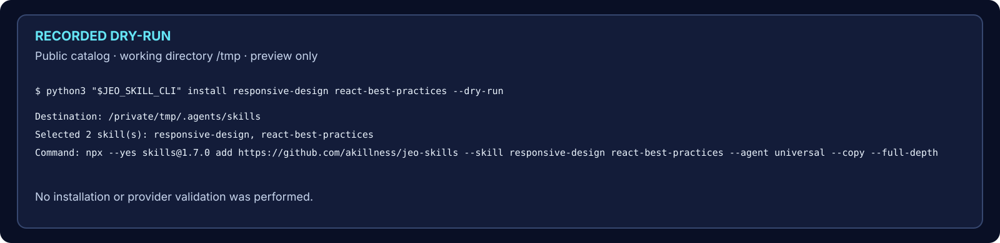

<div align="center">


# jeo-skills

**여러 에이전트에서 필요한 스킬을 찾고, 선택해 설치하고, 각 호스트에 맞게 운영하세요.**

[](#-스킬-목록)
[](#-카테고리)
[](https://agentskills.io/specification)
[](https://github.com/akillness/jeo-skills/actions/workflows/ci.yml)
[](LICENSE)
[](https://www.buymeacoffee.com/akillness3q)

프로젝트가 작성한 부분에는 [MIT 라이선스](LICENSE)가 적용됩니다. 사본이나 상당 부분을 배포할 때 저작권 및 허가 고지를 유지해야 합니다. 제3자 구성 요소에는 별도 조건이 적용될 수 있으므로 [업스트림 출처와 라이선스](docs/attribution.md) 및 각 라이선스·고지 파일도 확인하세요.

[빠른 시작](#-빠른-시작) · [작동 방식](#-작동-방식) · [설치 옵션](#-설치-옵션) · [지원 런타임](#-지원-런타임) · [라우터 CLI](#-라우터-cli) · [사용 추적 및 정리](#-사용-추적-및-정리) · [스킬](#-스킬-목록)

설치부터 시작하려면 [빠른 시작](#-빠른-시작)을, 특정 작업을 찾아보려면 아래 메뉴를 펼치세요.

<details>
<summary>작업별 메뉴 열기</summary>

- [카탈로그와 설치 흐름 이해하기](#-작동-방식)
- [카테고리별 스킬 찾기](#-카테고리)
- [설치 범위와 번들 선택하기](#-설치-옵션)
- [호스트 경로와 Jev 프로필 확인하기](#-지원-런타임)
- [CLI 명령 찾아보기](#-라우터-cli)
- [사용 이력 확인 및 안전하게 정리하기](#-사용-추적-및-정리)
- [선택적 통합 확인하기](#-선택적-통합)

</details>

[English](README.md) · **한국어** · [Español](README.es-ES.md)

</div>

---

## ✨ 한눈에 보기

| 영역 | 내용 |
|---|---|
| **카탈로그** | 스킬마다 하나의 폴더: `.agent-skills/<name>/SKILL.md`, 개방형 Agent Skills 형식 |
| **메타데이터** | 카테고리, 하위 카테고리, 인터페이스, 번들 및 관계 데이터는 `.agent-skills/skills.json`에 한 번만 저장됩니다 |
| **라우터** | `jeo-skill`로 찾아보고 검색하고 선택 항목을 미리 본 다음, 선택한 항목만 설치합니다 |
| **런타임** | 대부분의 에이전트가 공유하는 루트와 Claude Code, GJC, Antigravity, Aside용 네이티브 루트 |
| **수명 주기** | 보존된 기록에서 관찰된 호출·로드 이력으로 정리 후보를 찾고, 변경 전 미리 보기와 격리 후 복원을 지원합니다 |
| **선택 사항** | Jev 의사결정 하네스와 Jevgrep 검색 기능은 기본적으로 꺼져 있으며 별도로 설정합니다 |

## 🚀 빠른 시작

**옵션 A: 에이전트가 설치하도록 합니다.** Claude Code, Codex, Antigravity CLI(`agy`), Kimi Code, Grok Build, OpenCode 또는 다른 코딩 에이전트에 다음을 붙여 넣으세요.

```text
Read https://raw.githubusercontent.com/akillness/jeo-skills/main/setup-all-skills-prompt.md in full and follow it to install the jeo-skills.
```

이 가이드는 운영체제와 에이전트를 감지하고 기본 `full` 모드에서 전체 카탈로그와 고정 버전 공유 CLI 6종을 설치합니다. 먼저 전역·사용자 범위를 확인하며, 새 second-brain 볼트와 자동화는 대상·모델·비용에 대한 명시적 동의 후 준비합니다. `core only`는 `starter` 번들만, `minimal`은 라우터와 CLI 링크만 설치합니다. 사용자나 타사 스킬을 임의로 삭제하지 않습니다.

가이드 설치와 아래 라우터 전용 설치는 별개입니다. 대부분의 스킬은 안내 파일만 설치합니다. 예외로 `jeo-skill install`에서 `context7`을 선택하면 기존 `ctx7`이 없을 때 npm으로 `ctx7@0.11.1`을 설치합니다(Node.js 22.20 이상 필요). `--dry-run`은 다운로드 없이 미리 봅니다. 프로젝트 설치는 `.agents/context7`, 전역 설치는 `~/.local/share/jeo-skill/context7` 아래에 두며 사용하려면 해당 `node_modules/.bin`을 `PATH`에 추가하세요. 불완전한 기존 대상은 덮어쓰지 않고 실패합니다. CLI 설치는 서비스 활성화가 아닙니다. 로그인, MCP 등록, 설정 변경 및 외부 요청에는 별도 승인이 필요합니다. 직접 실행하는 `npx skills add`는 이 CLI를 설치하지 않습니다.

Windows에서는 Context7 자동 설치를 지원하지 않아 안전하게 실패합니다. 별도로 설치한 가이드와 CLI는 이 자동 경로의 대상이 아닙니다.

GitHub 스타는 별도 선택입니다. `JEO_SKILLS_STAR=true`를 명시하면 `akillness/jeo-skills`에 `gh`로 PUT한 직후 GET으로 확인합니다. `false`면 건너뛰고, 미설정이면 대화형 환경에서 기본값이 아니요인 질문을 표시합니다. 미리 보기에서는 스타를 누르지 않으며, 일반 `--yes`는 스타에 대한 동의가 아닙니다.

**옵션 B: 라우터를 설치한 다음 스킬을 선택합니다.**

```bash
curl -fsSL https://raw.githubusercontent.com/akillness/jeo-skills/main/install.sh | bash
jeo-skill doctor                                    # check catalog and installer prerequisites
jeo-skill search "react performance"                # find skills
jeo-skill install react-best-practices --global --dry-run   # preview
jeo-skill install react-best-practices --global --yes      # install
```

> [!TIP]
> 설치 후 `jeo-skill`을 찾을 수 없으면 `$HOME/.local/bin`을 `PATH`에 추가하세요.

## 🧭 작동 방식

<details>
<summary>카탈로그에서 호스트까지의 흐름 보기</summary>


1. **카탈로그.** 스킬은 `.agent-skills/<name>/SKILL.md` 형태로 평평하게 유지됩니다. 카테고리·번들·관계 정보는 `.agent-skills/skills.json`에서 중앙 관리하며, 분류를 위한 중첩 폴더는 만들지 않습니다.
2. **라우터.** `jeo-skill`은 `skills.json`을 기준으로 이름, 번들, 카테고리 및 하위 카테고리를 확인하고, 기록하기 전에 정확한 선택 항목을 표시합니다.
3. **설치.** 선택 항목은 `npx skills@1.7.0 add`에 위임되며, 256 KiB 고정 버퍼 기반 단일 패스 스트리밍 복사·SHA-256 검증, 반복형 `os.scandir` 순회, 동일 파일 재기록 생략을 통해 각 대상 런타임 루트에 투영됩니다.
4. **로드.** 각 호스트는 자체 루트에서 스킬을 검색합니다. 배치는 활성화가 아닙니다. 로딩, 권한, 모델 선택 및 실행은 호스트가 담당합니다.

</details>

## 🗂 카테고리

<details>
<summary>관심 분야별 카테고리 보기</summary>


| 카테고리 | 초점 | 찾아보기 |
|---|---|---|
| 🌐 Web | 프런트엔드, 백엔드, 디자인, API, 인증, 데이터, 테스트, 그래픽 | `jeo-skill list -c web` |
| 🏗 Infrastructure | 배포, 환경, 관측 가능성, 보안, 클라우드 데이터 | `jeo-skill list -c infrastructure` |
| 🎮 Game | 클라이언트, 웹, 디자인 UI, 오디오, 모션 VFX, QA 및 릴리스 | `jeo-skill list -c game` |
| 🎬 Creative Media | 이미지, 비디오, 모션, 오디오, 프레젠테이션, 다이어그램 | `jeo-skill list -c creative-media` |
| ⌨️ CLI Tools | 개발자, AI, 미디어, 자동화, 검색 및 벤치마크 CLI | `jeo-skill list -c cli-tools` |
| 🤖 AI & Agents | 오케스트레이션, 에이전트 프레임워크, 평가, 메모리, 계획 | `jeo-skill list -c ai-agents` |
| 🧰 Engineering | 코드 품질, 테스트, 아키텍처, 문서화, 탐색 | `jeo-skill list -c engineering` |
| 🔭 Research & Analysis | 학술, 웹 리서치, 데이터 분석, 실험, 인텔리전스 | `jeo-skill list -c research` |
| 📣 Business | 마케팅, 지원, 제품 디스커버리, 전략, 실행, 성장 | `jeo-skill list -c business` |
| 🔧 Utilities | 지식, 파일, Git, 워크스페이스, 프로젝트 관리 | `jeo-skill list -c utilities` |

전체 생성 목록은 [스킬 목록](#-스킬-목록)에 있습니다.

</details>

## 📦 설치 옵션

<details>
<summary>설치 범위, 예시 및 번들 보기</summary>

실제로 기록한 두 스킬 선택 미리 보기입니다. 설치나 제공자 활성화의 증거는 아닙니다.



| 목표 | 방법 |
|---|---|
| 에이전트의 안내에 따라 전체 설치 | [빠른 시작](#-빠른-시작)의 설정 프롬프트를 붙여 넣습니다 |
| 라우터만 설치(기본값) | 한 줄 명령을 그대로 사용합니다 |
| 라우터 + `starter` 번들 | `JEO_SKILLS_SELECTION=bundle`을 지정한 한 줄 명령 |
| 전체 카탈로그 + 공유 도구·워크스페이스 설정 | `JEO_SKILLS_SELECTION=all`을 지정한 한 줄 명령. 전역 모드에서는 공유 CLI 6종과 워크스페이스 설정도 실행하므로 [설치 가이드](setup-all-skills-prompt.md)의 승인 경계를 먼저 확인합니다 |
| 선택적 설정 없이 전체 카탈로그 설치 | `jeo-skill install --all --global --yes` (`--setup` 없이 실행; 위에 설명한 Context7 CLI 설치 포함) |
| 현재 프로젝트에만 설치 | `INSTALL_GLOBAL=false`를 지정한 한 줄 명령. `all`은 전역 도구 설치를 건너뛰고 부분 실패로 보고합니다 |
| 변경 없이 미리 보기 | `JEO_SKILLS_DRY_RUN=true`를 지정한 한 줄 명령 |
| 특정 스킬 | `jeo-skill install <name> [<name> ...] --global --yes` |
| 특정 스킬 + 도구 설치 또는 스모크 검증 | `jeo-skill install <name> ... --global --yes --setup` (지원되는 스킬에 한함). `--with-hooks`는 `--setup`을 포함하며 지원되는 훅/MCP 등록 단계도 실행합니다. [도구별 범위](setup-all-skills-prompt.md#step-5--full-mode-shared-tools)를 먼저 확인하세요 |
| 번들 또는 카테고리 일부 | `jeo-skill install --bundle <bundle> --global --yes` 또는 `--category <id> [--subcategory <id>]` |
| GitHub 프로그램 5종 운영 가이드 + 준비 상태 리포트 | `jeo-skill install --bundle github-five-programs --global --yes --setup`. `JEO_SKILLS_SELECTION=bundle JEO_SKILLS_BUNDLE=github-five-programs`를 지정한 한 줄 명령도 가이드 설치 후 같은 리포트를 출력합니다. **리포트 단계만** 오프라인·읽기 전용이며 업스트림 프로그램을 설치·시작하거나 네트워크에 접속하지 않습니다 |

게임 개발 도구별 스킬 10개는 `jeo-skill install --bundle game-source-repositories --dry-run`으로 미리 볼 수 있습니다. 물리, 지형, 재질, 이펙트, 경로 탐색, 애니메이션, 그래픽, 메시와 노이즈를 다루며 업스트림 도구 자체를 설치하거나 실행하지는 않습니다. [설치 범위](setup-all-skills-prompt.md#game-development-source-guides-on-demand)와 [출처별 라이선스](docs/attribution.md)를 확인하세요.

Lightpanda는 `jeo-skill install lightpanda --global --dry-run`으로 선택을 미리 확인한 뒤
스킬을 설치합니다. 스킬 설치는 안내문만 복사하며 브라우저는 설치하지 않습니다. 안정 버전
1.0.2의 fetch, 구조화 데이터, CDP 및 MCP를 다루며, 오프라인 진단은 로컬 메타데이터만 확인하고
실행 호환성을 보증하지 않습니다. 브라우저 다운로드·설치·실행, 사이트 접근, 서버, 자격 증명,
프로바이더 호출은 각각 별도 승인이 필요합니다. [설치 가이드](setup-all-skills-prompt.md#lightpanda-browser-operator-on-demand)를 참고하세요.

Impeccable은 `jeo-skill install impeccable --global --dry-run`으로 선택을 미리 확인한 뒤
스킬을 설치합니다. 스킬 설치는 `pbakaus/impeccable` 4.8.0 운영 가이드만 복사하며 Impeccable,
엔진, 디자인 훅은 설치하지 않습니다. 업스트림 설치 프로그램도 같은 `impeccable` 폴더 이름을
쓰므로 어느 쪽이든 쓰기 전에 오프라인 doctor로 먼저 확인합니다. npm 실행, 엔진 다운로드·실행,
훅, 브라우저 스캔, live 모드는 각각 별도 승인이 필요합니다. [설치 가이드](setup-all-skills-prompt.md#impeccable-design-operator-on-demand)를 참고하세요.

설치 프로그램 변수는 파이프 오른쪽의 `bash`에 지정합니다.

```bash
URL=https://raw.githubusercontent.com/akillness/jeo-skills/main/install.sh
curl -fsSL "$URL" | JEO_SKILLS_SELECTION=bundle bash
curl -fsSL "$URL" | JEO_SKILLS_DRY_RUN=true INSTALL_GLOBAL=false bash
```

`--dry-run`은 선택 항목·대상 경로·실행 예정 명령을 확인하는 용도이며 실제 설치나 호스트 활성화를 검증하지 않습니다. `install.sh`의 미리 보기는 런타임 지원 여부·계정·카탈로그 선택의 유효성을 실제 실행 시점까지 확인하지 않습니다. 준비 상태 리포트의 `ready`도 로컬 사전 점검 통과를 뜻할 뿐, 프로그램의 실제 실행이나 서비스 연결을 보증하지 않습니다.

<details>
<summary><b>번들</b> — 엄선한 시작 세트</summary>

| 번들 | 스킬 |
|---|---|
| `starter` | jeo-skill, skill-standardization, codebase-search, git-workflow, debugging, testing-strategies, image-to-github-repo |
| `cli-core` | jeo-skill, rtk, semble, zvec-grep, graphify, scrapling |
| `web-frontend` | react-best-practices, responsive-design, web-accessibility, design-system, web-design |
| `web-backend` | api-design, authentication-setup, database-schema-design, backend-testing |
| `web-design` | web-design, design-system, responsive-design, web-accessibility |
| `infrastructure-core` | deployment-automation, environment-setup, monitoring-observability, security-best-practices |
| `game-client` | unity-gamedev-skill-pack, game-performance-profiler, awesome-gamedev-agent-skills, donchitos-game-studios |
| `game-web` | web-game-development, threejs-fundamentals, implement-fog-of-war |
| `game-art` | game-vfx, rfxgen, perfectpixel, open-design-game-ui-concept, unirig |
| `media-video` | video-production, video-shotcraft, video-motion-previs, shopping-shorts, filmcraft |
| `skill-authoring` | skill-standardization, write-a-skill, upskill |
| `product-management` | pm-skills, create-prd, user-stories, opportunity-solution-tree, north-star-metric |
| `langchain` | langchain-fundamentals, langgraph-fundamentals, deep-agents-core, langsmith |
| `knowledge-repositories` | 22 ontology, code-graph, memory 및 retrieval 운영 가이드 (`jeo-skill install --bundle knowledge-repositories --dry-run`) |
| `ui-design-repositories` | 10 source-pinned UI operators (`jeo-skill install --bundle ui-design-repositories --dry-run`) |
| `github-five-programs` | fabric, moneyprinter-v2, agent-s, google-maps-scraper, gitingest: 오픈소스 프로그램 5종 운영 가이드, 그중 4종은 source-pinned (`jeo-skill install --bundle github-five-programs --dry-run`) |

대부분의 리포지터리 운영 스킬은 고정된 소스를 안내하며, 설치해도 업스트림 프로젝트를 설치·실행·연결하지 않습니다. 위에 설명한 Context7 CLI 설치는 예외이며, 활성화와 연결에는 별도 승인이 필요합니다.

</details>

</details>

## 🖥 지원 런타임

<details>
<summary>호스트별 경로와 Jev 프로필 보기</summary>

아래는 `jeo-skill install --agent <값>`의 설치 대상 경로입니다. 파일 배치와 호스트의 실제 스킬 탐색·활성화는 별도로 확인해야 합니다. GJC와 Antigravity의 전역 네이티브 경로에는 공유 루트에 설치한 선택 항목을 추가로 복사합니다.

| 런타임 | `--agent` | 전역 루트 | 프로젝트 루트 |
|---|---|---|---|
| JeoPi · Jeo(`jeo-code`) · OMP(`oh-my-pi`) | `universal` (기본값), `jeopi`, `jeo`, `omp` | `~/.agents/skills` | `.agents/skills` |
| Codex | `codex` / `universal` | `~/.agents/skills` | `.agents/skills` |
| Kimi Code | `kimi` / `kimi-code-cli` | `~/.agents/skills` | `.agents/skills` |
| OpenCode · Cursor | `opencode` / `cursor` / `universal` | `~/.agents/skills` | `.agents/skills` |
| Claude Code | `claude-code` / `claude` | `~/.claude/skills` (또는 `$CLAUDE_CONFIG_DIR/skills`) | `.claude/skills` |
| GJC | `gjc` | `~/.gjc/agent/skills` (설정 디렉터리 재정의는 아래 참고) | `.gjc/skills` |
| Pi | `pi` | `~/.pi/agent/skills` | `.pi/skills` |
| Antigravity CLI (AGY) | `agy` / `antigravity-cli` | `~/.gemini/antigravity-cli/skills` | `.agents/skills` |
| Grok Build | `grok` | `${GROK_HOME:-$HOME/.grok}/skills` | `.grok/skills` |
| Antigravity IDE | `antigravity` | `~/.gemini/config/skills` | `.agents/skills` (라우터 대상, IDE 탐색 미검증) |
| Crush | `crush` | `~/.config/crush/skills` | `.crush/skills` |
| Aside | `aside` + `--aside-account <id>` | `~/.aside/u/<id>/skills/user/` | — |

GJC 전역 설정 디렉터리는 `GJC_CONFIG_DIR`, 다음으로 `PI_CONFIG_DIR`를 따르며, 라우터는 프로젝트 `.env`와 같은 값이나 `..`가 포함된 값을 재정의로 사용하지 않습니다. Crush 전역 경로는 현재 라우터 구현의 고정 경로인 `~/.config/crush/skills`입니다. 위 표가 호스트의 모든 추가 탐색 경로를 나열하는 것은 아닙니다.

> [!NOTE]
> 이 가이드의 현재 호스트·설정 대상에서는 이전 `gemini-cli` 호스트/설치 별칭을 사용하지 않고 Antigravity CLI의 `agy`/`antigravity-cli`를 사용합니다. Google/Gemini 제공자·모델 이름과 AGY의 `.gemini` 저장 경로는 그대로 유효합니다. `kimi`는 `kimi-code-cli`로 정규화되어 공유 루트에 설치합니다. Kimi 자체는 `${KIMI_CODE_HOME:-$HOME/.kimi-code}/skills`와 프로젝트 `.kimi-code/skills`도 검색하지만, 라우터가 그 모든 경로에 복사한다는 뜻은 아닙니다.
> 
> `grok`는 Grok Build의 네이티브 대상이며 setup 가이드에서 명시적으로 선택할 때만 설정합니다. 설치 대상은 `JEO_SKILLS_AGENT=grok`, Jev 단일 프로필은 `JEV_AGENT=grok`로 선택하세요. 같은 이름의 Superagent/VibeKit CLI가 있으므로 setup은 `PATH`만 보고 자동 선택하지 않습니다. 컨트롤러의 `detect`는 바이너리 존재만 보고하며 구현 종류를 검증하지 않습니다. 그 바이너리가 스킬을 자동 로드한다고 가정하거나 자동 업그레이드하지 않습니다.
> 
> 설치하면 스킬 파일을 루트에 기록하지만 런타임에 로그인하거나 시작하거나 새로고침하지는 않습니다. 새로 설치한 스킬이 보이지 않으면 호스트를 새로고침하세요.

### Jev 에이전트별 프로필과 활성화 경계

Jev는 백엔드를 별도로 선택하고 옵트인한 뒤에만 설정합니다. 현재 가이드는 이전 `gemini-cli` 호스트/별칭을 설정 대상으로 사용하지 않으며, 이는 Google/Gemini 제공자·모델의 전역 종료를 주장하는 것이 아닙니다. 호스트와 모델·제공자는 별개입니다.

#### 기본 프로필

| canonical host ID | 기본 프로필 | 독립 실행형 설치 대상 및 비고 |
|---|---|---|
| `jeo` | `jeo` | `jeo` |
| `gjc` | `gjc` | `gjc` |
| `jeopi` | `jeopi` | `jeopi` |
| `pi` | `pi` | `pi` |
| `codex` | `codex` | `codex` |
| `claude` | `claude` | `claude-code` |
| `agy` | `agy` | `antigravity-cli` |
| `kimi` | `kimi` | `kimi-code-cli` (`skills@1.7.0`) |
| `grok` | `grok` | `grok` (Grok Build) |
| `opencode` | `opencode` | `opencode` |
| `omp` | `omp` | `omp` |
| `cursor` | `cursor` | `cursor` |
| `crush` | `crush` | `crush` |
| `antigravity` | `antigravity` | `antigravity` (IDE) |
| `aside` | `aside-u<account>` | `aside` 계정별 프로필 |

호스트 선택은 `JEV_AGENT` > `JEO_SKILLS_AGENT` 순서입니다. 두 변수가 없거나 값이 `universal`이면 감지된 호스트를 각각 독립적으로 구성합니다. 한 호스트의 프로필 우선순위는 `JEO_SKILLS_JEV_PROFILE` > `JEV_PROFILE` > `~/.agents/jev/agents.json`의 canonical host ID 매핑 > host ID와 같은 이름의 프로필입니다. Aside는 계정을 먼저 선택하고 `aside-u<account>`를 기본값으로 사용합니다.

호스트별 설정이 성공하면 기존 컨트롤러의 config-only 경로가 `~/.agents/jev/agents.json`에 canonical host ID 바인딩을 생성하거나 갱신합니다. 이 갱신은 기존 `native`·`scope`·사용자 지정 프로필 할당과 다른 호스트 항목을 보존하며, hook을 등록하지 않습니다. `agy`, `kimi`, `grok`, `opencode` 및 `cursor`를 제외한 기타 새 호스트의 프로필은 명시적 하네스·수동 경로만 제공하며 native hook 활성화를 주장하지 않습니다. `cursor`는 별도의 `jev-plugin.mjs hooks-install --agent cursor`로 hook 러너(스킬 이름 조언과 선택적 행동 검토)를 설치할 수 있지만, setup이 이를 자동으로 수행하지 않으며 실제 Cursor 세션에서는 검증되지 않았습니다.

컨트롤러(`jev-plugin.mjs`)의 `--agent`는 canonical host ID를 사용합니다. 독립 실행형 `jev-setup.sh --agent`의 값은 스킬 설치 대상(`claude-code`, `antigravity-cli`, `kimi-code-cli`, `grok` 등)입니다. 하네스(`jev-harness.mjs`)에는 `--agent` 옵션이나 호스트 자동 감지가 없으므로 모든 작업에 현재 프로필을 `--profile`로 명시해야 하며, 선택한 프로필이 없거나 비활성화되면 다른 프로필이나 레거시 공유 설정으로 대체하지 않습니다.

현재 프로필 상태만 읽으려면 다음처럼 실행하세요(`status`는 읽기 전용이며 구성된 로컬 백엔드를 확인할 수 있지만, 그 결과를 호스트 활성화나 모델 사용의 증거로 추론하지 않습니다).

```bash
node ~/.agents/jev/jev-harness.mjs \
  --profile "${JEV_PROFILE:?현재 할당된 Jev 프로필을 먼저 선택하세요}" status
```

모든 감지 호스트를 대상으로 설정하려면 설정 서브셸 내부에서만 `JEV_AGENT`, `JEV_PROFILE`, `JEO_SKILLS_AGENT`, `JEO_SKILLS_JEV_PROFILE`을 `unset`하고, 활성 세션 바깥의 값은 보존하세요. 프로필 설정만으로 native hook이 자동 활성화되지 않으며, 기존 실제 `HOME` 설치도 삭제하거나 초기화하지 않습니다. 자세한 호스트 매핑과 활성화 경계는 [Jev 활성화 및 프로필 표](jev/jev-control-plane.rule.md#activation-and-profiles), 설정 순서는 [설정 가이드](setup-all-skills-prompt.md#jev-control-plane-harness-system-one)와 [jev/README.md](jev/README.md)를 확인하세요.

</details>

## 💻 라우터 CLI

<details>
<summary>탐색, 설치 및 관리 명령 보기</summary>

| 명령 | 기능 |
|---|---|
| `jeo-skill categories` | 카테고리 및 하위 카테고리 개수 |
| `jeo-skill list -c <category> [-s <subcategory>]` | 한 분류 구간의 스킬 |
| `jeo-skill search "<query>"` | 이름, 설명 및 분류 체계 검색 |
| `jeo-skill related <name>` | 함께 고려할 중복 또는 순차 스킬 |
| `jeo-skill install ... --dry-run` | 파일을 기록하지 않고 선택 항목 미리 보기 |
| `jeo-skill doctor` | 카탈로그, `npx`/Node.js 사전 요건 및 CLI 링크 확인 |
| `jeo-skill readiness [--global] [--json]` | fabric, moneyprinter-v2, agent-s, google-maps-scraper, gitingest의 오프라인 읽기 전용 준비 상태 리포트 |
| `jeo-skill usage scan` / `usage report` | 보존된 로컬 기록에서 호출·로드 이벤트를 수집하고 보고 |
| `jeo-skill prune-unused` / `restore` / `purge-quarantine` | 관찰된 사용이 없는 후보를 미리 보고 격리·복원·영구 삭제 |
| `jeo-skill prune-retired --global --dry-run` | 은퇴한 카탈로그 스킬의 오래된 사본 제거 계획 미리 보기 |
| `jeo-skill explore "<question>" --root <dir> --dry-run` | 선택적 Jevgrep 문서 검색 계획 미리 보기 |

모든 명령에서 사용할 카탈로그를 고정하려면 `JEO_SKILLS_CATALOG=/path/to/skills.json`을 설정합니다.

</details>

## 🧹 사용 추적 및 정리

<details>
<summary>사용 상태, 격리 및 복원 절차 보기</summary>


`jeo-skill usage scan`은 로컬 런타임 기록(jeo, JeoPi, GJC, Pi, OMP, Claude, Codex, Gemini/Antigravity, OpenCode, Aside 세션 및 Jev 주입 원장)을 읽습니다. 사용 요약과 증분 스캔 메타데이터를 기본적으로 `~/.local/state/jeo-skill` 아래에 저장하며, 대화 기록 본문은 저장하지 않습니다. 기록에서 확인된 스킬 호출·읽기·주입 이벤트만 집계하고 프롬프트의 단순 언급은 제외하므로, 결과는 전체 사용 이력이 아닙니다.

| 상태 | 의미 |
|---|---|
| `used` | 보존된 기록에서 한 번 이상 호출되거나 로드됨 |
| `protected` | `jeo-skill`, `starter`/`cli-core`/`infrastructure-core` 번들, `usage keep` 고정 및 `usage relevance` 보호 |
| `in-grace` | 관찰된 사용이 없지만 추적 시작 또는 최초 설치 후 30일 유예 기간 이내 |
| `candidate` | 유예 기간 후에도 관찰된 사용이 없어 격리 대상 |

```bash
jeo-skill usage scan
jeo-skill usage report --status candidate
jeo-skill prune-unused --global                                   # preview only
jeo-skill prune-unused --global --apply --skip-jev-review         # or --jev-profile <p> --allow-remote
jeo-skill restore --list
jeo-skill restore --batch <batch-id> --apply
jeo-skill purge-quarantine --older-than 30 --apply                # permanent
```

> [!IMPORTANT]
> 관찰된 사용이 없다는 사실은 한 번도 쓰지 않았거나 앞으로도 필요 없다는 증거가 아닙니다. 런타임이 기록을 남기지 않거나 오래된 기록을 삭제했을 수 있습니다. `--apply`는 먼저 다시 스캔하며 현재 기록 저장소를 읽을 수 없으면 거부합니다. 이 카탈로그와 일치함을 입증할 수 있는 복사본만 이동하고, 타사 복사본과 심볼릭 링크는 유지합니다.

카탈로그 자체에서 스킬을 제거하는 것은 저장소 체크아웃에서 하는 별도의 유지관리자 단계입니다. 기본은 미리 보기이며, `--apply`에는 쉼표로 구분한 승인 이름과 검토 방식 선택이 필요합니다. 적용하면 프로젝션을 다시 생성하고 검증하며 실패하면 되돌립니다.

```bash
jeo-skill usage report --json > report.json
python3 scripts/retire-unused-skills.py --usage-report report.json                     # preview
python3 scripts/retire-unused-skills.py --usage-report report.json --apply \
  --approve name-a,name-b --skip-jev-review          # or --jev-profile <p> --allow-remote
```

</details>

## 🔄 설치된 스킬 최신 상태 유지

<details>
<summary>공유 루트를 새로 고치고 심볼릭 링크 호스트를 재조정하기</summary>


호스트별 스킬을 공유 루트(`~/.agents/skills`)로 연결하는 **스킬별 심볼릭 링크 구성을 사용 중이라면**, 공유 루트를 갱신한 뒤 호스트 링크를 재조정하세요. [전체 설치 가이드](setup-all-skills-prompt.md)가 모든 호스트에 이 구성을 보장하는 것은 아닙니다. 링크 구성에서는 호스트별 복사 설치기(`jeo-skill install -a claude-code`, `-a gjc` 등)로 덮어쓰지 마세요. 라우터는 심볼릭 링크 대상에 대한 쓰기를 거부하며, 아래 업그레이드 도구가 링크를 별도로 관리합니다.

```bash
bash scripts/skills-upgrade.sh              # pull → doctor → refresh → prune → reconcile → verify
bash scripts/skills-upgrade.sh --dry-run    # 쓰기 없이 계획만 생성
python3 scripts/refresh-host-links.py       # 링크 계획만 표시 (읽기 전용)
```

각 단계의 역할:

1. 신뢰된 체크아웃에서 `git pull --ff-only` — non-fast-forward면 실행 중단
2. `jeo-skill doctor`로 카탈로그 메타데이터·설치 사전 요건·CLI 링크 상태를 표시합니다. 이 단계의 실패만으로 업그레이드가 중단되지는 않으며, 전체 카탈로그 정합성 검증을 대신하지 않습니다.
3. `jeo-skill install --all --global --yes`로 공유 루트를 최신 카탈로그로 재작성
4. `jeo-skill prune-retired --global`로 은퇴한 카탈로그 사본 제거 (레거시 중복 정리 단계)
5. `scripts/refresh-host-links.py --apply` — 새로 추가된 스킬의 링크 생성, 끊긴 링크 제거, **호스트 로컬 비카탈로그 스킬은 절대 삭제하지 않음**
6. 검증: 스크립트에 경로가 정의된 선택 호스트 루트의 끊긴 링크를 검사합니다. `--dry-run`에서는 이 검사를 건너뛰며, 실제 호스트 활성화나 스킬 로드는 검증하지 않습니다.

| 옵션 | 효과 |
|---|---|
| `--hosts <목록>` | 호스트 지정 (기본 `claude,pi,gjc,antigravity,cursor,aside-user,opencode-config`) |
| `--skip-pull` | `git pull`만 생략합니다. 이후 `npx` 설치는 네트워크를 사용할 수 있으므로 오프라인 모드는 아닙니다 |
| `--replace-copies` | 낡은 실제 디렉터리 사본도 링크로 변환 (먼저 격리) |
| `SKILLS_UPGRADE_HOSTS` | 환경변수로 기본 호스트 지정 |

`--replace-copies`로 교체하는 실제 사본은 기본적으로 `~/.local/state/jeo-skill/quarantine/upgrade-<UTC>/` 아래에 격리합니다. 낡은 심볼릭 링크는 링크 자체를 제거하거나 다시 연결합니다. 정상 링크에 대한 재조정은 no-op이 될 수 있지만, 전체 업그레이드는 실행할 때마다 스킬 설치 명령을 호출합니다.

### 주기적 갱신

`scripts/com.jeo-skills.skills-upgrade.plist`는 주 1회(월요일 09:30) 업그레이드를 실행하는 launchd 템플릿으로, 로그는 `~/.local/state/jeo-skill/upgrade.log`에 남습니다. 스크립트는 `npx`를 찾지 못하면 로컬 nvm Node bin 경로를 추가합니다. 자동 갱신을 켜기로 한 경우 설치:

```bash
cp scripts/com.jeo-skills.skills-upgrade.plist ~/Library/LaunchAgents/
launchctl bootstrap gui/$(id -u) ~/Library/LaunchAgents/com.jeo-skills.skills-upgrade.plist
```

</details>

## 🔌 선택적 통합

<details>
<summary>Jev와 Jevgrep의 선택적 설정 경계 보기</summary>

| 통합 | 목적 | 설정 |
|---|---|---|
| **Jev** | 의사결정 하네스: 작업을 스킬로 라우팅하고, 컨텍스트를 정리하며, 정리 제안을 검토합니다 | `bash jev/jev-setup.sh --profile <name> ...` · [jev/README.md](jev/README.md) |
| **Jevgrep** | 선택한 스킬 또는 위키 문서의 원격 검색 | `jeo-skill explore "<question>" --root <dir> --dry-run` · [jevgrep](.agent-skills/jevgrep/SKILL.md) |

카탈로그에 포함된 운영 가이드를 설치해도 이 두 통합이 자동으로 활성화되지는 않습니다. 둘 다 구성된 백엔드로 데이터를 보낼 수 있습니다. `jeo-skill`에서는 이를 호출하는 명령(`prune-unused --apply`, `usage relevance`, `explore`)이 `--allow-remote` 없이는 원격 사용을 거부합니다. 독립 실행형 Jev 하네스는 구성된 백엔드로 직접 전송하므로, 사용하기 전에 호스팅 프로필을 승인하세요.

명시적으로 요청한 Jev 설정이 실패해도 검증된 스킬 설치는 실패로 처리하지 않습니다. 경고를 확인하고 Jev 통합이 부분적으로 완료되었음을 별도로 확인하세요.

</details>

## Claude Code Game Studios

명명된 프로젝트 템플릿용 [`donchitos-game-studios`](.agent-skills/donchitos-game-studios/SKILL.md)
운영 스킬을 추가했습니다. [딥리서치 결론](.agent-skills/donchitos-game-studios/references/research.md)은
75개 정규 워크플로우와 별칭 3개, 스킬 표준과 점수 휴리스틱을 구분합니다.
78개를 전역 설치하거나 별칭을 불필요하게 늘리는 대신 소스 고정·작업별 라우팅·
승인 경계·선택 공개 파일 12개의 오프라인 검사를 제공합니다. `game-client` 번들로도
선택할 수 있습니다. 원본 훅·게임·모델은 실행하지 않으며 정적 통과를 보안 또는
성능 향상으로 보고하지 않습니다. 원본 설치와 활성화 범위는
[setup 가이드](setup-all-skills-prompt.md#claude-code-game-studios-on-demand-project-template-not-global-skill-pack)를 확인하세요.
원본 `/adopt`의 승인 동작은 자동화 모드에 따라 달라지므로 도입 계획은 별도로
승인하세요. `/skill-test`의 네 모드는 모두 파일만 검토하며 스킬을 실행하지 않습니다.
[원본 운영 안내](.agent-skills/donchitos-game-studios/references/upstream.md)와
[MIT 라이선스 출처](docs/attribution.md)에서 상세 내용을 확인하세요.

## 📚 스킬 목록

> `.agent-skills/skills.json`에서 생성 · 440개 스킬 · 카테고리를 펼치면 스킬 목록이 보입니다.

### 🌐 웹 (73개)

하위 분류: `frontend` (13), `backend` (3), `design` (16), `api` (2), `auth` (1), `data` (13), `testing` (4), `accessibility` (1), `performance` (1), `graphics` (12), `capture` (7)

<details>
<summary>스킬 보기</summary>

| Skill |
|---|
| `ax` |
| `react-best-practices` |
| `react-bits` |
| `state-management` |
| `amrouter` |
| `colibri` |
| `pydantic-ai` |
| `astryx` |
| `build-daily-inspiration-sites` |
| `daily-ui-inspiration-capture` |
| `design-first-ui-prompting` |
| `design-system` |
| `devup-ui` |
| `html-to-interaction-prompts` |
| `lazyweb` |
| `responsive-design` |
| `stitch-skills` |
| `web-design` |
| `api-design` |
| `api-documentation` |
| `authentication-setup` |
| `database-schema-design` |
| `payloadcms` |
| `supabase-agent-skills` |
| `typesense` |
| `backend-testing` |
| `browser-harness` |
| `playwriter` |
| `web-accessibility` |
| `optimize-web-animations` |
| `threejs-animation` |
| `threejs-fundamentals` |
| `threejs-geometry` |
| `threejs-interaction` |
| `threejs-lighting` |
| `threejs-loaders` |
| `threejs-materials` |
| `threejs-postprocessing` |
| `threejs-shaders` |
| `threejs-textures` |
| `agentation` |
| `react-grab` |
| `slides-grab` |
| `stitched-full-page-capture` |
| `chatbot-template` |
| `airship` |
| `moli` |
| `lightpanda` |
| `design-taste-frontend` |
| `impeccable` |
| `higgsfield-websites` |
| `stagehand` |
| `helix-foundry` |
| `pg-jev` |
| `orionbelt-ontology-builder` |
| `open-ontologies` |
| `semantica` |
| `utopia` |
| `pixeltable` |
| `turbovec` |
| `pixelrag` |
| `superdesign` |
| `better-design` |
| `design-taste` |
| `canvas-ui` |
| `paper-shaders` |
| `ui-layouts` |
| `hyperiux` |
| `motion-primitives` |
| `cursify` |
| `trickle-ui` |
| `browser-use` |
| `modern-web-guidance` |

</details>

### 🏗 인프라 (18개)

하위 분류: `deployment` (2), `environment` (2), `observability` (3), `security` (3), `cloud-data` (7), `automation` (0), `tooling` (1)

<details>
<summary>스킬 보기</summary>

| Skill |
|---|
| `deployment-automation` |
| `vercel-deploy` |
| `environment-setup` |
| `system-environment-setup` |
| `log-analysis` |
| `monitoring-observability` |
| `openocta` |
| `security-best-practices` |
| `strix` |
| `firebase-cli` |
| `unity-cli` |
| `genkit` |
| `looker-studio-bigquery` |
| `zurp` |
| `ai-knowledge-management-platform` |
| `knowledge-catalog` |
| `cocoindex` |
| `pmtiles` |

</details>

### 🎮 게임 (40개)

하위 분류: `client` (9), `web` (2), `server` (1), `design-ui` (7), `audio` (1), `animation` (3), `motion-vfx` (3), `sprite-image` (1), `art-resources` (1), `storytelling` (0), `tooling` (6), `qa-performance` (4), `release` (2)

<details>
<summary>스킬 보기</summary>

| Skill |
|---|
| `implement-fog-of-war` |
| `unity-gamedev-skill-pack` |
| `agentic-gamedev-skills` |
| `web-game-development` |
| `bmad-gds` |
| `open-design-game-ui-concept` |
| `open-design-game-ui-handoff` |
| `open-design-game-ui-takeover` |
| `rfxgen` |
| `animato` |
| `unirig` |
| `dalamud-vfx-editor` |
| `game-vfx` |
| `perfectpixel` |
| `underworld-overseer-save-mapper` |
| `godogen` |
| `game-build-log-triage` |
| `game-demo-feedback-triage` |
| `game-performance-profiler` |
| `wai-play` |
| `game-ci-cd-pipeline` |
| `steam-store-launch-ops` |
| `unity-technologies-skills` |
| `multiplayer-game-architecture` |
| `game-design-theory` |
| `game-feel` |
| `game-ui-ux` |
| `awesome-gamedev-agent-skills` |
| `jolt-physics` |
| `terrain3d` |
| `material-maker` |
| `effekseer` |
| `godot-voxel-tools` |
| `recast-navigation` |
| `ozz-animation` |
| `the-forge` |
| `meshoptimizer` |
| `fastnoise2` |
| `donchitos-game-studios` |
| `gamefactory-3a` |

</details>

### 🎬 크리에이티브 미디어 (40개)

하위 분류: `image` (10), `video` (18), `motion` (1), `audio` (2), `presentation` (1), `diagram` (2), `design` (4), `capture` (0), `storytelling` (2)

<details>
<summary>스킬 보기</summary>

| Skill |
|---|
| `aura-asset-images` |
| `generate-reference-inspired-brand-worlds` |
| `god-tibo-imagen` |
| `paperbanana` |
| `unsplash-asset-images` |
| `browser-video-recording` |
| `gbro-collage-broll` |
| `opencut` |
| `video-production` |
| `filmcraft` |
| `video-shotcraft` |
| `video-to-superprompt` |
| `vox-director` |
| `video-motion-previs` |
| `elevenlabs-tts` |
| `presentation-builder` |
| `drawio` |
| `open-design` |
| `blender-mcp` |
| `webtoon-harness` |
| `palmier-pro` |
| `openstory` |
| `drama-skills` |
| `openmontage` |
| `open-generative-ai` |
| `higgsfield-generate` |
| `higgsfield-marketplace-cards` |
| `higgsfield-product-photoshoot` |
| `higgsfield-soul-id` |
| `higgsfield-youtube-thumbnail` |
| `higgsfield-video-explainer` |
| `higgsfield-brandkit` |
| `shopping-shorts` |
| `video-use` |
| `autoclip` |
| `moneyprinter-turbo` |
| `opencreator` |
| `voicestudio` |
| `diagram-design` |
| `artcraft` |

</details>

### ⌨️ CLI 도구 (47개)

하위 분류: `developer-cli` (12), `ai-cli` (17), `media-cli` (1), `automation-cli` (8), `search-cli` (8), `benchmark-cli` (1)

<details>
<summary>스킬 보기</summary>

| Skill |
|---|
| `context7` |
| `soup` |
| `caveman` |
| `ccpi-marketplace` |
| `cli-anything` |
| `ghgrab` |
| `jeo-skill` |
| `pretext` |
| `aider-cli-workflow` |
| `claudekit` |
| `fabric` |
| `ooo` |
| `open-code-review` |
| `zeude` |
| `compresso` |
| `codeflow` |
| `graphify` |
| `headroom` |
| `npm-git-install` |
| `okf` |
| `rtk` |
| `tokhub` |
| `scrapling` |
| `agent-reach` |
| `scrapingant-web-fetch` |
| `semble` |
| `zvec-grep` |
| `x-twitter-scraper` |
| `hyperfine-benchmarking` |
| `codeburn` |
| `mole` |
| `mcp-server-sv-number` |
| `zeroshot` |
| `k-skill-setup` |
| `jevgrep` |
| `openrig` |
| `uzu` |
| `context-mode` |
| `rea` |
| `llmfit` |
| `hyper-extract` |
| `leann` |
| `google-maps-scraper` |
| `gitingest` |
| `craft-anything` |
| `connectonion` |
| `flide` |

</details>

### 🤖 AI 및 에이전트 (82개)

하위 분류: `orchestration` (20), `agent-frameworks` (22), `skill-authoring` (5), `evaluation` (10), `memory` (7), `planning-review` (13), `discovery` (3), `prompting` (2)

<details>
<summary>스킬 보기</summary>

| Skill |
|---|
| `bmad` |
| `deep-dive` |
| `deepinit` |
| `spec-kit` |
| `ecc` |
| `microsoft-agent-framework` |
| `openai-agents-python` |
| `goalflow` |
| `openexecutive` |
| `article-prompts-to-skills` |
| `skill-standardization` |
| `upskill` |
| `write-a-skill` |
| `langsmith` |
| `opik` |
| `skill-autoresearch` |
| `nvidia-skill-evaluator` |
| `kadath` |
| `mex` |
| `bmad-idea` |
| `grill-me` |
| `grill-with-docs` |
| `plannotator` |
| `survey` |
| `to-tickets` |
| `to-spec` |
| `triage` |
| `openspace` |
| `agentic-skills` |
| `prompts-chat` |
| `find-skills` |
| `mcp-builder` |
| `ask-matt` |
| `grilling` |
| `setup-matt-pocock-skills` |
| `to-questionnaire` |
| `wayfinder` |
| `writing-for-agents` |
| `agent-guardrails` |
| `agent-system-design` |
| `agent-tool-routing` |
| `reflexion-pattern` |
| `agent-manager` |
| `langchain-fundamentals` |
| `langchain-middleware` |
| `langchain-rag` |
| `langchain-dependencies` |
| `langgraph-fundamentals` |
| `langgraph-persistence` |
| `langgraph-human-in-the-loop` |
| `deep-agents-core` |
| `deep-agents-memory` |
| `deep-agents-orchestration` |
| `langchain-bmad` |
| `a2a-protocol` |
| `agent-benchmarking` |
| `agent-observability` |
| `multi-agent-eval-harness` |
| `agent-memory-architecture` |
| `okf-agent-memory` |
| `agent-workflow` |
| `agent-principles` |
| `paperclip` |
| `jev-control-plane` |
| `anyjev` |
| `typesafe-computer-use` |
| `jev-ultrafast` |
| `agentic-graphrag-blueprint` |
| `memmachine` |
| `memori` |
| `memsearch` |
| `harness2` |
| `ruflo` |
| `agent-beacon` |
| `agent-s` |
| `aidlc-workflows` |
| `revfactory-harness` |
| `elephant-goldfish-model` |
| `kagent` |
| `trulens` |
| `fastmcp` |
| `canyonos` |

</details>

### 🧰 엔지니어링 (25개)

하위 분류: `code-quality` (12), `testing` (3), `architecture` (6), `documentation` (2), `code-navigation` (2)

<details>
<summary>스킬 보기</summary>

| Skill |
|---|
| `audit-reference-originality` |
| `audit-verify-explain-grade-5` |
| `code-refactoring` |
| `code-review` |
| `debugging` |
| `diagnosing-bugs` |
| `github-repo-candidate-quality-gate` |
| `migrate-to-shoehorn` |
| `performance-optimization` |
| `performance-profiling` |
| `scaffold-exercises` |
| `tdd` |
| `testing-strategies` |
| `improve-codebase-architecture` |
| `zoom-out` |
| `nightrun` |
| `changelog-maintenance` |
| `technical-writing` |
| `codebase-search` |
| `codebase-design` |
| `domain-modeling` |
| `implement` |
| `prototype` |
| `codebase-memory-mcp` |
| `ponytail` |

</details>

### 🔭 연구 및 분석 (15개)

하위 분류: `academic` (3), `web-research` (4), `data-analysis` (2), `experimentation` (2), `benchmarking` (1), `intelligence` (3)

<details>
<summary>스킬 보기</summary>

| Skill |
|---|
| `academic-research` |
| `research-paper-writing` |
| `scientific-agent-skills` |
| `deep-research` |
| `heretic` |
| `data-analysis` |
| `pattern-detection` |
| `autoresearch` |
| `scientific-llm-benchmarks` |
| `agent-pulse` |
| `research` |
| `korean-patent-search` |
| `fineenvs` |
| `mi-orchestration` |
| `image-to-github-repo` |

</details>

### 📣 비즈니스 (71개)

하위 분류: `marketing` (5), `support` (2), `publishing` (1), `pm-toolkit` (5), `pm-discovery` (13), `pm-strategy` (12), `pm-execution` (12), `pm-market-research` (7), `pm-analytics` (3), `pm-go-to-market` (6), `pm-growth` (5)

<details>
<summary>스킬 보기</summary>

| Skill |
|---|
| `marketing-automation` |
| `write-like-meng-on-x` |
| `x-bookmark-quote-posts` |
| `customer-email-draft-threads` |
| `customer-support-verification` |
| `yuwen-publish-precheck` |
| `youtube-growth-playbook-2026` |
| `pm-skills` |
| `draft-nda` |
| `grammar-check` |
| `privacy-policy` |
| `review-resume` |
| `analyze-feature-requests` |
| `brainstorm-experiments-existing` |
| `brainstorm-experiments-new` |
| `brainstorm-ideas-existing` |
| `brainstorm-ideas-new` |
| `identify-assumptions-existing` |
| `identify-assumptions-new` |
| `interview-script` |
| `metrics-dashboard` |
| `opportunity-solution-tree` |
| `prioritize-assumptions` |
| `prioritize-features` |
| `summarize-interview` |
| `ansoff-matrix` |
| `business-model` |
| `lean-canvas` |
| `monetization-strategy` |
| `pestle-analysis` |
| `porters-five-forces` |
| `pricing-strategy` |
| `product-strategy` |
| `product-vision` |
| `startup-canvas` |
| `swot-analysis` |
| `value-proposition` |
| `brainstorm-okrs` |
| `create-prd` |
| `dummy-dataset` |
| `job-stories` |
| `outcome-roadmap` |
| `pre-mortem` |
| `prioritization-frameworks` |
| `stakeholder-map` |
| `summarize-meeting` |
| `test-scenarios` |
| `user-stories` |
| `wwas` |
| `competitor-analysis` |
| `customer-journey-map` |
| `market-segments` |
| `market-sizing` |
| `sentiment-analysis` |
| `user-personas` |
| `user-segmentation` |
| `ab-test-analysis` |
| `cohort-analysis` |
| `sql-queries` |
| `beachhead-segment` |
| `competitive-battlecard` |
| `growth-loops` |
| `gtm-motions` |
| `gtm-strategy` |
| `ideal-customer-profile` |
| `marketing-ideas` |
| `north-star-metric` |
| `positioning-ideas` |
| `product-name` |
| `value-prop-statements` |
| `moneyprinter-v2` |

</details>

### 🔧 유틸리티 (29개)

하위 분류: `knowledge` (9), `files` (5), `git` (4), `workspace` (1), `project-management` (4), `productivity` (3), `general` (3)

<details>
<summary>스킬 보기</summary>

| Skill |
|---|
| `lapian-notes` |
| `llm-wiki` |
| `repo-knowledge-wiki` |
| `notebooklm` |
| `obsidian-mind` |
| `obsidian-second-brain` |
| `opencontext` |
| `file-organization` |
| `git-guardrails-claude-code` |
| `git-submodule` |
| `git-workflow` |
| `game-sounds` |
| `sprint-retrospective` |
| `standup-meeting` |
| `task-estimation` |
| `task-planning` |
| `google-workspace` |
| `watermarks-remover` |
| `solo-skills` |
| `eli5` |
| `handoff` |
| `resolving-merge-conflicts` |
| `teach` |
| `wait-what` |
| `wizard` |
| `hwp` |
| `rhwp-advanced` |
| `rhwp-edit` |
| `rowboat` |

</details>


---

## 🛠 유지관리자용

| 경로 | 내용 |
|---|---|
| `.agent-skills/` | 스킬 폴더, `skills.json`(소스 오브 트루스) 및 생성된 `skills.toon` |
| `install.sh` · `setup-all-skills-prompt.md` | 한 줄 설치 프로그램과 에이전트 주도 설정 가이드 |
| `scripts/` | 카탈로그 검증, 프로젝션 생성, 변경 로그 및 회귀 테스트 |
| `jev/` | 선택적 Jev 컨트롤 플레인 소스 |
| `changelog/` | 월별 릴리스 노트(영어 및 한국어) |
| `assets/` | README 시각 자료(Codex 생성, 출처는 `assets/readme-visuals.json`) |

`.agent-skills/skills.json`이 카탈로그 메타데이터의 기준입니다. README의 카테고리 개수와 스킬 목록 등 생성된 표는 직접 수정하지 말고, 매니페스트를 수정한 뒤 아래 순서로 재생성·검증하세요.

```bash
PYTHONDONTWRITEBYTECODE=1 python3 scripts/generate-catalog-projections.py
PYTHONDONTWRITEBYTECODE=1 python3 scripts/generate-catalog-projections.py --check
PYTHONDONTWRITEBYTECODE=1 python3 scripts/validate-catalog-projections.py --strict-links
PYTHONDONTWRITEBYTECODE=1 python3 scripts/repair-skill-frontmatter.py --check
PYTHONDONTWRITEBYTECODE=1 python3 flatten_skills.py --dry-run
PYTHONDONTWRITEBYTECODE=1 python3 scripts/changelog.py check
```

`.agent-skills/` 안에 `__pycache__`·`.pyc` 바이트코드가 남지 않도록 `PYTHONDONTWRITEBYTECODE=1`(`python3 -B`)로 실행하세요.
다른 프로젝트에서 적용한 스킬의 업스트림 소스와 라이선스는 [docs/attribution.md](docs/attribution.md)에 나열되어 있습니다.

## 🤝 관련 프로젝트

| 프로젝트 | 역할 |
|---|---|
| [jeo-code](https://github.com/akillness/jeo-code) | 공유 루트에서 스킬을 로드하는 코딩 에이전트 |
| [gajae-code (GJC)](https://github.com/akillness/gajae-code) | 자체 네이티브 스킬 루트를 사용하는 에이전트 런타임 |

## Revfactory Harness 팀 아키텍처 팩토리

[`revfactory-harness`](.agent-skills/revfactory-harness/SKILL.md)는
[revfactory/harness v2.1.0](https://github.com/revfactory/harness/tree/92d9f1b29e7af81acebf51a9fcd1832e739a1414)에
고정된 운영 스킬입니다. Claude Code 팀·스킬 생성, 실제 호스트 도구를 확인한 실행 모드 선택,
v1 마이그레이션, 실행 근거에 따른 `/harness:evolve`를 안내합니다.
`jeo-skill install revfactory-harness --global --yes`는 가이드와 오프라인 점검 도구만 복사하며
업스트림 플러그인을 활성화하지 않습니다. 헬퍼는 공개 파일 18개의 해시를 검증하지만
`runtime_verified: false`를 유지합니다. [설치·승인 경계](setup-all-skills-prompt.md#revfactory-harness-team-architecture-factory-on-demand)를
확인하세요. 기존 `harness2`와 별개이며, 은퇴된 카탈로그 이름 `harness`를 복원하지 않습니다.

## Elephant-Goldfish Model

[`elephant-goldfish-model`](.agent-skills/elephant-goldfish-model/SKILL.md)은
[Google Elephant-Goldfish Model](https://github.com/google/elephant-goldfish-model)의 설계·검토 흐름을 안내합니다.
카탈로그 스킬 설치만으로 업스트림 플러그인이 활성화되지는 않습니다. 새로운 컨텍스트의 검토에는
실제로 격리된 서브에이전트가 필요하며, 사람의 승인과 설치 경계를 지켜야 합니다.
[설치 경계](setup-all-skills-prompt.md#elephant-goldfish-model-on-demand)를 확인하세요.

---

<!-- WHATS-NEW:START -->

## 🆕 v2026-11-16 업데이트

| 변경 사항 | 상세 내용 |
|--------|---------|
| **NVIDIA SkillEvaluator 전체 카탈로그(440개 스킬) 보안 감사 및 개선** | `.agent-skills/` 전체 440개 스킬에 `skillevaluator security-scan`(`0.8.0` / `SkillSpector 2.13.3`)을 실행하고 Jev(`jev-harness.mjs` 검토·평가), 병렬 서브에이전트 배치(`RemediateBatch01–10`, `PolishBatchA–C`, `LiveScan1–4`), `agy`(`gemini-4-carbon-high`)를 연계해 보안 취약점과 정적 경고를 체계적으로 개선했습니다. **실측 BEFORE → AFTER(`skillevaluator-security.json`, 440/440)**: 통과 스킬 **221 → 366개**(+145, 83.2%), 실패 **192 → 63개**(-67.2%), 미완료 **27 → 11개**(-59.3%), `CRITICAL`/`HIGH` 무검출 스킬 **248 → 377 / 440개(85.7%)**, `CRITICAL`/`HIGH` 보유 스킬 **192 → 63개**(-67.2%), `CRITICAL` 발견 **4 → 0건**, `HIGH` **956 → 290건**(-69.7%), `MEDIUM` **1,296 → 647건**(-50.1%), `LOW` **61 → 12건**(-80.3%)이며 `LP1`(109→0)·`E2`(21→0)·`AE1`(114→0)·`LP3`(10→0)·`SC8`/`SC9`(52→0)을 전량 해소했습니다. 사후 리뷰를 통해 `agent-manager/scripts/install.sh`(`fi` 복구)·`agent-manager/evals/evals.json`·`lightpanda/evals/evals.json` 구문 오류 및 `animato/SKILL.md`·`animato_agent.py` 독스트링 길이(`animato` `passed`, `HIGH`/`AE1` 0건)까지 수정했습니다. 주요 조치: `animato`·`gbro-collage-broll`·`scientific-llm-benchmarks`·`elevenlabs-tts`의 HTTPS/호스트 화이트리스트 및 리다이렉트 차단(`TT3`), 최소 허용 환경변수 전달(`E2`, `obsidian-second-brain`·`zvec-grep` 포함), 51개 스킬 `permissions:` 최소 권한 선언(`LP1`/`LP3`), 32개 공용 `scripts/preflight.py`의 순수 표준 라이브러리 `percent_encode` 적용, `__pycache__`/`.pyc`/`.DS_Store`·`\u200b` 제로폭 문자·과다 공백 제거(`SC8`/`SC9`/`P2`/`P9`), `npx`/`uvx` 버전 고정(`RP1`), `curl \| sh`를 다운로드-검증-실행 절차로 교체(`SC2`/`TM2`), 안전 문구·DOM 정제(`P1`/`P6`/`AR2`/`OH1`), `static_parse_limit` 정리(`AE1`), 그리고 `skills.json`/`skills.toon`/README 프로젝션 동기화를 완료했습니다. |
| **CanyonOS·`jeox` 코드 그래프 및 설정 가이드 동기화** | 440번째 카탈로그 스킬 `canyonos`(`.canyon` 멀티에이전트 배포 운영자)와 `jeox`(`scripts/jeox.py` SQLite/FTS5 폴백 코드 그래프 및 `scripts/setup-workspace.py` `step_jeox`) 현황을 `README.md`·`README.ko.md`·`README.es-ES.md` 및 `setup-all-skills-prompt.md`(Step 5B·Step 7·온디맨드 NVIDIA SkillEvaluator 섹션)에 반영했습니다. |

## 🆕 v2026-11-15 업데이트

| 변경 사항 | 상세 내용 |
|--------|---------|
| **PMTiles 클라우드 네이티브 타일 아카이브 스킬** | 업스트림 `aec8fa1341222fdddb3318e9ffa8e18e19b312f7` (v3 규격)에 고정한 `pmtiles`를 추가했습니다. PMTiles v3 127바이트 헤더 검사, MBTiles에서 PMTiles로의 변환, 공간 하위 집합 추출(`--bbox`), S3·R2·GCS CORS 및 HTTP Range 요청 설정, MapLibre GL JS 프로토콜 등록, 오프라인 바이너리 헤더 프리플라이트 헬퍼를 제공합니다. 스킬 440개 카탈로그, README 3개 언어 목록과 setup 가이드를 동기화했습니다. |
| **현재 카탈로그** | 현재 매니페스트는 `kagent`, `trulens`, `fastmcp`, `canyonos`, `pmtiles`를 포함한 스킬 440개·카테고리 10개를 담고 있습니다. 카탈로그 표는 `.agent-skills/skills.json`에서 다시 생성합니다. |

## 🆕 v2026-11-14 업데이트

| 변경 사항 | 상세 내용 |
|--------|---------|
| **TruLens 평가 및 트래킹 운영 스킬** | 업스트림 `32f57106c7f897a05806107737c413e65665fe46` (v2.16.0)에 고정한 `trulens`를 추가했습니다. RAG Triad 평가(문맥 관련성, 근거성, 답변 관련성), Snowflake Cortex·OpenAI·Bedrock·LiteLLM 제공자 기반 피드백 함수 정의, 애플리케이션 계측(`TruChain`, `TruLlama`, `TruCustomApp`), 가드레일 필터, 표준 라이브러리 오프라인 프리플라이트 헬퍼를 제공합니다. 스킬 435개 카탈로그, README 3개 언어 목록과 setup 가이드를 동기화했습니다. |
| **현재 카탈로그** | 현재 매니페스트는 `kagent`, `modern-web-guidance`, `trulens`를 포함한 스킬 435개·카테고리 10개를 담고 있습니다. 카탈로그 표는 `.agent-skills/skills.json`에서 다시 생성합니다. |

## 🆕 v2026-11-13 업데이트

| 변경 사항 | 상세 내용 |
|--------|---------|
| **NVIDIA SkillEvaluator 운영 스킬** | 업스트림 `12b387f7a62b5f3e0de9eff392a3f6b7e952f2c2`에 고정한 `nvidia-skill-evaluator`를 추가했습니다. 단계별 명령, 스캐너·제공자·샌드박스·CI 승인 경계, Apache-2.0 출처, 파일 12개의 SHA-256 매니페스트와 독립 오프라인 헬퍼를 제공합니다. 스킬 432개 카탈로그, README 3개 언어 목록과 setup 가이드를 동기화했습니다. 오프라인 회귀 테스트 15개, 선택 파일 12개 해시, 격리 HOME 설치 파일 5개의 바이트 일치 검증을 통과했습니다. 라우팅 시나리오 10개는 작성만 했으며 모델로 실행하지 않았습니다. 평가기·보안 스캐너·유료 모델·실제 Tier 3 실행은 수행하지 않았습니다. |
| **현재 카탈로그** | 현재 매니페스트는 `donchitos-game-studios`와 `nvidia-skill-evaluator`를 포함한 스킬 432개·카테고리 10개를 담고 있으며, `agenticskills` 번들 설치기는 제거했습니다. 카탈로그 표는 `.agent-skills/skills.json`에서 다시 생성합니다. |
| **README 3개 언어의 운영 안내 정렬** | 영어·한국어·스페인어 안내에서 설치와 활성화, 관찰된 사용 기록과 런타임 설치 경로의 한계를 구분하고 카탈로그 유지관리 명령을 추가했습니다. 현재 설치·갱신 동작은 과거 업데이트 요약보다 README의 운영 안내를 기준으로 확인하세요. |

## 🆕 v2026-11-07 업데이트

| 변경 사항 | 상세 내용 |
|--------|---------|
| **심볼릭 링크 호스트용 원커맨드 공유 루트 업그레이드** | `scripts/skills-upgrade.sh`가 전체 설치 이후의 유지보수 부담(pull → 검증 → 갱신 → 은퇴 정리 → 호스트 링크 재조정 → 검증)을 하나의 멱등 커맨드로 통합했습니다. `setup-all-skills-prompt.md`를 따르는 머신에서는 카탈로그가 하나의 공유 루트(`~/.agents/skills`)에 있고 각 호스트 디렉터리(claude, pi, gjc, antigravity, cursor, aside-user)에 스킬당 심볼릭 링크가 생기는데, 스크립트는 그 공유 루트만 갱신하고 안전하지 않은 호스트별 복사 설치기(rmtree가 심볼릭 링크 슬롯을 따라 공유 루트 원본까지 삭제할 수 있음)는 의도적으로 피합니다. 함께 추가된 `scripts/refresh-host-links.py`는 새 스킬의 링크를 생성하고 끊긴 링크를 제거하며, 교체된 사본과 낡은 링크를 삭제하지 않고 `~/.local/state/jeo-skill/quarantine/upgrade-<UTC>/` 아래로 격리하고, 호스트 로컬 비카탈로그 스킬은 절대 만지지 않습니다. 스크립트가 직접 최신 nvm Node bin을 `PATH`에 추가해 헤드리스 실행에서도 `npx`를 찾고, `scripts/com.jeo-skills.skills-upgrade.plist`가 launchd로 주간 스케줄을 담당합니다. README와 `README.ko.md`에는 이 워크플로우를 담은 "설치된 스킬 최신 상태 유지" 섹션이 새로 생겼습니다. |

> 📜 이전 기록: [`changelog/ko/`](changelog/ko/) (월별 파일, 최신순).

<!-- WHATS-NEW:END -->

---

<div align="center">

jeo-skills가 도움이 되었다면 저장소에 ⭐를 눌러 주세요.

</div>
