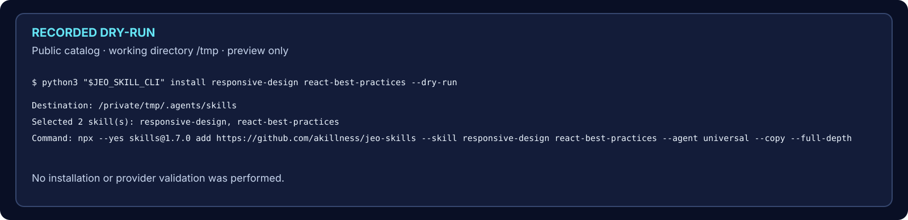

<div align="center">


# jeo-skills

**여러 에이전트에서 필요한 스킬을 찾고, 선택해 설치하고, 각 호스트에 맞게 운영하세요.**

[](#-스킬-목록)
[](#-카테고리)
[](https://agentskills.io/specification)
[](https://github.com/akillness/jeo-skills/actions/workflows/ci.yml)
[](LICENSE)
[](https://www.buymeacoffee.com/akillness3q)

프로젝트가 작성한 부분에는 [MIT 라이선스](LICENSE)가 적용됩니다. 사본이나 상당 부분을 배포할 때 저작권 및 허가 고지를 유지해야 합니다. 제3자 구성 요소에는 별도 조건이 적용될 수 있으므로 [업스트림 출처와 라이선스](docs/attribution.md) 및 각 라이선스·고지 파일도 확인하세요.

[빠른 시작](#-빠른-시작) · [작동 방식](#-작동-방식) · [설치 옵션](#-설치-옵션) · [지원 런타임](#-지원-런타임) · [라우터 CLI](#-라우터-cli) · [사용 추적 및 정리](#-사용-추적-및-정리) · [스킬](#-스킬-목록)

설치부터 시작하려면 [빠른 시작](#-빠른-시작)을, 특정 작업을 찾아보려면 아래 메뉴를 펼치세요.

<details>
<summary>작업별 메뉴 열기</summary>

- [카탈로그와 설치 흐름 이해하기](#-작동-방식)
- [카테고리별 스킬 찾기](#-카테고리)
- [설치 범위와 번들 선택하기](#-설치-옵션)
- [호스트 경로와 Jev 프로필 확인하기](#-지원-런타임)
- [CLI 명령 찾아보기](#-라우터-cli)
- [사용 이력 확인 및 안전하게 정리하기](#-사용-추적-및-정리)
- [선택적 통합 확인하기](#-선택적-통합)

</details>

[English](README.md) · **한국어** · [Español](README.es-ES.md)

</div>

---

## ✨ 한눈에 보기

| 영역 | 내용 |
|---|---|
| **카탈로그** | 스킬마다 하나의 폴더: `.agent-skills/<name>/SKILL.md`, 개방형 Agent Skills 형식 |
| **메타데이터** | 카테고리, 하위 카테고리, 인터페이스, 번들 및 관계 데이터는 `.agent-skills/skills.json`에 한 번만 저장됩니다 |
| **라우터** | `jeo-skill`로 찾아보고 검색하고 선택 항목을 미리 본 다음, 선택한 항목만 설치합니다 |
| **런타임** | 대부분의 에이전트가 공유하는 루트와 Claude Code, GJC, Antigravity, Aside용 네이티브 루트 |
| **수명 주기** | 사용 추적으로 어떤 에이전트도 로드하지 않은 스킬을 찾고, 정리는 미리 보고 검토하며 되돌릴 수 있습니다 |
| **선택 사항** | Jev 의사결정 하네스와 Jevgrep 검색 기능은 기본적으로 꺼져 있으며 별도로 설정합니다 |

## 🚀 빠른 시작

**옵션 A: 에이전트가 설치하도록 합니다.** Claude Code, Codex, Antigravity CLI(`agy`), Kimi Code, Grok Build, OpenCode 또는 다른 코딩 에이전트에 다음을 붙여 넣으세요.

```text
Read https://raw.githubusercontent.com/akillness/jeo-skills/main/setup-all-skills-prompt.md in full and follow it to install the jeo-skills.
```

이 가이드는 운영체제와 에이전트를 감지하고 기본적으로 전체 카탈로그를 설치합니다("core only"를 요청하면 범위를 좁힐 수 있음). 에이전트가 설치하지 않은 스킬은 삭제하지 않습니다.

가이드 설치와 아래 라우터 전용 설치는 별개입니다. OpenSpace, Jev, 메모리·컨텍스트·데이터베이스 및 제공자 설정은 각 단계의 선택과 승인, 호스트 지원 여부에 따라 별도로 진행됩니다. 설치만으로 이 기능이 활성화되지는 않습니다.

GitHub 스타는 별도 선택입니다. `JEO_SKILLS_STAR=true`를 명시하면 `akillness/jeo-skills`에 `gh`로 PUT한 직후 GET으로 확인합니다. `false`면 건너뛰고, 미설정이면 대화형 환경에서 기본값이 아니요인 질문을 표시합니다. 미리 보기에서는 스타를 누르지 않으며, 일반 `--yes`는 스타에 대한 동의가 아닙니다.

**옵션 B: 라우터를 설치한 다음 스킬을 선택합니다.**

```bash
curl -fsSL https://raw.githubusercontent.com/akillness/jeo-skills/main/install.sh | bash
jeo-skill doctor                                    # check catalog and installer prerequisites
jeo-skill search "react performance"                # find skills
jeo-skill install react-best-practices --global --dry-run   # preview
jeo-skill install react-best-practices --global --yes      # install
```

> [!TIP]
> 설치 후 `jeo-skill`을 찾을 수 없으면 `$HOME/.local/bin`을 `PATH`에 추가하세요.

## 🧭 작동 방식

<details>
<summary>카탈로그에서 호스트까지의 흐름 보기</summary>


1. **카탈로그.** 스킬은 `<name>/SKILL.md` 형태로 평평하게 유지됩니다. 분류 체계는 폴더가 아니라 메타데이터이므로 런타임은 항상 예상한 경로에서 스킬을 찾습니다.
2. **라우터.** `jeo-skill`은 `skills.json`을 기준으로 이름, 번들, 카테고리 및 하위 카테고리를 확인하고, 기록하기 전에 정확한 선택 항목을 표시합니다.
3. **설치.** 선택 항목은 `npx skills@1.7.0 add`에 위임되며, 256 KiB 고정 버퍼 기반 단일 패스 스트리밍 복사·SHA-256 검증, 반복형 `os.scandir` 순회, 동일 파일 재기록 생략을 통해 각 대상 런타임 루트에 투영됩니다.
4. **로드.** 각 호스트는 자체 루트에서 스킬을 검색합니다. 배치는 활성화가 아닙니다. 로딩, 권한, 모델 선택 및 실행은 호스트가 담당합니다.

</details>

## 🗂 카테고리

<details>
<summary>관심 분야별 카테고리 보기</summary>


| 카테고리 | 초점 | 찾아보기 |
|---|---|---|
| 🌐 Web | 프런트엔드, 백엔드, 디자인, API, 인증, 데이터, 테스트, 그래픽 | `jeo-skill list -c web` |
| 🏗 Infrastructure | 배포, 환경, 관측 가능성, 보안, 클라우드 데이터 | `jeo-skill list -c infrastructure` |
| 🎮 Game | 클라이언트, 웹, 디자인 UI, 오디오, 모션 VFX, QA 및 릴리스 | `jeo-skill list -c game` |
| 🎬 Creative Media | 이미지, 비디오, 모션, 오디오, 프레젠테이션, 다이어그램 | `jeo-skill list -c creative-media` |
| ⌨️ CLI Tools | 개발자, AI, 미디어, 자동화, 검색 및 벤치마크 CLI | `jeo-skill list -c cli-tools` |
| 🤖 AI & Agents | 오케스트레이션, 에이전트 프레임워크, 평가, 메모리, 계획 | `jeo-skill list -c ai-agents` |
| 🧰 Engineering | 코드 품질, 테스트, 아키텍처, 문서화, 탐색 | `jeo-skill list -c engineering` |
| 🔭 Research & Analysis | 학술, 웹 리서치, 데이터 분석, 실험, 인텔리전스 | `jeo-skill list -c research` |
| 📣 Business | 마케팅, 지원, 제품 디스커버리, 전략, 실행, 성장 | `jeo-skill list -c business` |
| 🔧 Utilities | 지식, 파일, Git, 워크스페이스, 프로젝트 관리 | `jeo-skill list -c utilities` |

전체 생성 목록은 [스킬 목록](#-스킬-목록)에 있습니다.

</details>

## 📦 설치 옵션

<details>
<summary>설치 범위, 예시 및 번들 보기</summary>

실제로 기록한 두 스킬 선택 미리 보기입니다. 설치나 제공자 활성화의 증거는 아닙니다.



| 목표 | 방법 |
|---|---|
| 에이전트의 안내에 따라 전체 설치 | [빠른 시작](#-빠른-시작)의 설정 프롬프트를 붙여 넣습니다 |
| 라우터만 설치(기본값) | 한 줄 명령을 그대로 사용합니다 |
| 라우터 + `starter` 번들 | `JEO_SKILLS_SELECTION=bundle`을 지정한 한 줄 명령 |
| 전체 카탈로그 | `JEO_SKILLS_SELECTION=all`을 지정한 한 줄 명령 |
| 현재 프로젝트에만 설치 | `INSTALL_GLOBAL=false`를 지정한 한 줄 명령 |
| 변경 없이 미리 보기 | `JEO_SKILLS_DRY_RUN=true`를 지정한 한 줄 명령 |
| 특정 스킬 | `jeo-skill install <name> [<name> ...] --global --yes` |
| 특정 스킬 + 런타임/스모크 검증 | `jeo-skill install <name> ... --global --yes --setup` (지원되는 스킬에 한해 훅/MCP 단계를 실행하려면 `--with-hooks` 추가, 도구별 지원 범위는 [설치 가이드](setup-all-skills-prompt.md#step-5--full-mode-shared-tools) 참조) |
| 번들 또는 카테고리 일부 | `jeo-skill install --bundle <bundle> --global --yes` 또는 `--category <id> [--subcategory <id>]` |
| GitHub 프로그램 5종 + 준비 상태 리포트 | `jeo-skill install --bundle github-five-programs --global --yes --setup`. `JEO_SKILLS_SELECTION=bundle JEO_SKILLS_BUNDLE=github-five-programs`를 지정한 한 줄 명령도 같은 리포트를 출력합니다. 오프라인 읽기 전용이라 아무것도 설치하거나 실행하지 않으며 프로그램별 승인을 묻지 않습니다 |

게임 개발 도구별 스킬 10개는 `jeo-skill install --bundle game-source-repositories --dry-run`으로 미리 볼 수 있습니다. 물리, 지형, 재질, 이펙트, 경로 탐색, 애니메이션, 그래픽, 메시와 노이즈를 다루며 업스트림 도구 자체를 설치하거나 실행하지는 않습니다. [설치 범위](setup-all-skills-prompt.md#game-development-source-guides-on-demand)와 [출처별 라이선스](docs/attribution.md)를 확인하세요.

Lightpanda는 `jeo-skill install lightpanda --global --dry-run`으로 선택을 미리 확인한 뒤
스킬을 설치합니다. 스킬 설치는 안내문만 복사하며 브라우저는 설치하지 않습니다. 안정 버전
1.0.2의 fetch, 구조화 데이터, CDP 및 MCP를 다루며, 오프라인 진단은 로컬 메타데이터만 확인하고
실행 호환성을 보증하지 않습니다. 브라우저 다운로드·설치·실행, 사이트 접근, 서버, 자격 증명,
프로바이더 호출은 각각 별도 승인이 필요합니다. [설치 가이드](setup-all-skills-prompt.md#lightpanda-browser-operator-on-demand)를 참고하세요.

Impeccable은 `jeo-skill install impeccable --global --dry-run`으로 선택을 미리 확인한 뒤
스킬을 설치합니다. 스킬 설치는 `pbakaus/impeccable` 4.8.0 운영 가이드만 복사하며 Impeccable,
엔진, 디자인 훅은 설치하지 않습니다. 업스트림 설치 프로그램도 같은 `impeccable` 폴더 이름을
쓰므로 어느 쪽이든 쓰기 전에 오프라인 doctor로 먼저 확인합니다. npm 실행, 엔진 다운로드·실행,
훅, 브라우저 스캔, live 모드는 각각 별도 승인이 필요합니다. [설치 가이드](setup-all-skills-prompt.md#impeccable-design-operator-on-demand)를 참고하세요.

설치 프로그램 변수는 파이프 오른쪽의 `bash`에 지정합니다.

```bash
URL=https://raw.githubusercontent.com/akillness/jeo-skills/main/install.sh
curl -fsSL "$URL" | JEO_SKILLS_SELECTION=bundle bash
curl -fsSL "$URL" | JEO_SKILLS_DRY_RUN=true INSTALL_GLOBAL=false bash
```

<details>
<summary><b>번들</b> — 엄선한 시작 세트</summary>

| 번들 | 스킬 |
|---|---|
| `starter` | jeo-skill, skill-standardization, codebase-search, git-workflow, debugging, testing-strategies, image-to-github-repo |
| `cli-core` | jeo-skill, rtk, semble, zvec-grep, graphify, scrapling |
| `web-frontend` | react-best-practices, responsive-design, web-accessibility, design-system, web-design |
| `web-backend` | api-design, authentication-setup, database-schema-design, backend-testing |
| `web-design` | web-design, design-system, responsive-design, web-accessibility |
| `infrastructure-core` | deployment-automation, environment-setup, monitoring-observability, security-best-practices |
| `game-client` | unity-gamedev-skill-pack, game-studio-harness, game-performance-profiler, awesome-gamedev-agent-skills |
| `game-web` | web-game-development, threejs-fundamentals, implement-fog-of-war |
| `game-art` | game-vfx, rfxgen, perfectpixel, open-design-game-ui-concept, unirig |
| `media-video` | video-production, video-shotcraft, video-motion-previs, shopping-shorts, filmcraft |
| `skill-authoring` | skill-standardization, write-a-skill, upskill |
| `product-management` | pm-skills, create-prd, user-stories, opportunity-solution-tree, north-star-metric |
| `langchain` | langchain-fundamentals, langgraph-fundamentals, deep-agents-core, langsmith |
| `knowledge-repositories` | 22 ontology, code-graph, memory 및 retrieval 운영 가이드 (`jeo-skill install --bundle knowledge-repositories --dry-run`) |
| `ui-design-repositories` | 10 source-pinned UI operators (`jeo-skill install --bundle ui-design-repositories --dry-run`) |
| `github-five-programs` | fabric, moneyprinter-v2, agent-s, google-maps-scraper, gitingest: 오픈소스 프로그램 5종 운영 가이드, 그중 4종은 source-pinned (`jeo-skill install --bundle github-five-programs --dry-run`) |

리포지터리 운영 스킬은 고정된 소스를 안내하는 가이드입니다. 설치해도 업스트림 프로젝트를 설치하거나 실행하거나 연결하지 않으며, 해당 단계에는 별도 승인이 필요합니다.

</details>

</details>

## 🖥 지원 런타임

<details>
<summary>호스트별 경로와 Jev 프로필 보기</summary>

| 런타임 | `--agent` | 전역 루트 | 프로젝트 루트 |
|---|---|---|---|
| JeoPi · Jeo(`jeo-code`) · OMP(`oh-my-pi`) | `universal` (기본값), `jeopi`, `jeo`, `omp` | `~/.agents/skills` | `.agents/skills` |
| Codex | `universal` | `~/.agents/skills` | `.agents/skills` |
| Kimi Code | `kimi` (`skills@1.7.0` 대상은 `kimi-code-cli`) | `~/.agents/skills` | `.agents/skills` |
| OpenCode · Cursor | `universal` | `~/.agents/skills` | `.agents/skills` |
| Claude Code | `claude-code` | `~/.claude/skills` (또는 `$CLAUDE_CONFIG_DIR/skills`) | `.claude/skills` |
| GJC | `gjc` | `~/.gjc/agent/skills` | `.gjc/skills` |
| Pi | `pi` | `~/.pi/agent/skills` | `.pi/skills` |
| Antigravity CLI (AGY) | `agy` / `antigravity-cli` | `~/.gemini/antigravity-cli/skills` | `.agents/skills` |
| Grok Build | `grok` | `${GROK_HOME:-$HOME/.grok}/skills` | `.grok/skills` |
| Antigravity IDE | `antigravity` | `~/.gemini/config/skills` | — |
| Crush | `crush` | `~/.config/crush/skills` | `.crush/skills` |
| Aside | `aside` + `--aside-account <id>` | `~/.aside/u/<id>/skills/user/` | — |

> [!NOTE]
> 이 가이드의 현재 호스트·설정 대상에서는 이전 `gemini-cli` 호스트/설치 별칭을 사용하지 않고 Antigravity CLI의 `agy`/`antigravity-cli`를 사용합니다. Google/Gemini 제공자·모델 이름과 AGY의 `.gemini` 저장 경로는 그대로 유효합니다. `kimi`는 `kimi-code-cli`로 정규화되어 공유 루트에 설치합니다. Kimi 자체는 `${KIMI_CODE_HOME:-$HOME/.kimi-code}/skills`와 프로젝트 `.kimi-code/skills`도 검색하지만, 라우터가 그 모든 경로에 복사한다는 뜻은 아닙니다.
> 
> `grok`는 Grok Build의 네이티브 대상이며 setup 가이드에서 명시적으로 선택할 때만 설정합니다. 설치 대상은 `JEO_SKILLS_AGENT=grok`, Jev 단일 프로필은 `JEV_AGENT=grok`로 선택하세요. 같은 이름의 Superagent/VibeKit CLI가 있으므로 setup은 `PATH`만 보고 자동 선택하지 않습니다. 컨트롤러의 `detect`는 바이너리 존재만 보고하며 구현 종류를 검증하지 않습니다. 그 바이너리가 스킬을 자동 로드한다고 가정하거나 자동 업그레이드하지 않습니다.
> 
> 설치하면 스킬 파일을 루트에 기록하지만 런타임에 로그인하거나 시작하거나 새로고침하지는 않습니다. 새로 설치한 스킬이 보이지 않으면 호스트를 새로고침하세요.

### Jev 에이전트별 프로필과 활성화 경계

Jev는 백엔드를 별도로 선택하고 옵트인한 뒤에만 설정합니다. 현재 가이드는 이전 `gemini-cli` 호스트/별칭을 설정 대상으로 사용하지 않으며, 이는 Google/Gemini 제공자·모델의 전역 종료를 주장하는 것이 아닙니다. 호스트와 모델·제공자는 별개입니다.

#### 기본 프로필

| canonical host ID | 기본 프로필 | 독립 실행형 설치 대상 및 비고 |
|---|---|---|
| `jeo` | `jeo` | `jeo` |
| `gjc` | `gjc` | `gjc` |
| `jeopi` | `jeopi` | `jeopi` |
| `pi` | `pi` | `pi` |
| `codex` | `codex` | `codex` |
| `claude` | `claude` | `claude-code` |
| `agy` | `agy` | `antigravity-cli` |
| `kimi` | `kimi` | `kimi-code-cli` (`skills@1.7.0`) |
| `grok` | `grok` | `grok` (Grok Build) |
| `opencode` | `opencode` | `opencode` |
| `omp` | `omp` | `omp` |
| `cursor` | `cursor` | `cursor` |
| `crush` | `crush` | `crush` |
| `antigravity` | `antigravity` | `antigravity` (IDE) |
| `aside` | `aside-u<account>` | `aside` 계정별 프로필 |

호스트 선택은 `JEV_AGENT` > `JEO_SKILLS_AGENT` 순서입니다. 두 변수가 없거나 값이 `universal`이면 감지된 호스트를 각각 독립적으로 구성합니다. 한 호스트의 프로필 우선순위는 `JEO_SKILLS_JEV_PROFILE` > `JEV_PROFILE` > `~/.agents/jev/agents.json`의 canonical host ID 매핑 > host ID와 같은 이름의 프로필입니다. Aside는 계정을 먼저 선택하고 `aside-u<account>`를 기본값으로 사용합니다.

호스트별 설정이 성공하면 기존 컨트롤러의 config-only 경로가 `~/.agents/jev/agents.json`에 canonical host ID 바인딩을 생성하거나 갱신합니다. 이 갱신은 기존 `native`·`scope`·사용자 지정 프로필 할당과 다른 호스트 항목을 보존하며, hook을 등록하지 않습니다. `agy`, `kimi`, `grok`, `opencode` 및 기타 새 호스트의 프로필은 명시적 하네스·수동 경로만 제공하며 native hook 활성화를 주장하지 않습니다.

컨트롤러(`jev-plugin.mjs`)의 `--agent`는 canonical host ID를 사용합니다. 독립 실행형 `jev-setup.sh --agent`의 값은 스킬 설치 대상(`claude-code`, `antigravity-cli`, `kimi-code-cli`, `grok` 등)입니다. 하네스(`jev-harness.mjs`)에는 `--agent` 옵션이나 호스트 자동 감지가 없으므로 모든 작업에 현재 프로필을 `--profile`로 명시해야 하며, 선택한 프로필이 없거나 비활성화되면 다른 프로필이나 레거시 공유 설정으로 대체하지 않습니다.

현재 프로필 상태만 읽으려면 다음처럼 실행하세요(`status`는 읽기 전용이며 구성된 로컬 백엔드를 확인할 수 있지만, 그 결과를 호스트 활성화나 모델 사용의 증거로 추론하지 않습니다).

```bash
node ~/.agents/jev/jev-harness.mjs \
  --profile "${JEV_PROFILE:?현재 할당된 Jev 프로필을 먼저 선택하세요}" status
```

모든 감지 호스트를 대상으로 설정하려면 설정 서브셸 내부에서만 `JEV_AGENT`, `JEV_PROFILE`, `JEO_SKILLS_AGENT`, `JEO_SKILLS_JEV_PROFILE`을 `unset`하고, 활성 세션 바깥의 값은 보존하세요. 프로필 설정만으로 native hook이 자동 활성화되지 않으며, 기존 실제 `HOME` 설치도 삭제하거나 초기화하지 않습니다. 자세한 호스트 매핑과 활성화 경계는 [Jev 활성화 및 프로필 표](jev/jev-control-plane.rule.md#activation-and-profiles), 설정 순서는 [설정 가이드](setup-all-skills-prompt.md#jev-control-plane-harness-system-one)와 [jev/README.md](jev/README.md)를 확인하세요.

</details>

## 💻 라우터 CLI

<details>
<summary>탐색, 설치 및 관리 명령 보기</summary>

| 명령 | 기능 |
|---|---|
| `jeo-skill categories` | 카테고리 및 하위 카테고리 개수 |
| `jeo-skill list -c <category> [-s <subcategory>]` | 한 분류 구간의 스킬 |
| `jeo-skill search "<query>"` | 이름, 설명 및 분류 체계 검색 |
| `jeo-skill related <name>` | 함께 고려할 중복 또는 순차 스킬 |
| `jeo-skill install ... --dry-run` | 파일을 기록하지 않고 선택 항목 미리 보기 |
| `jeo-skill doctor` | 카탈로그, `npx`/Node.js 사전 요건 및 CLI 링크 확인 |
| `jeo-skill readiness [--global] [--json]` | fabric, moneyprinter-v2, agent-s, google-maps-scraper, gitingest의 오프라인 읽기 전용 준비 상태 리포트 |
| `jeo-skill usage scan` / `usage report` | 설치된 스킬 중 에이전트가 실제로 로드한 항목 추적 |
| `jeo-skill prune-unused` / `restore` / `purge-quarantine` | 한 번도 사용하지 않은 스킬 격리, 복원 또는 삭제 |
| `jeo-skill prune-retired --global --dry-run` | 폐기된 카탈로그 스킬의 오래된 복사본 제거 |
| `jeo-skill explore "<question>" --dry-run` | 선택적 Jevgrep 문서 검색 |

모든 명령에서 사용할 카탈로그를 고정하려면 `JEO_SKILLS_CATALOG=/path/to/skills.json`을 설정합니다.

</details>

## 🧹 사용 추적 및 정리

<details>
<summary>사용 상태, 격리 및 복원 절차 보기</summary>


`jeo-skill usage scan`은 로컬 런타임 기록(Claude, Codex, OpenCode, Antigravity, Aside, jeopi/GJC/OMP/Pi 세션 및 Jev 주입 원장)을 읽습니다. 사용 요약과 증분 스캔 메타데이터를 `~/.local/state/jeo-skill` 아래에 저장하며, 대화 기록 본문은 저장하지 않습니다. 에이전트가 스킬을 호출하거나 로드한 경우에만 사용으로 집계하고, 프롬프트의 언급은 집계하지 않습니다.

| 상태 | 의미 |
|---|---|
| `used` | 보존된 기록에서 한 번 이상 호출되거나 로드됨 |
| `protected` | `jeo-skill`, `starter`/`cli-core`/`infrastructure-core` 번들, `usage keep` 고정 및 `usage relevance` 보호 |
| `in-grace` | 아직 사용되지 않았지만 추적 시작 또는 최초 설치 후 30일 이내 |
| `candidate` | 유예 기간 후에도 관찰된 사용이 없어 격리 대상 |

```bash
jeo-skill usage scan
jeo-skill usage report --status candidate
jeo-skill prune-unused --global                                   # preview only
jeo-skill prune-unused --global --apply --skip-jev-review         # or --jev-profile <p> --allow-remote
jeo-skill restore --list
jeo-skill restore --batch <batch-id> --apply
jeo-skill purge-quarantine --older-than 30 --apply                # permanent
```

> [!IMPORTANT]
> 관찰된 사용이 없다고 해서 평생 사용하지 않는다는 증거는 아닙니다. 런타임이 오래된 기록을 삭제했을 수 있습니다. `--apply`는 먼저 다시 스캔하며 현재 기록 저장소를 읽을 수 없으면 거부합니다. 이 카탈로그와 일치함을 입증할 수 있는 복사본만 이동하고, 타사 복사본과 심볼릭 링크는 유지합니다.

카탈로그 자체에서 스킬을 제거하는 것은 저장소 체크아웃에서 하는 별도의 유지관리자 단계입니다. 기본은 미리 보기이며, `--apply`에는 쉼표로 구분한 승인 이름과 검토 방식 선택이 필요합니다. 적용하면 프로젝션을 다시 생성하고 검증하며 실패하면 되돌립니다.

```bash
jeo-skill usage report --json > report.json
python3 scripts/retire-unused-skills.py --usage-report report.json                     # preview
python3 scripts/retire-unused-skills.py --usage-report report.json --apply \
  --approve name-a,name-b --skip-jev-review          # or --jev-profile <p> --allow-remote
```

</details>

## 🔄 설치된 스킬 최신 상태 유지

<details>
<summary>공유 루트를 새로 고치고 심볼릭 링크 호스트를 재조정하기</summary>


[전체 설치 가이드](setup-all-skills-prompt.md)를 따르는 머신에서는 카탈로그가 하나의 공유 루트(`~/.agents/skills`)에 있고 각 호스트의 스킬 디렉터리(claude, pi, gjc, antigravity, cursor, aside-user, opencode-config)가 스킬당 심볼릭 링크로 이를 가리킵니다. 이후에는 **공유 루트만** 새로 고치면 됩니다 — 호스트별 복사 설치기(`jeo-skill install -a claude-code`, `-a gjc`, …)를 실행하는 것은 위험합니다: rmtree가 심볼릭 링크 슬롯을 따라 공유 루트 원본까지 삭제할 수 있습니다.

```bash
bash scripts/skills-upgrade.sh              # pull → doctor → refresh → prune → reconcile → verify
bash scripts/skills-upgrade.sh --dry-run    # 쓰기 없이 계획만 생성
python3 scripts/refresh-host-links.py       # 링크 계획만 표시 (읽기 전용)
```

각 단계의 역할:

1. 신뢰된 체크아웃에서 `git pull --ff-only` — non-fast-forward면 실행 중단
2. `jeo-skill doctor`로 갱신된 카탈로그 검증
3. `jeo-skill install --all --global --yes`로 공유 루트를 최신 카탈로그로 재작성
4. `jeo-skill prune-retired --global`로 은퇴한 카탈로그 사본 제거 (레거시 중복 정리 단계)
5. `scripts/refresh-host-links.py --apply` — 새로 추가된 스킬의 링크 생성, 끊긴 링크 제거, **호스트 로컬 비카탈로그 스킬은 절대 삭제하지 않음**
6. 검증: doctor 상태 + 모든 설정된 호스트 루트의 끊긴 링크 스캔

| 옵션 | 효과 |
|---|---|
| `--hosts <목록>` | 호스트 지정 (기본 `claude,pi,gjc,antigravity,cursor,aside-user,opencode-config`) |
| `--skip-pull` | 오프라인 실행 (편집으로 해결하지 않고 나중에 stale 체크아웃 놀람을 거부) |
| `--replace-copies` | 낡은 실제 디렉터리 사본도 링크로 변환 (먼저 격리) |
| `SKILLS_UPGRADE_HOSTS` | 환경변수로 기본 호스트 지정 |

교체된 사본과 낡은 링크는 `~/.local/state/jeo-skill/quarantine/upgrade-<UTC>/` 아래로 격리되며 절대 하드 삭제되지 않고, 전체 흐름은 멱등성을 가집니다: 건강한 설치는 no-op 계획으로 다시 실행됩니다.

### 주기적 갱신

`scripts/com.jeo-skills.skills-upgrade.plist`는 주 1회(월요일 09:30) 업그레이드를 실행하는 launchd 템플릿으로, 로그는 `~/.local/state/jeo-skill/upgrade.log`에 남습니다. 스크립트가 직접 최신 nvm Node bin을 `PATH`에 추가하므로 헤드리스 실행에서도 `npx`를 찾을 수 있습니다. 설치:

```bash
cp scripts/com.jeo-skills.skills-upgrade.plist ~/Library/LaunchAgents/
launchctl bootstrap gui/$(id -u) ~/Library/LaunchAgents/com.jeo-skills.skills-upgrade.plist
```

</details>

## 🔌 선택적 통합

<details>
<summary>Jev와 Jevgrep의 선택적 설정 경계 보기</summary>

| 통합 | 목적 | 설정 |
|---|---|---|
| **Jev** | 의사결정 하네스: 작업을 스킬로 라우팅하고, 컨텍스트를 정리하며, 정리 제안을 검토합니다 | `bash jev/jev-setup.sh --profile <name> ...` · [jev/README.md](jev/README.md) |
| **Jevgrep** | 선택한 스킬 또는 위키 문서의 원격 검색 | `jeo-skill explore "<question>" --root <dir> --dry-run` · [jevgrep](.agent-skills/jevgrep/SKILL.md) |

둘 다 카탈로그 설치에 포함되지 않습니다. 둘 다 구성된 백엔드로 데이터를 보낼 수 있습니다. `jeo-skill`에서는 이를 호출하는 명령(`prune-unused --apply`, `usage relevance`, `explore`)이 `--allow-remote` 없이는 원격 사용을 거부합니다. 독립 실행형 Jev 하네스는 구성된 백엔드로 직접 전송하므로, 사용하기 전에 호스팅 프로필을 승인하세요.

명시적으로 요청한 Jev 설정이 실패해도 검증된 스킬 설치는 실패로 처리하지 않습니다. 경고를 확인하고 Jev 통합이 부분적으로 완료되었음을 별도로 확인하세요.

</details>

## 📚 스킬 목록

> `.agent-skills/skills.json`에서 생성 · 428개 스킬 · 카테고리를 펼치면 스킬 목록이 보입니다.

### 🌐 웹 (71개)

하위 분류: `frontend` (12), `backend` (3), `design` (16), `api` (2), `auth` (1), `data` (13), `testing` (4), `accessibility` (1), `performance` (1), `graphics` (12), `capture` (6)

<details>
<summary>스킬 보기</summary>

| Skill |
|---|
| `ax` |
| `react-best-practices` |
| `react-bits` |
| `state-management` |
| `amrouter` |
| `colibri` |
| `pydantic-ai` |
| `astryx` |
| `build-daily-inspiration-sites` |
| `daily-ui-inspiration-capture` |
| `design-first-ui-prompting` |
| `design-system` |
| `devup-ui` |
| `html-to-interaction-prompts` |
| `lazyweb` |
| `responsive-design` |
| `stitch-skills` |
| `web-design` |
| `api-design` |
| `api-documentation` |
| `authentication-setup` |
| `database-schema-design` |
| `payloadcms` |
| `supabase-agent-skills` |
| `typesense` |
| `backend-testing` |
| `browser-harness` |
| `playwriter` |
| `web-accessibility` |
| `optimize-web-animations` |
| `threejs-animation` |
| `threejs-fundamentals` |
| `threejs-geometry` |
| `threejs-interaction` |
| `threejs-lighting` |
| `threejs-loaders` |
| `threejs-materials` |
| `threejs-postprocessing` |
| `threejs-shaders` |
| `threejs-textures` |
| `agentation` |
| `react-grab` |
| `slides-grab` |
| `stitched-full-page-capture` |
| `chatbot-template` |
| `airship` |
| `moli` |
| `lightpanda` |
| `design-taste-frontend` |
| `impeccable` |
| `higgsfield-websites` |
| `stagehand` |
| `helix-foundry` |
| `pg-jev` |
| `orionbelt-ontology-builder` |
| `open-ontologies` |
| `semantica` |
| `utopia` |
| `pixeltable` |
| `turbovec` |
| `pixelrag` |
| `superdesign` |
| `better-design` |
| `design-taste` |
| `canvas-ui` |
| `paper-shaders` |
| `ui-layouts` |
| `hyperiux` |
| `motion-primitives` |
| `cursify` |
| `trickle-ui` |

</details>

### 🏗 인프라 (17개)

하위 분류: `deployment` (2), `environment` (2), `observability` (3), `security` (3), `cloud-data` (6), `automation` (0), `tooling` (1)

<details>
<summary>스킬 보기</summary>

| Skill |
|---|
| `deployment-automation` |
| `vercel-deploy` |
| `environment-setup` |
| `system-environment-setup` |
| `log-analysis` |
| `monitoring-observability` |
| `openocta` |
| `security-best-practices` |
| `strix` |
| `firebase-cli` |
| `unity-cli` |
| `genkit` |
| `looker-studio-bigquery` |
| `zurp` |
| `ai-knowledge-management-platform` |
| `knowledge-catalog` |
| `cocoindex` |

</details>

### 🎮 게임 (39개)

하위 분류: `client` (9), `web` (2), `server` (1), `design-ui` (7), `audio` (1), `animation` (3), `motion-vfx` (3), `sprite-image` (1), `art-resources` (1), `storytelling` (0), `tooling` (5), `qa-performance` (4), `release` (2)

<details>
<summary>스킬 보기</summary>

| Skill |
|---|
| `implement-fog-of-war` |
| `unity-gamedev-skill-pack` |
| `agentic-gamedev-skills` |
| `web-game-development` |
| `bmad-gds` |
| `open-design-game-ui-concept` |
| `open-design-game-ui-handoff` |
| `open-design-game-ui-takeover` |
| `rfxgen` |
| `animato` |
| `unirig` |
| `dalamud-vfx-editor` |
| `game-vfx` |
| `perfectpixel` |
| `game-studio-harness` |
| `underworld-overseer-save-mapper` |
| `godogen` |
| `game-build-log-triage` |
| `game-demo-feedback-triage` |
| `game-performance-profiler` |
| `wai-play` |
| `game-ci-cd-pipeline` |
| `steam-store-launch-ops` |
| `unity-technologies-skills` |
| `multiplayer-game-architecture` |
| `game-design-theory` |
| `game-feel` |
| `game-ui-ux` |
| `awesome-gamedev-agent-skills` |
| `jolt-physics` |
| `terrain3d` |
| `material-maker` |
| `effekseer` |
| `godot-voxel-tools` |
| `recast-navigation` |
| `ozz-animation` |
| `the-forge` |
| `meshoptimizer` |
| `fastnoise2` |

</details>

### 🎬 크리에이티브 미디어 (40개)

하위 분류: `image` (10), `video` (18), `motion` (1), `audio` (2), `presentation` (1), `diagram` (2), `design` (4), `capture` (0), `storytelling` (2)

<details>
<summary>스킬 보기</summary>

| Skill |
|---|
| `aura-asset-images` |
| `generate-reference-inspired-brand-worlds` |
| `god-tibo-imagen` |
| `paperbanana` |
| `unsplash-asset-images` |
| `browser-video-recording` |
| `gbro-collage-broll` |
| `opencut` |
| `video-production` |
| `filmcraft` |
| `video-shotcraft` |
| `video-to-superprompt` |
| `vox-director` |
| `video-motion-previs` |
| `elevenlabs-tts` |
| `presentation-builder` |
| `drawio` |
| `open-design` |
| `blender-mcp` |
| `webtoon-harness` |
| `palmier-pro` |
| `openstory` |
| `drama-skills` |
| `openmontage` |
| `open-generative-ai` |
| `higgsfield-generate` |
| `higgsfield-marketplace-cards` |
| `higgsfield-product-photoshoot` |
| `higgsfield-soul-id` |
| `higgsfield-youtube-thumbnail` |
| `higgsfield-video-explainer` |
| `higgsfield-brandkit` |
| `shopping-shorts` |
| `video-use` |
| `autoclip` |
| `moneyprinter-turbo` |
| `opencreator` |
| `voicestudio` |
| `diagram-design` |
| `artcraft` |

</details>

### ⌨️ CLI 도구 (44개)

하위 분류: `developer-cli` (12), `ai-cli` (15), `media-cli` (1), `automation-cli` (7), `search-cli` (8), `benchmark-cli` (1)

<details>
<summary>스킬 보기</summary>

| Skill |
|---|
| `soup` |
| `caveman` |
| `ccpi-marketplace` |
| `cli-anything` |
| `ghgrab` |
| `jeo-skill` |
| `pretext` |
| `aider-cli-workflow` |
| `claudekit` |
| `fabric` |
| `ooo` |
| `open-code-review` |
| `zeude` |
| `compresso` |
| `codeflow` |
| `graphify` |
| `headroom` |
| `npm-git-install` |
| `okf` |
| `rtk` |
| `tokhub` |
| `scrapling` |
| `agent-reach` |
| `scrapingant-web-fetch` |
| `semble` |
| `zvec-grep` |
| `x-twitter-scraper` |
| `hyperfine-benchmarking` |
| `codeburn` |
| `mole` |
| `mcp-server-sv-number` |
| `zeroshot` |
| `k-skill-setup` |
| `jevgrep` |
| `openrig` |
| `uzu` |
| `context-mode` |
| `rea` |
| `llmfit` |
| `hyper-extract` |
| `leann` |
| `google-maps-scraper` |
| `gitingest` |
| `craft-anything` |

</details>

### 🤖 AI 및 에이전트 (78개)

하위 분류: `orchestration` (19), `agent-frameworks` (20), `skill-authoring` (5), `evaluation` (8), `memory` (7), `planning-review` (13), `discovery` (3), `prompting` (3)

<details>
<summary>스킬 보기</summary>

| Skill |
|---|
| `bmad` |
| `deep-dive` |
| `deepinit` |
| `spec-kit` |
| `ecc` |
| `microsoft-agent-framework` |
| `openai-agents-python` |
| `goalflow` |
| `openexecutive` |
| `article-prompts-to-skills` |
| `skill-standardization` |
| `upskill` |
| `write-a-skill` |
| `langsmith` |
| `opik` |
| `skill-autoresearch` |
| `kadath` |
| `mex` |
| `bmad-idea` |
| `grill-me` |
| `grill-with-docs` |
| `plannotator` |
| `survey` |
| `to-tickets` |
| `to-spec` |
| `triage` |
| `openspace` |
| `agentic-skills` |
| `agenticskills` |
| `prompts-chat` |
| `find-skills` |
| `mcp-builder` |
| `ask-matt` |
| `grilling` |
| `setup-matt-pocock-skills` |
| `to-questionnaire` |
| `wayfinder` |
| `writing-for-agents` |
| `agent-guardrails` |
| `agent-system-design` |
| `agent-tool-routing` |
| `reflexion-pattern` |
| `agent-manager` |
| `langchain-fundamentals` |
| `langchain-middleware` |
| `langchain-rag` |
| `langchain-dependencies` |
| `langgraph-fundamentals` |
| `langgraph-persistence` |
| `langgraph-human-in-the-loop` |
| `deep-agents-core` |
| `deep-agents-memory` |
| `deep-agents-orchestration` |
| `langchain-bmad` |
| `a2a-protocol` |
| `agent-benchmarking` |
| `agent-observability` |
| `multi-agent-eval-harness` |
| `agent-memory-architecture` |
| `okf-agent-memory` |
| `agent-workflow` |
| `agent-principles` |
| `paperclip` |
| `jev-control-plane` |
| `anyjev` |
| `typesafe-computer-use` |
| `jev-ultrafast` |
| `agentic-graphrag-blueprint` |
| `memmachine` |
| `memori` |
| `memsearch` |
| `harness2` |
| `ruflo` |
| `agent-beacon` |
| `agent-s` |
| `aidlc-workflows` |
| `revfactory-harness` |
| `elephant-goldfish-model` |

</details>

### 🧰 엔지니어링 (25개)

하위 분류: `code-quality` (12), `testing` (3), `architecture` (6), `documentation` (2), `code-navigation` (2)

<details>
<summary>스킬 보기</summary>

| Skill |
|---|
| `audit-reference-originality` |
| `audit-verify-explain-grade-5` |
| `code-refactoring` |
| `code-review` |
| `debugging` |
| `diagnosing-bugs` |
| `github-repo-candidate-quality-gate` |
| `migrate-to-shoehorn` |
| `performance-optimization` |
| `performance-profiling` |
| `scaffold-exercises` |
| `tdd` |
| `testing-strategies` |
| `improve-codebase-architecture` |
| `zoom-out` |
| `nightrun` |
| `changelog-maintenance` |
| `technical-writing` |
| `codebase-search` |
| `codebase-design` |
| `domain-modeling` |
| `implement` |
| `prototype` |
| `codebase-memory-mcp` |
| `ponytail` |

</details>

### 🔭 연구 및 분석 (15개)

하위 분류: `academic` (3), `web-research` (4), `data-analysis` (2), `experimentation` (2), `benchmarking` (1), `intelligence` (3)

<details>
<summary>스킬 보기</summary>

| Skill |
|---|
| `academic-research` |
| `research-paper-writing` |
| `scientific-agent-skills` |
| `deep-research` |
| `heretic` |
| `data-analysis` |
| `pattern-detection` |
| `autoresearch` |
| `scientific-llm-benchmarks` |
| `agent-pulse` |
| `research` |
| `korean-patent-search` |
| `fineenvs` |
| `mi-orchestration` |
| `image-to-github-repo` |

</details>

### 📣 비즈니스 (71개)

하위 분류: `marketing` (5), `support` (2), `publishing` (1), `pm-toolkit` (5), `pm-discovery` (13), `pm-strategy` (12), `pm-execution` (12), `pm-market-research` (7), `pm-analytics` (3), `pm-go-to-market` (6), `pm-growth` (5)

<details>
<summary>스킬 보기</summary>

| Skill |
|---|
| `marketing-automation` |
| `write-like-meng-on-x` |
| `x-bookmark-quote-posts` |
| `customer-email-draft-threads` |
| `customer-support-verification` |
| `yuwen-publish-precheck` |
| `youtube-growth-playbook-2026` |
| `pm-skills` |
| `draft-nda` |
| `grammar-check` |
| `privacy-policy` |
| `review-resume` |
| `analyze-feature-requests` |
| `brainstorm-experiments-existing` |
| `brainstorm-experiments-new` |
| `brainstorm-ideas-existing` |
| `brainstorm-ideas-new` |
| `identify-assumptions-existing` |
| `identify-assumptions-new` |
| `interview-script` |
| `metrics-dashboard` |
| `opportunity-solution-tree` |
| `prioritize-assumptions` |
| `prioritize-features` |
| `summarize-interview` |
| `ansoff-matrix` |
| `business-model` |
| `lean-canvas` |
| `monetization-strategy` |
| `pestle-analysis` |
| `porters-five-forces` |
| `pricing-strategy` |
| `product-strategy` |
| `product-vision` |
| `startup-canvas` |
| `swot-analysis` |
| `value-proposition` |
| `brainstorm-okrs` |
| `create-prd` |
| `dummy-dataset` |
| `job-stories` |
| `outcome-roadmap` |
| `pre-mortem` |
| `prioritization-frameworks` |
| `stakeholder-map` |
| `summarize-meeting` |
| `test-scenarios` |
| `user-stories` |
| `wwas` |
| `competitor-analysis` |
| `customer-journey-map` |
| `market-segments` |
| `market-sizing` |
| `sentiment-analysis` |
| `user-personas` |
| `user-segmentation` |
| `ab-test-analysis` |
| `cohort-analysis` |
| `sql-queries` |
| `beachhead-segment` |
| `competitive-battlecard` |
| `growth-loops` |
| `gtm-motions` |
| `gtm-strategy` |
| `ideal-customer-profile` |
| `marketing-ideas` |
| `north-star-metric` |
| `positioning-ideas` |
| `product-name` |
| `value-prop-statements` |
| `moneyprinter-v2` |

</details>

### 🔧 유틸리티 (28개)

하위 분류: `knowledge` (8), `files` (5), `git` (4), `workspace` (1), `project-management` (4), `productivity` (3), `general` (3)

<details>
<summary>스킬 보기</summary>

| Skill |
|---|
| `lapian-notes` |
| `llm-wiki` |
| `notebooklm` |
| `obsidian-mind` |
| `obsidian-second-brain` |
| `opencontext` |
| `file-organization` |
| `git-guardrails-claude-code` |
| `git-submodule` |
| `git-workflow` |
| `game-sounds` |
| `sprint-retrospective` |
| `standup-meeting` |
| `task-estimation` |
| `task-planning` |
| `google-workspace` |
| `watermarks-remover` |
| `solo-skills` |
| `eli5` |
| `handoff` |
| `resolving-merge-conflicts` |
| `teach` |
| `wait-what` |
| `wizard` |
| `hwp` |
| `rhwp-advanced` |
| `rhwp-edit` |
| `rowboat` |

</details>


---

## 🛠 유지관리자용

| 경로 | 내용 |
|---|---|
| `.agent-skills/` | 스킬 폴더, `skills.json`(소스 오브 트루스) 및 생성된 `skills.toon` |
| `install.sh` · `setup-all-skills-prompt.md` | 한 줄 설치 프로그램과 에이전트 주도 설정 가이드 |
| `scripts/` | 카탈로그 검증, 프로젝션 생성, 변경 로그 및 회귀 테스트 |
| `jev/` | 선택적 Jev 컨트롤 플레인 소스 |
| `changelog/` | 월별 릴리스 노트(영어 및 한국어) |
| `assets/` | README 시각 자료(Codex 생성, 출처는 `assets/readme-visuals.json`) |

```bash
python3 scripts/validate-catalog-projections.py        # manifest, TOON, READMEs, SKILL.md
python3 scripts/generate-catalog-projections.py --check
python3 scripts/changelog.py check
```

메타데이터는 생성된 표가 아니라 `skills.json`에서 편집하세요. 다른 프로젝트에서 적용한 스킬의 업스트림 소스와 라이선스는 [docs/attribution.md](docs/attribution.md)에 나열되어 있습니다.

## 🤝 관련 프로젝트

| 프로젝트 | 역할 |
|---|---|
| [jeo-code](https://github.com/akillness/jeo-code) | 공유 루트에서 스킬을 로드하는 코딩 에이전트 |
| [gajae-code (GJC)](https://github.com/akillness/gajae-code) | 자체 네이티브 스킬 루트를 사용하는 에이전트 런타임 |

## Revfactory Harness 팀 아키텍처 팩토리

[`revfactory-harness`](.agent-skills/revfactory-harness/SKILL.md)는
[revfactory/harness v2.1.0](https://github.com/revfactory/harness/tree/92d9f1b29e7af81acebf51a9fcd1832e739a1414)에
고정된 운영 스킬입니다. Claude Code 팀·스킬 생성, 실제 호스트 도구를 확인한 실행 모드 선택,
v1 마이그레이션, 실행 근거에 따른 `/harness:evolve`를 안내합니다.
`jeo-skill install revfactory-harness --global --yes`는 가이드와 오프라인 점검 도구만 복사하며
업스트림 플러그인을 활성화하지 않습니다. 헬퍼는 공개 파일 18개의 해시를 검증하지만
`runtime_verified: false`를 유지합니다. [설치·승인 경계](setup-all-skills-prompt.md#revfactory-harness-team-architecture-factory-on-demand)를
확인하세요. 기존 `harness2`와 별개이며, 은퇴된 카탈로그 이름 `harness`를 복원하지 않습니다.

## Elephant-Goldfish Model

[`elephant-goldfish-model`](.agent-skills/elephant-goldfish-model/SKILL.md)은
[Google Elephant-Goldfish Model](https://github.com/google/elephant-goldfish-model)의 설계·검토 흐름을 안내합니다.
카탈로그 스킬 설치만으로 업스트림 플러그인이 활성화되지는 않습니다. 새로운 컨텍스트의 검토에는
실제로 격리된 서브에이전트가 필요하며, 사람의 승인과 설치 경계를 지켜야 합니다.
[설치 경계](setup-all-skills-prompt.md#elephant-goldfish-model-on-demand)를 확인하세요.

---

<!-- WHATS-NEW:START -->

## 🆕 v2026-11-07 업데이트

| 변경 사항 | 상세 내용 |
|--------|---------|
| **심볼릭 링크 호스트용 원커맨드 공유 루트 업그레이드** | `scripts/skills-upgrade.sh`가 전체 설치 이후의 유지보수 부담(pull → 검증 → 갱신 → 은퇴 정리 → 호스트 링크 재조정 → 검증)을 하나의 멱등 커맨드로 통합했습니다. `setup-all-skills-prompt.md`를 따르는 머신에서는 카탈로그가 하나의 공유 루트(`~/.agents/skills`)에 있고 각 호스트 디렉터리(claude, pi, gjc, antigravity, cursor, aside-user)에 스킬당 심볼릭 링크가 생기는데, 스크립트는 그 공유 루트만 갱신하고 안전하지 않은 호스트별 복사 설치기(rmtree가 심볼릭 링크 슬롯을 따라 공유 루트 원본까지 삭제할 수 있음)는 의도적으로 피합니다. 함께 추가된 `scripts/refresh-host-links.py`는 새 스킬의 링크를 생성하고 끊긴 링크를 제거하며, 교체된 사본과 낡은 링크를 삭제하지 않고 `~/.local/state/jeo-skill/quarantine/upgrade-<UTC>/` 아래로 격리하고, 호스트 로컬 비카탈로그 스킬은 절대 만지지 않습니다. 스크립트가 직접 최신 nvm Node bin을 `PATH`에 추가해 헤드리스 실행에서도 `npx`를 찾고, `scripts/com.jeo-skills.skills-upgrade.plist`가 launchd로 주간 스케줄을 담당합니다. README와 `README.ko.md`에는 이 워크플로우를 담은 "설치된 스킬 최신 상태 유지" 섹션이 새로 생겼습니다. |

## 🆕 v2026-11-06 업데이트

| 변경 사항 | 상세 내용 |
|--------|---------|
| **`image-to-github-repo`: 이미지 속 프로그램의 깃허브 주소 찾기** | 스크린샷·카드뉴스·SNS 게시물에서 프로젝트 이름, 표기된 링크, 별 개수, 키워드 힌트를 읽어 `scripts/resolve_repo.py`로 각 프로젝트의 실제 저장소를 검증하는 `research` / `web-research` 스킬을 추가했습니다(표준 라이브러리만 사용, GitHub API GET 요청만 전송). 이름이 바뀐 저장소의 리다이렉트를 따라가고, 표기된 별 개수를 0.9~2배 범위와 비교하며, 키워드 불일치만으로 후보를 배제하지 않고, 동명 저장소 사이에서 추측하는 대신 `verified` / `high` / `medium` / `ambiguous` / `low`로 신뢰도를 보고합니다(종료 코드 0/1/2). `scripts/test_image_to_github_repo.py`가 오프라인으로 검증하며 CI에서 실행됩니다. `jeo-skill install image-to-github-repo --global --yes`로 설치하고, 네트워크·토큰 경계는 설치 가이드의 온디맨드 런타임 섹션에 기록했습니다. |
| **GitHub 프로그램 5종 운영 가이드와 `github-five-programs` 번들** | 기존 `fabric`에 더해 `moneyprinter-v2`, `agent-s`, `google-maps-scraper`, `gitingest`를 추가했습니다. 새 가이드는 모두 라우팅 우선 구조이며 감사한 업스트림 커밋에 고정되고, SHA-256 매니페스트, 오프라인 표준 라이브러리 `scripts/preflight.py`, evals를 갖췄습니다. 감사 결과는 추정이 아니라 기록입니다: MPV2의 앱 내 CRON 메뉴는 등록한 작업을 실행하지 않고 Outreach는 확인 없이 조건을 통과한 모든 행에 메일을 보냅니다. pip는 Python 3.12.1 이상에서 `gui-agents` 0.3.2를 거부하고 Agent S는 생성한 코드를 동작별 확인 없이 실행합니다. 스크레이퍼 웹 UI에는 인증이 없고 텔레메트리는 기본 켜짐입니다. gitingest 기본 무시 목록은 `.env`만 제외하고 `.env.local`과 키 파일은 포함합니다(0.3.1에서 관찰). `jeo-skill install --bundle github-five-programs --global --yes`로 설치하며 `scripts/test_five_github_programs.py`가 헬퍼를 오프라인으로 검증하고 CI에서 실행됩니다. |
| **프로그램 5종 준비 상태 리포트 한 번에** | `jeo-skill readiness`(새 `skill_readiness.py`)가 각 운영 스킬의 오프라인 `preflight.py`를 실행해 리포트 하나로 출력합니다. `jeo-skill install … --setup`, `install.sh`(`JEO_SKILLS_SELECTION=all` 또는 `JEO_SKILLS_BUNDLE=github-five-programs`), `scripts/install-full-tools.sh --programs`가 설치 후 이 리포트를 보여주며 도구 총계에는 포함하지 않습니다. blocked는 설치 실패가 아니라 리포트(종료 코드 1)이고, 프로그램별 승인이 필요 없으며 아무것도 설치하지 않고 네트워크 연결도 열지 않습니다. `JEO_SKILLS_READINESS=skip`으로 끌 수 있습니다. `fabric`에도 같은 고정 헬퍼(기본 루프백 서버, `.env` 권한 점검)가 생겼고 `image-to-github-repo`가 `starter` 번들에 들어갔습니다. 오프라인 테스트가 CI에서 Linux와 macOS를 모두 검증합니다. |
| **전체 도구 설치 헬퍼가 이미 `mex`·`rtk`가 있는 환경에서도 실패하지 않음** | 공개 가이드를 실제 Mac에서 돌려 보니 TeX Live가 `/opt/homebrew/bin/mex`를 이미 쓰고 있어 `npm install -g mex-agent`가 EEXIST로 멈췄고, `install-full-tools.sh`가 5/6으로 끝났습니다. 이제 다른 프로그램이 `mex` 링크를 쓰고 있으면 이를 감지해 고정 버전 패키지를 `~/.local` 아래에 `--no-bin-links`로 설치하고(기존 `mex-agent` 래퍼가 그 경로를 찾습니다) 다른 도구는 건드리지 않습니다. 같은 헬퍼를 읽다가 `rtk`에도 비슷한 빈틈을 확인했습니다. `cargo`가 없으면 고정 버전이 Homebrew 등으로 이미 설치돼 있어도 실패했습니다. 이제 PATH의 `rtk`가 고정 버전을 정확히 출력하고 `rtk gain`이 실행될 때만 통과하며, 그 밖의 상태와 `cargo install` 실패는 여전히 실패로 보고합니다. Mac 실제 실행은 `mex` 수정 뒤 6/6이었고, `rtk` 변경은 그 실행이 아니라 테스트로 검증했습니다. 테스트: `scripts/test_full_tools_independent.py`(새 케이스 6개, 변형 검증 완료). |
| **jeo-code 프롬프트 라우팅 및 지식 훅** | `route-hooks.py install --host jeo` 가 `~/.jeo/hooks.json`(`config.json` 은 건드리지 않음)에 `pre-prompt` 항목을 등록합니다. jeo-code 0.12.23 은 OpenSpace 스킬 노트를 프롬프트에 덧붙이고 최종 응답을 `turn-end` 훅에 전달하므로 `ingest-prompt.py` / `ingest-output.py` 도 동작합니다. 이전 jeo 빌드는 파일을 무시합니다. 실제 `jeo` 실행으로 end-to-end 검증했습니다. |
| **워크플로 규칙이 실제로 적용되고 설치 시 검증됨** | `setup-workspace.py`가 `jeo-workflows.md`를 `alwaysApply: true` frontmatter가 맨 위에 오도록 쓰고(기존 마커 우선 파일은 jeopi가 무시), 기존 파일은 제자리에서 마이그레이션하며, openspace 폴백이 OpenSpace venv 인터프리터를 쓰도록 고쳤습니다. 읽기 전용 `--verify`가 규칙마다 `ok`/`inert`/`stale`/`missing`을 보고하고, `install.sh`는 이를 실행해 규칙이 적용되지 않으면 설치를 실패로 끝냅니다. 가이드 Step 5B도 활성화와 `--verify`를 명시적으로 실행합니다. `route-hooks.py status`는 낡은 라우터 복사본도 알려 줍니다. 실제 `jeopi`·`jeo` 실행과 끄기 대조군으로 검증했습니다. |
| **`aidlc-workflows`: AWS Labs의 AI-DLC 운영 가이드** | `awslabs/aidlc-workflows`(MIT-0)를 다루는 `ai-agents` / `orchestration` 스킬을 추가했습니다. `aidlc` 명령과 `/aidlc` 뒤에 있는 하네스 중립 워크플로 엔진입니다. 라우팅 우선 구조이며 릴리스 `v2.11.3`(`a8721be`)에 고정되고, SHA-256 매니페스트, 감사 노트, 동작 evals 6개, 오프라인 표준 라이브러리 `scripts/preflight.py`를 갖췄습니다. 이 헬퍼는 플랫폼 지원, 설치 도구, root·sudo 여부, 다운로드를 바꾸는 환경변수, 프로젝트의 핀·자동 승인 권한·훅 개수·MCP 서버를 `aidlc`를 실행하거나 값을 출력하지 않고 점검합니다. 감사 결과는 추정이 아니라 기록입니다: README는 설치 스크립트를 `sh`로 바로 넘기지만 설치 가이드에는 먼저 내려받아 증명을 검증하는 경로가 있고, 호환되는 `gh`가 없으면 출처 증명을 건너뛰며 릴리스에는 OS 코드 서명이 없습니다. 기본 Claude 설정은 `Edit(/**)`를 미리 승인하고 훅 명령 16개를 등록하며, 선택형 Claude MCP 항목은 AWS 서버 4개를 `uvx ...@latest`로 시작합니다. 릴리스 이후 `main`에서는 Kiro 하네스 ID도 바뀌었습니다. `jeo-skill install aidlc-workflows --global --yes`로 설치하며 테스트는 `scripts/test_aidlc_workflows.py`입니다. |

## 🆕 v2026-11-04 업데이트

| 변경 사항 | 상세 내용 |
|--------|---------|
| **설치 성능 및 메모리 최적화** | `install_support.py`가 재사용 가능한 256 KiB `bytearray`/`memoryview`(`readinto`) 버퍼로 SHA-256 해싱과 단일 패스 스트리밍 복사를 수행하고, `require_safe_tree`·`dir_manifest`·`copy_tree`·`_retired_reason`의 `Path.rglob("*")` 재귀 순회를 반복형 `os.scandir` 순회로 교체해 `__pycache__`·`.DS_Store` 하위 진입과 불필요한 `Path`/`lstat` 할당을 제거했습니다. 대상 파일의 `st_size`·`st_mtime_ns`·SHA-256이 이미 일치하면 디스크 재기록을 생략합니다. `jeo-skill.py`는 `search`에서 `--limit 0` 즉시 반환과 `heapq.nsmallest` 상위 선택을 적용하고, `bootstrap` 시 동일 라우터 경로에서는 하위 Python 프로세스를 띄우지 않고 인프로세스로 CLI 링크를 생성합니다. `install.sh`는 `PYTHONDONTWRITEBYTECODE=1`을 기본 설정하고 사전 심볼릭 링크 검사를 반복형 `os.scandir`로 수행합니다. |
| **OpenSpace 프롬프트 라우터 메모리 절감 및 Orca 훅 지원** | `openspace/scripts/route_prompt.py`가 `index.json` 캐시를 압축 저장하고, BM25 순위 산정 전에 전체 스킬의 단어 집합(`set`)을 일괄 생성하던 방식을 제거해 질의어 빈도만 계산한 뒤 상위 후보에 대해서만 집합을 생성합니다. `openspace/scripts/route-hooks.py`는 기본 홈 외에도 `CLAUDE_CONFIG_DIR`, `CODEX_HOME`, Orca 프로필·런타임·계정 홈(`claude@orca-*`, `codex@orca-runtime`, `codex@orca-*`)을 감지해 프롬프트 라우팅 훅을 설치·관리합니다. |
| **저장소 폴더 정리 및 회귀 테스트 보강** | 작업 트리에 남아 있던 에이전트별 임시 스킬 폴더, 이전 세션·캐시 디렉터리(`graphify-out/`, `llm-wiki/`, `.jeo/`, `.gjc/`, `.omo/`, `.serena/`), 빈 은퇴 스킬 폴더, 빌드 산출물, `__pycache__`, `.DS_Store`를 일괄 정리했습니다. `test_installer_regressions.py`는 하위 프로세스 표준 입력을 `DEVNULL`로 격리해 대화형 터미널에서도 선택적 Jev 프롬프트 대기 없이 즉시 실행되며, `test_performance_regressions.py`와 `test_openspace_routing.py`에 멱등 복사 패스트패스 및 Orca 리다이렉트 홈 훅 회귀 테스트를 추가했습니다. |

## 🆕 v2026-11-01 업데이트

| 변경 사항 | 상세 내용 |
|--------|---------|
| **선택적 스킬 설정 및 훅 자동화** | `jeo-skill install`에 명시적 허용목록(`SUPPORTED_SETUP_SKILLS`) 기반 `--setup`과 Hook/MCP 자동 등록용 `--with-hooks`(`JEO_SKILLS_APPROVE_ALL_HOOKS_MCP=true` 내보냄)를 추가했습니다. 지원 스킬(`open-ontologies`, `okf-agent-memory`, `mex`, `openspace`, `ooo`, `rtk`, `cli-anything`, `spec-kit`, `ecc`, `jev-control-plane`, `graphify`, `semble`, `zvec-grep`, `llm-wiki`)의 번들 CLI/스모크 검증을 수행하며, 미지원 스킬은 안전하게 건너뜁니다. `--dry-run` 시 서브프로세스나 파일 쓰기를 전혀 수행하지 않습니다. |
| **OpenSpace `--skip-mcp` 런타임 모드 및 훅 격리** | `install-openspace.sh`에 `--skip-mcp` 옵션을 추가하고 `jeo-skill install openspace --setup` 및 `install-full-tools.sh`의 기본 호출에 연결해, `--with-hooks` 승인 없이 호스트 MCP 설정이 변경되는 문제를 방지했습니다. upstream v2.0의 ooo/openspace 독립 설치 구조를 그대로 유지합니다. |
| **Full-tools 확장 및 다중 에이전트 spec-kit** | `scripts/install-full-tools.sh`에 기본 6/6 계약을 유지하면서 `Graphify`, `OpenSpace`(BM25 프로브 기준), `Open-Ontologies`(`smoke.py`), `OKF-Agent-Memory`(`smoke.py`)를 포함하는 `--extended`(10/10 도구) 모드를 추가했습니다. TeX Live `mex`보다 최신 nvm/npm 버전을 우선하는 `~/.local/bin/mex-agent` 래퍼 설치, `~/.local/bin/rtk -> ~/.cargo/bin/rtk`(`1.1.0`) 심볼릭 링크 연결, 다중 에이전트 `SPEC_KIT_INTEGRATION` 스테이징 및 안전한 미존재 파일 전용 병합을 지원합니다. |
| **지식 파이프라인 및 볼트 동시성 강화** | `hooks/ctx/lock.py`, `hooks/ingest-output.py`, `hooks/ingest-prompt.py`를 레포에 패키징하고 실제 `fcntl.flock` 폴백을 내장했습니다. `Stop`/`AfterAgent`/`post-turn` 턴 종료 이벤트 시 출력이 있으면 볼트 락 하에 `ingest-output.py`로 위임하며 가시적 텍스트 블록만 추출합니다(`thinking`/`tool_use` 필터링). 고유 `capture_id`와 배타적 생성(`"x"`)으로 파일 덮어쓰기 충돌을 차단하고, 백틱 비변조 외곽 펜스를 적용했으며, 락 점유 시 `.state/deferred-index.jsonl`에 안전하게 지연 기록 후 다음 실행 시 자동 색인 병합합니다. |
| **Jev 다중 호스트 바인딩 및 ECC 업데이트** | 감지된 10개 코딩 에이전트 호스트를 `~/.agents/jev/agents.json`의 독립 프로필에 연결하고, `echo-turn-jeopi`를 `runtimeMode: assist`로 전환하여 스킬 본문 자동 주입을 활성화했으며, Claude Code `ecc@ecc` 플러그인을 Jev 리뷰를 거쳐 `2.2.3`으로 업데이트했습니다. |

## 🆕 v2026-10-30 업데이트

| 변경 사항 | 상세 내용 |
|--------|---------|
| **Impeccable 디자인 운영 가이드** | `pbakaus/impeccable` 스킬 4.8.0 / 엔진 0.1.18, 커밋 `02523aec3e4c4580102d996d1b6a71fbe062e03f`(Apache-2.0, LICENSE·NOTICE.md 확인)에 고정한 `impeccable` v1.0.0을 추가했습니다. 카탈로그는 408→409개(`web/design`)입니다. 업스트림 명령 24개를 라우팅하고, 업스트림 스킬 없이도 작업할 수 있도록 critique/audit 방법론과 craft floor를 요약해 담았으며, 62개 규칙 탐지기와 ignore 정책을 문서화했습니다. npm 실행, 엔진 다운로드·실행, 샌드박스가 아닌 디자인 훅, 브라우저 스캔, live 모드는 각각 별도 승인합니다. 업스트림도 같은 `impeccable` 폴더 이름을 쓰므로 어느 설치 프로그램이든 쓰기 전에 먼저 확인합니다. |
| **Impeccable 도구와 검증** | `scripts/doctor.py`는 설치본(업스트림/카탈로그 운영 가이드), 런처 순서의 엔진 후보와 선택적 고정 다이제스트 비교, 훅 매니페스트, 텔레메트리 옵트아웃, 프로젝트 컨텍스트 파일을 아무것도 실행하거나 소켓을 열거나 파일을 쓰지 않고 보고합니다. `scripts/triage_findings.py`는 `detect --json` 결과를 blocking/quality/slop/advisory 순으로 묶고 명령을 제안하며, 위치 샘플은 중복 없이 보여 주고 snippet은 출력하지 않습니다. macOS arm64의 임시 `HOME`에서 실제 동작을 확인했습니다: 공개 카탈로그 설치본이 저장소와 바이트 단위로 같았고, 고정 런처가 받은 엔진 0.1.18의 SHA-256이 고정값과 일치했으며, 바이너리의 62개 규칙 목록이 `source.json`과 같았고, 실제 `detect --json` 실행(종료 코드 2, 결과 19건)이 문서화한 스키마와 일치해 triage까지 처리됐습니다. 전용 테스트 22/22, Node 24에서 설치 회귀 72/72·설치 가이드 34/34가 통과했습니다. 평가 9개는 작성된 시나리오입니다. URL/CDP 스캔, 훅, live 모드, npm 경로, Linux/Windows 자산은 아직 검증하지 않았습니다. |
| **mex v1.2: mex-agent 0.8 setup 대응** | 새 프로젝트에서 `scripts/install.sh`가 `mex setup` 직후 멈췄습니다. mex-agent 0.8은 스캐폴드 내용 채우기가 남아 있으면 종료 코드 2를 내는데 설치 스크립트가 `set -euo pipefail`로 실행돼 루트 `AGENTS.md` 연결, 그래프, check가 실행되지 않았고, 0.8은 파이프로 넣던 도구 메뉴 답도 무시합니다. 이제 mex-agent 0.8 이상에는 `--yes --tool <tool>`(필요 시 `--force`)을 넘기고 0.7.x에는 기존 메뉴 입력을 유지합니다. 종료 코드 2는 `mex-agent setup next --start` 안내와 함께 보고하고 계속 진행하며, 그 밖의 setup 실패에서는 멈춥니다. mex-agent가 없으면 `mex-agent@0.8.5`를 설치합니다(`MEX_AGENT_NPM_SPEC`로 변경 가능). 임시 `HOME`에서 실제 mex-agent 0.8.5로 종료 코드 0, 루트 `AGENTS.md` 생성, graph·check 실행을 확인했습니다. |
| **obsidian-second-brain v1.0.1: 원본 설치 수정** | `WITH_UPSTREAM=1`이 macOS `/bin/bash` 3.2와 UTF-8 로케일에서 중단됐습니다(`"$dest…"`를 정의되지 않은 변수로 읽음). `GLOBAL=1`이면 `npx skills add -g`가 `~/.claude/skills/obsidian-second-brain`을 라우팅 사본 링크로 바꿔, 원본 clone은 항상 실패하는데도 `Done`이 출력됐고 재실행하면 기존 원본 checkout이 삭제됐습니다. 이제 `npx` 실행 동안 그 자리의 실제 디렉터리를 옆으로 옮겨 두었다가 복원하고, clone이 성공한 뒤에만 라우팅 링크·사본을 교체하며, 다른 디렉터리는 건드리지 않고 거부합니다. `git`이 없거나 clone 실패·거부 시 종료 코드 1을 냅니다. 실제 `skills@1.7.0`, `git`, `/bin/bash` 3.2로 첫 실행에서 원본이 설치되고 재실행에서 로컬 표식이 유지된 채 pull되는 것을 확인했습니다. |
| **devup-ui v1.0.1과 회귀 방지** | `devup-ui/scripts/install.sh`에도 같은 `$pm…` 패턴이 있어 중괄호로 고쳤습니다. `scripts/test-runtime-config-writers.sh`가 추적 중인 셸 스크립트에서 비ASCII 문자 바로 앞의 중괄호 없는 변수를 검사하고, obsidian 원본 설치 경우(최초, 재실행, 다른 디렉터리, clone 실패, 원본만 있는 경우)를 UTF-8 로케일에서 검증합니다. `mex/scripts/test-runtime.sh`는 mex-agent 0.8 setup을 검증합니다. Node 24에서 설정 작성기 26/26, 설치 회귀 72/72, 설치 가이드 34/34가 통과했습니다. |
| **ponytail v2.0.0: Ponytail 5.3.3 반영** | 원본 `DietrichGebert/ponytail` 5.3.3, 커밋 `7801d061243d7b753bad0e0b3c057cd250b11755`(MIT, 라이선스 사본 포함)에 맞췄습니다. 표준 라이브러리보다 코드베이스에 이미 있는 코드를 먼저 쓰고, 변경이 깨뜨리는 호출부를 모두 마무리하고, 위험한 로직에는 작은 검사를 남기고, 답변은 건너뛴 것과 위험으로 끝냅니다. `ultra`는 요청 자체에 이의를 제기하고, 표시 주석은 `shortcut: <한계>, <업그레이드 시점>`입니다(예전 `ponytail:`도 수집). `/ponytail-review`와 `/ponytail-audit`는 전체 품질 리뷰가 됐고, `/ponytail-gain`은 예전 80–94% 주장 대신 고정 커밋의 측정값(코드 −53%, 비용 −26%, 시간 −41%)을 보여 줍니다. 분류는 `engineering/code-quality`로 옮겼습니다. |
| **ponytail 설치 안내와 레거시 제거** | `references/commands.md`와 `scripts/install.sh`가 원본 플러그인의 모든 호스트(Codex `plugin add`, Copilot CLI, Qwen, omp, OpenCode 2 `plugin add`, Antigravity, Hermes, Devin, Grok, Goose, OpenClaw, Kimi, Cursor 훅)와 설정·제거 방법을 다룹니다. `APPLY=1`은 호스트 하나만 실행하고 모호하면 거부합니다. 2 MB 데모 GIF(옛 단계), 존재하지 않는 `skills serve` MCP 안내, OpenCode 2가 거부하는 파일 경로 플러그인 안내, 사실과 다른 변경 이력 날짜를 지우고 현재 단계를 보여 주는 5 KB SVG로 바꿨습니다. 설치 용량은 2.03 MB → 33 KB입니다. 격리된 환경에서 Claude Code와 omp에 플러그인 5.3.3이 실제로 설치되는 것을 확인했습니다. |
| **caveman v2.0.0: 유지되는 원본으로 교체** | 원본에서 삭제된 `mattpocock/skills` 출처 사본을 `JuliusBrussee/caveman` 4.0.1, 커밋 `d262ab3882952a59312ff3537cd86d894523c5ab`(Apache-2.0, 라이선스 사본과 변경 사항 명시)에 맞췄습니다. 결론부터 말하고, 코드·경로·오류는 그대로 두며, 임의 약어와 화살표를 쓰지 않고, 경고·되돌릴 수 없는 작업·파일에 남는 내용은 평문으로 씁니다. 근거 없던 “~75%”는 원본 자체 수치로 바꿨고 내용 없는 상투 섹션을 지웠습니다. 새 `scripts/test_ponytail_caveman_skills.py`(테스트 12개, CI 포함)가 고정 커밋, 버전, 링크, 레거시 파일, 설치 스크립트의 실행 안 함·호스트 하나 규칙을 검사합니다. |
| **openspace v2.0: 모든 모델에서 동작하는 프롬프트 단계 스킬 라우팅** | `scripts/route_prompt.py`가 모델이 실행되기 전에 OpenSpace의 로컬 BM25(`SkillRanker.bm25_only`, LLM·임베딩·네트워크 없음)로 설치된 스킬을 순위 매기고, 맞는 스킬 최대 3개를 `SKILL.md` 경로와 함께 넘깁니다. 그래서 어떤 스킬을 고를지가 모델 성능에 달려 있지 않습니다. 프롬프트가 스킬 이름을 직접 말하거나, 드문 단어가 충분히 겹칠 때만 제안하고 나머지는 조용히 넘어갑니다. 한국어 조사 제거, 영문·한글 경계 분리, 언어별 희소도 판단을 넣었습니다. `scripts/route-hooks.py`가 Claude Code, Codex, Gemini CLI/Antigravity, Kimi Code, jeopi/omp/pi/gjc, OpenCode에 하나의 래퍼로 연결하며, 문제가 생기면 아무것도 출력하지 않습니다. 스킬 764개 기준 라벨 점검: 라우팅해야 할 33개 중 26개에 맞는 스킬, 라우팅하면 안 되는 24개 중 23개는 무출력, 프롬프트당 약 0.3초. 라우팅을 끈 대조군과 비교한 실제 실행으로 Claude Code, jeopi(`claude-haiku-4-5`, `gpt-5.6-sol` 포함 모델 3개), omp에서 확인했습니다. |
| **OpenSpace와 ooo 분리 설치** | `ooo/scripts/install.sh`는 더 이상 OpenSpace를 확인·설치·검색하지 않으며 `--search`, `--ensure-openspace`는 사용법 오류입니다. OpenSpace 설치 스크립트는 검증한 커밋 고정, 망가진 venv 재생성, `mcp<2` 고정(MCP SDK 2에서 `openspace-mcp`가 깨짐), 라우터 점검을 합니다. MCP 등록 스크립트는 Gemini CLI와 Qwen Code가 시작을 거부하던 `toolTimeout`을 더 이상 쓰지 않고 기존 항목을 고칩니다. 새 `test_openspace_routing.py`(테스트 24개)와 `test_ooo_installer.py`(5개)가 CI에서 기존 결합 테스트를 대체합니다. |

> 📜 이전 기록: [`changelog/ko/`](changelog/ko/) (월별 파일, 최신순).

<!-- WHATS-NEW:END -->

---

<div align="center">

jeo-skills가 도움이 되었다면 저장소에 ⭐를 눌러 주세요.

</div>
