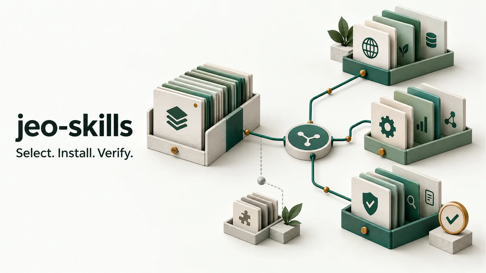
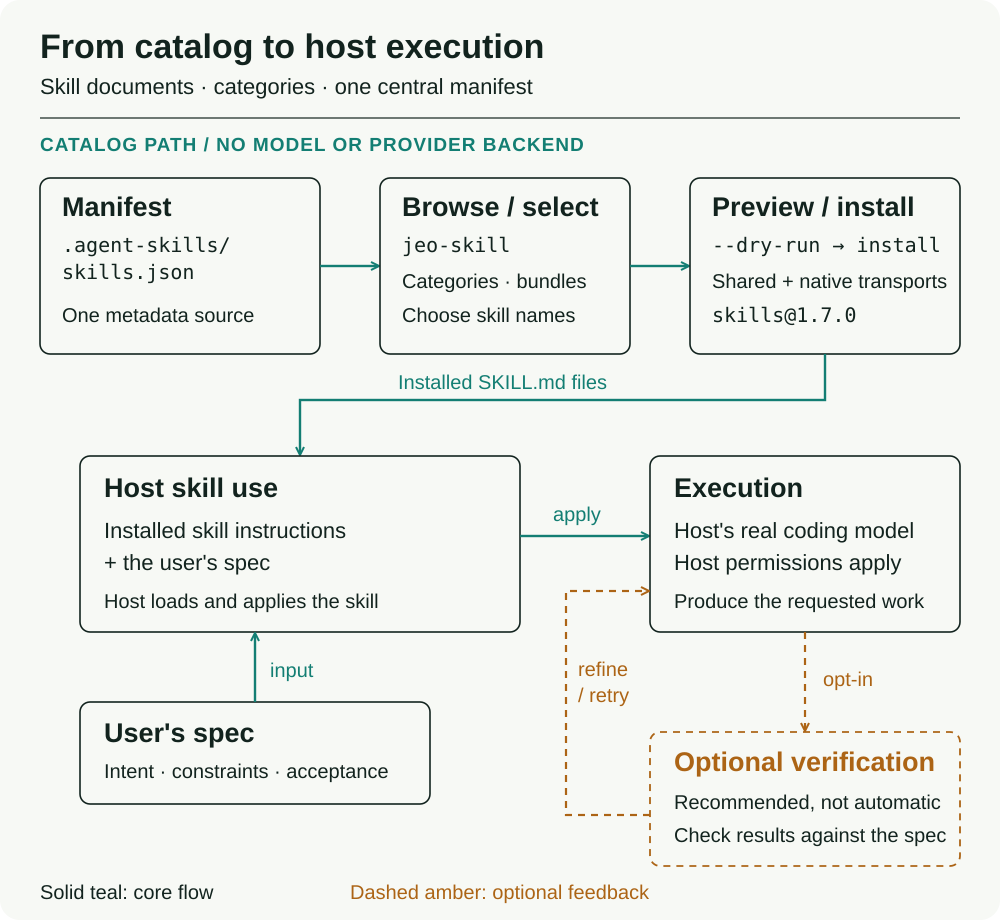
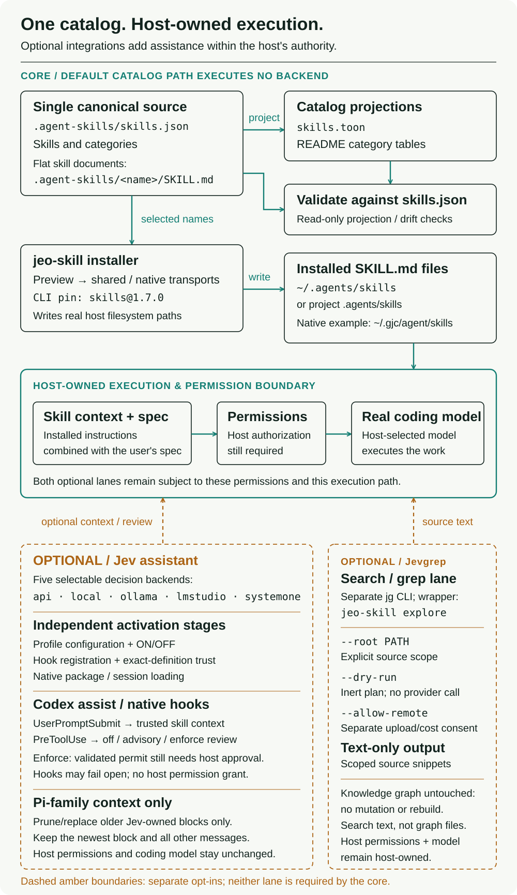

# Agent Skills

<div align="center">

[](https://github.com/akillness/jeo-skills)
[](https://github.com/akillness/jeo-skills)
[](LICENSE)
[](https://github.com/akillness/gajae-code)
[](https://github.com/akillness/jeo-code)
[](https://www.buymeacoffee.com/akillness3q)

**카테고리형 스킬 400개 · 경량 선택 설치 · 압축 TOON 카탈로그 · 멀티플랫폼**

스펙 우선 멀티 에이전트 LLM 워크플로우 컬렉션입니다. 프롬프트 하나로 전체 설정을
위임하거나, `jeo-skill` 라우터부터 설치해 필요한 웹, 인프라, 게임, 미디어, CLI,
유틸리티 스킬만 선택적으로 추가할 수 있습니다.

[빠른 시작](#-설치) · [스킬 목록](#-스킬-목록) · [English](README.md)

</div>

---



## 💡 Agent Skills란?

각 스킬은 `.agent-skills/<name>/SKILL.md` 경로로 그대로 검색됩니다. 카테고리,
하위 분류, 인터페이스, 번들, 연관 관계는 `.agent-skills/skills.json` 한 곳에서
관리하므로 중복 래퍼 폴더를 만들거나 런타임 경로를 옮기지 않아도 됩니다.
`jeo-skills`는 [`jeo-code`](https://github.com/akillness/jeo-code)와 함께 쓰는 스펙 우선 Socratic AI 코딩 에이전트 스킬 카탈로그입니다. 각 스킬은 필요한 작업 단계에 맞춰 조합하며, 실제 적용 범위는 호스트 통합과 사용자가 선택한 설정에 따라 달라집니다.

| 워크플로우 | 실제 구성 |
| :--- | :--- |
| 요구사항·스펙 | [`ooo`](.agent-skills/ooo/SKILL.md) · [`spec-kit`](.agent-skills/spec-kit/SKILL.md) |
| 실행·검증 | [`cli-anything`](.agent-skills/cli-anything/SKILL.md) · [`browser-harness`](.agent-skills/browser-harness/SKILL.md) |
| 런타임 | 공개 [`jeo-code`](https://github.com/akillness/jeo-code)와 호스트별 통합 |

필요한 단계만 조합해 사용하세요. 이 카탈로그는 공개 `jeo-code` 런타임과 스킬 문서를 연결하지만, 호스트의 권한·훅 정책을 대신 부여하지 않습니다.

---

## 🏗 워크플로우 및 아키텍처




### Jev 컨트롤 플레인 (선택적 System One 통합)

Jev는 기본 카탈로그 설치에 포함되지 않는 별도의 홈 범위 선택 기능이며, 전체 설치에서도 동일합니다. 소스와 상세 안내는 [`jev/`](jev/README.md)에 있습니다. 표준 `jev/jev-setup.sh`가 선택한 백엔드, 하네스, 호스트 규칙을 구성합니다. 규칙 파일 배치는 네이티브 훅 설치나 런타임 강제 적용의 증거가 아닙니다. 호스트가 규칙을 로드하고 따라야 합니다.

| 단계 | 커맨드 | 역할 |
| :--- | :--- | :--- |
| 스킬 라우팅 | `route-skills "<task>"` | 읽기 전용 `skills.json`에 대한 용량 인식 선택: 게이트 Noul 뒤 샤딩된 Choice 또는 어휘 숏리스트를 적합도 Noul로 재정렬 → Top-K 스킬 또는 명시적 "없음". `model_policies`에서 `provider/model` 권고 라우팅 |
| 컨텍스트 프루닝 | `prune-context` | JSONL `{id,text}` 블록 → keep/drop 판정, 응답 백엔드의 상태 한도 안에서 배치 처리 |
| 액션 게이트 | `review "<task>" '<proposal>'` | `permit` / `proposal_only` / `reject` / `unavailable` + 백엔드·모델·티어에 묶인 SHA-256 영수증 |

발견은 **로컬 카탈로그**(`route-skills` / `jeo-skill`)에서 시작합니다. 로컬 매치가 약하면 `publicRegistryFallback`으로 `find-skills`의 **공개 skills.sh 레지스트리** 탐색을 안내합니다. 후보를 검토하고 명시적인 승인을 받은 뒤 설치하세요. 하네스 자체는 공개 스킬을 검색하거나 설치하지 않습니다.

#### 구성: 백엔드, 작업별 라우팅, 결정 모델 분리

**백엔드 종류** — 하나 또는 다섯 개 모두를 선택합니다(`api`, `local`, `ollama`, `lmstudio`, `systemone`). 각 작업은 프로필에서 결정 백엔드를 선택합니다. 하네스는 스킬 선택, keep/drop 판정, 검토 결과를 반환하며, 활성화된 호스트 통합이 아래 범위에서 결과를 적용합니다. 적격 `api`·`systemone` 드라이버에서 실제 제공 모델과 저장된 검증 모델 증명이 일치해야 `permit`을 반환할 수 있습니다. Jev는 호스트의 코딩 모델을 자동 변경하지 않습니다:

```bash
# 구성: 작업별 백엔드를 한 번에 하나씩 명시적으로 설정
bash jev/jev-setup.sh --profile gjc --mode api --config-only --key-env JEV_API_KEY --route-backend api --review-backend api
bash jev/jev-setup.sh --profile gjc --mode local --config-only --prune-backend local

# 폴백 체인(주 백엔드 미사용 시 순서대로 시도)
bash jev/jev-setup.sh --profile jeopi --mode local --config-only --fallback route-skills=ollama,lmstudio

# 호출당 오버라이드(저장된 설정 변경 없음)
node ~/.agents/jev/jev-harness.mjs --profile gjc route-skills --backend ollama --model qwen2.5:7b "<task>"

# 각 작업별 설정 상태 확인
node ~/.agents/jev/jev-harness.mjs --profile gjc status
node ~/.agents/jev/jev-harness.mjs --profile gjc status --operation route-skills
```

**백엔드 전제 조건 및 부작용**:
- `api` — TypeSafe API 키(`JEV_API_KEY`) 필요; 호스팅 추론은 비용 발생 가능; 설정만 무료.
- `local` — 승인된 일반 설정은 Python 의존성과 전체 정밀도 모델을 내려받습니다. `--config-only`는 둘 다 실행하지 않습니다.
- `ollama` / `lmstudio` — 승인된 일반 설정은 서버를 시작하거나 모델을 내려받고 로드할 수 있습니다. `--config-only`는 설정만 기록합니다.
- `systemone` — 운영자가 띄운 System One 엔드포인트 지정(다운로드, 서비스 시작 없음).

**결과를 실제 적용하는 호스트 통합**. 기본값은 `JEV_RUNTIME_MODE=advisory`, `JEV_REVIEW_MODE=off`이며, 각 프로필의 `JEV_ENABLED`가 ON/OFF를 제어합니다. `--runtime-mode assist`에서는 로드된 Claude·jeopi·oh-my-pi 계열 통합이 선택한 설치 스킬의 `SKILL.md` 본문과 출처 경로를 모델 문맥에 주입합니다. 신뢰된 카탈로그와 일치하고 스킬 루트 내부에 있는 파일만 읽으며, 크기 초과 파일은 통째로 건너뜁니다(스킬당 64 KiB, 합계 96 KiB). jeopi·oh-my-pi 계열은 오래된 Jev 소유 커스텀 메시지만 입력에서 정리합니다. 최신 스킬 지침과 사용자·시스템·어시스턴트·도구 메시지는 보존합니다. Claude는 현재 스킬 주입만 지원합니다. `model-plan`은 계속 권고 전용이며 호스트 모델을 바꾸지 않습니다.

Codex 0.162.1에서는 네이티브 훅의 `UserPromptSubmit`으로 스킬을 주입하고 `PreToolUse`로 제안된 행동을 검토합니다. 프로필 구성과 훅 정의 등록은 별도 단계입니다:

```bash
# JEV_API_KEY를 먼저 설정하세요. 기존 프로필의 키를 유지하려면 --key-env를 생략합니다
node ~/.agents/jev/jev-plugin.mjs configure --agent codex --profile codex --backend api --key-env JEV_API_KEY --runtime-mode assist --review-mode advisory --apply
node ~/.agents/jev/jev-plugin.mjs enable --agent codex --profile codex --apply
node ~/.agents/jev/jev-plugin.mjs hooks-install --agent codex --profile codex --apply
```

Codex `/hooks`에서 설치된 정확한 정의를 검토하고 신뢰해야 합니다. 설치만으로 신뢰가 부여되거나 프로필이 활성화되지는 않습니다. `advisory` 검토는 판정을 알리며, 명시적인 `--review-mode enforce`는 검증된 백엔드의 `permit`이 아니면 제안된 행동을 거부합니다. 호스트의 실행 권한은 OS·호스트 설정이 결정하며 Jev 응답이 이를 허가하지 않습니다. 검토 범위는 등록된 도구 matcher이며, 신뢰되지 않은 훅·호스트 실패·시간 초과에서는 호출이 생략되거나 fail-open할 수 있으므로 OS 보안 경계가 아닙니다. Claude에는 자동 행동 차단이 없고 Codex에는 자동 대화 이력 정리가 없습니다. `host-plan`은 읽기 전용이며 네이티브 패키지 복사는 영구 등록이 아닙니다. 로드·신뢰·검증 범위는 [호스트 통합 안내](jev/README.md)를 참고하세요.

**ON/OFF 및 공유 프로필**:
```bash
# 프로필의 Jev 활성화
bash jev/jev-setup.sh --profile gjc --enable

# 활성화 상태 확인
node ~/.agents/jev/jev-harness.mjs --profile gjc status
# Exit 0 = 사용 가능, 2 = 비활성화/미구성, 3 = fail-closed

# Jev 비활성화(설정 보존; 다음 상태 호출에서 2로 종료)
bash jev/jev-setup.sh --profile gjc --disable

# 개인정보 프로필 파일(모드 600)
ls -la ~/.agents/jev/profiles/
# gjc.env, gjc.api.env, gjc.local.env, gjc.systemone.env, …
```

**설정 전용 모드(무료)**: 백엔드 다운로드, 추론 호출, 호스팅 서비스를 실행하지 않고 설정 검증:
```bash
# 오프라인 검증; 백엔드에 도달하지 않음
bash jev/jev-setup.sh --profile jeopi --mode ollama --config-only --endpoint http://127.0.0.1:11434 --model qwen2.5:0.5b
node ~/.agents/jev/jev-harness.mjs self-test --mock
```

**논블로킹 Jev 설정**: Jev 설정은 선택 사항이며 스킬 카탈로그를 차단하지 않습니다. Jev 설정을 거절, 건너뛰거나 오류가 발생한 경우:
- 검증된 선택 스킬은 설치 상태를 유지합니다. 카탈로그 탐색과 결정적인 `jeo-skill` 검색은 Jev 없이도 사용할 수 있습니다.
- 잘못된 모드, 프로젝트 범위 opt-in, 임시 파일 생성, 다운로드, Jev 설정 실패는 경고하고 Jev만 건너뜁니다.
- `JEO_SKILLS_JEV=skip`은 기존 Jev 상태를 보존하며, 실제 스킬 설치 오류는 여전히 실패로 반환합니다.

**로컬 레거시 구성**: 의도적인 `~/.agents/jev/.env`(프로필 없음)는 하위 호환성을 위해 지원됩니다. 주변 환경 변수는 매칭되는 파일 키를 오버라이드하지만 누락된/비활성화된 프로필을 활성화할 수는 없습니다. 프로필(`--profile <id>`)은 격리됩니다. 누락된 프로필은 절대 다른 프로필로 폴백되지 않습니다.

Jev 작업은 판정을 반환하며, 자동 적용 여부는 위의 호스트와 선택 모드에 달려 있습니다. 모든 응답은 백엔드 종류·모델·티어를 기록합니다(적격 드라이버의 제공 모델과 저장된 증명이 일치하지 않으면 `unvalidated`). 증명 일치나 통신 성공은 보정·판단 품질의 증거가 아닙니다. 토큰 절감량도 호스트 사용량 실측이 아닌 추정치입니다. `--mock`은 오프라인 계약을 검증하며 자율 조치를 허가하지 않습니다.

자세한 설정, 종료 코드, 검증 범위, local/Ollama/LM Studio 설정 전제 조건은 [`jev/README.md`](jev/README.md)를 참조하세요.
### Jevgrep (선택적 원격 소스 탐색)

[Jevgrep](.agent-skills/jevgrep/SKILL.md)는 Jev 컨트롤 플레인 하네스와 별개인 `jg` CLI입니다. 기본 경로는 로컬 카탈로그 메타데이터, 네이티브 정확 검색/LSP, zvec-grep 워크스페이스 검색, 그래프 관계용 Graphify `query` / `path` / `explain`입니다. 명시적으로 선택한 스킬 문서, 위키 Markdown, 그래프 소스 문서를 텍스트로 검색할 수 있지만 그래프 바이너리를 탐색하거나 소스를 수정하거나 그래프를 재생성하지 않습니다.

범위를 좁힌 공개 문서 루트로 Jevgrep 호출 없이 실행 계획을 미리 확인합니다.

```bash
jeo-skill explore "Which document explains checkpoint ownership?" --root /path/to/jeo-skills/docs --dry-run
# 쿼리·소스 업로드·비용을 별도로 승인하고, jg와 저장된 자격 증명이 이미 구성된 경우에만:
jeo-skill explore "Which document explains checkpoint ownership?" --root /path/to/jeo-skills/docs --allow-remote
```

원격 실행은 쿼리와 검색 대상 소스 내용을 설정된 제공자에게 전송하며 비용이 발생할 수 있습니다. 저장된 자격 증명은 전송 동의가 아닙니다. 일괄 설정은 Jevgrep을 설치하거나 인증하지 않습니다. 고정 버전 설치와 제한은 [수동 선택 가이드](setup-all-skills-prompt.md#jevgrep-optional-remote-source-discovery)를 참조하세요. Dry-run은 실행하지 않는 계획이며 로컬 `jg files -- ROOT`는 파일명이나 개인정보 보호 인증이 아닌 개수만 반환합니다. 어느 쪽도 실제 제공자의 검색 품질을 증명하지 않으며, 여기서는 해당 검색을 실행하지 않았습니다.


---

## 📦 설치

### ✨ 권장: LLM 위임 설치(프롬프트 하나로 모든 플랫폼 지원)

설정 프롬프트를 코딩 에이전트(Claude Code, Codex, Gemini CLI 등)에게 전달하세요. 에이전트가 가이드를 읽고 OS를 감지한 뒤 `skills` CLI를 설치하고, 각 에이전트의 올바른 경로에 모든 스킬을 추가하며, 명시된 공유 MCP/셸 도구를 등록합니다. 선택적 Jev·Jevgrep 런타임 설정은 별도 승인이 필요합니다.

```bash
# 위임 가이드를 가져와 에이전트에게 전달
curl -s https://raw.githubusercontent.com/akillness/jeo-skills/main/setup-all-skills-prompt.md
```

또는 에이전트 채팅에 다음 문장을 그대로 붙여 넣으세요.

> Read https://raw.githubusercontent.com/akillness/jeo-skills/main/setup-all-skills-prompt.md in full and follow it to install the jeo-skills.

에이전트는 기본적으로 **전체 설치**를 실행합니다. 범위를 줄이려면 “core only” 또는 “minimal”이라고 요청하세요. 에이전트가 수행하는 작업은 다음과 같습니다.

- macOS / Linux / Windows를 감지하고 `brew` / `snap` / `winget`과 올바른 설치 경로를 선택합니다.
- `skills@1.7.0` CLI를 설치하고 universal 공유 루트(`~/.agents/skills`)에 스킬을 추가합니다. 공유 루트를 사용하는 jeopi, jeo-code, oh-my-pi, Claude Code, Codex, Gemini CLI, OpenCode가 이를 읽도록 설정됩니다.
- **GJC는 native 투영이 필요**하므로 `~/.gjc/agent/skills`(글로벌) 또는 `.gjc/skills`(프로젝트)에 스킬을 따로 배치합니다. 설정 가이드의 target-aware bootstrap이 이를 처리하며, 공유 루트 설치만으로 전용 경로 로드가 완료됐다고 가정하지 않습니다.
- **Antigravity IDE와 CLI도 native 투영이 필요**합니다. `skills@1.7.0`이 `--agent` 플래그를 무시하고 공유 루트에 설치하므로, 설정 가이드 Step 4C가 올바른 전용 경로를 따로 채웁니다.
- `--global`은 홈 범위 설치입니다. `--global`을 생략하면 현재 프로젝트 범위가 기본이며, 프로젝트 헬퍼를 직접 실행해 그 범위에 설치합니다.
- MCP 도구(`ooo`, `semble`), 셸 도구(`rtk`), 플랫폼별 통합을 등록합니다.
- 기존 스킬을 보존하며 추가 또는 업데이트만 수행하고 삭제하지 않습니다.

모든 카탈로그 모드에서 Jev는 선택 사항입니다. 기본 설정은 Jev 모델을 다운로드하거나 Jev 규칙/훅을 설치하지 않습니다. 루트 설치 프로그램은 대화형 홈 범위 세션에서만 기본값이 ‘아니요’인 질문을 표시하며, 위임 가이드는 명시적으로 승인된 선택이 있을 때만 Jev 설정을 실행합니다.
> [!NOTE]
> 카탈로그 포함 항목: **`scrapingant-web-fetch`** 는 호스팅 MCP fetch 도구를 제공해
> Cloudflare/봇 차단과 JS 전용 페이지를 처리하고 LLM이 바로 쓸 수 있는 Markdown을
> 반환하며, 로컬 브라우저가 필요 없습니다. 사용자 본인의 API 키가 필요하므로 설정
> 가이드는 명시적으로 요청할 때만 구성합니다. 자세한 내용:
> [`.agent-skills/scrapingant-web-fetch/SKILL.md`](.agent-skills/scrapingant-web-fetch/SKILL.md).

### 경량 선택 설치(수동 / CI)

400개 스킬 폴더 전체가 아니라 **`jeo-skill` 라우터부터 설치**합니다. 카테고리,
하위 분류, 인터페이스, 번들, 연관 스킬을 탐색할 수 있으며 앱·모델·MCP 서버·런타임은
실제 선택된 작업에서만 온디맨드로 설치합니다.

`ui-design-repositories` 번들은 고정 소스 기반 UI 운영 가이드 10개를 설치하며,
업스트림 컴포넌트나 서비스를 실행하지 않습니다. [소스·라이선스·중복 감사](docs/ui-design-repositories.md)에
삭제 0개 근거, Canvas UI의 Commons Clause, Hyperiux Effects 별도 제한, Cursify의
라이선스 부재를 기록했습니다. `jeo-skill install --bundle ui-design-repositories --dry-run`으로
미리 확인하세요. 의존성 설치·원격 디자인 호출·프로젝트/CSS 쓰기·공개 배포는 별도 승인이
필요하며, 평가 시나리오는 작성된 픽스처이지 실행한 UI 품질 평가가 아닙니다.

`knowledge-repositories` 번들은 온톨로지·코드 그래프·메모리·검색 프로젝트
21개를 묶습니다. 커밋 고정 운영 스킬 18개를 추가하고 기존 스킬 3개는
재사용합니다. 오프라인 헬퍼는 도구 존재와 선택된 공개 파일의 해시만 확인하며,
Git 전체 리비전이나 실제 실행 준비 상태를 검증하지 않습니다. 스킬 설치는
업스트림 앱 설치·비공개 데이터 수집·MCP 활성화·유료 호출·DB 변경 승인이 아닙니다.
`jeo-skill install --bundle knowledge-repositories --dry-run`으로 선택 범위를 미리 확인합니다.

```bash
# 공유 글로벌 경로에 라우터를 설치하고 native 투영의 기반을 마련
npx --yes skills@1.7.0 add https://github.com/akillness/jeo-skills \
 --skill jeo-skill --global --agent universal --yes --copy --full-depth

python3 "$HOME/.agents/skills/jeo-skill/scripts/jeo-skill.py" link
jeo-skill doctor

# 현재 프로젝트 범위에 선택 설치(--global 생략; 위에서 설치한 홈 라우터 사용)
python3 "$HOME/.agents/skills/jeo-skill/scripts/jeo-skill.py" install responsive-design --yes

# 홈 범위에 선택 설치
python3 "$HOME/.agents/skills/jeo-skill/scripts/jeo-skill.py" install responsive-design --global --yes
```

필요한 범위를 먼저 탐색하고 미리 확인합니다.

```bash
jeo-skill categories
jeo-skill list --category web --subcategory frontend
jeo-skill list --category game --subcategory motion-vfx
jeo-skill related code-review
jeo-skill install --bundle web-frontend --dry-run
```

검토한 스킬이나 번들만 설치합니다.

```bash
jeo-skill install responsive-design react-best-practices --global --yes
jeo-skill install --bundle game-web --global --yes
```

원라인 설치기도 같은 경량 기본값을 사용합니다.

```bash
curl -fsSL https://raw.githubusercontent.com/akillness/jeo-skills/main/install.sh | bash
```

`JEO_SKILLS_SELECTION=bundle`, `category`, `all`은 셸 설치기의 더 넓은 범위가 의도된
경우에만 지정합니다. LLM 위임 설치의 전체 기본 모드와 더 좁은 “core only”,
“minimal” 모드는 [setup-all-skills-prompt.md](setup-all-skills-prompt.md)를 참고하세요.

### 온디맨드 비디오 모션 프리비스

`video-motion-previs`는 CLI 우선 모션 워크플로우를 유지합니다. 데스크톱 앱과
모델/런타임 자산은 실제 모션 작업에서 필요할 때만 설치합니다.

```bash
jeo-skill install video-motion-previs --global --yes
video-motion-previs check
```

### 온디맨드 FilmCraft 레포 운영 스킬

[`filmcraft`](https://github.com/storytold/filmcraft/tree/1fdfd8324db4aa23b08c69f518b086e632f75f84)는
순수 Rust로 작성된 오픈소스 비선형 동영상 편집기 FilmCraft를 위한 소스 고정 운영 스킬입니다.
스킬 설치는 지침 문서만 추가하며 FilmCraft, Rust/Cargo, 데스크톱 앱, `filmcraft-cli`, 선택
폰트, 미디어, MCP/클라이언트 등록을 설치하지 않습니다.

먼저 미리보기한 뒤 스킬 설치를 명시적으로 적용합니다.

```bash
jeo-skill install filmcraft --global --dry-run
jeo-skill install filmcraft --global --yes
```

FilmCraft는 로컬 프로젝트/시퀀스 검사, 편집, 프리뷰 렌더링, 내보내기, 자동화에만 사용합니다.
소스 설정은 별도 작업이며, 사용자가 작업을 명시적으로 요청하고 범위가 분명하면 진행할 수 있습니다 (`cargo build --release -p filmcraft-cli -p filmcraft`;
데스크톱 데모/제어는 `cargo run --release -p filmcraft` 또는
`cargo run --release -p filmcraft -- --control 9876`). 헤드리스 MCP는
`filmcraft-cli mcp --project /abs/project.fcproj`, 데스크톱 브리지는 앱 제어 채널과
`filmcraft-cli mcp --bridge 127.0.0.1:9876`가 필요합니다. 브리지 모드에서는 앱에서 현재 선택한
프로젝트가 기준입니다. `--bridge`와 `--project` 또는 `--demo`를 함께 쓰지 마세요(브리지에서는
해당 옵션이 무시됩니다). 검증된 `filmcraft doctor` 명령이나 폴더 제한 플래그는 없으며 경로는
사용자 권한 범위에서 제한 없이 동작합니다.
선택 폰트에는 별도 `craft-fonts` 체크아웃과 `CRAFT_FONTS_DIR`가 필요합니다. 일괄 설정에서는
FilmCraft 빌드, MCP 등록, 앱 시작, 폰트 다운로드, 미디어 가져오기를 실행하지 않습니다.
사용자가 작업과 목적지를 명시적으로 요청하면 중복 승인을 요구하지 않습니다. 범위·동의·목적지 또는
새 파괴적 작업이 불분명할 때만 되묻습니다. 프로그래밍/템플릿 동영상 생성은 `video-production`을 사용하세요.


---

### 온디맨드 레포 운영 스킬

`openrig`, `anyjev`, `typesafe-computer-use`, `zurp`, `helix-foundry`, `uzu`,
`context-mode`, `rea`, `fineenvs`, `llmfit`, `pg-jev`, `jev-ultrafast`의 원문
커밋을 고정한 운영 스킬 12개를 제공합니다. 각 v1.1.0 패키지는 표준 `SKILL.md`, 커밋 고정
레퍼런스, 실행 가능한 표준 라이브러리 기반 오프라인 점검 스크립트와 평가 사례를 포함합니다. 앱·모델·키,
MCP/훅 등록, 데스크톱 제어, 데이터베이스 쓰기는 각각 별도 승인이 필요합니다.
[setup 가이드](setup-all-skills-prompt.md#repository-operators-on-demand-offline-support)를 참고하세요.

이 저장소에서 선택한 패키지의 사전 조건만 점검할 수 있습니다. 원본 앱은 실행하지 않습니다.

```bash
python3 .agent-skills/openrig/scripts/preflight.py --json
```

12개 스크립트 모두 `--help`, `--json`, 선택적 `--repo`와 `--expect-commit`을 지원하며,
스킬 설치 후에도 다른 스킬 없이 독립 실행됩니다. 결과는 항상 `runtime_verified: false`입니다.
종료 코드 0은 오프라인 점검 통과, 1은 누락·불일치, 2는 잘못된 입력을 뜻합니다.
도구 경로나 소스 HEAD 일치는 실제 런타임 작동 증명이 아닙니다.


## 📚 스킬 목록

> 중앙 매니페스트: `.agent-skills/skills.json` · 400개 스킬 · 10개 기본 카테고리 · 하위 카테고리/인터페이스/관계 그룹 지원

### 🌐 웹 (69개)

하위 분류: `frontend` (12), `backend` (3), `design` (15), `api` (2), `auth` (1), `data` (13), `testing` (4), `accessibility` (1), `performance` (1), `graphics` (12), `capture` (5)

| Skill |
|---|
| `ax` |
| `react-best-practices` |
| `react-bits` |
| `state-management` |
| `amrouter` |
| `colibri` |
| `pydantic-ai` |
| `astryx` |
| `build-daily-inspiration-sites` |
| `daily-ui-inspiration-capture` |
| `design-first-ui-prompting` |
| `design-system` |
| `devup-ui` |
| `html-to-interaction-prompts` |
| `lazyweb` |
| `responsive-design` |
| `stitch-skills` |
| `web-design` |
| `api-design` |
| `api-documentation` |
| `authentication-setup` |
| `database-schema-design` |
| `payloadcms` |
| `supabase-agent-skills` |
| `typesense` |
| `backend-testing` |
| `browser-harness` |
| `playwriter` |
| `web-accessibility` |
| `optimize-web-animations` |
| `threejs-animation` |
| `threejs-fundamentals` |
| `threejs-geometry` |
| `threejs-interaction` |
| `threejs-lighting` |
| `threejs-loaders` |
| `threejs-materials` |
| `threejs-postprocessing` |
| `threejs-shaders` |
| `threejs-textures` |
| `agentation` |
| `react-grab` |
| `slides-grab` |
| `stitched-full-page-capture` |
| `chatbot-template` |
| `airship` |
| `moli` |
| `design-taste-frontend` |
| `higgsfield-websites` |
| `stagehand` |
| `helix-foundry` |
| `pg-jev` |
| `orionbelt-ontology-builder` |
| `open-ontologies` |
| `semantica` |
| `utopia` |
| `pixeltable` |
| `turbovec` |
| `pixelrag` |
| `superdesign` |
| `better-design` |
| `design-taste` |
| `canvas-ui` |
| `paper-shaders` |
| `ui-layouts` |
| `hyperiux` |
| `motion-primitives` |
| `cursify` |
| `trickle-ui` |

### 🏗 인프라 (17개)

하위 분류: `deployment` (2), `environment` (2), `observability` (3), `security` (3), `cloud-data` (6), `automation` (0), `tooling` (1)

| Skill |
|---|
| `deployment-automation` |
| `vercel-deploy` |
| `environment-setup` |
| `system-environment-setup` |
| `log-analysis` |
| `monitoring-observability` |
| `openocta` |
| `security-best-practices` |
| `strix` |
| `firebase-cli` |
| `unity-cli` |
| `genkit` |
| `looker-studio-bigquery` |
| `zurp` |
| `ai-knowledge-management-platform` |
| `knowledge-catalog` |
| `cocoindex` |

### 🎮 게임 (28개)

하위 분류: `client` (3), `web` (2), `server` (1), `design-ui` (7), `audio` (1), `animation` (2), `motion-vfx` (2), `sprite-image` (1), `art-resources` (0), `storytelling` (0), `tooling` (3), `qa-performance` (4), `release` (2)

| Skill |
|---|
| `implement-fog-of-war` |
| `unity-gamedev-skill-pack` |
| `agentic-gamedev-skills` |
| `web-game-development` |
| `bmad-gds` |
| `open-design-game-ui-concept` |
| `open-design-game-ui-handoff` |
| `open-design-game-ui-takeover` |
| `rfxgen` |
| `animato` |
| `unirig` |
| `dalamud-vfx-editor` |
| `game-vfx` |
| `perfectpixel` |
| `game-studio-harness` |
| `underworld-overseer-save-mapper` |
| `godogen` |
| `game-build-log-triage` |
| `game-demo-feedback-triage` |
| `game-performance-profiler` |
| `wai-play` |
| `game-ci-cd-pipeline` |
| `steam-store-launch-ops` |
| `unity-technologies-skills` |
| `multiplayer-game-architecture` |
| `game-design-theory` |
| `game-feel` |
| `game-ui-ux` |

### 🎬 크리에이티브 미디어 (36개)

하위 분류: `image` (10), `video` (17), `motion` (1), `audio` (1), `presentation` (1), `diagram` (1), `design` (3), `capture` (0), `storytelling` (2)

| Skill |
|---|
| `aura-asset-images` |
| `generate-reference-inspired-brand-worlds` |
| `god-tibo-imagen` |
| `paperbanana` |
| `unsplash-asset-images` |
| `browser-video-recording` |
| `gbro-collage-broll` |
| `opencut` |
| `video-production` |
| `filmcraft` |
| `video-shotcraft` |
| `video-to-superprompt` |
| `vox-director` |
| `video-motion-previs` |
| `elevenlabs-tts` |
| `presentation-builder` |
| `drawio` |
| `open-design` |
| `blender-mcp` |
| `webtoon-harness` |
| `palmier-pro` |
| `openstory` |
| `drama-skills` |
| `openmontage` |
| `open-generative-ai` |
| `higgsfield-generate` |
| `higgsfield-marketplace-cards` |
| `higgsfield-product-photoshoot` |
| `higgsfield-soul-id` |
| `higgsfield-youtube-thumbnail` |
| `higgsfield-video-explainer` |
| `higgsfield-brandkit` |
| `shopping-shorts` |
| `video-use` |
| `autoclip` |
| `moneyprinter-turbo` |

### ⌨️ CLI 도구 (42개)

하위 분류: `developer-cli` (10), `ai-cli` (16), `media-cli` (1), `automation-cli` (6), `search-cli` (8), `benchmark-cli` (1)

| Skill |
|---|
| `soup` |
| `caveman` |
| `ccpi-marketplace` |
| `cli-anything` |
| `ghgrab` |
| `jeo-skill` |
| `pretext` |
| `aider-cli-workflow` |
| `claudekit` |
| `fabric` |
| `ooo` |
| `open-code-review` |
| `ponytail` |
| `zeude` |
| `compresso` |
| `codeflow` |
| `graphify` |
| `headroom` |
| `npm-git-install` |
| `okf` |
| `rtk` |
| `tokhub` |
| `scrapling` |
| `agent-reach` |
| `scrapingant-web-fetch` |
| `semble` |
| `zvec-grep` |
| `x-twitter-scraper` |
| `hyperfine-benchmarking` |
| `codeburn` |
| `mole` |
| `mcp-server-sv-number` |
| `zeroshot` |
| `k-skill-setup` |
| `jevgrep` |
| `openrig` |
| `uzu` |
| `context-mode` |
| `rea` |
| `llmfit` |
| `hyper-extract` |
| `leann` |

### 🤖 AI 및 에이전트 (71개)

하위 분류: `orchestration` (15), `agent-frameworks` (19), `skill-authoring` (5), `evaluation` (7), `memory` (6), `planning-review` (13), `discovery` (3), `prompting` (3)

| Skill |
|---|
| `bmad` |
| `deep-dive` |
| `deepinit` |
| `spec-kit` |
| `ecc` |
| `microsoft-agent-framework` |
| `openai-agents-python` |
| `goalflow` |
| `openexecutive` |
| `article-prompts-to-skills` |
| `skill-standardization` |
| `upskill` |
| `write-a-skill` |
| `langsmith` |
| `opik` |
| `skill-autoresearch` |
| `kadath` |
| `mex` |
| `bmad-idea` |
| `grill-me` |
| `grill-with-docs` |
| `plannotator` |
| `survey` |
| `to-tickets` |
| `to-spec` |
| `triage` |
| `openspace` |
| `agentic-skills` |
| `agenticskills` |
| `prompts-chat` |
| `find-skills` |
| `mcp-builder` |
| `ask-matt` |
| `grilling` |
| `setup-matt-pocock-skills` |
| `to-questionnaire` |
| `wayfinder` |
| `writing-for-agents` |
| `agent-guardrails` |
| `agent-system-design` |
| `agent-tool-routing` |
| `reflexion-pattern` |
| `agent-manager` |
| `langchain-fundamentals` |
| `langchain-middleware` |
| `langchain-rag` |
| `langchain-dependencies` |
| `langgraph-fundamentals` |
| `langgraph-persistence` |
| `langgraph-human-in-the-loop` |
| `deep-agents-core` |
| `deep-agents-memory` |
| `deep-agents-orchestration` |
| `langchain-bmad` |
| `a2a-protocol` |
| `agent-benchmarking` |
| `agent-observability` |
| `multi-agent-eval-harness` |
| `agent-memory-architecture` |
| `okf-agent-memory` |
| `agent-workflow` |
| `agent-principles` |
| `paperclip` |
| `jev-control-plane` |
| `anyjev` |
| `typesafe-computer-use` |
| `jev-ultrafast` |
| `agentic-graphrag-blueprint` |
| `memmachine` |
| `memori` |
| `memsearch` |

### 🧰 엔지니어링 (25개)

하위 분류: `code-quality` (11), `testing` (4), `architecture` (6), `documentation` (2), `code-navigation` (2)

| Skill |
|---|
| `audit-reference-originality` |
| `audit-verify-explain-grade-5` |
| `code-refactoring` |
| `code-review` |
| `debugging` |
| `diagnosing-bugs` |
| `github-repo-candidate-quality-gate` |
| `migrate-to-shoehorn` |
| `performance-optimization` |
| `performance-profiling` |
| `harness` |
| `scaffold-exercises` |
| `tdd` |
| `testing-strategies` |
| `improve-codebase-architecture` |
| `zoom-out` |
| `nightrun` |
| `changelog-maintenance` |
| `technical-writing` |
| `codebase-search` |
| `codebase-design` |
| `domain-modeling` |
| `implement` |
| `prototype` |
| `codebase-memory-mcp` |

### 🔭 연구 및 분석 (14개)

하위 분류: `academic` (3), `web-research` (3), `data-analysis` (2), `experimentation` (2), `benchmarking` (1), `intelligence` (3)

| Skill |
|---|
| `academic-research` |
| `research-paper-writing` |
| `scientific-agent-skills` |
| `deep-research` |
| `heretic` |
| `data-analysis` |
| `pattern-detection` |
| `autoresearch` |
| `scientific-llm-benchmarks` |
| `agent-pulse` |
| `research` |
| `korean-patent-search` |
| `fineenvs` |
| `mi-orchestration` |

### 📣 비즈니스 (70개)

하위 분류: `marketing` (4), `support` (2), `publishing` (1), `pm-toolkit` (5), `pm-discovery` (13), `pm-strategy` (12), `pm-execution` (12), `pm-market-research` (7), `pm-analytics` (3), `pm-go-to-market` (6), `pm-growth` (5)

| Skill |
|---|
| `marketing-automation` |
| `write-like-meng-on-x` |
| `x-bookmark-quote-posts` |
| `customer-email-draft-threads` |
| `customer-support-verification` |
| `yuwen-publish-precheck` |
| `youtube-growth-playbook-2026` |
| `pm-skills` |
| `draft-nda` |
| `grammar-check` |
| `privacy-policy` |
| `review-resume` |
| `analyze-feature-requests` |
| `brainstorm-experiments-existing` |
| `brainstorm-experiments-new` |
| `brainstorm-ideas-existing` |
| `brainstorm-ideas-new` |
| `identify-assumptions-existing` |
| `identify-assumptions-new` |
| `interview-script` |
| `metrics-dashboard` |
| `opportunity-solution-tree` |
| `prioritize-assumptions` |
| `prioritize-features` |
| `summarize-interview` |
| `ansoff-matrix` |
| `business-model` |
| `lean-canvas` |
| `monetization-strategy` |
| `pestle-analysis` |
| `porters-five-forces` |
| `pricing-strategy` |
| `product-strategy` |
| `product-vision` |
| `startup-canvas` |
| `swot-analysis` |
| `value-proposition` |
| `brainstorm-okrs` |
| `create-prd` |
| `dummy-dataset` |
| `job-stories` |
| `outcome-roadmap` |
| `pre-mortem` |
| `prioritization-frameworks` |
| `stakeholder-map` |
| `summarize-meeting` |
| `test-scenarios` |
| `user-stories` |
| `wwas` |
| `competitor-analysis` |
| `customer-journey-map` |
| `market-segments` |
| `market-sizing` |
| `sentiment-analysis` |
| `user-personas` |
| `user-segmentation` |
| `ab-test-analysis` |
| `cohort-analysis` |
| `sql-queries` |
| `beachhead-segment` |
| `competitive-battlecard` |
| `growth-loops` |
| `gtm-motions` |
| `gtm-strategy` |
| `ideal-customer-profile` |
| `marketing-ideas` |
| `north-star-metric` |
| `positioning-ideas` |
| `product-name` |
| `value-prop-statements` |

### 🔧 유틸리티 (28개)

하위 분류: `knowledge` (8), `files` (5), `git` (4), `workspace` (1), `project-management` (4), `productivity` (3), `general` (3)

| Skill |
|---|
| `lapian-notes` |
| `llm-wiki` |
| `notebooklm` |
| `obsidian-mind` |
| `obsidian-second-brain` |
| `opencontext` |
| `file-organization` |
| `git-guardrails-claude-code` |
| `git-submodule` |
| `git-workflow` |
| `game-sounds` |
| `sprint-retrospective` |
| `standup-meeting` |
| `task-estimation` |
| `task-planning` |
| `google-workspace` |
| `watermarks-remover` |
| `solo-skills` |
| `eli5` |
| `handoff` |
| `resolving-merge-conflicts` |
| `teach` |
| `wait-what` |
| `wizard` |
| `hwp` |
| `rhwp-advanced` |
| `rhwp-edit` |
| `rowboat` |

---

## 🧬 TOON 포맷

TOON(Token-Oriented Object Notation)은 카탈로그를 명시적으로 포맷할 때 사용할 수 있는 선택적 표현입니다. 현재 소스에서 확인되는 것은 명시적 포맷 처리뿐이며, 카탈로그 설치만으로 프롬프트 자동 주입이나 특정 토큰 절감률·지연시간이 보장되지는 않습니다. 플랫폼별 훅이나 정적 파일 등록도 이 카탈로그 설치에 포함되지 않습니다. 필요한 경우 사용 중인 로더·도구에서 포맷을 명시적으로 요청하고 해당 환경에서 별도로 측정하세요.
---

## 🔮 주요 도구

### ooo — 스펙 우선 제어 루프
> 키워드: `ooo` · `ouroboros` · `ooo interview` | 플랫폼: Claude · Codex · Gemini · OpenCode

스펙 우선 개발 프런트도어입니다. **git 데이터에 근거한 인터뷰**로 모호한 요청을 명확히 하고, 계약을 동결하고, **spec-kit으로 실행 계획을 렌더링**한 뒤 **cli-anything harness로 실행**하고, 완료 전에 검증합니다. MCP 서버 설치: `claude mcp add ooo -s user -- ouroboros mcp`.

| Packet / 단계 | 소유자 | 설명 |
|---------------|--------|------|
| Clarify / Spec | `ooo interview` | 라이브 git 데이터(`.ouroboros/interview-context.md`: 커밋 · churn · 기여자, 인터뷰마다 재생성)에 근거해 질문하고, 실행 전 인수 기준 동결 |
| Plan | `spec-kit` (`/speckit.plan` → `/speckit.tasks`) | 동결된 seed에서 검토 가능한 실행 계획을 렌더링 (seed → plan 단방향; `OOO_SPEC_KIT=1` 기본 설치) |
| Plan / Review | `plannotator` + `bmad` | 이미 결정된 작업을 다시 열지 않고 계획 승인 |
| Execute | `cli-anything` (`cli-hub search` → `install` → `launch`) | 실제 소프트웨어를 agent-native CLI harness로 구동; `--json` 출력이 evaluate 단계의 증거 (`OOO_CLI_ANYTHING=1` 기본 설치) |
| Verify / QA | `browser-harness` | 완료 주장 전에 CDP 브라우저 / QA 근거를 기록 |
| Verify UI / annotate | `agentation` | 명시적 submit 이후에만 UI 피드백 처리 |
| Cleanup | repo cleanup scripts + `worktree-cleanup.sh` | 요약, follow-up queue, worktree 정리 |

### plannotator — 시각적 계획 검토
> 키워드: `plan` | [문서](.agent-skills/plannotator/SKILL.md) | [GitHub](https://github.com/backnotprop/plannotator)

AI 계획을 브라우저 UI에서 어노테이션. 클릭 한 번으로 승인 또는 구조화된 피드백 전송. Claude Code, OpenCode, Gemini CLI, Codex CLI 지원.

```bash
bash scripts/install.sh --all
```

### ooo — Ouroboros 스펙 우선 개발
> 키워드: `ooo`, `ouroboros`, `ooo ralph` | [문서](.agent-skills/ooo/SKILL.md) | [GitHub](https://github.com/Q00/ouroboros)

**업데이트되는 git 데이터에 근거한** 소크라테스식 인터뷰 → 불변 seed/spec 고정 → **spec-kit이 seed로부터 실행 계획을 렌더링** → **cli-anything harness로 실행**(`--json` 출력 = evaluate 증거) → 완료 주장 전에 검증 → 실제로 검증될 때까지 반복합니다. Claude Code 플러그인 또는 pip으로 설치 가능하며, 스킬 installer가 세 연동을 기본으로 배선합니다.

```bash
# 플러그인 설치 (Claude Code)
claude plugin marketplace add Q00/ouroboros

# pip 설치
pip install ouroboros-ai[all]

# 스킬 설치 (모든 플랫폼)
npx skills add https://github.com/akillness/jeo-skills --skill ooo

# 원샷 installer: 스킬 + ouroboros-ai + git 인터뷰 + spec-kit + cli-anything
bash .agent-skills/ooo/scripts/install.sh
# knob: OOO_GIT_INTERVIEW=0 · OOO_SPEC_KIT=0 · OOO_CLI_ANYTHING=0 · SPEC_KIT_REF=<ref>

# 사용법
bash .agent-skills/ooo/scripts/git-interview-context.sh   # 라이브 git 컨텍스트 갱신
ouroboros init start "작업 관리 CLI를 만들고 싶어요"
# seed 동결 후: /speckit.plan → /speckit.tasks (seed 기준)
cli-hub search <키워드> && cli-hub install <이름>        # execute harness 준비
ouroboros run workflow seed.yaml
ouroboros run resume
ouroboros tui monitor
```

### god-tibo-imagen — Codex 백엔드를 활용한 AI 이미지 생성
> 키워드: `god-tibo-imagen`, `gti`, `image generation`, `codex image` | [문서](.agent-skills/god-tibo-imagen/SKILL.md) | [GitHub](https://github.com/NomaDamas/god-tibo-imagen)

의존성 없는 AI 이미지 생성 도구. Codex ChatGPT 백엔드를 활용하며, 기존 `~/.codex/auth.json` 인증을 재사용합니다. CLI(`gti`), Node.js 라이브러리, Python SDK를 지원하며 참조 이미지 입력도 가능합니다.

```bash
# 플러그인 설치 (Claude Code)
claude plugin marketplace add NomaDamas/god-tibo-imagen

# npm 설치 (CLI)
npm install -g god-tibo-imagen

# Python SDK
pip install god-tibo-imagen

# 스킬 설치
npx skills add https://github.com/akillness/jeo-skills --skill god-tibo-imagen

# 사용법
gti --prompt "파란색 사각형 아이콘" --output ./icon.png
gti --prompt "둥글게 만들어줘" --input ./ref.png --output ./out.png
```

### notebooklm — Claude Code용 Google NotebookLM 통합
> 키워드: `notebooklm`, `notebook query`, `google notebooklm` | [문서](.agent-skills/notebooklm/SKILL.md) | [GitHub](https://github.com/PleasePrompto/notebooklm-skill)

Patchright 브라우저 자동화를 통해 Claude Code에서 직접 Google NotebookLM 노트북을 조회합니다. 에디터를 벗어나지 않고 업로드된 문서로부터 출처 기반, 인용 포함 답변을 받을 수 있습니다. **로컬 Claude Code 전용** (웹 UI 미지원).

```bash
# 플러그인 설치 (Claude Code)
claude plugin marketplace add PleasePrompto/notebooklm-skill

# 수동 클론
git clone https://github.com/PleasePrompto/notebooklm-skill.git ~/.claude/skills/notebooklm

# 스킬 설치
npx skills add https://github.com/akillness/jeo-skills --skill notebooklm

# 최초 설정 (Google 로그인을 위해 Chrome 창이 열립니다)
python scripts/run.py auth_manager.py setup

# 노트북 추가 및 질문
python scripts/run.py notebook_manager.py add --url "https://notebooklm.google.com/notebook/ID" --name "my-research"
python scripts/run.py ask_question.py --question "주요 발견 사항은 무엇인가요?"
```

### pretext — 빠른 멀티라인 텍스트 측정 & 레이아웃
> 키워드: `pretext`, `text measurement`, `text layout`, `paragraph height` | [문서](.agent-skills/pretext/SKILL.md) | [GitHub](https://github.com/chenglou/pretext)

DOM 리플로우 없는 순수 JS/TS 텍스트 측정 및 레이아웃 라이브러리. 문단 높이 계산, 라인별 레이아웃, 이모지·CJK·RTL 지원, DOM·Canvas·SVG 출력 — 캐시된 폰트 메트릭 기반 순수 연산.

```bash
# 플러그인 설치 (Claude Code)
claude plugin marketplace add chenglou/pretext

# npm 설치
npm install @chenglou/pretext

# jeo-skills에서 설치
npx skills add https://github.com/akillness/jeo-skills --skill pretext
```

### zeude — Claude Code 엔터프라이즈 AI 도입 플랫폼
> 키워드: `zeude`, `ai adoption`, `claude code adoption`, `enterprise claude` | [문서](.agent-skills/zeude/SKILL.md) | [GitHub](https://github.com/zep-us/zeude)

Claude Code의 Intention-Action Gap을 해결하는 엔터프라이즈 플랫폼. OpenTelemetry 측정, Zeude Shim을 통한 스킬/MCP/훅 중앙 동기화, 프롬프트 시점 스킬 제안으로 3배 도입률 향상(6%→18%). Supabase + ClickHouse 필요.

```bash
# 플러그인 설치 (Claude Code)
claude plugin marketplace add zep-us/zeude

# 자체 호스팅 설치
git clone https://github.com/zep-us/zeude.git
cd zeude && cp .env.example .env
# Supabase, ClickHouse 환경변수 설정

# 스킬 설치
npx skills add https://github.com/akillness/jeo-skills --skill zeude

# 개발자별 Shim 설치 (대시보드에서 agent key 발급 후)
curl -fsSL https://raw.githubusercontent.com/zep-us/zeude/main/install.sh | bash -s -- --key <AGENT_KEY>
```

### compresso — 오프라인 배치 동영상/이미지 압축
> 키워드: `compresso`, `compress video`, `batch compression` | [문서](.agent-skills/compresso/SKILL.md) | [GitHub](https://github.com/codeforreal1/compressO)

무료 오픈소스 오프라인 데스크톱 압축 앱 (Tauri+React). 동영상/이미지 배치 압축, 트리밍/분할, 포맷 변환, 자막 삽입, 메타데이터 관리 — FFmpeg/pngquant/jpegoptim/gifski 기반, 네트워크 없이 완전 로컬 처리.

```bash
# 플러그인 설치 (Claude Code)
claude plugin marketplace add codeforreal1/compressO

# macOS Homebrew
brew install --cask codeforreal1/tap/compresso

# jeo-skills에서 설치
npx skills add https://github.com/akillness/jeo-skills --skill compresso
```

### stitch-skills — Stitch MCP 에이전트 스킬
> 키워드: `stitch`, `stitch-design`, `stitch-loop`, `enhance-prompt` | [문서](.agent-skills/stitch-skills/SKILL.md) | [GitHub](https://github.com/google-labs-code/stitch-skills)

Stitch MCP 서버를 통한 AI 기반 UI 디자인 생성, 프롬프트 정제, 화면-코드 변환 워크플로우. 고품질 화면, 멀티페이지 웹사이트, DESIGN.md 문서, React/shadcn-ui 컴포넌트, Remotion 동영상 생성을 지원합니다.

```bash
# 플러그인 설치 (Claude Code)
claude plugin marketplace add google-labs-code/stitch-skills

# 스킬 설치 (모든 플랫폼)
npx skills add google-labs-code/stitch-skills --skill stitch-design --global
npx skills add google-labs-code/stitch-skills --skill enhance-prompt --global

# jeo-skills에서 설치
npx skills add https://github.com/akillness/jeo-skills --skill stitch-skills
```

### open-design — 로컬 우선 디자인 아티팩트 생성
> 키워드: `open-design`, `local design tool`, `prototype generation` | [GitHub](https://github.com/nexu-io/open-design)

Anthropic의 Claude Design에 대한 오픈소스 대안. 로컬에 설치된 코딩 에이전트를 사용해 웹/모바일/데스크톱 프로토타입, 프레젠테이션 덱, 미디어 아티팩트를 생성합니다. 72개 내장 디자인 시스템, 5가지 비주얼 방향, 93개 미디어 프롬프트 템플릿, 멀티 포맷 내보내기를 지원합니다.

```bash
# 플러그인 설치 (Claude Code)
claude plugin marketplace add nexu-io/open-design

# 로컬에서 직접 실행
git clone https://github.com/nexu-io/open-design.git
cd open-design && corepack enable && pnpm install
pnpm tools-dev run web

# jeo-skills에서 설치
npx skills add https://github.com/akillness/jeo-skills --skill open-design
```

### semble — 에이전트용 토큰 효율 코드 검색
> 키워드: `semble`, `code search`, `semble search`, `semantic code search` | [GitHub](https://github.com/MinishLab/semble)

grep+read 대비 토큰 사용량 ~98% 절감. 로컬/원격 리포지터리를 ~250ms(CPU만, GPU·API 키 불필요) 안에 인덱싱합니다. 자연어·심볼 쿼리, `find-related`를 통한 의미 기반 유사 코드 탐색, Claude Code·Codex·Cursor·OpenCode용 MCP 서버 통합을 지원합니다.

```bash
# MCP 설치 (Claude Code)
claude mcp add semble -s user -- uvx --from "semble[mcp]" semble

# CLI 설치
pip install semble          # pip
uv tool install semble      # uv

# jeo-skills에서 설치
npx skills add https://github.com/akillness/jeo-skills --skill semble
```

---

## 🌐 추천 Harness OSS

| 저장소 | 스타 | 설명 |
|-------|-----:|------|
| [AutoGPT](https://github.com/Significant-Gravitas/AutoGPT) | 182k | 지속적 에이전트를 위한 접근성 높은 AI 플랫폼 |
| [AutoGen](https://github.com/microsoft/autogen) | 55.4k | Microsoft 멀티에이전트 대화 프레임워크 |
| [CrewAI](https://github.com/crewAIInc/crewAI) | 45.7k | 역할 기반 자율 AI 에이전트 오케스트레이션 |
| [smolagents](https://github.com/huggingface/smolagents) | 25.9k | HuggingFace 코드 사고 경량 에이전트 라이브러리 |
| [agency-agents](https://github.com/msitarzewski/agency-agents) | 21.2k | 9개 부서의 61개 특화 AI 에이전트 |
| [revfactory/harness](https://github.com/revfactory/harness) | meta-skill | 에이전트 팀 · 스킬 하네스 설계 플러그인 |
| [revfactory/webtoon-harness](https://github.com/revfactory/webtoon-harness) | harness | 27개 에이전트 웹툰 제작 팀(트렌드 → 세로 스크롤 뷰어) 플러그인 |

> 설치 및 연동 가이드 → [.agent-skills/harness/SKILL.md](.agent-skills/harness/SKILL.md) · 패키징된 스킬 → [.agent-skills/harness/SKILL.md](.agent-skills/harness/SKILL.md)

---

## 📁 구조

```text
├── .agent-skills/          ← 400개 스킬 폴더 (SKILL.md + 선택적 지원 파일)
├── assets/                ← README hero 및 카탈로그/런타임 다이어그램
├── changelog/             ← 월별 다국어 릴리스 소스 파일
├── docs/                  ← ScrapingAnt 파트너십·아웃리치 자료
├── install.sh             ← 한 줄 설치 스크립트
├── scripts/               ← 카탈로그 및 링크 검증 도구
├── jev/                   ← 선택적 Jev 제어 평면 소스
├── README.md              ← English
├── README.ko.md           ← 한국어 (이 파일)
├── README.es-ES.md        ← Español
└── CHANGELOG.md           ← 릴리스 기록

```

---

## 📖 관련 문서

| 도구 | 키워드 | 문서 |
|------|--------|------|
| `ooo` | `ooo`, `ouroboros`, `ooo interview` | [.agent-skills/ooo/SKILL.md](.agent-skills/ooo/SKILL.md) |
| `plannotator` | `plan` | [.agent-skills/plannotator/SKILL.md](.agent-skills/plannotator/SKILL.md) |
| `ooo` | `ooo`, `ouroboros` | [.agent-skills/ooo/SKILL.md](.agent-skills/ooo/SKILL.md) |
| `stitch-skills` | `stitch`, `stitch-design`, `enhance-prompt` | [.agent-skills/stitch-skills/SKILL.md](.agent-skills/stitch-skills/SKILL.md) |
| `compresso` | `compresso`, `compress video`, `batch compression` | [.agent-skills/compresso/SKILL.md](.agent-skills/compresso/SKILL.md) |
| `filmcraft` | `filmcraft`, `filmcraft-cli`, `.fcproj`, `FilmCraft MCP` | [.agent-skills/filmcraft/SKILL.md](.agent-skills/filmcraft/SKILL.md) |
| `open-design` | `open-design`, `local design tool`, `prototype generation` | [.agent-skills/open-design/SKILL.md](.agent-skills/open-design/SKILL.md) |
| `codeflow` | `codeflow`, `visualize codebase`, `dependency graph` | [.agent-skills/codeflow/SKILL.md](.agent-skills/codeflow/SKILL.md) |
| `slides-grab` | `slides-grab`, `slides grab`, `generate slides` | [.agent-skills/slides-grab/SKILL.md](.agent-skills/slides-grab/SKILL.md) |
| `pretext` | `pretext`, `text measurement`, `text layout` | [.agent-skills/pretext/SKILL.md](.agent-skills/pretext/SKILL.md) |
| `god-tibo-imagen` | `god-tibo-imagen`, `gti`, `image generation` | [.agent-skills/god-tibo-imagen/SKILL.md](.agent-skills/god-tibo-imagen/SKILL.md) |
| `notebooklm` | `notebooklm`, `notebook query`, `google notebooklm` | [.agent-skills/notebooklm/SKILL.md](.agent-skills/notebooklm/SKILL.md) |
| `zeude` | `zeude`, `ai adoption`, `enterprise claude` | [.agent-skills/zeude/SKILL.md](.agent-skills/zeude/SKILL.md) |
| `harness` | `harness` | [.agent-skills/harness/SKILL.md](.agent-skills/harness/SKILL.md) |
| `webtoon-harness` | `웹툰 만들어`, `웹툰 하네스` | [.agent-skills/webtoon-harness/SKILL.md](.agent-skills/webtoon-harness/SKILL.md) |
| `game-studio-harness` | `게임 제작 하네스`, `게임 제작 사이클`, `stage gate` | [.agent-skills/game-studio-harness/SKILL.md](.agent-skills/game-studio-harness/SKILL.md) |
| `heretic` | `heretic`, `어블리터레이션`, `모델 검열 제거` | [.agent-skills/heretic/SKILL.md](.agent-skills/heretic/SKILL.md) |
| `bmad` | `bmad` | [.agent-skills/bmad/SKILL.md](.agent-skills/bmad/SKILL.md) |
| Harness OSS | — | [.agent-skills/harness/SKILL.md](.agent-skills/harness/SKILL.md) |
| `scrapingant-web-fetch` | `scrapingant`, `mcp 웹 스크래핑`, `차단된 페이지 fetch` | [.agent-skills/scrapingant-web-fetch/SKILL.md](.agent-skills/scrapingant-web-fetch/SKILL.md) |

---

## 📎 참고 자료

| 컴포넌트 | 출처 | 라이선스 |
|----------|------|---------|
| UI design operators (10; original guidance only) | [Pinned ten-source audit](docs/ui-design-repositories.md) | Mixed upstream terms; restricted/missing grants documented |
| `ooo` | [Q00/ouroboros v0.29.0](https://github.com/Q00/ouroboros/tree/v0.29.0) | MIT |
| `stitch-skills` | [google-labs-code/stitch-skills](https://github.com/google-labs-code/stitch-skills) | Apache-2.0 |
| `compresso` | [codeforreal1/compressO](https://github.com/codeforreal1/compressO) | AGPL-3.0 |
| `open-design` | [nexu-io/open-design](https://github.com/nexu-io/open-design) | MIT |
| `pretext` | [chenglou/pretext](https://github.com/chenglou/pretext) | MIT |
| `god-tibo-imagen` | [NomaDamas/god-tibo-imagen](https://github.com/NomaDamas/god-tibo-imagen) | MIT |
| `notebooklm` | [PleasePrompto/notebooklm-skill](https://github.com/PleasePrompto/notebooklm-skill) | MIT |
| `zeude` | [zep-us/zeude](https://github.com/zep-us/zeude) | Apache-2.0 |
| `plannotator` | [plannotator.ai](https://plannotator.ai) | MIT |
| `bmad` | [bmad-dev/BMAD-METHOD](https://github.com/bmad-dev/BMAD-METHOD) | MIT |
| `agentation` | [benjitaylor/agentation](https://github.com/benjitaylor/agentation) | MIT |
| `fabric` | [danielmiessler/fabric](https://github.com/danielmiessler/fabric) | MIT |
| `harness` | [revfactory/harness](https://github.com/revfactory/harness) | Apache-2.0 |
| `webtoon-harness` | [revfactory/webtoon-harness](https://github.com/revfactory/webtoon-harness) | MIT |
| `heretic` | [p-e-w/heretic](https://github.com/p-e-w/heretic) | AGPL-3.0-or-later |
| `llm-wiki` | [karpathy/llm-wiki gist](https://gist.github.com/karpathy/442a6bf555914893e9891c11519de94f) | — |
| `obsidian-second-brain` | [eugeniughelbur/obsidian-second-brain](https://github.com/eugeniughelbur/obsidian-second-brain) (포크: [akillness/obsidian-second-brain](https://github.com/akillness/obsidian-second-brain)) | MIT |
| `graphify` | [safishamsi/graphify](https://github.com/safishamsi/graphify) | MIT |
| `scrapling` | [D4Vinci/Scrapling](https://github.com/D4Vinci/Scrapling) | BSD-3-Clause |
| `agent-reach` | [Panniantong/Agent-Reach](https://github.com/Panniantong/Agent-Reach) | MIT |
| `semble` | [MinishLab/semble](https://github.com/MinishLab/semble) | MIT |
| `harness` | [revfactory/harness](https://github.com/revfactory/harness) | Apache-2.0 |
| `strix` | [usestrix/strix](https://github.com/usestrix/strix) | Apache-2.0 |
| `autoresearch` | Andrej Karpathy methodology | — |
| `nightrun` | [hardrave/NIGHTRUN](https://github.com/hardrave/NIGHTRUN) | MIT |
| `soup` | [MakazhanAlpamys/Soup](https://github.com/MakazhanAlpamys/Soup) | Apache-2.0 |
| `wai-play` | [waiterve/wai-play](https://github.com/waiterve/wai-play) | — |
| `goalflow` | [wanmol/goal-flow](https://github.com/wanmol/goal-flow) | MIT |

| `research-paper-writing` | [Master-cai/Research-Paper-Writing-Skills](https://github.com/Master-cai/Research-Paper-Writing-Skills) | — |
| `academic-research` | [Imbad0202/academic-research-skills](https://github.com/Imbad0202/academic-research-skills) | CC-BY-NC-4.0 |
| `scientific-agent-skills` | [K-Dense-AI/scientific-agent-skills](https://github.com/K-Dense-AI/scientific-agent-skills) | MIT 래퍼; 업스트림 스킬별 조건 상이 |
| `eli5` | [DreambigOu/ELI5](https://github.com/DreambigOu/ELI5) | MIT |
| `openocta` | [openocta/openocta](https://github.com/openocta/openocta) | Apache-2.0 래퍼 |
| `open-code-review` | [alibaba/open-code-review](https://github.com/alibaba/open-code-review) | Apache-2.0 |
| `pm-skills` + `pm-*` 스킬 62개 | [phuryn/pm-skills @ 8607e3b](https://github.com/phuryn/pm-skills) | MIT |
| `langchain-*`, `langgraph-*`, `deep-agents-*` (10개) | [langchain-ai/langchain-skills @ 88df7d9](https://github.com/langchain-ai/langchain-skills) | MIT |
| `higgsfield-*` (8개) | [higgsfield-ai/skills 0.12.0 @ d071406](https://github.com/higgsfield-ai/skills) | MIT |
| `hwp`, `rhwp-edit`, `rhwp-advanced`, `korean-patent-search`, `k-skill-setup` | [NomaDamas/k-skill @ 783d3c3](https://github.com/NomaDamas/k-skill) | MIT (프록시 디렉터리는 AGPL-3.0, 미포함) |
| `a2a-protocol`, `agent-*`, `multi-agent-eval-harness`, `reflexion-pattern`, `langchain-bmad` (+4개는 정본 스킬로 병합, `retired_skills` 참조) | [akillness/oh-my-gods @ 1b2779a](https://github.com/akillness/oh-my-gods) | MIT |
| `paperclip` (운영 안내; 업스트림 파일 미포함) | [paperclipai/paperclip @ 0f14d26](https://github.com/paperclipai/paperclip/tree/0f14d261233c545aa6a8a38ec253c498a5130fff) | MIT (upstream) |
| `stagehand` | [browserbase/stagehand](https://github.com/browserbase/stagehand) | MIT |
| `openrig` | [mvschwarz/openrig @ 3001cc4](https://github.com/mvschwarz/openrig/tree/3001cc436656c435e54425443e708e3e2d8c7d68) | Apache-2.0 (upstream) |
| `anyjev` | [nokia-applied-research/AnyJev @ d458d13](https://github.com/nokia-applied-research/AnyJev/tree/d458d13968eec0e2cfa8c81b64629b96cf5cb4a9) | Apache-2.0 (upstream) |
| `typesafe-computer-use` | [awlevin/typesafe-computer-use @ 44ca11f](https://github.com/awlevin/typesafe-computer-use/tree/44ca11f0935b021b73020825da054b5c92cc1288) | MIT (upstream) |
| `zurp` | [facebookincubator/Zurp @ c30c04e](https://github.com/facebookincubator/Zurp/tree/c30c04edd8a0a85f3ee980324b7edc8e814fadb3) | MIT (project; FBDL provenance includes ISC) |
| `helix-foundry` | [HelixDB/helix-foundry @ 8489985](https://github.com/HelixDB/helix-foundry/tree/84899851d845d1db98f9e328634f14e0ed4ad7b7) | Apache-2.0 (upstream) |
| `uzu` | [trymirai/uzu @ d76d468](https://github.com/trymirai/uzu/tree/d76d468a1898cacc9c4920accf8f5ff099967107) | MIT (upstream) |
| `context-mode` | [mksglu/context-mode @ abb1048](https://github.com/mksglu/context-mode/tree/abb104847cbb66c2182816a72bb69455bc778b5e) | Elastic-2.0 (upstream; not OSI-approved) |
| `rea` | [morluto/rea @ ee50ed1](https://github.com/morluto/rea/tree/ee50ed121e38cc6e1a2ff0dc8b789f15f71c5402) | MIT (upstream) |
| `fineenvs` | [adithya-s-k/FineEnvs @ 5e0b46e](https://github.com/adithya-s-k/FineEnvs/tree/5e0b46e96bfd20105976e50a06a3b79c9c62f076) | Apache-2.0 (code; PortSim data terms differ) |
| `llmfit` | [AlexsJones/llmfit @ 4b9fdd9](https://github.com/AlexsJones/llmfit/tree/4b9fdd9c5d1da3aa38ee5f7de872a5555c029a3e) | MIT (upstream) |
| `pg-jev` | [realZachi/pg-jev @ e3450d4](https://github.com/realZachi/pg-jev/tree/e3450d44f7f6745aa2d728c9289b9ca4a6feda9a) | PostgreSQL License (upstream) |
| `jev-ultrafast` | [browser-use/jev-ultrafast @ 1231850](https://github.com/browser-use/jev-ultrafast/tree/1231850a0bf1a0c0341fe408ef1668dbbfdfac46) | MIT (upstream) |
| Agent Skills Spec | [agentskills.io](https://agentskills.io/specification) | — |

---

<!-- WHATS-NEW:START -->

## 🆕 v2026-10-15 업데이트

| 변경 사항 | 상세 내용 |
|--------|---------|
| **UI 소스 고정 운영 스킬 10개** | Superdesign, Better Design, Design Taste, Canvas UI, Paper Shaders, UI Layouts, Hyperiux, Motion Primitives, Cursify, Trickle UI Kit 가이드를 추가했습니다. 정확한 저장소·커밋·선택 소스·전체 라이선스 관찰·중복 결정을 `docs/ui-design-repositories.md`와 독립 레퍼런스에 기록했습니다. |
| **선택 설치와 재사용 권한** | `ui-design-repositories` 번들은 문서만 추가합니다(390 → 400개). 기존 스킬 삭제는 0개이며 시스템 거버넌스·레시피·성능 진단 역할을 보존했습니다. Canvas UI 배포 제한, Hyperiux Effects 별도 조건, Cursify 라이선스 부재를 명시하고 업스트림 컴포넌트 코드는 포함하지 않았습니다. |
| **오프라인 검증 범위** | 패키징·라우터 회귀 6개가 통과했고 Ubuntu/macOS CI에 연결했습니다. 평가 시나리오 45개는 작성된 픽스처이지 실행한 모델 품질·브라우저 평가가 아닙니다. 업스트림 설치·서버·원격 디자인 호출·유료 서비스·UI 런타임은 실행하지 않았습니다. |
| **OKF Agent Memory 운영 스킬** | 별도 Go CLI·stdio MCP 프로젝트인 `okf-memory/okf-agent-memory`를 위한 `okf-agent-memory`를 추가했습니다. upstream 커밋 `ad7beb01b9d4294d8dd28c25494d274374985b69`(MIT)에 고정하고 OKF v0.2 프로젝트 메모리, 명령, 보안, 승인 경계를 안내합니다. |
| **라우팅과 카탈로그** | `ai-agents/memory`로 등록하고 `okf` 및 지식 관리 스킬과 연결했습니다. 기존 `okf`는 Google OKF v0.1 문서 작성 경로로 명확히 구분했습니다. 매니페스트 투영, README 3개 언어의 현재 개수, setup 안내, `AGENTS.md`, `.mex/ROUTER.md`를 갱신해 카탈로그가 367개에서 368개가 됐습니다. 새 운영 스킬과 기존 `okf` 경계에 평가 시나리오 9개를 추가했습니다. |
| **읽기 전용 사전 점검과 회귀** | 고정 커밋과 공개 소스 경로를 확인하는 표준 라이브러리 기반 단독 preflight를 추가했습니다. 심볼릭 링크 경로와 1 MiB 초과 파일을 거부하고 Git 환경을 allowlist로 제한하며 업스트림 실행 파일은 호출하지 않습니다. 공용 사전 점검 회귀 13/13이 통과했고 악성 경로, 커밋 고정, 링크, 크기, 무변조, 자격증명 격리를 확인했습니다. |
| **업스트림 문서 충돌 및 실행 범위** | 고정 `go.mod`는 Go 1.26.0을 요구하지만 시작 가이드는 1.22+라고 안내합니다. 스킬에 이 충돌을 기록했습니다. 업스트림 설치·빌드·bootstrap·MCP 등록과 대상 프로젝트 쓰기는 실행하지 않았습니다. |

## 🆕 v2026-10-14 업데이트

| 변경 사항 | 상세 내용 |
|--------|---------|
| **Codex Jev 런타임 활성화** | `codex` 프로파일이 `api` 백엔드·assist 스킬 주입·advisory PreToolUse 리뷰로 ON 상태이며, 생성된 훅 정의 2건이 실제 Codex 세션에서 trusted·enabled로 확인됐고 live TypeSafe 라우팅 근거(`jev-1.13.0` 경유 `react-best-practices` 선택)를 확보했습니다. tier는 unvalidated 유지 — 전송 증명이며 캘리브레이션·권한 부여 증명이 아닙니다. |
| **타임아웃 픽스처 동기화** | 네이티브 SIGTERM/SIGKILL 상승 테스트가 wall-clock 대신 자식 핸들러 준비 상태에 따르도록 수정했습니다. 운영 타임아웃 동작은 불변입니다. |
| **CI test 잡 설정 축소** | `test` 잡에서 미사용 Bun 설치를 제거하고(4단계 모두 pure Python) `pyyaml==6.0.3`으로 고정했습니다. `flatten_skills.py`의 낡은 다음 단계 힌트는 실제 `generate-catalog-projections.py --check`를 가리킵니다. 설치 스위트의 대기(hung-node 바운드, unreachable probe)는 계약상 의도된 동작이라 유지합니다. |
| **README 시각 자료 갱신** | 장비 GIF 5개와 구형 SVG 2개, 직렬 CI 파이프라인 이미지를 Codex 정적 커버(`readme-hero.webp`)와 소스에 맞는 SVG 2개(`catalog-workflow.svg`, `runtime-architecture.svg`)로 교체했습니다. 명령·문서 링크·TOON·native 경계와 한국어 대체 텍스트, 실제 스킬·공개 `jeo-code` 링크도 현재 소스에 맞췄습니다. 이는 문서·카탈로그 표현 갱신이며 런타임 동작 보장이 아닙니다. |
| **카탈로그 검증·검색 최적화** | 카탈로그 검증기 warm median은 268.69ms→126.49ms, 동일 검색 핸들러에서 40개 쿼리 총 실행은 1134.76ms→157.30ms로 개선됐고 스트리밍·실패 정리를 반영했습니다. 집중 검증은 Python 31개와 Node 28개로 skip 0건입니다. 수치는 소스 전용 픽스처·벤치마크이며 CLI 기동 시간이 아닌 CI 배선 검증이지 원격 동작 통과가 아닙니다. 모델·GPU·전체 브라우저·전역 누수 없음은 주장하지 않습니다. |

## 🆕 v2026-10-12 업데이트

| 변경 사항 | 상세 내용 |
|--------|---------|
| **레포 운영 스킬의 독립 지원 파일** | 요청한 운영 스킬 11개를 v1.1.0으로 표준화하고 짧은 SKILL.md, 원문 커밋 고정 레퍼런스, 실행 가능한 표준 라이브러리 기반 오프라인 점검 스크립트를 구성했습니다. 매니페스트 버전·변경된 설명, README 번역본, TOON과 setup 가이드를 동기화하며 기존 367개 카탈로그는 유지합니다. |
| **오프라인 동작·안전성 검증** | 회귀 테스트 12개와 Ubuntu/macOS 설치 CI 실행 단계를 추가했습니다. 로컬에서 소스·커밋, 도구 누락, 특수문자 경로, 독립 실행, 파일·비밀값 보호, 자식 프로세스 자격증명 차단, Git 대상 바꿔치기·trace 검사가 통과했습니다. Git 검사는 요청한 루트에 결속하고 OS 실행에 필요한 환경만 허용하며 상속 설정·프롬프트·네트워크 프로토콜을 차단합니다. Zurp는 Burp/MCP 사전 조건을 따로 선택합니다. 스크립트 평가 사례 11개로 작성된 시나리오는 44개에서 55개가 됩니다. 원본 런타임·프로바이더·모델·데스크톱·DB 실행을 검증한 것은 아닙니다. |
| **FilmCraft 스킬** | Rust 영상 편집기의 headless CLI/MCP와 데스크톱 loopback 제어 bridge를 위한 `filmcraft`를 추가했습니다. 원본 커밋 `1fdfd8324db4aa23b08c69f518b086e632f75f84`에 근거해 프로젝트 보존, 명령 탐색, 미디어 누락 오류와 승인된 출력 경로를 안내합니다. |
| **선택 설치와 카탈로그** | 스킬 1개를 등록해 354개에서 355개로 갱신하고 README 번역본, TOON, setup 문서를 동기화했습니다. 스킬 설치는 FilmCraft 앱 설치·빌드, MCP 등록, 미디어 수정을 수행하지 않습니다. 다른 작업의 로컬 스킬 추가는 이번 공개 변경에서 제외했습니다. |
| **검증 범위** | 스킬 형식 검증, 카탈로그 검색, 선택 설치 dry-run이 통과했습니다. 행동 평가 시나리오 10개를 포함했으며 FilmCraft 빌드, GUI/MCP 실행, 편집과 export는 실행하지 않았습니다. |
| **원문 커밋을 고정한 레포 운영 스킬 11개** | `openrig`, `anyjev`, `typesafe-computer-use`, `zurp`, `helix-foundry`, `uzu`, `context-mode`, `rea`, `fineenvs`, `llmfit`, `pg-jev` 운영 지침을 추가했습니다. 실제 소스 명령, 커밋, 라이선스 근거와 부작용 승인 경계를 기록했습니다. 이번 묶음은 배포 카탈로그를 355개에서 366개로 늘립니다. |
| **선택 설정과 탐색** | 영어·한국어·스페인어 README 카탈로그와 출처, setup 가이드, Jev·로컬 모델·컨텍스트 도구의 관계를 갱신했습니다. 카탈로그 설치는 문서만 추가하며 앱·모델·MCP/훅·키·데스크톱 제어·DB 쓰기를 자동 실행하지 않습니다. Context Mode 프로세스 실행은 OS 보안 샌드박스가 아니며 npm postinstall은 Claude 설정을 변경할 수 있습니다. |
| **검증 범위** | 행동 평가 시나리오 44개를 추가했습니다. 스킬 11개의 frontmatter 로딩과 11개 선택 설치 dry-run을 확인했습니다. 실제 업스트림 런타임, 모델 품질, 데스크톱 액션, 라이브 대상·DB 실행을 검증했다는 뜻은 아닙니다. |

## 🆕 v2026-10-08 업데이트

| 변경 사항 | 상세 내용 |
|--------|---------|
| **Jev 작업별 백엔드 라우팅** | `route-skills`, `prune-context`, `review`가 각각 프로필에서 자기 백엔드(`JEV_<OP>_BACKEND`와 순서가 있는 `_FALLBACK` 허용 목록)를 해석합니다. 설정 플래그는 `--route-backend`, `--prune-backend`, `--review-backend`, `--fallback <op>=<kind[,kind]>`입니다. `--backend` / `--model`은 한 번의 호출만 덮어쓰고, `status --operation`이 각 체인을 보고합니다. 폴백은 목록에 있는 종류만 시도하며 다른 프로필로 넘어가지 않습니다. |
| **System One 백엔드 종류** | 새 `systemone` 모드는 운영자가 띄운 System One 엔드포인트를 세 가지 드라이버로 사용합니다: TypeSafe 호환, AutoTrust `serve_decide.py` `/v1/decide`(`thinking: "off"`로 순수 System 1), 토큰 logprob에서 읽는 vLLM `jev-decision` 헤드. 다운로드나 서버 시작은 하지 않습니다. |
| **증명 기반 티어** | 모든 백엔드는 `--validated-model`이 실제 서빙 모델과 일치하지 않는 한 `unvalidated`이며, 보정된 결정 헤드 드라이버(`api`, `systemone`)만 검증될 수 있습니다. `review`는 검증된 티어에서만 `permit`을 내리므로 `local`, Ollama, LM Studio는 추천(`proposal_only`)만 하고 승인하지 않습니다. 영수증(v2)은 백엔드·모델·티어에 묶입니다. |
| **용량 인식 스킬 선택과 프로바이더/모델 정책** | 게이트 Noul 뒤 샤딩된 Choice 또는 어휘 숏리스트를 적합도 Noul로 재정렬하며, "맞는 스킬 없음"을 명시적으로 답할 수 있습니다. 선택적인 `skills.json` `model_policies`는 스킬별 `provider/model` 권고 라우팅(예: `openai/gpt-6.1-sol`, `ollama/qwen2.5:7b`)을 추가합니다. 호스트 어댑터는 아직 없습니다. |
| **수정** | 호스팅 `api` 요청이 문서화된 `/v1/systemone` 본문(`model`, Choice `criteria`, `noul` 응답)과 일치합니다. 프루닝 배치는 위치 키를 쓰고 각 백엔드의 상태 한도로 제한되며, 한도를 넘는 입력은 서버에서 잘리는 대신 요청 전에 거부됩니다. 설정이 검증된 카탈로그 스냅샷을 설치해 체크아웃 밖에서도 `route-skills`가 동작하고, 백엔드로 보내는 스킬 발췌는 카탈로그 루트 안으로 제한됩니다(`../`와 외부를 가리키는 심볼릭 링크 거부). |
| **검증** | 루프백 회귀 52개(Python 3.11 + Node 24에서도 통과), 오프라인 self-test 20/20, 격리 프로필 테스트 3개, Linux·macOS CI 통과, Ollama JEV-9B-GGUF 대상 격리 HOME 실사용 검증: 빈 디렉터리에서 354개 스킬 스냅샷으로 라우팅, `local`→`ollama` 프루닝 폴백, `review --backend local`의 fail-closed. 이 실행은 전송 경로를 증명할 뿐 보정을 증명하지 않습니다(티어 `unvalidated`). |

## 🆕 v2026-10-01 업데이트

| 변경 사항 | 상세 내용 |
|--------|---------|
| **Linux 파일 권한 보존 수정** | Agentation과 설정 회귀 테스트의 권한 조회를 OS별 BSD/GNU `stat` 선택 방식으로 수정했습니다. 첫 Ubuntu CI에서 파일시스템 출력이 권한 값에 섞이는 문제가 드러났으며, 기존 파일 권한의 정확한 보존을 확인하는 검증은 유지했습니다. |
| **구버전 업그레이드와 CI 검증 보강** | PATH의 구버전 라우터를 우회하는 이식 가능한 `install.sh` 미리보기·업그레이드 절차를 추가하고, 수동 복사 안내를 보호 검사가 있는 설치 명령으로 교체했습니다. 공유 CLI 링크 보존, 미리보기 무변경, GJC·AGY·IDE의 미리보기와 실제 설치가 minimal/core/full 선택을 유지하는지 확인하는 회귀 테스트를 추가했습니다. 로컬 설치 34개·로더 6개·설정 24개 테스트 통과. Linux/macOS CI는 PR뿐 아니라 main push와 수동 실행에서도 이 검증을 수행합니다. 실제 사용자 설치와 ECC 설정은 변경하지 않았습니다. |
| **설치 문서: 런타임 매핑 검증 완료** | `setup-all-skills-prompt.md`, `README.md`, `README.ko.md`, `README.es-ES.md`, `jeo-skill` SKILL.md를 업데이트해 정확한 런타임 지원 경로와 native 투영 요구사항을 명확히 했습니다. 설치 프로그램 12가지 케이스 + 7가지 연결된 선택적 설치 + 8가지 실제 세션 로더 모두 스모크 테스트 통과. |
| **Antigravity IDE/CLI 경로 수정** | Antigravity IDE native 루트를 `~/.gemini/config/skills`로 수정 (레거시 `~/.gemini/antigravity/skills` 경로 보존, 삭제 안 함). Antigravity CLI (`agy`)는 `~/.gemini/antigravity-cli/skills`로 유지. 두 모드 모두 native 투영 필요 (`skills@1.7.0`이 `--agent` 플래그 무시하고 공유 루트에 설치하므로); 설정 가이드 Step 4C가 자동으로 처리. |
| **OMP → oh-my-pi 명명 수정** | 모든 README 및 설치 가이드 섹션에서 OpenMP 참조를 oh-my-pi (실제 런타임 이름)로 수정. |
| **Native 투영 참조 표 추가** | `jeo-skill` 가이드에 런타임 별칭, 공유·전용 경로, 설치 범위, 선택한 스킬의 자동 배치와 Aside 계정 선택을 문서화했습니다. 전용 경로 배치는 수동 복사가 아닌 설치 프로그램이 처리합니다. |
| **공유 프로바이더 및 계정 안전성** | jeopi/jeo-code/oh-my-pi의 공유 `.agents/skills` 경로 로드를 확인했습니다. ECC 어댑터는 필요하지 않습니다. GJC는 전역 `~/.gjc/agent/skills` 또는 프로젝트 `.gjc/skills`를 사용합니다. Aside는 계정별 `~/.aside/u/<id>/skills/user/` 경로를 사용하며 자격증명을 계정 간 공유하지 않습니다. |
| **설치 필수 요소 검증** | 문서 명시: Bash 3+, Node.js >= 22.20, `skills@1.7.0` CLI 고정. 검증 범위는 정확함: 거짓 end-to-end 데스크톱 테스트 주장 없음; 모든 보장은 자동화된 설치 프로그램 회귀 테스트 스위트로 뒷받침. |

> 📜 이전 기록: [`changelog/ko/`](changelog/ko/) (월별 파일, 최신순).

<!-- WHATS-NEW:END -->

---

<div align="center">

[](https://www.buymeacoffee.com/akillness3q)

⭐ 도움이 됐다면 저장소에 스타를 눌러주세요!

```bash
gh api --silent --method PUT /user/starred/akillness/jeo-skills >/dev/null 2>&1 || true
```

</div>
