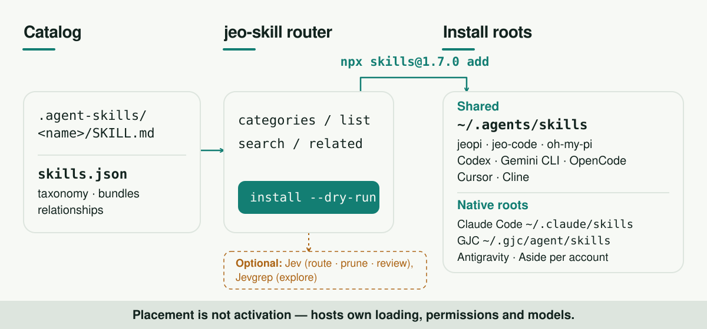
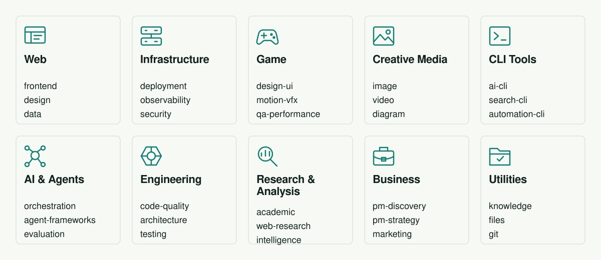

<div align="center">


# jeo-skills

**A categorized catalog of agent skills. Install only the skills you need, on the agents you already use.**

[](#-skills-list)
[](#-categories)
[](https://agentskills.io/specification)
[](https://github.com/akillness/jeo-skills/actions/workflows/ci.yml)
[](LICENSE)

[Quick start](#-quick-start) · [How it works](#-how-it-works) · [Install](#-install-options) · [Runtimes](#-supported-runtimes) · [CLI](#-router-cli) · [Lifecycle](#-usage-tracking-and-cleanup) · [Skills](#-skills-list)

**English** · [한국어](README.ko.md) · [Español](README.es-ES.md)

</div>

---

## ✨ At a glance

| Area | What you get |
|---|---|
| **Catalog** | One folder per skill: `.agent-skills/<name>/SKILL.md`, the open Agent Skills format |
| **Metadata** | Category, subcategory, interface, bundle and relationship data live once in `.agent-skills/skills.json` |
| **Router** | `jeo-skill` browses, searches and previews selections, then installs only what you pick |
| **Runtimes** | A shared root for most agents plus native roots for Claude Code, GJC, Antigravity and Aside |
| **Lifecycle** | Usage tracking finds skills no agent ever loads; cleanup is previewed, reviewed and reversible |
| **Optional** | Jev decision harness and Jevgrep discovery, both off by default and set up separately |

## 🚀 Quick start

**Option A: let your agent install it.** Paste this into Claude Code, Codex, Gemini CLI or any coding agent:

```text
Read https://raw.githubusercontent.com/akillness/jeo-skills/main/setup-all-skills-prompt.md in full and follow it to install the jeo-skills.
```

The guide detects your OS and agents, installs the full catalog by default (ask for "core only" to narrow it) and never deletes skills it did not install.

**Option B: install the router, then pick skills.**

```bash
curl -fsSL https://raw.githubusercontent.com/akillness/jeo-skills/main/install.sh | bash
jeo-skill doctor                                    # check catalog and installer prerequisites
jeo-skill search "react performance"                # find skills
jeo-skill install react-best-practices --global --dry-run   # preview
jeo-skill install react-best-practices --global --yes      # install
```

> [!TIP]
> Add `$HOME/.local/bin` to `PATH` if `jeo-skill` is not found after installation.

## 🧭 How it works



1. **Catalog.** Skills stay flat as `<name>/SKILL.md`. Taxonomy is metadata, not folders, so runtimes always find skills at the path they expect.
2. **Router.** `jeo-skill` resolves names, bundles, categories and subcategories against `skills.json` and shows the exact selection before anything is written.
3. **Install.** Selections are delegated to `npx skills@1.7.0 add` and copied into the root of each target runtime.
4. **Load.** Each host discovers skills from its own root. Placement is not activation: loading, permissions, model choice and execution stay with the host.

## 🗂 Categories



| Category | Focus | Browse |
|---|---|---|
| 🌐 Web | frontend, backend, design, API, auth, data, testing, graphics | `jeo-skill list -c web` |
| 🏗 Infrastructure | deployment, environment, observability, security, cloud data | `jeo-skill list -c infrastructure` |
| 🎮 Game | client, web, design-ui, audio, motion-vfx, QA and release | `jeo-skill list -c game` |
| 🎬 Creative Media | image, video, motion, audio, presentation, diagram | `jeo-skill list -c creative-media` |
| ⌨️ CLI Tools | developer, AI, media, automation, search and benchmark CLIs | `jeo-skill list -c cli-tools` |
| 🤖 AI & Agents | orchestration, agent frameworks, evaluation, memory, planning | `jeo-skill list -c ai-agents` |
| 🧰 Engineering | code quality, testing, architecture, documentation, navigation | `jeo-skill list -c engineering` |
| 🔭 Research & Analysis | academic, web research, data analysis, experiments, intelligence | `jeo-skill list -c research` |
| 📣 Business | marketing, support, product discovery, strategy, execution, growth | `jeo-skill list -c business` |
| 🔧 Utilities | knowledge, files, git, workspace, project management | `jeo-skill list -c utilities` |

The full, generated list is in [Skills list](#-skills-list).

## 📦 Install options

| Goal | How |
|---|---|
| Everything, guided by your agent | Paste the setup prompt from [Quick start](#-quick-start) |
| Router only (default) | the one-liner as is |
| Router + `starter` bundle | one-liner with `JEO_SKILLS_SELECTION=bundle` |
| The whole catalog | one-liner with `JEO_SKILLS_SELECTION=all` |
| Current project only | one-liner with `INSTALL_GLOBAL=false` |
| Preview without changes | one-liner with `JEO_SKILLS_DRY_RUN=true` |
| Specific skills | `jeo-skill install <name> [<name> ...] --global --yes` |
| A bundle or category slice | `jeo-skill install --bundle <bundle> --global --yes` or `--category <id> [--subcategory <id>]` |

Installer variables belong to `bash`, on the right side of the pipe:

```bash
URL=https://raw.githubusercontent.com/akillness/jeo-skills/main/install.sh
curl -fsSL "$URL" | JEO_SKILLS_SELECTION=bundle bash
curl -fsSL "$URL" | JEO_SKILLS_DRY_RUN=true INSTALL_GLOBAL=false bash
```

<details>
<summary><b>Bundles</b> — curated starting sets</summary>

| Bundle | Skills |
|---|---|
| `starter` | jeo-skill, skill-standardization, codebase-search, git-workflow, debugging, testing-strategies |
| `cli-core` | jeo-skill, rtk, semble, zvec-grep, graphify, scrapling |
| `web-frontend` | react-best-practices, responsive-design, web-accessibility, design-system, web-design |
| `web-backend` | api-design, authentication-setup, database-schema-design, backend-testing |
| `web-design` | web-design, design-system, responsive-design, web-accessibility |
| `infrastructure-core` | deployment-automation, environment-setup, monitoring-observability, security-best-practices |
| `game-client` | unity-gamedev-skill-pack, game-studio-harness, game-performance-profiler, awesome-gamedev-agent-skills |
| `game-web` | web-game-development, threejs-fundamentals, implement-fog-of-war |
| `game-art` | game-vfx, rfxgen, perfectpixel, open-design-game-ui-concept, unirig |
| `media-video` | video-production, video-shotcraft, video-motion-previs, shopping-shorts, filmcraft |
| `skill-authoring` | skill-standardization, write-a-skill, upskill |
| `product-management` | pm-skills, create-prd, user-stories, opportunity-solution-tree, north-star-metric |
| `langchain` | langchain-fundamentals, langgraph-fundamentals, deep-agents-core, langsmith |
| `knowledge-repositories` | 22 ontology, code-graph, memory and retrieval operators (`jeo-skill install --bundle knowledge-repositories --dry-run`) |
| `ui-design-repositories` | 10 source-pinned UI operators (`jeo-skill install --bundle ui-design-repositories --dry-run`) |

Repository-operator skills are guides with pinned sources. Installing them does not install, run or connect the upstream projects; those steps need separate approval.

</details>

## 🖥 Supported runtimes

| Runtime | `--agent` | Global root | Project root |
|---|---|---|---|
| jeopi · jeo-code · oh-my-pi | `universal` (default), `jeopi`, `jeo`, `omp` | `~/.agents/skills` | `.agents/skills` |
| Codex · Gemini CLI · OpenCode · Cursor · Cline | `universal` | `~/.agents/skills` | `.agents/skills` |
| Claude Code | `claude-code` | `~/.claude/skills` (or `$CLAUDE_CONFIG_DIR/skills`) | `.claude/skills` |
| GJC | `gjc` | `~/.gjc/agent/skills` | `.gjc/skills` |
| Antigravity CLI | `agy` / `antigravity-cli` | `~/.gemini/antigravity-cli/skills` | `.agents/skills` |
| Antigravity IDE | `antigravity` | `~/.gemini/config/skills` | — |
| Aside | `aside` + `--aside-account <id>` | `~/.aside/u/<id>/skills/user/` | — |

> [!NOTE]
> Installing writes skill files into a root. It does not sign in, start, or reload a runtime. Reload the host if a newly installed skill does not appear.

## 💻 Router CLI

| Command | What it does |
|---|---|
| `jeo-skill categories` | Categories and subcategory counts |
| `jeo-skill list -c <category> [-s <subcategory>]` | Skills in one slice |
| `jeo-skill search "<query>"` | Search names, descriptions and taxonomy |
| `jeo-skill related <name>` | Overlapping or sequential skills to consider together |
| `jeo-skill install ... --dry-run` | Preview a selection without writing files |
| `jeo-skill doctor` | Check the catalog, `npx`/Node.js prerequisites and the CLI link |
| `jeo-skill usage scan` / `usage report` | Track which installed skills agents actually load |
| `jeo-skill prune-unused` / `restore` / `purge-quarantine` | Quarantine, restore or delete never-used skills |
| `jeo-skill prune-retired --global --dry-run` | Remove stale copies of retired catalog skills |
| `jeo-skill explore "<question>" --dry-run` | Optional Jevgrep document discovery |

Set `JEO_SKILLS_CATALOG=/path/to/skills.json` to pin the catalog used by every command.

## 🧹 Usage tracking and cleanup


`jeo-skill usage scan` reads local runtime records (Claude, Codex, OpenCode, Antigravity, Aside, jeopi/GJC/OMP/Pi sessions and the Jev injection ledger). It stores usage summaries and incremental scan metadata under `~/.local/state/jeo-skill`, never transcript bodies. A skill counts as used only when an agent invoked or loaded it; mentions in prompts never count.

| Status | Meaning |
|---|---|
| `used` | Invoked or loaded at least once in the retained records |
| `protected` | `jeo-skill`, the `starter`/`cli-core`/`infrastructure-core` bundles, `usage keep` pins and `usage relevance` protections |
| `in-grace` | No use yet, but within 30 days of tracking start or first install |
| `candidate` | No observed use after the grace period; eligible for quarantine |

```bash
jeo-skill usage scan
jeo-skill usage report --status candidate
jeo-skill prune-unused --global                                   # preview only
jeo-skill prune-unused --global --apply --skip-jev-review         # or --jev-profile <p> --allow-remote
jeo-skill restore --list
jeo-skill restore --batch <batch-id> --apply
jeo-skill purge-quarantine --older-than 30 --apply                # permanent
```

> [!IMPORTANT]
> Zero observed uses is not proof of lifetime non-use: runtimes may have deleted older history. `--apply` rescans first and refuses when a present record store cannot be read. Only copies that provably match this catalog are moved; third-party copies and symlinks are kept.

Removing a skill from the catalog itself is a separate maintainer step in a repository checkout. It previews by default; `--apply` needs comma-separated approved names plus a review choice, then regenerates the projections, validates and rolls back on failure:

```bash
jeo-skill usage report --json > report.json
python3 scripts/retire-unused-skills.py --usage-report report.json                     # preview
python3 scripts/retire-unused-skills.py --usage-report report.json --apply \
  --approve name-a,name-b --skip-jev-review          # or --jev-profile <p> --allow-remote
```

## 🔌 Optional integrations

| Integration | Purpose | Setup |
|---|---|---|
| **Jev** | Decision harness: route a task to skills, prune context, review cleanup proposals | `bash jev/jev-setup.sh --profile <name> ...` · [jev/README.md](jev/README.md) |
| **Jevgrep** | Remote discovery over selected skill or wiki documents | `jeo-skill explore "<question>" --root <dir> --dry-run` · [jevgrep](.agent-skills/jevgrep/SKILL.md) |

Neither is part of catalog installation. Both can send data to a configured backend. In `jeo-skill`, the commands that call them (`prune-unused --apply`, `usage relevance`, `explore`) refuse remote use without `--allow-remote`; the standalone Jev harness sends to its configured backend directly, so approve a hosted profile before using it.

## 📚 Skills List

> Generated from `.agent-skills/skills.json` · 407 skills · expand a category to see its skills.

### 🌐 Web (69)

Subcategories: `frontend` (12), `backend` (3), `design` (15), `api` (2), `auth` (1), `data` (13), `testing` (4), `accessibility` (1), `performance` (1), `graphics` (12), `capture` (5)

<details>
<summary>Show skills</summary>

| Skill |
|---|
| `ax` |
| `react-best-practices` |
| `react-bits` |
| `state-management` |
| `amrouter` |
| `colibri` |
| `pydantic-ai` |
| `astryx` |
| `build-daily-inspiration-sites` |
| `daily-ui-inspiration-capture` |
| `design-first-ui-prompting` |
| `design-system` |
| `devup-ui` |
| `html-to-interaction-prompts` |
| `lazyweb` |
| `responsive-design` |
| `stitch-skills` |
| `web-design` |
| `api-design` |
| `api-documentation` |
| `authentication-setup` |
| `database-schema-design` |
| `payloadcms` |
| `supabase-agent-skills` |
| `typesense` |
| `backend-testing` |
| `browser-harness` |
| `playwriter` |
| `web-accessibility` |
| `optimize-web-animations` |
| `threejs-animation` |
| `threejs-fundamentals` |
| `threejs-geometry` |
| `threejs-interaction` |
| `threejs-lighting` |
| `threejs-loaders` |
| `threejs-materials` |
| `threejs-postprocessing` |
| `threejs-shaders` |
| `threejs-textures` |
| `agentation` |
| `react-grab` |
| `slides-grab` |
| `stitched-full-page-capture` |
| `chatbot-template` |
| `airship` |
| `moli` |
| `design-taste-frontend` |
| `higgsfield-websites` |
| `stagehand` |
| `helix-foundry` |
| `pg-jev` |
| `orionbelt-ontology-builder` |
| `open-ontologies` |
| `semantica` |
| `utopia` |
| `pixeltable` |
| `turbovec` |
| `pixelrag` |
| `superdesign` |
| `better-design` |
| `design-taste` |
| `canvas-ui` |
| `paper-shaders` |
| `ui-layouts` |
| `hyperiux` |
| `motion-primitives` |
| `cursify` |
| `trickle-ui` |

</details>

### 🏗 Infrastructure (17)

Subcategories: `deployment` (2), `environment` (2), `observability` (3), `security` (3), `cloud-data` (6), `automation` (0), `tooling` (1)

<details>
<summary>Show skills</summary>

| Skill |
|---|
| `deployment-automation` |
| `vercel-deploy` |
| `environment-setup` |
| `system-environment-setup` |
| `log-analysis` |
| `monitoring-observability` |
| `openocta` |
| `security-best-practices` |
| `strix` |
| `firebase-cli` |
| `unity-cli` |
| `genkit` |
| `looker-studio-bigquery` |
| `zurp` |
| `ai-knowledge-management-platform` |
| `knowledge-catalog` |
| `cocoindex` |

</details>

### 🎮 Game (29)

Subcategories: `client` (4), `web` (2), `server` (1), `design-ui` (7), `audio` (1), `animation` (2), `motion-vfx` (2), `sprite-image` (1), `art-resources` (0), `storytelling` (0), `tooling` (3), `qa-performance` (4), `release` (2)

<details>
<summary>Show skills</summary>

| Skill |
|---|
| `implement-fog-of-war` |
| `unity-gamedev-skill-pack` |
| `agentic-gamedev-skills` |
| `web-game-development` |
| `bmad-gds` |
| `open-design-game-ui-concept` |
| `open-design-game-ui-handoff` |
| `open-design-game-ui-takeover` |
| `rfxgen` |
| `animato` |
| `unirig` |
| `dalamud-vfx-editor` |
| `game-vfx` |
| `perfectpixel` |
| `game-studio-harness` |
| `underworld-overseer-save-mapper` |
| `godogen` |
| `game-build-log-triage` |
| `game-demo-feedback-triage` |
| `game-performance-profiler` |
| `wai-play` |
| `game-ci-cd-pipeline` |
| `steam-store-launch-ops` |
| `unity-technologies-skills` |
| `multiplayer-game-architecture` |
| `game-design-theory` |
| `game-feel` |
| `game-ui-ux` |
| `awesome-gamedev-agent-skills` |

</details>

### 🎬 Creative Media (40)

Subcategories: `image` (10), `video` (18), `motion` (1), `audio` (2), `presentation` (1), `diagram` (2), `design` (4), `capture` (0), `storytelling` (2)

<details>
<summary>Show skills</summary>

| Skill |
|---|
| `aura-asset-images` |
| `generate-reference-inspired-brand-worlds` |
| `god-tibo-imagen` |
| `paperbanana` |
| `unsplash-asset-images` |
| `browser-video-recording` |
| `gbro-collage-broll` |
| `opencut` |
| `video-production` |
| `filmcraft` |
| `video-shotcraft` |
| `video-to-superprompt` |
| `vox-director` |
| `video-motion-previs` |
| `elevenlabs-tts` |
| `presentation-builder` |
| `drawio` |
| `open-design` |
| `blender-mcp` |
| `webtoon-harness` |
| `palmier-pro` |
| `openstory` |
| `drama-skills` |
| `openmontage` |
| `open-generative-ai` |
| `higgsfield-generate` |
| `higgsfield-marketplace-cards` |
| `higgsfield-product-photoshoot` |
| `higgsfield-soul-id` |
| `higgsfield-youtube-thumbnail` |
| `higgsfield-video-explainer` |
| `higgsfield-brandkit` |
| `shopping-shorts` |
| `video-use` |
| `autoclip` |
| `moneyprinter-turbo` |
| `opencreator` |
| `voicestudio` |
| `diagram-design` |
| `artcraft` |

</details>

### ⌨️ CLI Tools (42)

Subcategories: `developer-cli` (10), `ai-cli` (16), `media-cli` (1), `automation-cli` (6), `search-cli` (8), `benchmark-cli` (1)

<details>
<summary>Show skills</summary>

| Skill |
|---|
| `soup` |
| `caveman` |
| `ccpi-marketplace` |
| `cli-anything` |
| `ghgrab` |
| `jeo-skill` |
| `pretext` |
| `aider-cli-workflow` |
| `claudekit` |
| `fabric` |
| `ooo` |
| `open-code-review` |
| `ponytail` |
| `zeude` |
| `compresso` |
| `codeflow` |
| `graphify` |
| `headroom` |
| `npm-git-install` |
| `okf` |
| `rtk` |
| `tokhub` |
| `scrapling` |
| `agent-reach` |
| `scrapingant-web-fetch` |
| `semble` |
| `zvec-grep` |
| `x-twitter-scraper` |
| `hyperfine-benchmarking` |
| `codeburn` |
| `mole` |
| `mcp-server-sv-number` |
| `zeroshot` |
| `k-skill-setup` |
| `jevgrep` |
| `openrig` |
| `uzu` |
| `context-mode` |
| `rea` |
| `llmfit` |
| `hyper-extract` |
| `leann` |

</details>

### 🤖 AI & Agents (74)

Subcategories: `orchestration` (16), `agent-frameworks` (19), `skill-authoring` (5), `evaluation` (8), `memory` (7), `planning-review` (13), `discovery` (3), `prompting` (3)

<details>
<summary>Show skills</summary>

| Skill |
|---|
| `bmad` |
| `deep-dive` |
| `deepinit` |
| `spec-kit` |
| `ecc` |
| `microsoft-agent-framework` |
| `openai-agents-python` |
| `goalflow` |
| `openexecutive` |
| `article-prompts-to-skills` |
| `skill-standardization` |
| `upskill` |
| `write-a-skill` |
| `langsmith` |
| `opik` |
| `skill-autoresearch` |
| `kadath` |
| `mex` |
| `bmad-idea` |
| `grill-me` |
| `grill-with-docs` |
| `plannotator` |
| `survey` |
| `to-tickets` |
| `to-spec` |
| `triage` |
| `openspace` |
| `agentic-skills` |
| `agenticskills` |
| `prompts-chat` |
| `find-skills` |
| `mcp-builder` |
| `ask-matt` |
| `grilling` |
| `setup-matt-pocock-skills` |
| `to-questionnaire` |
| `wayfinder` |
| `writing-for-agents` |
| `agent-guardrails` |
| `agent-system-design` |
| `agent-tool-routing` |
| `reflexion-pattern` |
| `agent-manager` |
| `langchain-fundamentals` |
| `langchain-middleware` |
| `langchain-rag` |
| `langchain-dependencies` |
| `langgraph-fundamentals` |
| `langgraph-persistence` |
| `langgraph-human-in-the-loop` |
| `deep-agents-core` |
| `deep-agents-memory` |
| `deep-agents-orchestration` |
| `langchain-bmad` |
| `a2a-protocol` |
| `agent-benchmarking` |
| `agent-observability` |
| `multi-agent-eval-harness` |
| `agent-memory-architecture` |
| `okf-agent-memory` |
| `agent-workflow` |
| `agent-principles` |
| `paperclip` |
| `jev-control-plane` |
| `anyjev` |
| `typesafe-computer-use` |
| `jev-ultrafast` |
| `agentic-graphrag-blueprint` |
| `memmachine` |
| `memori` |
| `memsearch` |
| `harness2` |
| `ruflo` |
| `agent-beacon` |

</details>

### 🧰 Engineering (24)

Subcategories: `code-quality` (11), `testing` (3), `architecture` (6), `documentation` (2), `code-navigation` (2)

<details>
<summary>Show skills</summary>

| Skill |
|---|
| `audit-reference-originality` |
| `audit-verify-explain-grade-5` |
| `code-refactoring` |
| `code-review` |
| `debugging` |
| `diagnosing-bugs` |
| `github-repo-candidate-quality-gate` |
| `migrate-to-shoehorn` |
| `performance-optimization` |
| `performance-profiling` |
| `scaffold-exercises` |
| `tdd` |
| `testing-strategies` |
| `improve-codebase-architecture` |
| `zoom-out` |
| `nightrun` |
| `changelog-maintenance` |
| `technical-writing` |
| `codebase-search` |
| `codebase-design` |
| `domain-modeling` |
| `implement` |
| `prototype` |
| `codebase-memory-mcp` |

</details>

### 🔭 Research & Analysis (14)

Subcategories: `academic` (3), `web-research` (3), `data-analysis` (2), `experimentation` (2), `benchmarking` (1), `intelligence` (3)

<details>
<summary>Show skills</summary>

| Skill |
|---|
| `academic-research` |
| `research-paper-writing` |
| `scientific-agent-skills` |
| `deep-research` |
| `heretic` |
| `data-analysis` |
| `pattern-detection` |
| `autoresearch` |
| `scientific-llm-benchmarks` |
| `agent-pulse` |
| `research` |
| `korean-patent-search` |
| `fineenvs` |
| `mi-orchestration` |

</details>

### 📣 Business (70)

Subcategories: `marketing` (4), `support` (2), `publishing` (1), `pm-toolkit` (5), `pm-discovery` (13), `pm-strategy` (12), `pm-execution` (12), `pm-market-research` (7), `pm-analytics` (3), `pm-go-to-market` (6), `pm-growth` (5)

<details>
<summary>Show skills</summary>

| Skill |
|---|
| `marketing-automation` |
| `write-like-meng-on-x` |
| `x-bookmark-quote-posts` |
| `customer-email-draft-threads` |
| `customer-support-verification` |
| `yuwen-publish-precheck` |
| `youtube-growth-playbook-2026` |
| `pm-skills` |
| `draft-nda` |
| `grammar-check` |
| `privacy-policy` |
| `review-resume` |
| `analyze-feature-requests` |
| `brainstorm-experiments-existing` |
| `brainstorm-experiments-new` |
| `brainstorm-ideas-existing` |
| `brainstorm-ideas-new` |
| `identify-assumptions-existing` |
| `identify-assumptions-new` |
| `interview-script` |
| `metrics-dashboard` |
| `opportunity-solution-tree` |
| `prioritize-assumptions` |
| `prioritize-features` |
| `summarize-interview` |
| `ansoff-matrix` |
| `business-model` |
| `lean-canvas` |
| `monetization-strategy` |
| `pestle-analysis` |
| `porters-five-forces` |
| `pricing-strategy` |
| `product-strategy` |
| `product-vision` |
| `startup-canvas` |
| `swot-analysis` |
| `value-proposition` |
| `brainstorm-okrs` |
| `create-prd` |
| `dummy-dataset` |
| `job-stories` |
| `outcome-roadmap` |
| `pre-mortem` |
| `prioritization-frameworks` |
| `stakeholder-map` |
| `summarize-meeting` |
| `test-scenarios` |
| `user-stories` |
| `wwas` |
| `competitor-analysis` |
| `customer-journey-map` |
| `market-segments` |
| `market-sizing` |
| `sentiment-analysis` |
| `user-personas` |
| `user-segmentation` |
| `ab-test-analysis` |
| `cohort-analysis` |
| `sql-queries` |
| `beachhead-segment` |
| `competitive-battlecard` |
| `growth-loops` |
| `gtm-motions` |
| `gtm-strategy` |
| `ideal-customer-profile` |
| `marketing-ideas` |
| `north-star-metric` |
| `positioning-ideas` |
| `product-name` |
| `value-prop-statements` |

</details>

### 🔧 Utilities (28)

Subcategories: `knowledge` (8), `files` (5), `git` (4), `workspace` (1), `project-management` (4), `productivity` (3), `general` (3)

<details>
<summary>Show skills</summary>

| Skill |
|---|
| `lapian-notes` |
| `llm-wiki` |
| `notebooklm` |
| `obsidian-mind` |
| `obsidian-second-brain` |
| `opencontext` |
| `file-organization` |
| `git-guardrails-claude-code` |
| `git-submodule` |
| `git-workflow` |
| `game-sounds` |
| `sprint-retrospective` |
| `standup-meeting` |
| `task-estimation` |
| `task-planning` |
| `google-workspace` |
| `watermarks-remover` |
| `solo-skills` |
| `eli5` |
| `handoff` |
| `resolving-merge-conflicts` |
| `teach` |
| `wait-what` |
| `wizard` |
| `hwp` |
| `rhwp-advanced` |
| `rhwp-edit` |
| `rowboat` |

</details>


---

## 🛠 For maintainers

| Path | Contents |
|---|---|
| `.agent-skills/` | Skill folders, `skills.json` (source of truth) and the generated `skills.toon` |
| `install.sh` · `setup-all-skills-prompt.md` | One-line installer and the agent-led setup guide |
| `scripts/` | Catalog validation, projection generation, changelog and regression tests |
| `jev/` | Optional Jev control-plane source |
| `changelog/` | Monthly release notes (English and Korean) |
| `assets/` | README visuals (Codex-generated; provenance in `assets/readme-visuals.json`) |

```bash
python3 scripts/validate-catalog-projections.py        # manifest, TOON, READMEs, SKILL.md
python3 scripts/generate-catalog-projections.py --check
python3 scripts/changelog.py check
```

Edit metadata in `skills.json`, never in the generated tables. Upstream sources and licenses for adapted skills are listed in [docs/attribution.md](docs/attribution.md).

## 🤝 Related projects

| Project | Role |
|---|---|
| [jeo-code](https://github.com/akillness/jeo-code) | Coding agent that loads skills from the shared root |
| [gajae-code (GJC)](https://github.com/akillness/gajae-code) | Agent runtime with its own native skills root |

---

<!-- WHATS-NEW:START -->

## 🆕 What's New in v2026-10-24

| Change | Details |
|--------|---------|
| **Cross-engine game skill collection** | Added `awesome-gamedev-agent-skills` v1.0.0 for `gamedev-skills/awesome-gamedev-agent-skills` at `7eb1b53305fab881f4758e2eff2e371cd7869221` (Apache-2.0; LICENSE and NOTICE inspected). The catalog grows from 406 to 407 and `game-client` from three to four guides. The operator selects from 76 upstream leaves plus their router without vendoring the pack, preserves project engine versions, and protects same-name local skills. |
| **Game collection verification** | Dedicated subprocess tests pass 6/6 and installer regressions 66/66; all 12 selected public-source hashes match. A project-scoped guide install from the local working tree passed with a transparent launcher executing cached genuine `skills@1.7.0`: preview, nested bytes/modes, fingerprinted retired-`jeo` removal and foreign/current/HOME preservation. No registry resolution, public-repository install, real-HOME activation, engine or provider execution was performed. Six routing/safety evals are authored, not executed model-quality results. |

## 🆕 What's New in v2026-10-22

| Change | Details |
|--------|---------|
| **uvx MCP servers on macOS after Aside** | Applying the setup guide to a real home showed that wheels uv first downloaded inside an Aside session keep `com.apple.quarantine ...;Aside;`: macOS deletes their extension modules when they load, and uvx keeps reusing the broken cached environment, so `uvx`-registered `semble` and `ooo` fail with `No module named 'orjson.orjson'` or `'rpds.rpds'`. The guide's Semble and Ouroboros blocks, its Aside section, and the `ooo` skill now give the signature, the `xattr` check, and the recovery: stop uv-based MCP servers, run `uv cache clean` from a regular terminal, rerun. Verified in fresh caches; `--refresh`, `--reinstall`, and `uv cache clean <package>` do not fix it, and `uv cache clean` waits while uv-launched servers run. |

## 🆕 What's New in v2026-10-21

| Change | Details |
|--------|---------|
| **Agent Beacon operator** | Added `agent-beacon` v1.0.0 for `Asymptote-Labs/agent-beacon`, pinned to `cfbd7b1d721664e3b1b5ca2fca5eac4327532c07` (MIT). Covers cross-harness session history, local/cloud destinations, reviewed memory, lenses, sharing and CLI/MCP integration with explicit capture, private-data, service, upload and removal approvals. The catalog grows from 405 to 406; `knowledge-repositories` contains 22 guides and 19 selected-file helpers. Installation adds the guide and support files, not the Beacon runtime. |
| **Beacon offline and installer coverage** | The standalone helper inherits the existing secure no-Git implementation; all 12 selected official public-file hashes match. Modified helper and installer suites pass 20/20 and 65/65, including named Beacon installation, nested assets, same-root retired `jeo` removal, foreign/current skill preservation and byte-stable previews. Installer evidence uses isolated fixture transport, not a public install. Six routing/privacy evaluations are authored fixtures, not executed model-quality results. |
| **Setup guide install fixes** | A full run of `setup-all-skills-prompt.md` in an isolated macOS HOME (real `skills@1.7.0`, uv, npm, Claude Code, Codex, opencode 2.0.32) found and fixed: Step 1 resolved the login home even when `$HOME` pointed elsewhere (it now honors `$HOME` outside Aside) and left `~/.local/bin` off `PATH`, so `jeo-skill` and `graphify` were not found; non-interactive `rtk init -g` never registered its hook (now `--auto-patch`); `ooo` was registered over the `[all]` extra, whose MCP SDK 1.x makes `ouroboros mcp serve` fail (now `uvx --isolated --from 'ouroboros-ai[mcp]'`); the Aside step rewrote JSONC `opencode.json`, dropping comments and every other key (now `opencode mcp add`); the knowledge-pipeline writer overwrote customized wrappers and rewrote settings on every run (now keep-and-report, write only on change, non-ASCII kept). Step 4D now only verifies and reports stale `~/.config/opencode/skills` copies, Step 7 uses the scoped `skills list -g -a universal` (the unscoped form hung past 150 s on a large home), three broken code fences were restored, and Steps 6–7 precede the on-demand reference. `jeo-skill` run from HOME no longer reads the legacy `~/.agent-skills/skills.json`. |
| **Install verification** | After the fixes, full, core and minimal modes ran end to end (every step exit 0; Claude Code reports semble, ooo, aside and the OMC plugin server Connected; installed bytes match the repository in the shared, Claude, GJC, Antigravity CLI and Aside roots; seeded user skills, hooks and JSONC config preserved), and a second full run changed no guide-owned config. New `scripts/test_setup_guide_regressions.py` (7 tests) runs in CI; installer 64/64, Jev 64/64, config writers 24/24 and catalog gates pass. |
| **README rebuilt for readability** | Replaced every README prose section and visual: new Codex cover `assets/readme-cover.webp`, Codex-written `how-it-works.svg`, `catalog-map.svg` and `skill-lifecycle.svg`, scannable tables for install options, runtimes, router CLI and lifecycle states, collapsible category lists, and a live skill-count badge. Featured tools, recommended OSS, related-docs and long operator notes were removed; upstream sources and licenses moved to `docs/attribution.md`. `catalog-install-flow.svg` and `runtime-boundaries.svg` were retired. Installer variables are now shown on the `bash` side of the pipe. Documentation only. |
| **Open Ontologies operator refresh** | Updated the existing `open-ontologies` guide to v1.1.0 without adding a duplicate or changing the 405-skill count. Reverified six selected public-file SHA256s at `dfb09bf815326913d7d7822fa7228f2602fb4976` (MIT), documented offline preflight and approval/evidence boundaries, and added setup/README references. Named-install and standalone-helper regressions pass with the modified suites at 64/64 and 19/19; catalog-fingerprinted `jeo` is removed while current, foreign and out-of-scope skills survive. Catalog installation adds only the operator package, not the upstream runtime. |
| **harness → harness2** | Replaced the revfactory `harness` skill with `harness2`, an operator for `google-research/harness2` pinned to `1cfe254e8d25b15f37048c3730134686abe60335` (Apache-2.0): credential-free demo, LAB/JobBench/WorkBuddy setup and paid-run gates, Codex bridge, and a method mode that applies Propose–Probe–Compose by hand (agent-team design moved here). `harness` is now in `retired_skills` and every route-out was repointed. |
| **Four new operators** | Added `ruflo` (ruvnet/ruflo, MIT), `voicestudio` (debpalash/VoiceStudio, AGPL-3.0-only), `diagram-design` (cathrynlavery/diagram-design, MIT), and `artcraft` (storytold/artcraft, MIT OR Apache-2.0), each commit-pinned with an offline preflight and explicit install, model, provider, server, and publishing gates. With `harness` retired, the catalog grows from 401 to 405. |
| **Retired-skill cleanup on install** | `jeo-skill install` and `install.sh` now remove stale catalog copies of retired `jeo` (→ `ooo`) and `harness` (→ `harness2`) from the roots they write, and `jeo-skill prune-retired [--global] [--dry-run]` sweeps every runtime root. Removal requires the catalog's exact frontmatter name and first heading; links are unlinked only when they point at a copy the same sweep removed. Third-party same-name skills, unrelated links, and roots behind linked ancestors are kept. `.skill-lock.json` is not edited. |
| **Verification** | Installer regressions 63/63 (15 new, vendored fixtures), repository preflight regressions 15/15 (five new helpers plus harness2 bench/method cases), catalog projection/frontmatter/layout/changelog gates pass; 25 new eval scenarios. The documented full install (Steps 4–4E, 7) ran end to end with the real pinned `skills@1.7.0` in an isolated HOME seeded with this machine's stale copies, against a committed local snapshot of this working tree (the GitHub URL was redirected to it; public HEAD does not contain these changes until they are pushed): every retired copy and its dependent link was removed, unrelated skills, links, and Aside `builtin/` stayed byte-identical, and real jeopi/oh-my-pi/GJC loaders resolve the five new skills and no `jeo`/`harness`. OpenCode was verified by shared-root placement only, not runtime activation. The upstream harness2 demo passed in both recursion modes (2/2 tasks each) plus its 5 unit tests; no benchmark, model, judge, or other upstream runtime ran. |
| **Skill usage tracking and unused-skill cleanup** | Added `jeo-skill usage scan`/`report` evidence aggregation across local runtime records and the Jev `jev-usage.jsonl` ledger, zero-use plus 30-day-grace candidate rules, protected bundles/pins, reversible `prune-unused` quarantine with `restore`, permanent `purge-quarantine`, and the separate maintainer `retire-unused-skills.py` lane. Only provable catalog copies move; third-party copies, symlinks, and linked roots stay. Jev `deny`/unavailable aborts apply, `proposal_only` proceeds only with explicit `--apply`, and skipped review is recorded; routed ledger events do not count as use, only injections do. Usage (7), quarantine (15), retirement (7 Python) and Jev ledger (4 Node) regressions pass; a real-data read-only scan used `/tmp`, with no tracking state or host hook started. |
| **README visual refresh** | Documentation-only: added the Codex cover `assets/readme-cover.webp` and `catalog-install-flow.svg`, `runtime-boundaries.svg`, and `skill-lifecycle.svg`; superseded `readme-hero.webp`, `catalog-workflow.svg`, `runtime-architecture.svg`, and the orphan `assets/scrapingant/` logo; merged duplicate `ooo` docs, corrected god-tibo-imagen and plannotator commands, and updated the operator count from 12 to 18. |

## 🆕 What's New in v2026-10-17

| Change | Details |
|--------|---------|
| **OpenCreator operator** | Added the source-pinned `opencreator` guide for `krillinai/OpenCreator` commit `b01a9f71165b9010216e25c462653b0cfa33cbce`, covering Desktop/CLI/Server, creator tasks, Codex/provider setup, Skills/MCP/schedules, release integrity and approval boundaries. Added an offline read-only preflight, 11 authored scenarios, and 16 passing subprocess regressions wired into CI. Catalog: 400 → 401. No upstream app, installer, provider, or paid service was run. |

## 🆕 What's New in v2026-10-15

| Change | Details |
|--------|---------|
| **Ten source-pinned UI operators** | Added Superdesign, Better Design, Design Taste, Canvas UI, Paper Shaders, UI Layouts, Hyperiux, Motion Primitives, Cursify and Trickle UI Kit guides. Exact repository identities, commits, selected source coordinates, complete license observations and duplicate decisions live in `docs/ui-design-repositories.md` and independent skill references. |
| **Selective setup and rights** | The `ui-design-repositories` bundle adds documents only (390 → 400 skills). Zero existing skills were removed: named-source tooling does not replace system governance, visual recipes or performance diagnosis. Canvas UI redistribution is restricted, Hyperiux Effects has separate terms, and Cursify has no observed license grant; no upstream component code is vendored. |
| **Offline verification boundary** | Added six passing packaging/router regressions and Ubuntu/macOS CI wiring. Forty-five positive/negative scenarios are authored fixtures, not executed model-quality or browser evaluations. Upstream installs, servers, remote design calls, paid services and UI runtime execution were not performed. |
| **OKF Agent Memory operator** | Added `okf-agent-memory` for the separate `okf-memory/okf-agent-memory` Go CLI and stdio MCP, pinned to upstream commit `ad7beb01b9d4294d8dd28c25494d274374985b69` (MIT). The guide covers project-local OKF v0.2 workflows, source-pinned commands, security, and approval gates. |
| **Routing and catalog** | Registered the skill under `ai-agents/memory`, linked it with `okf` and related knowledge-vault skills, and clarified that `okf` remains the Google OKF v0.1 format authoring path. Refreshed manifest projections, all README locale counts, setup guidance, `AGENTS.md`, and `.mex/ROUTER.md`; catalog grows from 367 to 368. Added nine routing/safety evaluation scenarios across the new operator and the `okf` route-out. |
| **Read-only preflight and regressions** | Added a standalone stdlib preflight bound to the pinned commit and fixed public source markers. It rejects symlinked paths and oversized markers, scopes Git environment variables, and runs no upstream executable. The shared repository-preflight regression suite passes 13/13, including malicious-path, pin, symlink, size, no-write, and credential-isolation cases. |
| **Known upstream drift and execution boundary** | The pinned `go.mod` requires Go 1.26.0, while the getting-started guide says 1.22+; the skill records the conflict. No upstream installation, build, bootstrap, MCP registration, or target-project write was performed. |

> 📜 Older entries: [`changelog/en/`](changelog/en/) (monthly files, newest first).

<!-- WHATS-NEW:END -->

---

<div align="center">

[](https://www.buymeacoffee.com/akillness3q)

If jeo-skills helps you, please ⭐ the repository.

</div>
