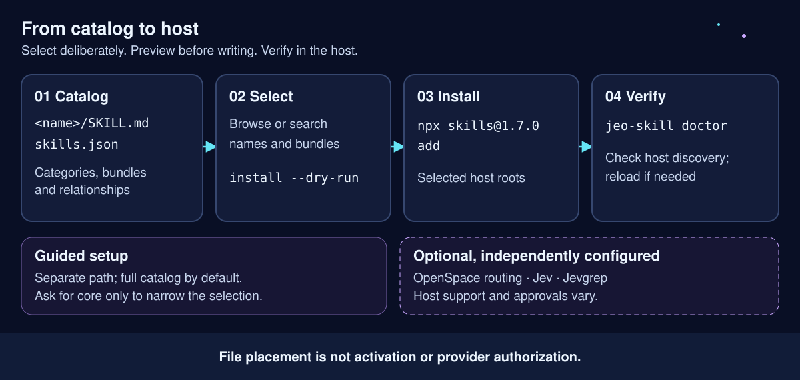
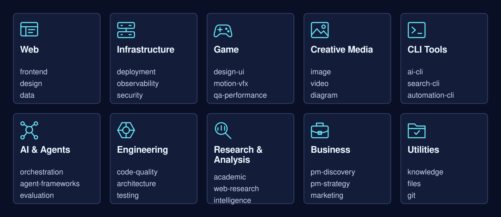
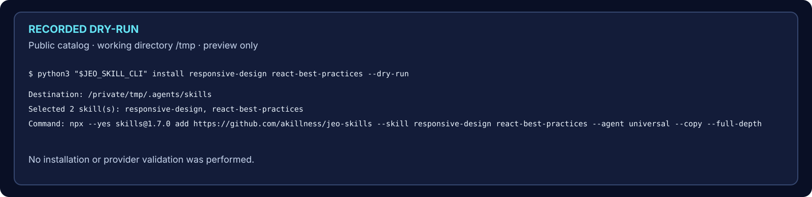
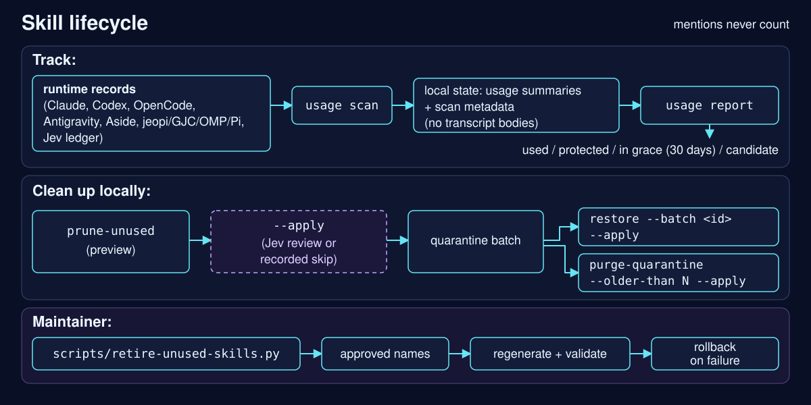

<div align="center">


# jeo-skills

**A library of agent skills and a guided setup for the coding agents you already use. Choose what to install, and keep optional integrations under your control.**

[](#-skills-list)
[](#-categories)
[](https://agentskills.io/specification)
[](https://github.com/akillness/jeo-skills/actions/workflows/ci.yml)
[](LICENSE)
[](https://www.buymeacoffee.com/akillness3q)

[Start](#-quick-start) · [Explore the workflow](#-how-it-works) · [Choose an installation](#-install-options) · [Find your runtime](#-supported-runtimes) · [Operate the router](#-router-cli) · [Manage installed skills](#-usage-tracking-and-cleanup) · [Integrations](#-optional-integrations) · [Catalog](#-skills-list)

**English** · [한국어](README.ko.md) · [Español](README.es-ES.md)

</div>

---

## License and attribution

Project-authored material is available under the [MIT License](LICENSE). When distributing copies or substantial portions, retain its copyright and permission notices. Third-party components may have different terms; see [upstream sources and licenses](docs/attribution.md) and their own license and notice files.

## ✨ At a glance

| Area | What you get |
|---|---|
| **Catalog** | One folder per skill: `.agent-skills/<name>/SKILL.md`, the open Agent Skills format |
| **Metadata** | Category, subcategory, interface, bundle and relationship data live once in `.agent-skills/skills.json` |
| **Router** | `jeo-skill` browses, searches and previews selections, then installs only what you pick |
| **Runtimes** | A shared root for most agents plus native roots for Claude Code, GJC, Antigravity and Aside |
| **Lifecycle** | Usage tracking finds skills no agent ever loads; cleanup is previewed, reviewed and reversible |
| **Optional** | OpenSpace routing, Jev and Jevgrep have separate setup and approval boundaries; installing skills does not activate them |

## 🚀 Quick start

**Option A: let your agent install it.** Paste this into Claude Code, Codex, Antigravity CLI (`agy`), Kimi Code, Grok Build, OpenCode or another coding agent:

```text
Read https://raw.githubusercontent.com/akillness/jeo-skills/main/setup-all-skills-prompt.md in full and follow it to install the jeo-skills.
```

The guide detects your OS and agents. Its default full mode installs the catalog and pinned shared tools; ask for "core only" or "minimal" to narrow it. Memory, context, database, provider and routing setup have separate approvals and host prerequisites. The guide does not delete skills it did not install. See [the full setup guide](setup-all-skills-prompt.md) for exact boundaries.

**Option B: install the router, then pick skills.**

```bash
curl -fsSL https://raw.githubusercontent.com/akillness/jeo-skills/main/install.sh | bash
jeo-skill doctor                                    # check catalog and installer prerequisites
jeo-skill search "react performance"                # find skills
jeo-skill install react-best-practices --global --dry-run   # preview
jeo-skill install react-best-practices --global --yes      # install
```

> [!TIP]
> Add `$HOME/.local/bin` to `PATH` if `jeo-skill` is not found after installation.

## 🧭 How it works



<details>
<summary>Explore the path from catalog to host</summary>


1. **Catalog.** Skills stay flat as `<name>/SKILL.md`. Taxonomy is metadata, not folders, so runtimes always find skills at the path they expect.
2. **Router.** `jeo-skill` resolves names, bundles, categories and subcategories against `skills.json` and shows the exact selection before anything is written.
3. **Install.** Selections are delegated to `npx skills@1.7.0 add` and projected into each target runtime root using bounded-memory 256 KiB streaming copy+SHA-256 verification, iterative `os.scandir` traversal, and unchanged-file skip on re-runs.
4. **Load.** Each host discovers skills from its own root. Placement is not activation: loading, permissions, model choice and execution stay with the host.

</details>

## 🗂 Categories



| Category | Focus | Browse |
|---|---|---|
| 🌐 Web | frontend, backend, design, API, auth, data, testing, graphics | `jeo-skill list -c web` |
| 🏗 Infrastructure | deployment, environment, observability, security, cloud data | `jeo-skill list -c infrastructure` |
| 🎮 Game | client, web, design-ui, audio, motion-vfx, QA and release | `jeo-skill list -c game` |
| 🎬 Creative Media | image, video, motion, audio, presentation, diagram | `jeo-skill list -c creative-media` |
| ⌨️ CLI Tools | developer, AI, media, automation, search and benchmark CLIs | `jeo-skill list -c cli-tools` |
| 🤖 AI & Agents | orchestration, agent frameworks, evaluation, memory, planning | `jeo-skill list -c ai-agents` |
| 🧰 Engineering | code quality, testing, architecture, documentation, navigation | `jeo-skill list -c engineering` |
| 🔭 Research & Analysis | academic, web research, data analysis, experiments, intelligence | `jeo-skill list -c research` |
| 📣 Business | marketing, support, product discovery, strategy, execution, growth | `jeo-skill list -c business` |
| 🔧 Utilities | knowledge, files, git, workspace, project management | `jeo-skill list -c utilities` |

The full, generated list is in [Skills list](#-skills-list).

## 📦 Install options

| Goal | How |
|---|---|
| Everything, guided by your agent | Paste the setup prompt from [Quick start](#-quick-start) |
| Router only (default) | the one-liner as is |
| Router + `starter` bundle | one-liner with `JEO_SKILLS_SELECTION=bundle` |
| The whole catalog | one-liner with `JEO_SKILLS_SELECTION=all` |
| Current project only | one-liner with `INSTALL_GLOBAL=false` |
| Preview without changes | one-liner with `JEO_SKILLS_DRY_RUN=true` |
| Specific skills | `jeo-skill install <name> [<name> ...] --global --yes` |
| Specific skills with setup/smoke | `jeo-skill install <name> ... --global --yes --setup` (add `--with-hooks` for supported hook steps only; see [setup guide](setup-all-skills-prompt.md#step-5--full-mode-shared-tools) for exact tool boundaries) |
| A bundle or category slice | `jeo-skill install --bundle <bundle> --global --yes` or `--category <id> [--subcategory <id>]` |
| Five GitHub programs and one readiness report | `jeo-skill install --bundle github-five-programs --global --yes --setup`; the one-liner with `JEO_SKILLS_SELECTION=bundle JEO_SKILLS_BUNDLE=github-five-programs` prints the same report. It is offline and read-only: nothing is installed or run, and no per-program approval is asked |

For the ten source-specific game-development guides, preview `jeo-skill install --bundle game-source-repositories --dry-run`. The guides cover physics, terrain, materials, effects, navigation, animation, graphics, meshes, and noise; they do not install or run the upstream tools. See the [setup boundaries](setup-all-skills-prompt.md#game-development-source-guides-on-demand) and [source licenses](docs/attribution.md).

<details>
<summary>Review source-specific operator guides</summary>


For Lightpanda, preview `jeo-skill install lightpanda --global --dry-run` before installing
the selected skill. It installs guidance, not the browser. The skill covers stable 1.0.2
fetch, structured data, CDP and MCP; its offline doctor checks local metadata, not runtime
compatibility. Browser download, installation, execution, site access, servers, credentials
and provider calls require separate approval. See the [setup guide](setup-all-skills-prompt.md#lightpanda-browser-operator-on-demand).

For browser-use, preview `jeo-skill install browser-use --global --dry-run` before installing
the selected skill. It installs an operator guide, not browser-use, for `browser-use/browser-use`
1.0.3, with an offline helper that never runs it. Upstream's `browser-use skill install` writes a
`SKILL.md` with the same name into `~/.agents/skills` and every installed agent directory,
through symlinks too, so it replaces this skill: never run it, use `browser-use skill show`
instead. Installing the CLI, `login`, an `Agent` run (a hosted model and a billed cloud browser by
default), a cloud browser, attaching to your Chrome and MCP registration require separate approval.
See the [setup guide](setup-all-skills-prompt.md#browser-use-operator-on-demand-billed-and-can-control-your-chrome).

For Flide decision inference, preview `jeo-skill install flide --global --dry-run`. The guide includes an offline preflight; package/model downloads, GPU use and server startup require separate approval. See the [setup guide](setup-all-skills-prompt.md#flide-decision-inference-on-demand).

For Impeccable, preview `jeo-skill install impeccable --global --dry-run` before installing
the selected skill. It installs an operator guide for `pbakaus/impeccable` 4.8.0, not
Impeccable, its engine or its design hook; the upstream installer uses the same `impeccable`
folder name, so run the offline doctor before either installer writes. npm execution, engine
download and runs, the hook, browser scans and live mode require separate approval. See the [setup guide](setup-all-skills-prompt.md#impeccable-design-operator-on-demand).

</details>

Installer variables belong to `bash`, on the right side of the pipe:

```bash
URL=https://raw.githubusercontent.com/akillness/jeo-skills/main/install.sh
curl -fsSL "$URL" | JEO_SKILLS_SELECTION=bundle bash
curl -fsSL "$URL" | JEO_SKILLS_DRY_RUN=true INSTALL_GLOBAL=false bash
```

<details>
<summary>Choose whether to star the repository</summary>

Starring is a separate GitHub account action, not consent implied by installation or `--yes`. Set `JEO_SKILLS_STAR=true` for explicit opt-in, or `JEO_SKILLS_STAR=false` to skip. If unset, an interactive prompt defaults to no; a non-interactive run skips it. A dry run does not prompt or star. Opting in uses authenticated `gh` to send a PUT and then GET for `akillness/jeo-skills`; a failed readback is reported as unverified and installation continues. A successful PUT may have starred the repository even when readback fails.

</details>

<details>
<summary><b>Bundles</b> — curated starting sets</summary>

| Bundle | Skills |
|---|---|
| `starter` | jeo-skill, skill-standardization, codebase-search, git-workflow, debugging, testing-strategies, image-to-github-repo |
| `cli-core` | jeo-skill, rtk, semble, zvec-grep, graphify, scrapling |
| `web-frontend` | react-best-practices, responsive-design, web-accessibility, design-system, web-design |
| `web-backend` | api-design, authentication-setup, database-schema-design, backend-testing |
| `web-design` | web-design, design-system, responsive-design, web-accessibility |
| `infrastructure-core` | deployment-automation, environment-setup, monitoring-observability, security-best-practices |
| `game-client` | unity-gamedev-skill-pack, game-studio-harness, game-performance-profiler, awesome-gamedev-agent-skills |
| `game-web` | web-game-development, threejs-fundamentals, implement-fog-of-war |
| `game-art` | game-vfx, rfxgen, perfectpixel, open-design-game-ui-concept, unirig |
| `media-video` | video-production, video-shotcraft, video-motion-previs, shopping-shorts, filmcraft |
| `skill-authoring` | skill-standardization, write-a-skill, upskill |
| `product-management` | pm-skills, create-prd, user-stories, opportunity-solution-tree, north-star-metric |
| `langchain` | langchain-fundamentals, langgraph-fundamentals, deep-agents-core, langsmith |
| `knowledge-repositories` | 22 ontology, code-graph, memory and retrieval operators (`jeo-skill install --bundle knowledge-repositories --dry-run`) |
| `ui-design-repositories` | 10 source-pinned UI operators (`jeo-skill install --bundle ui-design-repositories --dry-run`) |
| `github-five-programs` | fabric, moneyprinter-v2, agent-s, google-maps-scraper, gitingest: five open-source program operators, four of them source-pinned (`jeo-skill install --bundle github-five-programs --dry-run`) |

Repository-operator skills are guides with pinned sources. Installing them does not install, run or connect the upstream projects; those steps need separate approval.

</details>

## 🖥 Supported runtimes

<details>
<summary>Find install roots and host-specific boundaries</summary>


| Runtime | Install target (`--agent`; router alias) | Global root | Project root |
|---|---|---|---|
| Jeo (`jeo-code`) | `jeo` (router alias → `universal`) | `~/.agents/skills` | `.agents/skills` |
| JeoPi | `jeopi` (router alias → `universal`) | `~/.agents/skills` | `.agents/skills` |
| Pi | `pi` | `~/.pi/agent/skills` | `.pi/skills` |
| OMP (`oh-my-pi`) | `omp` (router alias → `universal`) | `~/.agents/skills` | `.agents/skills` |
| GJC | `gjc` (router alias → `universal`; native projection follows) | `~/.gjc/agent/skills` | `.gjc/skills` |
| Codex | `codex` | `~/.agents/skills` | `.agents/skills` |
| Claude Code | `claude-code` | `~/.claude/skills` (or `$CLAUDE_CONFIG_DIR/skills`) | `.claude/skills` |
| AGY (Antigravity CLI) | `agy` (`antigravity-cli` alias) | `~/.gemini/antigravity-cli/skills` | `.agents/skills` |
| Kimi CLI | `kimi` (registered target `kimi-code-cli`) | `~/.agents/skills` | `.agents/skills` |
| Grok Build | `grok` | `${GROK_HOME:-$HOME/.grok}/skills` | `.grok/skills` |
| OpenCode | `opencode` | `~/.agents/skills` | `.agents/skills` |
| Cursor | `cursor` | `~/.agents/skills` | `.agents/skills` |
| Crush | `crush` | `~/.config/crush/skills` | `.crush/skills` |
| Antigravity IDE | `antigravity` | `~/.gemini/config/skills` | — |
| Aside | `aside` + `--aside-account <id>` | `~/.aside/u/<id>/skills/user/` | — |

This guide uses **AGY** (`agy`) for the Antigravity CLI target; `antigravity-cli` is only its setup alias. Shared-root runtimes (Jeo, JeoPi, OMP, Codex, Kimi CLI, OpenCode and Cursor) load from `~/.agents/skills` / `.agents/skills`; GJC and AGY receive explicit native projections. Kimi Code also scans `${KIMI_CODE_HOME:-$HOME/.kimi-code}/skills`.

Grok Build is the registry-native `grok` target and requires explicit setup selection: `JEO_SKILLS_AGENT=grok` for installation or `JEV_AGENT=grok` for a single Jev profile. The setup guide excludes it from host auto-selection by `PATH`, because a local `grok` binary may be the older Superagent/VibeKit CLI without an Agent Skill loader. Controller `detect` only reports binary inventory, not which implementation is installed. Confirm that separately; this guide does not replace or auto-upgrade that binary.

> [!NOTE]
> Installing writes skill files into a root. It does not sign in, start, or reload a runtime. Reload the host if a newly installed skill does not appear.

</details>

## 💻 Router CLI

<details>
<summary>Browse, install and inspect skills</summary>


| Command | What it does |
|---|---|
| `jeo-skill categories` | Categories and subcategory counts |
| `jeo-skill list -c <category> [-s <subcategory>]` | Skills in one slice |
| `jeo-skill search "<query>"` | Search names, descriptions and taxonomy |
| `jeo-skill related <name>` | Overlapping or sequential skills to consider together |
| `jeo-skill install ... --dry-run` | Preview a selection without writing files |
| `jeo-skill doctor` | Check the catalog, `npx`/Node.js prerequisites and the CLI link |
| `jeo-skill readiness [--global] [--json]` | Offline, read-only readiness report for fabric, moneyprinter-v2, agent-s, google-maps-scraper and gitingest |
| `jeo-skill usage scan` / `usage report` | Track which installed skills agents actually load |
| `jeo-skill prune-unused` / `restore` / `purge-quarantine` | Quarantine, restore or delete never-used skills |
| `jeo-skill prune-retired --global --dry-run` | Remove stale copies of retired catalog skills |
| `jeo-skill explore "<question>" --dry-run` | Optional Jevgrep document discovery |

Set `JEO_SKILLS_CATALOG=/path/to/skills.json` to pin the catalog used by every command.

Recorded local dry-run example: this preview selected two skills and showed the destination and command. It did not install skills or validate a provider.



</details>

## 🧹 Usage tracking and cleanup



<details>
<summary>Review usage, quarantine and restore skills</summary>


`jeo-skill usage scan` reads local runtime records (Claude, Codex, OpenCode, Antigravity, Aside, jeopi/GJC/OMP/Pi sessions and the Jev injection ledger). It stores usage summaries and incremental scan metadata under `~/.local/state/jeo-skill`, never transcript bodies. A skill counts as used only when an agent invoked or loaded it; mentions in prompts never count.

| Status | Meaning |
|---|---|
| `used` | Invoked or loaded at least once in the retained records |
| `protected` | `jeo-skill`, the `starter`/`cli-core`/`infrastructure-core` bundles, `usage keep` pins and `usage relevance` protections |
| `in-grace` | No use yet, but within 30 days of tracking start or first install |
| `candidate` | No observed use after the grace period; eligible for quarantine |

```bash
jeo-skill usage scan
jeo-skill usage report --status candidate
jeo-skill prune-unused --global                                   # preview only
jeo-skill prune-unused --global --apply --skip-jev-review         # or --jev-profile <p> --allow-remote
jeo-skill restore --list
jeo-skill restore --batch <batch-id> --apply
jeo-skill purge-quarantine --older-than 30 --apply                # permanent
```

> [!IMPORTANT]
> Zero observed uses is not proof of lifetime non-use: runtimes may have deleted older history. `--apply` rescans first and refuses when a present record store cannot be read. Only copies that provably match this catalog are moved; third-party copies and symlinks are kept.

Removing a skill from the catalog itself is a separate maintainer step in a repository checkout. It previews by default; `--apply` needs comma-separated approved names plus a review choice, then regenerates the projections, validates and rolls back on failure:

```bash
jeo-skill usage report --json > report.json
python3 scripts/retire-unused-skills.py --usage-report report.json                     # preview
python3 scripts/retire-unused-skills.py --usage-report report.json --apply \
  --approve name-a,name-b --skip-jev-review          # or --jev-profile <p> --allow-remote
```

</details>

## 🔄 Keeping installed skills current

<details>
<summary>Refresh the shared root and reconcile symlinked hosts</summary>


On machines following the [full-install guide](setup-all-skills-prompt.md), the catalog lives in one shared root (`~/.agents/skills`) and each host's skill directory (claude, pi, gjc, antigravity, cursor, aside-user, opencode-config) points at it with per-skill symlinks. After that, refresh the **shared root only** — running per-host copy installers (`jeo-skill install -a claude-code`, `-a gjc`, …) is unsafe: their rmtree can follow the symlink slots back into the shared root and delete originals.

```bash
bash scripts/skills-upgrade.sh              # pull → doctor → refresh → prune → reconcile → verify
bash scripts/skills-upgrade.sh --dry-run    # plan without writes
python3 scripts/refresh-host-links.py       # link plan only (read-only)
```

What each step does:

1. `git pull --ff-only` on the trusted checkout — any non-fast-forward stops the run
2. `jeo-skill doctor` validates the refreshed catalog projections
3. `jeo-skill install --all --global --yes` rewrites the shared root with the latest catalog
4. `jeo-skill prune-retired --global` removes retired catalog copies (the legacy-dedupe step)
5. `scripts/refresh-host-links.py --apply` creates links for newly added skills, removes dangling ones, and **never deletes host-local non-catalog skills**
6. verification: doctor status plus a broken-link scan of every configured host root

| Option | Effect |
|---|---|
| `--hosts <list>` | Override hosts (default `claude,pi,gjc,antigravity,cursor,aside-user,opencode-config`) |
| `--skip-pull` | Run offline (refuses stale-checkout surprises later, not by editing) |
| `--replace-copies` | Also convert stale real-dir copies into links (quarantined first) |
| `SKILLS_UPGRADE_HOSTS` | Default hosts via environment |

Replaced copies and stale links are quarantined under `~/.local/state/jeo-skill/quarantine/upgrade-<UTC>/` — never hard-deleted — and the whole flow is idempotent: a healthy installation re-runs as a no-op plan.

### Scheduled refresh

`scripts/com.jeo-skills.skills-upgrade.plist` is a launchd template that runs the upgrade weekly (Monday 09:30) with logs under `~/.local/state/jeo-skill/upgrade.log`. The script adds the newest nvm Node bin to `PATH` itself, so headless runs still find `npx`. Install it with:

```bash
cp scripts/com.jeo-skills.skills-upgrade.plist ~/Library/LaunchAgents/
launchctl bootstrap gui/$(id -u) ~/Library/LaunchAgents/com.jeo-skills.skills-upgrade.plist
```

</details>

## 🔌 Optional integrations

<details>
<summary>Choose an optional routing or discovery integration</summary>


| Integration | Purpose | Setup |
|---|---|---|
| **OpenSpace** | Optional local prompt-time skill finder and routing | [OpenSpace setup](setup-all-skills-prompt.md#openspace-skill-finder-and-prompt-time-skill-routing) |
| **Jev** | Decision harness: route a task to skills, prune context, review cleanup proposals | `bash jev/jev-setup.sh --profile <name> ...` · [jev/README.md](jev/README.md) |
| **Jevgrep** | Remote discovery over selected skill or wiki documents | `jeo-skill explore "<question>" --root <dir> --dry-run` · [jevgrep](.agent-skills/jevgrep/SKILL.md) |

These integrations are independent of catalog installation and of each other. Jev and Jevgrep can send data to a configured backend. In `jeo-skill`, commands that call them (`prune-unused --apply`, `usage relevance`, `explore`) refuse remote use without `--allow-remote`; the standalone Jev harness sends to its configured backend directly, so approve a hosted profile before using it. OpenSpace setup and host activation also require their own approval.

### Jev profiles follow the current coding agent

After a separate backend opt-in, the [setup guide](setup-all-skills-prompt.md#jev-control-plane-harness-system-one) configures each detected host independently. After each successful host setup, it calls the existing controller in config-only mode to create or update the canonical `~/.agents/jev/agents.json` binding while preserving native/scope/custom assignments and mappings for other hosts; this does not register hooks. See the [detailed host map](jev/jev-control-plane.rule.md#activation-and-profiles) for the authoritative boundaries.

| Host | Default profile | Standalone setup destination | Jev boundary |
|---|---|---|---|
| `jeo` | `jeo` | `jeo` | adapter-only unless separately verified |
| `gjc` | `gjc` | `gjc` | adapter-only |
| `jeopi` | `jeopi` | `jeopi` | native session extension |
| `pi` | `pi` | `pi` | native session extension |
| `omp` | `omp` | `omp` | native session extension |
| `codex` | `codex` | `codex` | native hooks |
| `claude` | `claude` | `claude-code` | native lifecycle |
| `agy` | `agy` | `agy` | manual harness only; no Jev hooks |
| `kimi` | `kimi` | `kimi-code-cli` | manual harness only; no Jev hooks |
| `grok` | `grok` | `grok` | explicit-selection-only manual harness; no Jev hooks |
| `opencode` | `opencode` | `opencode` | adapter-only; no native hooks |
| `cursor` | `cursor` | `cursor` | hook runner installed by `hooks-install --agent cursor` (advisory skill names, optional review); not live-verified |
| `crush` | `crush` | `crush` | manual harness only; no Jev hooks |
| `antigravity` | `antigravity` | `antigravity` | manual harness only; no Jev hooks |
| `aside` | `aside-u<account>` | `aside` | adapter-only; account-specific, no native hooks |

Host selection is `JEV_AGENT` > `JEO_SKILLS_AGENT`; an absent selector or `universal` means all detected hosts. For one selected host, profile precedence is `JEO_SKILLS_JEV_PROFILE` > `JEV_PROFILE` > the existing canonical `agents.json[host].profile` mapping > the same host ID. Aside requires a selected account and uses `aside-u<account>` by default. A custom profile requires one selected host; setup preserves existing assignments and rejects invalid or shared mappings.

Standalone setup takes the skill-install destination as `--agent`; the controller takes the canonical host ID. The Jev harness itself has no `--agent` option or host autodetection. Profile configuration enables explicit harness use only unless the table above says a verified native boundary exists.

Inspect the selected profile with this safe read-only status command; it may probe configured local backends but does not run inference:

```sh
: "${JEV_PROFILE:?Select the current agent profile first}"
node ~/.agents/jev/jev-harness.mjs --profile "${JEV_PROFILE:?Select the current agent profile first}" status
```

</details>

## 📚 Skills List

> Generated from `.agent-skills/skills.json` · 432 skills · expand a category to see its skills.

### 🌐 Web (72)

Subcategories: `frontend` (12), `backend` (3), `design` (16), `api` (2), `auth` (1), `data` (13), `testing` (5), `accessibility` (1), `performance` (1), `graphics` (12), `capture` (6)

<details>
<summary>Show Web skills</summary>

| Skill |
|---|
| `ax` |
| `react-best-practices` |
| `react-bits` |
| `state-management` |
| `amrouter` |
| `colibri` |
| `pydantic-ai` |
| `astryx` |
| `build-daily-inspiration-sites` |
| `daily-ui-inspiration-capture` |
| `design-first-ui-prompting` |
| `design-system` |
| `devup-ui` |
| `html-to-interaction-prompts` |
| `lazyweb` |
| `responsive-design` |
| `stitch-skills` |
| `web-design` |
| `api-design` |
| `api-documentation` |
| `authentication-setup` |
| `database-schema-design` |
| `payloadcms` |
| `supabase-agent-skills` |
| `typesense` |
| `backend-testing` |
| `browser-harness` |
| `playwriter` |
| `web-accessibility` |
| `optimize-web-animations` |
| `threejs-animation` |
| `threejs-fundamentals` |
| `threejs-geometry` |
| `threejs-interaction` |
| `threejs-lighting` |
| `threejs-loaders` |
| `threejs-materials` |
| `threejs-postprocessing` |
| `threejs-shaders` |
| `threejs-textures` |
| `agentation` |
| `react-grab` |
| `slides-grab` |
| `stitched-full-page-capture` |
| `chatbot-template` |
| `airship` |
| `moli` |
| `lightpanda` |
| `design-taste-frontend` |
| `impeccable` |
| `higgsfield-websites` |
| `stagehand` |
| `helix-foundry` |
| `pg-jev` |
| `orionbelt-ontology-builder` |
| `open-ontologies` |
| `semantica` |
| `utopia` |
| `pixeltable` |
| `turbovec` |
| `pixelrag` |
| `superdesign` |
| `better-design` |
| `design-taste` |
| `canvas-ui` |
| `paper-shaders` |
| `ui-layouts` |
| `hyperiux` |
| `motion-primitives` |
| `cursify` |
| `trickle-ui` |
| `browser-use` |

</details>

### 🏗 Infrastructure (17)

Subcategories: `deployment` (2), `environment` (2), `observability` (3), `security` (3), `cloud-data` (6), `automation` (0), `tooling` (1)

<details>
<summary>Show Infrastructure skills</summary>

| Skill |
|---|
| `deployment-automation` |
| `vercel-deploy` |
| `environment-setup` |
| `system-environment-setup` |
| `log-analysis` |
| `monitoring-observability` |
| `openocta` |
| `security-best-practices` |
| `strix` |
| `firebase-cli` |
| `unity-cli` |
| `genkit` |
| `looker-studio-bigquery` |
| `zurp` |
| `ai-knowledge-management-platform` |
| `knowledge-catalog` |
| `cocoindex` |

</details>

### 🎮 Game (39)

Subcategories: `client` (9), `web` (2), `server` (1), `design-ui` (7), `audio` (1), `animation` (3), `motion-vfx` (3), `sprite-image` (1), `art-resources` (1), `storytelling` (0), `tooling` (5), `qa-performance` (4), `release` (2)

<details>
<summary>Show Game skills</summary>

| Skill |
|---|
| `implement-fog-of-war` |
| `unity-gamedev-skill-pack` |
| `agentic-gamedev-skills` |
| `web-game-development` |
| `bmad-gds` |
| `open-design-game-ui-concept` |
| `open-design-game-ui-handoff` |
| `open-design-game-ui-takeover` |
| `rfxgen` |
| `animato` |
| `unirig` |
| `dalamud-vfx-editor` |
| `game-vfx` |
| `perfectpixel` |
| `game-studio-harness` |
| `underworld-overseer-save-mapper` |
| `godogen` |
| `game-build-log-triage` |
| `game-demo-feedback-triage` |
| `game-performance-profiler` |
| `wai-play` |
| `game-ci-cd-pipeline` |
| `steam-store-launch-ops` |
| `unity-technologies-skills` |
| `multiplayer-game-architecture` |
| `game-design-theory` |
| `game-feel` |
| `game-ui-ux` |
| `awesome-gamedev-agent-skills` |
| `jolt-physics` |
| `terrain3d` |
| `material-maker` |
| `effekseer` |
| `godot-voxel-tools` |
| `recast-navigation` |
| `ozz-animation` |
| `the-forge` |
| `meshoptimizer` |
| `fastnoise2` |

</details>

### 🎬 Creative Media (40)

Subcategories: `image` (10), `video` (18), `motion` (1), `audio` (2), `presentation` (1), `diagram` (2), `design` (4), `capture` (0), `storytelling` (2)

<details>
<summary>Show Creative Media skills</summary>

| Skill |
|---|
| `aura-asset-images` |
| `generate-reference-inspired-brand-worlds` |
| `god-tibo-imagen` |
| `paperbanana` |
| `unsplash-asset-images` |
| `browser-video-recording` |
| `gbro-collage-broll` |
| `opencut` |
| `video-production` |
| `filmcraft` |
| `video-shotcraft` |
| `video-to-superprompt` |
| `vox-director` |
| `video-motion-previs` |
| `elevenlabs-tts` |
| `presentation-builder` |
| `drawio` |
| `open-design` |
| `blender-mcp` |
| `webtoon-harness` |
| `palmier-pro` |
| `openstory` |
| `drama-skills` |
| `openmontage` |
| `open-generative-ai` |
| `higgsfield-generate` |
| `higgsfield-marketplace-cards` |
| `higgsfield-product-photoshoot` |
| `higgsfield-soul-id` |
| `higgsfield-youtube-thumbnail` |
| `higgsfield-video-explainer` |
| `higgsfield-brandkit` |
| `shopping-shorts` |
| `video-use` |
| `autoclip` |
| `moneyprinter-turbo` |
| `opencreator` |
| `voicestudio` |
| `diagram-design` |
| `artcraft` |

</details>

### ⌨️ CLI Tools (46)

Subcategories: `developer-cli` (12), `ai-cli` (16), `media-cli` (1), `automation-cli` (8), `search-cli` (8), `benchmark-cli` (1)

<details>
<summary>Show CLI Tools skills</summary>

| Skill |
|---|
| `soup` |
| `caveman` |
| `ccpi-marketplace` |
| `cli-anything` |
| `ghgrab` |
| `jeo-skill` |
| `pretext` |
| `aider-cli-workflow` |
| `claudekit` |
| `fabric` |
| `ooo` |
| `open-code-review` |
| `zeude` |
| `compresso` |
| `codeflow` |
| `graphify` |
| `headroom` |
| `npm-git-install` |
| `okf` |
| `rtk` |
| `tokhub` |
| `scrapling` |
| `agent-reach` |
| `scrapingant-web-fetch` |
| `semble` |
| `zvec-grep` |
| `x-twitter-scraper` |
| `hyperfine-benchmarking` |
| `codeburn` |
| `mole` |
| `mcp-server-sv-number` |
| `zeroshot` |
| `k-skill-setup` |
| `jevgrep` |
| `openrig` |
| `uzu` |
| `context-mode` |
| `rea` |
| `llmfit` |
| `hyper-extract` |
| `leann` |
| `google-maps-scraper` |
| `gitingest` |
| `craft-anything` |
| `connectonion` |
| `flide` |

</details>

### 🤖 AI & Agents (79)

Subcategories: `orchestration` (19), `agent-frameworks` (20), `skill-authoring` (5), `evaluation` (9), `memory` (7), `planning-review` (13), `discovery` (3), `prompting` (3)

<details>
<summary>Show AI &amp; Agents skills</summary>

| Skill |
|---|
| `bmad` |
| `deep-dive` |
| `deepinit` |
| `spec-kit` |
| `ecc` |
| `microsoft-agent-framework` |
| `openai-agents-python` |
| `goalflow` |
| `openexecutive` |
| `article-prompts-to-skills` |
| `skill-standardization` |
| `upskill` |
| `write-a-skill` |
| `langsmith` |
| `opik` |
| `skill-autoresearch` |
| `nvidia-skill-evaluator` |
| `kadath` |
| `mex` |
| `bmad-idea` |
| `grill-me` |
| `grill-with-docs` |
| `plannotator` |
| `survey` |
| `to-tickets` |
| `to-spec` |
| `triage` |
| `openspace` |
| `agentic-skills` |
| `agenticskills` |
| `prompts-chat` |
| `find-skills` |
| `mcp-builder` |
| `ask-matt` |
| `grilling` |
| `setup-matt-pocock-skills` |
| `to-questionnaire` |
| `wayfinder` |
| `writing-for-agents` |
| `agent-guardrails` |
| `agent-system-design` |
| `agent-tool-routing` |
| `reflexion-pattern` |
| `agent-manager` |
| `langchain-fundamentals` |
| `langchain-middleware` |
| `langchain-rag` |
| `langchain-dependencies` |
| `langgraph-fundamentals` |
| `langgraph-persistence` |
| `langgraph-human-in-the-loop` |
| `deep-agents-core` |
| `deep-agents-memory` |
| `deep-agents-orchestration` |
| `langchain-bmad` |
| `a2a-protocol` |
| `agent-benchmarking` |
| `agent-observability` |
| `multi-agent-eval-harness` |
| `agent-memory-architecture` |
| `okf-agent-memory` |
| `agent-workflow` |
| `agent-principles` |
| `paperclip` |
| `jev-control-plane` |
| `anyjev` |
| `typesafe-computer-use` |
| `jev-ultrafast` |
| `agentic-graphrag-blueprint` |
| `memmachine` |
| `memori` |
| `memsearch` |
| `harness2` |
| `ruflo` |
| `agent-beacon` |
| `agent-s` |
| `aidlc-workflows` |
| `revfactory-harness` |
| `elephant-goldfish-model` |

</details>

### 🧰 Engineering (25)

Subcategories: `code-quality` (12), `testing` (3), `architecture` (6), `documentation` (2), `code-navigation` (2)

<details>
<summary>Show Engineering skills</summary>

| Skill |
|---|
| `audit-reference-originality` |
| `audit-verify-explain-grade-5` |
| `code-refactoring` |
| `code-review` |
| `debugging` |
| `diagnosing-bugs` |
| `github-repo-candidate-quality-gate` |
| `migrate-to-shoehorn` |
| `performance-optimization` |
| `performance-profiling` |
| `scaffold-exercises` |
| `tdd` |
| `testing-strategies` |
| `improve-codebase-architecture` |
| `zoom-out` |
| `nightrun` |
| `changelog-maintenance` |
| `technical-writing` |
| `codebase-search` |
| `codebase-design` |
| `domain-modeling` |
| `implement` |
| `prototype` |
| `codebase-memory-mcp` |
| `ponytail` |

</details>

### 🔭 Research & Analysis (15)

Subcategories: `academic` (3), `web-research` (4), `data-analysis` (2), `experimentation` (2), `benchmarking` (1), `intelligence` (3)

<details>
<summary>Show Research &amp; Analysis skills</summary>

| Skill |
|---|
| `academic-research` |
| `research-paper-writing` |
| `scientific-agent-skills` |
| `deep-research` |
| `heretic` |
| `data-analysis` |
| `pattern-detection` |
| `autoresearch` |
| `scientific-llm-benchmarks` |
| `agent-pulse` |
| `research` |
| `korean-patent-search` |
| `fineenvs` |
| `mi-orchestration` |
| `image-to-github-repo` |

</details>

### 📣 Business (71)

Subcategories: `marketing` (5), `support` (2), `publishing` (1), `pm-toolkit` (5), `pm-discovery` (13), `pm-strategy` (12), `pm-execution` (12), `pm-market-research` (7), `pm-analytics` (3), `pm-go-to-market` (6), `pm-growth` (5)

<details>
<summary>Show Business skills</summary>

| Skill |
|---|
| `marketing-automation` |
| `write-like-meng-on-x` |
| `x-bookmark-quote-posts` |
| `customer-email-draft-threads` |
| `customer-support-verification` |
| `yuwen-publish-precheck` |
| `youtube-growth-playbook-2026` |
| `pm-skills` |
| `draft-nda` |
| `grammar-check` |
| `privacy-policy` |
| `review-resume` |
| `analyze-feature-requests` |
| `brainstorm-experiments-existing` |
| `brainstorm-experiments-new` |
| `brainstorm-ideas-existing` |
| `brainstorm-ideas-new` |
| `identify-assumptions-existing` |
| `identify-assumptions-new` |
| `interview-script` |
| `metrics-dashboard` |
| `opportunity-solution-tree` |
| `prioritize-assumptions` |
| `prioritize-features` |
| `summarize-interview` |
| `ansoff-matrix` |
| `business-model` |
| `lean-canvas` |
| `monetization-strategy` |
| `pestle-analysis` |
| `porters-five-forces` |
| `pricing-strategy` |
| `product-strategy` |
| `product-vision` |
| `startup-canvas` |
| `swot-analysis` |
| `value-proposition` |
| `brainstorm-okrs` |
| `create-prd` |
| `dummy-dataset` |
| `job-stories` |
| `outcome-roadmap` |
| `pre-mortem` |
| `prioritization-frameworks` |
| `stakeholder-map` |
| `summarize-meeting` |
| `test-scenarios` |
| `user-stories` |
| `wwas` |
| `competitor-analysis` |
| `customer-journey-map` |
| `market-segments` |
| `market-sizing` |
| `sentiment-analysis` |
| `user-personas` |
| `user-segmentation` |
| `ab-test-analysis` |
| `cohort-analysis` |
| `sql-queries` |
| `beachhead-segment` |
| `competitive-battlecard` |
| `growth-loops` |
| `gtm-motions` |
| `gtm-strategy` |
| `ideal-customer-profile` |
| `marketing-ideas` |
| `north-star-metric` |
| `positioning-ideas` |
| `product-name` |
| `value-prop-statements` |
| `moneyprinter-v2` |

</details>

### 🔧 Utilities (28)

Subcategories: `knowledge` (8), `files` (5), `git` (4), `workspace` (1), `project-management` (4), `productivity` (3), `general` (3)

<details>
<summary>Show Utilities skills</summary>

| Skill |
|---|
| `lapian-notes` |
| `llm-wiki` |
| `notebooklm` |
| `obsidian-mind` |
| `obsidian-second-brain` |
| `opencontext` |
| `file-organization` |
| `git-guardrails-claude-code` |
| `git-submodule` |
| `git-workflow` |
| `game-sounds` |
| `sprint-retrospective` |
| `standup-meeting` |
| `task-estimation` |
| `task-planning` |
| `google-workspace` |
| `watermarks-remover` |
| `solo-skills` |
| `eli5` |
| `handoff` |
| `resolving-merge-conflicts` |
| `teach` |
| `wait-what` |
| `wizard` |
| `hwp` |
| `rhwp-advanced` |
| `rhwp-edit` |
| `rowboat` |

</details>


---

## 🛠 For maintainers

| Path | Contents |
|---|---|
| `.agent-skills/` | Skill folders, `skills.json` (source of truth) and the generated `skills.toon` |
| `install.sh` · `setup-all-skills-prompt.md` | One-line installer and the agent-led setup guide |
| `scripts/` | Catalog validation, projection generation, changelog and regression tests |
| `jev/` | Optional Jev control-plane source |
| `changelog/` | Monthly release notes (English and Korean) |
| `assets/` | README visuals (Codex-generated; provenance in `assets/readme-visuals.json`) |

```bash
python3 scripts/validate-catalog-projections.py        # manifest, TOON, READMEs, SKILL.md
python3 scripts/generate-catalog-projections.py --check
python3 scripts/changelog.py check
```

Edit metadata in `skills.json`, never in the generated tables. Upstream sources and licenses for adapted skills are listed in [docs/attribution.md](docs/attribution.md).

## 🤝 Related projects

| Project | Role |
|---|---|
| [jeo-code](https://github.com/akillness/jeo-code) | Coding agent that loads skills from the shared root |
| [gajae-code (GJC)](https://github.com/akillness/gajae-code) | Agent runtime with its own native skills root |

## Revfactory Harness team factory

[`revfactory-harness`](.agent-skills/revfactory-harness/SKILL.md) adds a source-pinned
operator for [revfactory/harness v2.1.0](https://github.com/revfactory/harness/tree/92d9f1b29e7af81acebf51a9fcd1832e739a1414):
Claude Code team/skill generation, three capability-gated execution modes, v1 migration,
and evidence-based `/harness:evolve`. Install with
`jeo-skill install revfactory-harness --global --yes`; this copies the guide and offline
helper, **not** the upstream plugin. The helper verifies 18 pinned public-file hashes
and reports `runtime_verified: false`. See the [setup boundary](setup-all-skills-prompt.md#revfactory-harness-team-architecture-factory-on-demand).
This is not `harness2`; the retired catalog name `harness` is not restored.

## Elephant-Goldfish Model

[`elephant-goldfish-model`](.agent-skills/elephant-goldfish-model/SKILL.md) guides the
[Google Elephant-Goldfish Model](https://github.com/google/elephant-goldfish-model) design and review workflow.
Installing this catalog skill does not activate the upstream plugin. Fresh-context review
requires actual isolated subagents; preserve human approval and installation boundaries.
See the [setup boundary](setup-all-skills-prompt.md#elephant-goldfish-model-on-demand).

---

<!-- WHATS-NEW:START -->

## 🆕 What's New in v2026-11-13

| Change | Details |
|--------|---------|
| **NVIDIA SkillEvaluator operator skill** | Adds `nvidia-skill-evaluator`, pinned to upstream `12b387f7a62b5f3e0de9eff392a3f6b7e952f2c2`, with tier-specific commands, scanner/provider/sandbox/CI approval boundaries, Apache-2.0 attribution, a 12-file SHA-256 manifest, and a standalone offline helper. The 432-skill catalog, three README inventories and setup guide are synchronized. Verification: 15 offline regression tests, all 12 selected-file hashes, and byte-identical five-file installation into an isolated HOME passed. Ten routing scenarios are authored, not model-executed; the evaluator, scanners, paid models and live Tier 3 runs were not executed. |
| **`browser-use`: operate the Browser Use agent, CLI and Cloud safely** | Upgrades the existing `browser-use` skill to a `web` / `testing` operator for [`browser-use/browser-use`](https://github.com/browser-use/browser-use/tree/dfb6a73d520809341c975c6a01c228327991e88b) 1.0.3 (MIT), without adding another catalog skill. It routes one request to exactly one path (the `browser-use` CLI, the Python library, Browser Use Cloud or `--cli-mcp`) and gates every side effect, and ships four audited references (`upstream`, `command-catalog`, `safety`, `library-and-cloud`), a SHA-256 source manifest, 10 behavioral evals and an offline stdlib `scripts/preflight.py` that reports install routes, local browsers, credential variable names, the telemetry default, state paths and a project's `browser-use` pin (`--project`) without running anything or reading a value. The audit executed the read-only CLI and the 0.x removal errors on a throwaway 1.0.3 install and recorded what it found: upstream's own `browser-use skill install` overwrites `~/.agents/skills/browser-use/SKILL.md` and every installed agent directory, also through symlinks, so it replaces this catalog skill (use `skill show`); telemetry is on by default and covers `--help` and `--version`; `Agent(task)` alone uses the hosted gateway model and a billed cloud browser; an `agent_helpers.py` in the harness workspace runs on every CLI call; and upstream's `qa` and `x402` skills self-sign-up, open public tunnels and fund wallets. Joins the `browser-evidence` group and the new layered `browser-use-stack` group with `browser-harness` and `jev-ultrafast`. Install with `jeo-skill install browser-use --global --yes`; blanket setup installs documents only. `scripts/test_browser_use_skill.py` covers it offline and runs in CI, and the helper is also in the shared preflight contract suite. |

## 🆕 What's New in v2026-11-07

| Change | Details |
|--------|---------|
| **One-command shared-root upgrade for symlinked hosts** | `scripts/skills-upgrade.sh` turns the post-full-install maintenance burden (pull → validate → refresh → prune-retired → host-link reconcile → verify) into a single idempotent command. On machines following `setup-all-skills-prompt.md`, the catalog lives in one shared root (`~/.agents/skills`) with per-skill symlinks in each host directory (claude, pi, gjc, antigravity, cursor, aside-user); the script refreshes that root only and explicitly avoids unsafe per-host copy installers, whose rmtree can follow symlink slots back into the shared root and delete originals. Paired `scripts/refresh-host-links.py` creates links for new skills, removes dangling ones, quarantines replaced copies and stale links under `~/.local/state/jeo-skill/quarantine/upgrade-<UTC>/` instead of deleting them, and never touches host-local non-catalog skills. The script adds the newest nvm Node bin to `PATH` itself so headless runs still find `npx`, and `scripts/com.jeo-skills.skills-upgrade.plist` schedules the same flow weekly via launchd. The README and `README.ko.md` now document this workflow in a new "Keeping installed skills current" section. |

## 🆕 What's New in v2026-11-06

| Change | Details |
|--------|---------|
| **`image-to-github-repo`: the GitHub address behind an image** | New `research` / `web-research` skill that reads a screenshot, card-news slide or SNS post, extracts project names, printed links, star counts and keyword hints, and resolves each project to a verified repository with `scripts/resolve_repo.py` (stdlib-only; GET requests to the GitHub API only). It follows rename redirects, checks printed star counts against a 0.9×–2× window, never lets a missing keyword rule a repo out, and reports `verified` / `high` / `medium` / `ambiguous` / `low` instead of guessing between same-named repositories (exit 0/1/2). `scripts/test_image_to_github_repo.py` covers it offline and runs in CI. Install with `jeo-skill install image-to-github-repo --global --yes`; the setup guide's on-demand runtimes section records its network and token boundary. |
| **Five GitHub program operators and the `github-five-programs` bundle** | Adds `moneyprinter-v2`, `agent-s`, `google-maps-scraper` and `gitingest` next to the existing `fabric`. Each new guide is router-first and pinned to an audited upstream commit with a SHA-256 manifest, an offline stdlib `scripts/preflight.py` and evals. Audit findings are recorded, not assumed: MPV2's in-app CRON menu never runs its jobs and Outreach emails every passing row without confirmation; pip refuses `gui-agents` 0.3.2 on Python 3.12.1 and later and Agent S executes generated code with no per-action dialog; the scraper's Web UI has no authentication and telemetry is on by default; gitingest's default ignore list drops `.env` but ingests `.env.local` and key files (observed with 0.3.1). Install with `jeo-skill install --bundle github-five-programs --global --yes`; `scripts/test_five_github_programs.py` covers the helpers offline and runs in CI. |
| **One readiness report for the five programs** | `jeo-skill readiness` (new `skill_readiness.py`) runs each operator's offline `preflight.py` and prints one report. `jeo-skill install … --setup`, `install.sh` (`JEO_SKILLS_SELECTION=all` or `JEO_SKILLS_BUNDLE=github-five-programs`) and `scripts/install-full-tools.sh --programs` print it after installing, without counting it in the tool total. Blocked is a report (exit 1), not an install failure, and it needs no per-program approval, installs nothing and opens no network connection; opt out with `JEO_SKILLS_READINESS=skip`. `fabric` gains the same pinned helper (loopback-by-default server, `.env` permission check) and `image-to-github-repo` joins the `starter` bundle. Offline tests cover Linux and macOS in CI. |
| **Full-tool helper no longer fails on hosts that already own `mex` or `rtk`** | Running the published guide on a real Mac exposed one failure: `npm install -g mex-agent` stopped with EEXIST because TeX Live owns `/opt/homebrew/bin/mex`, so `install-full-tools.sh` reported 5/6. It now detects a `mex` link owned by another program, installs the pinned package under `~/.local` with `--no-bin-links` (the existing `mex-agent` wrapper finds it) and never replaces the other tool. Reading the same helper showed `rtk` had a matching gap: without `cargo` it failed even when the pinned release was already installed another way (for example Homebrew). That case now passes only when `rtk` on PATH reports exactly the pinned version and `rtk gain` runs; any other state still fails, and a failed `cargo install` is still reported. The Mac run itself reached 6/6 after the `mex` fix; the `rtk` change is covered by tests, not by that run. Tests: `scripts/test_full_tools_independent.py` (6 new cases, mutation-checked). |
| **Prompt routing and knowledge hooks for jeo-code** | `route-hooks.py install --host jeo` writes a `pre-prompt` entry to `~/.jeo/hooks.json` (never `config.json`); jeo-code 0.12.23 appends the OpenSpace skill note to the prompt and sends the final reply to `turn-end` hooks, so `ingest-prompt.py` / `ingest-output.py` work there too. Older jeo builds ignore the file. Verified end to end with a real `jeo` run. |
| **Workflow rules are now actually applied, and verified at install** | `setup-workspace.py` writes `jeo-workflows.md` with `alwaysApply: true` frontmatter first (jeopi ignored the old marker-first file), migrates legacy files in place, and points the openspace fallback at the OpenSpace venv interpreter. New read-only `--verify` reports each rule `ok`/`inert`/`stale`/`missing`; `install.sh` runs it and fails the install instead of reporting inert rules as active, and the guide's Step 5B now runs activation and `--verify` explicitly. `route-hooks.py status` also flags a stale router copy. Verified with real `jeopi` and `jeo` runs, each with an off-switch control. |
| **`aidlc-workflows`: operate AWS Labs' AI-DLC** | New `ai-agents` / `orchestration` skill for `awslabs/aidlc-workflows` (MIT-0), the harness-neutral workflow engine behind the `aidlc` command and `/aidlc`. It is router-first and pinned to release `v2.11.3` (`a8721be`) with a SHA-256 manifest, audited notes, 6 behavioral evals and an offline stdlib `scripts/preflight.py` that checks platform support, installer tools, root or sudo, environment overrides that redirect downloads, and a project's pin, pre-approved permissions, hook counts and MCP servers without running `aidlc` or printing values. Audit findings are recorded, not assumed: the README pipes the installer into `sh` although the install guide documents a download-first, attestation-verified path; provenance is skipped without a compatible `gh` and the release is not code-signed; the shipped Claude settings pre-approve `Edit(/**)` and register 16 hook commands; the optional Claude MCP entries start four AWS servers with `uvx ...@latest`; and Kiro's harness ids changed on `main` after the release. Install with `jeo-skill install aidlc-workflows --global --yes`. Tests: `scripts/test_aidlc_workflows.py`. |

## 🆕 What's New in v2026-11-04

| Change | Details |
|--------|---------|
| **Installer performance and memory optimization** | `install_support.py` now hashes and stream-copies skill files through a reusable 256 KiB `bytearray`/`memoryview` (`readinto`), replaces recursive `Path.rglob("*")` walks in `require_safe_tree`, `dir_manifest`, `copy_tree`, and `_retired_reason` with iterative `os.scandir` traversal (skipping `__pycache__` and `.DS_Store` before descending), and skips rewriting destination files when `st_size`, `st_mtime_ns`, and SHA-256 already match. `jeo-skill.py` short-circuits `--limit 0`, selects top search matches with `heapq.nsmallest`, and links the global CLI in-process during `bootstrap` when running from the installed router path. `install.sh` exports `PYTHONDONTWRITEBYTECODE=1` and uses iterative `os.scandir` in its pre-install symlink check. |
| **OpenSpace prompt router memory trim and Orca hooks** | `openspace/scripts/route_prompt.py` writes compact index cache JSON and computes query-term document frequencies without allocating full term `set` objects for every skill in the catalog before BM25 ranking, building term sets only for the top-ranked candidates. `openspace/scripts/route-hooks.py` now discovers and wires redirected Claude Code and Codex homes (`CLAUDE_CONFIG_DIR`, `CODEX_HOME`, and Orca profile/runtime/account homes under `ORCA_USER_DATA_PATH`) alongside the default homes. |
| **Repository cleanup and regression coverage** | Removed untracked local agent directories, stale session/cache folders (`graphify-out/`, `llm-wiki/`, `.jeo/`, `.gjc/`, `.omo/`, `.serena/`), empty retired skill directories, build artifacts, `__pycache__`, and `.DS_Store` files across the checkout. `test_installer_regressions.py` now isolates subprocess stdin with `DEVNULL` so interactive TTY runs never block on optional Jev prompts, and new regressions in `test_performance_regressions.py` and `test_openspace_routing.py` cover idempotent `copy_tree` fast-paths and Orca redirected hook installation. |

## 🆕 What's New in v2026-11-01

| Change | Details |
|--------|---------|
| **Selective skill setup & hook automation** | Added `--setup` (with an explicit allowlist `SUPPORTED_SETUP_SKILLS`) and `--with-hooks` (which exports `JEO_SKILLS_APPROVE_ALL_HOOKS_MCP=true`) to `jeo-skill install`. It runs bundled CLI/smoke verification for supported skills (`open-ontologies`, `okf-agent-memory`, `mex`, `openspace`, `ooo`, `rtk`, `cli-anything`, `spec-kit`, `ecc`, `jev-control-plane`, `graphify`, `semble`, `zvec-grep`, `llm-wiki`) and explicitly skips unsupported ones. `--dry-run` executes zero subprocesses and writes zero files. |
| **OpenSpace `--skip-mcp` runtime mode & hook isolation** | Added `--skip-mcp` to `install-openspace.sh` and wired it into `jeo-skill install openspace --setup` and `scripts/install-full-tools.sh`, preventing unintended host MCP registration during setup without `--with-hooks`. Upstream `ooo` and `openspace` separation from v2.0 is preserved. |
| **Extended full-tools & multi-agent spec-kit** | `scripts/install-full-tools.sh` adds `--extended` mode (10/10 tools) covering `Graphify`, `OpenSpace` (BM25 probe), `Open-Ontologies` (`smoke.py`), and `OKF-Agent-Memory` (`smoke.py`) while preserving the 6/6 default baseline. It installs the unambiguous `~/.local/bin/mex-agent` wrapper (prioritizing active npm and newest nvm Node ahead of TeX Live `mex`), automatically links `~/.local/bin/rtk -> ~/.cargo/bin/rtk` (`1.1.0`), and supports multi-agent `SPEC_KIT_INTEGRATION` (`auto` or comma-separated) with staging and absent-only atomic merge. |
| **Knowledge pipeline & vault concurrency** | Packaged `hooks/ctx/lock.py`, `hooks/ingest-output.py`, and `hooks/ingest-prompt.py` in the repository with real `fcntl.flock` fallbacks. Turn-end events (`Stop`, `AfterAgent`, `post-turn`) with output payloads delegate to `ingest-output.py` under the vault layer lock, capturing visible text only (filtering `thinking`/`tool_use`). File collisions are eliminated with `capture_id` and exclusive creation (`"x"` mode), raw captures use non-mutating outer fences, and lock contention defers indexing to `.state/deferred-index.jsonl` with automatic reconciliation on the next unlocked run. |
| **Jev multi-host binding & ECC update** | Bound all 10 detected coding agent hosts to independent profiles in `~/.agents/jev/agents.json`, switched `echo-turn-jeopi` to `runtimeMode: assist` for automated skill instruction injection, and updated Claude Code `ecc@ecc` plugin to `2.2.3` with Jev proposal reviews. |

> 📜 Older entries: [`changelog/en/`](changelog/en/) (monthly files, newest first).

<!-- WHATS-NEW:END -->

---

<div align="center">

If jeo-skills helps you, please ⭐ the repository.

</div>
