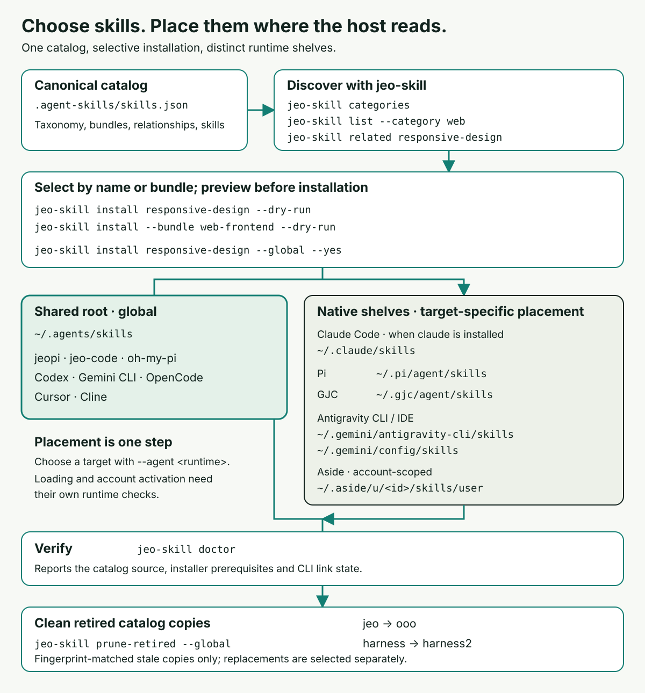
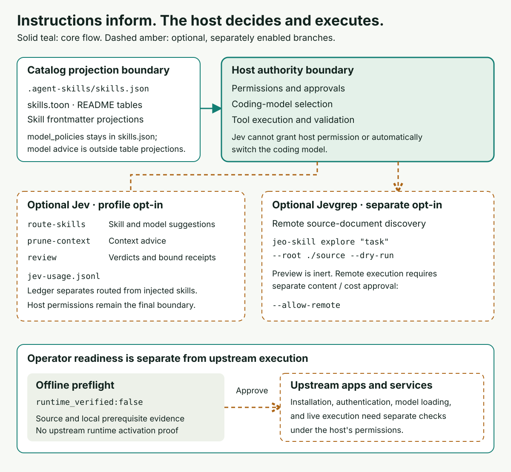
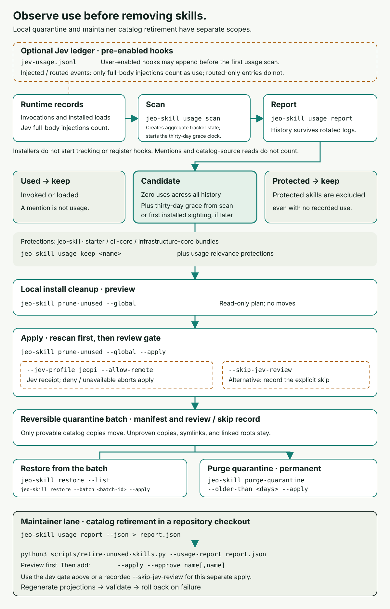

# Agent Skills

<div align="center">

[](https://github.com/akillness/jeo-skills)
[](https://github.com/akillness/jeo-skills)
[](LICENSE)
[](https://github.com/akillness/gajae-code)
[](https://github.com/akillness/jeo-code)
[](https://www.buymeacoffee.com/akillness3q)

**373 categorized skills · lightweight selective install · compact TOON catalog · cross-platform**

A curated collection for spec-first, multi-agent LLM workflows. Delegate a complete setup
with one prompt, or install the `jeo-skill` router first and add only the web,
infrastructure, game, media, CLI, or utility skills you need.

[Quick Start](#-installation) · [Skills List](#-skills-list) · [한국어](README.ko.md)

</div>

---


## 💡 What is Agent Skills?

Each skill remains discoverable as `.agent-skills/<name>/SKILL.md`. Category, subcategory,
interface, bundle, and relationship metadata lives once in `.agent-skills/skills.json`, so
skills can be grouped without duplicating wrapper folders or moving runtime-facing paths.

## 🧩 Jeo Agent & Composable Workflows

Compose the catalog with the public [`jeo-code`](https://github.com/akillness/jeo-code) coding agent: clarify with [`ooo`](.agent-skills/ooo/SKILL.md), review with [`plannotator`](.agent-skills/plannotator/SKILL.md), execute through [`cli-anything`](.agent-skills/cli-anything/SKILL.md), and verify with [`browser-harness`](.agent-skills/browser-harness/SKILL.md) or the test skill that fits your project. These are independent `SKILL.md` instructions; jeo-code owns execution, host permissions, and the final verification decision.

---

## 🏗 Workflow & Architecture




### Jev Control Plane (optional System One integration)

Jev is a separate, home-scoped opt-in, not part of catalog installation, including `full` mode. Source lives in [`jev/README.md`](jev/README.md); the canonical `jev/jev-setup.sh` configures the selected profile/backend under `~/.agents/jev`. Host integration is separate: copying a rule or package is not activation, and native hook registration, profile enablement, and exact-definition trust remain host-owned.

| Stage | Command | Role |
| :--- | :--- | :--- |
| Skill routing | `route-skills "<task>"` | Cap-aware selection over read-only `skills.json`: gate Nouls, then sharded Choice or a lexical shortlist reranked by fit Nouls → Top-K skills or an explicit "none"; advisory `provider/model` routing from `model_policies` |
| Context pruning | `prune-context` | JSONL `{id,text}` blocks → keep/drop verdicts, batched within the answering backend's state limit |
| Action gate | `review "<task>" '<proposal>'` | `permit` / `proposal_only` / `reject` / `unavailable` + SHA-256 receipt bound to backend, model, and tier |

Discovery starts with the **local catalog** (`route-skills` / `jeo-skill`). A weak local match emits `publicRegistryFallback` for the **public skills.sh registry** through `find-skills`; review candidates and obtain explicit approval before installation. The harness does not search or install public skills itself.

#### Configure: backends, per-operation routing, and decision model separation

**Backend kinds** — Choose one or configure all five (`api`, `local`, `ollama`, `lmstudio`, `systemone`). Each operation resolves its own decision backend from the profile. The harness returns skill selections, keep/drop decisions, and review verdicts; the enabled host integration applies the supported results described below. Only eligible `api` and `systemone` drivers with a matching validated-model attestation can return `permit`. Jev does not automatically change the host's coding model:

```bash
# Configure: explicit per-operation backends, one at a time
bash jev/jev-setup.sh --profile gjc --mode api --config-only --key-env JEV_API_KEY --route-backend api --review-backend api
bash jev/jev-setup.sh --profile gjc --mode local --config-only --prune-backend local

# Fallback chains (tried in order if primary unavailable)
bash jev/jev-setup.sh --profile jeopi --mode local --config-only --fallback route-skills=ollama,lmstudio

# Per-invocation override (does not change stored config)
node ~/.agents/jev/jev-harness.mjs --profile gjc route-skills --backend ollama --model qwen2.5:7b "<task>"

# Check configured state for each operation
node ~/.agents/jev/jev-harness.mjs --profile gjc status
node ~/.agents/jev/jev-harness.mjs --profile gjc status --operation route-skills
```

**Backend prerequisites and side effects**: 
- `api` — requires TypeSafe API key (`JEV_API_KEY`); hosted inference may incur charges; configuration-only setup is free.
- `local` — approved ordinary setup installs Python dependencies and downloads a full-precision model; `--config-only` does neither.
- `ollama` / `lmstudio` — approved ordinary setup may start the service and pull/load a model; `--config-only` records settings only.
- `systemone` — points to an operator-run System One endpoint (no downloads, no service startup).

**Host integration that applies decisions**. Profiles default to `JEV_RUNTIME_MODE=advisory` and `JEV_REVIEW_MODE=off`; `JEV_ENABLED` controls each profile independently. With `--runtime-mode assist`, a loaded Claude/jeopi/OMP/Pi integration injects the selected installed `SKILL.md` instructions, including their source paths. Files must match the trusted catalog and remain within its skill root; oversized files are skipped whole (64 KiB per skill, 96 KiB combined). jeopi/OMP/Pi also prune older Jev-owned custom messages from model input. The newest skill instructions and user, system, assistant, and tool messages remain intact. Claude currently injects skills only. `model-plan` remains advisory and never changes the host model.

Codex CLI 0.162.1 uses the official [hooks interface](https://learn.chatgpt.com/docs/hooks): `UserPromptSubmit` can inject selected skills and `PreToolUse` can review matched tool calls. Configure, register, and trust the definitions separately:

```bash
# JEV_API_KEY must already be set; omit --key-env to preserve an existing profile key
node ~/.agents/jev/jev-plugin.mjs configure --agent codex --profile codex --backend api --key-env JEV_API_KEY --runtime-mode assist --review-mode advisory --apply
node ~/.agents/jev/jev-plugin.mjs enable --agent codex --profile codex --apply
node ~/.agents/jev/jev-plugin.mjs hooks-install --agent codex --profile codex --apply
```

Review and trust the exact installed definitions in Codex `/hooks`; installation does not grant trust or enable the profile. `advisory` review reports the verdict; explicit `--review-mode enforce` denies a proposed action unless the verdict is `permit` from a validated backend. It never returns a host permission grant. Review covers the registered tool matchers; untrusted hooks, host failures, or timeouts can skip execution or fail open, so this is not an OS security boundary. Claude has no automatic action enforcement, and Codex has no automatic history pruning. `host-plan` is read-only; copying native packages does not register them persistently. See [the host integration guide](jev/README.md) for loading, trust, and verification limits.

**ON/OFF and shared profiles**: 
```bash
# Enable Jev for a profile
bash jev/jev-setup.sh --profile gjc --enable

# Check if enabled
node ~/.agents/jev/jev-harness.mjs --profile gjc status
# Exit 0 = usable, 2 = inactive/unconfigured, 3 = fail-closed

# Disable Jev (preserves configuration; exits 2 on next status)
bash jev/jev-setup.sh --profile gjc --disable

# Private profile files (mode 600)
ls -la ~/.agents/jev/profiles/
# gjc.env, gjc.api.env, gjc.local.env, gjc.systemone.env, …
```

**Configuration-only mode (free)**: Verify setup without executing backend downloads, inference calls, or hosted services:
```bash
# Offline validation; does not reach any backend
bash jev/jev-setup.sh --profile jeopi --mode ollama --config-only --endpoint http://127.0.0.1:11434 --model qwen2.5:0.5b
node ~/.agents/jev/jev-harness.mjs self-test --mock
```

**Non-blocking Jev setup**: Jev installation is optional and does not block the skills catalog. If Jev setup is declined, skipped, or encounters an error:
- Verified selected skills remain installed; catalog browsing and deterministic `jeo-skill` search do not require Jev.
- Invalid modes, project-scoped opt-in, allocation, download, and Jev setup failures warn and skip only Jev.
- Explicit `JEO_SKILLS_JEV=skip` preserves existing Jev state; genuine skill installation errors still return failure.

**Local Legacy wiring**: The intentional `~/.agents/jev/.env` (no profile) is supported for backward compatibility. Ambient environment variables override matching file keys but cannot enable a missing/disabled profile. Profiles (`--profile <id>`) are isolated: a missing profile never falls back to another.

Jev operations return decisions; automatic application depends on the host and opt-in mode above. Every response binds the backend kind, model, and tier (`unvalidated` unless an eligible driver's served model matches its saved attestation). Attestation and transport checks do not prove calibration or decision quality. Token savings are estimates, not measured host usage. `--mock` validates contracts offline and never permits autonomous action.

See [`jev/README.md`](jev/README.md) for detailed settings, exit codes, validation limits, and local/Ollama/LM Studio setup prerequisites.
### Jevgrep (optional remote source discovery)

[Jevgrep](.agent-skills/jevgrep/SKILL.md) is a separate `jg` CLI, not the Jev control-plane harness. Defaults remain local catalog metadata, native exact search/LSP, zvec-grep workspace retrieval, and Graphify `query` / `path` / `explain` for graph relationships. Explicitly selected skill documents, wiki Markdown, and graph source documents can be searched as text; Jevgrep does not traverse graph binaries, mutate sources, or rebuild graphs.

Preview a narrowly scoped public documentation root without invoking Jevgrep:

```bash
jeo-skill explore "Which document explains checkpoint ownership?" --root /path/to/jeo-skills/docs --dry-run
# Only after separate query/source-upload/cost approval, with jg and saved credentials already configured:
jeo-skill explore "Which document explains checkpoint ownership?" --root /path/to/jeo-skills/docs --allow-remote
```

Remote execution sends the query and eligible source content to the configured provider and may incur charges; saved credentials are not consent. Blanket setup does not install or authenticate Jevgrep. See the [manual opt-in guide](setup-all-skills-prompt.md#jevgrep-optional-remote-source-discovery) for the pinned install and limits. Dry-run is an inert plan, and local `jg files -- ROOT` reports counts only, not filenames or a privacy certification. Neither proves live provider search quality; that has not been exercised here.


## 📦 Installation

### ✨ Recommended: LLM-driven install (one prompt, all platforms)

Hand the setup prompt to your coding agent (Claude Code, Codex, Gemini CLI, …). It reads the guide, detects your OS, installs the `skills` CLI, adds every skill into the correct per-agent paths, and registers the listed shared MCP/shell tools. Optional Jev and Jevgrep runtime setup still requires separate approval.

```bash
# Fetch the delegation guide and hand it to your agent
curl -s https://raw.githubusercontent.com/akillness/jeo-skills/main/setup-all-skills-prompt.md
```

Or just paste the URL into the agent chat:

> Read https://raw.githubusercontent.com/akillness/jeo-skills/main/setup-all-skills-prompt.md in full and follow it to install the jeo-skills.

The agent runs a **full install by default** (say "core only" or "minimal" to narrow it) and will:

- detect macOS / Linux / Windows and select the native package manager,
- install the `skills@1.7.0` CLI and add skills to the universal shared root (`~/.agents/skills`), which jeopi, jeo-code, oh-my-pi, Codex, Gemini CLI, OpenCode, Cursor, and Cline automatically discover and load; when `claude` is installed, the guide also places skills natively in `~/.claude/skills`,
- **GJC requires native projection** to `~/.gjc/agent/skills` (global) or `.gjc/skills` (project) since it does not load shared providers; the setup guide handles this automatically,
- **Antigravity IDE and CLI require native projection** (see setup guide Step 4C) since `skills@1.7.0` installs to shared root regardless of `--agent` flag,
- register MCP tools (`ooo`, `semble`), shell tooling (`rtk`), and platform-specific integrations,
- **preserve any pre-existing skills** — it never deletes other skills; the only removals are fingerprint-matched catalog copies of retired `jeo`/`harness`.

Jev remains optional in all catalog modes: default setup does not download Jev models or install Jev rules/hooks. The root installer offers a default-no prompt only in an interactive home-scoped session; the delegation guide requires explicit approved opt-in before running Jev setup.
> [!NOTE]
>
> **Included in the catalog:** **`scrapingant-web-fetch`** gives agents a hosted MCP fetch tool
> that handles Cloudflare/bot-checks and JS-only pages and returns LLM-ready Markdown, with
> no local browser. It needs your own API key, so the setup guide only configures it on
> explicit request. Details:
> [`.agent-skills/scrapingant-web-fetch/SKILL.md`](.agent-skills/scrapingant-web-fetch/SKILL.md).

### Lightweight selective install (manual / CI)

Install the **`jeo-skill` router first**, not all 373 skill folders. It provides category,
subcategory, interface, bundle, and relationship discovery while keeping heavy apps,
models, MCP servers, and runtimes on demand.

```bash
# One lightweight skill, shared globally
# Shared-root hosts discover this install: jeopi, jeo-code, oh-my-pi, Codex,
# Gemini CLI, OpenCode, Cursor, and Cline. Claude Code is native; pass
# `--agent claude-code` when `claude` is installed. GJC is separate; pass
# `--agent gjc` when you want the router to copy the selected skills into `~/.gjc/agent/skills`.
npx --yes skills@1.7.0 add https://github.com/akillness/jeo-skills \
  --skill jeo-skill --global --agent universal --yes --copy --full-depth

python3 "$HOME/.agents/skills/jeo-skill/scripts/jeo-skill.py" link
jeo-skill doctor
```

Browse and preview the narrowest useful selection:

```bash
jeo-skill categories
jeo-skill list --category web --subcategory frontend
jeo-skill list --category game --subcategory motion-vfx
jeo-skill related code-review
jeo-skill install --bundle web-frontend --dry-run
```

Install only the reviewed names or bundle:

```bash
jeo-skill install responsive-design react-best-practices --global --yes
jeo-skill install --bundle game-web --global --yes
```

**Project-local install** (install skills only for the current project):

```bash
npx --yes skills@1.7.0 add https://github.com/akillness/jeo-skills \
  --skill jeo-skill --agent universal --yes --copy --full-depth

python3 "$PWD/.agents/skills/jeo-skill/scripts/jeo-skill.py" install responsive-design --yes
```

The one-line installer uses the lightweight default:

```bash
curl -fsSL https://raw.githubusercontent.com/akillness/jeo-skills/main/install.sh | bash
```

To control scope and selection, set environment variables:

```bash
# Install core bundle instead of router only
JEO_SKILLS_SELECTION=bundle bash -c 'curl -fsSL https://raw.githubusercontent.com/akillness/jeo-skills/main/install.sh | bash'

# Project-local instead of global
INSTALL_GLOBAL=false JEO_SKILLS_SELECTION=bundle bash -c 'curl -fsSL https://raw.githubusercontent.com/akillness/jeo-skills/main/install.sh | bash'
```

Available modes:
- `JEO_SKILLS_SELECTION=router` (default) — install the jeo-skill catalog router only
- `JEO_SKILLS_SELECTION=bundle` — install the `starter` bundle through jeo-skill
- `JEO_SKILLS_SELECTION=all` — install every skill in the catalog

Installs also remove stale catalog copies of retired skills — `jeo` (now `ooo`) and
`harness` (now `harness2`) — from the roots they write, only when the copy's frontmatter
name and first heading match this catalog's version. Preview or sweep every runtime root:

```bash
jeo-skill prune-retired --global --dry-run
jeo-skill prune-retired --global
```

### Skill usage tracking and unused-skill cleanup



`jeo-skill usage scan` reads local runtime records (Claude `skillUsage` and transcripts, Codex
rollouts, OpenCode, Antigravity, Aside, jeopi/GJC/OMP/Pi sessions, and the Jev injection ledger)
and stores only skill names, counts, and timestamps under
`${JEO_SKILL_STATE_DIR:-${XDG_STATE_HOME:-~/.local/state}/jeo-skill}`. A skill counts as used only
when an agent invoked or loaded it; prompt mentions, Jev routing without injection, and reads of
the catalog source checkout never count. Evidence survives rotated or deleted runtime logs.

A skill becomes a candidate only with zero uses across all history and a 30-day grace period after
tracking began (or after it was first seen installed, if later). `jeo-skill`, the `starter`,
`cli-core`, and `infrastructure-core` bundles, `usage keep` pins, and `usage relevance` protections
are never candidates.

```bash
jeo-skill usage scan                     # refresh evidence (writes tracker state only)
jeo-skill usage report --status candidate
jeo-skill usage keep rare-but-needed       # `usage unkeep` removes the pin
jeo-skill usage relevance --repos ~/work/app --jev-profile jeopi --dry-run

# Preview, then quarantine (rescans before --apply; reversible)
jeo-skill prune-unused --global
jeo-skill prune-unused --global --apply --jev-profile jeopi --allow-remote
# Or explicitly skip review (recorded in the batch manifest)
jeo-skill prune-unused --global --apply --skip-jev-review
jeo-skill restore --list
jeo-skill restore --batch <batch-id> --apply
jeo-skill purge-quarantine --older-than 30 --apply   # permanent; preview without --apply
```

Quarantine moves only provable catalog copies; third-party copies, symlinks, and linked roots are
reported and kept. A Jev `deny` or unavailable review aborts `--apply`; `proposal_only` proceeds
because the explicit `--apply` is the human approval, and the receipt is stored in the batch
manifest. `--skip-jev-review` is recorded instead. Catalog retirement is a separate maintainer
step in a repository checkout:
`python3 scripts/retire-unused-skills.py --usage-report report.json` previews proposals, while
`python3 scripts/retire-unused-skills.py --usage-report report.json --apply --approve name[,name] --jev-profile jeopi --allow-remote`
(or `--skip-jev-review`, recorded instead of a receipt) retires approved skills, regenerates
projections, validates, and rolls back on failure. `--apply` without one of the two review
choices is rejected.

Installers never start tracking or register hooks. `jeo-skill usage scan` creates the aggregate
tracker state and starts the 30-day grace clock. If Jev hooks are already enabled, they may write
routed/injected events to `jev-usage.jsonl` in the same private state directory
(`${JEO_SKILL_STATE_DIR:-${XDG_STATE_HOME:-~/.local/state}/jeo-skill}`) without a scan; only
injections count as use. Optional SessionEnd or cron scheduling is user-installed. See the
[`jeo-skill` usage-tracking guidance](.agent-skills/jeo-skill/SKILL.md#usage-tracking-and-unused-skill-cleanup).

### On-demand video motion previs

`video-motion-previs` remains a CLI-first motion workflow. Its desktop app and generated
model/runtime assets are installed only when a real motion task needs them.

```bash
jeo-skill install video-motion-previs --global --yes
video-motion-previs check
```

### On-demand FilmCraft repository operator

[`filmcraft`](https://github.com/storytold/filmcraft/tree/1fdfd8324db4aa23b08c69f518b086e632f75f84)
is a source-pinned operator for FilmCraft, an open-source nonlinear video editor written in
pure Rust. Installing the skill adds instructions only; it does **not** install FilmCraft,
Rust/Cargo, the desktop app, `filmcraft-cli`, optional fonts, media, or MCP/client registration.

Preview and then explicitly apply the skill install:

```bash
jeo-skill install filmcraft --global --dry-run
jeo-skill install filmcraft --global --yes
```

Use FilmCraft only for local project/sequence inspection, editing, preview rendering, export,
or automation. Source setup is separate; proceed when the user explicitly requests the operation and
its scope is clear (`cargo build --release -p filmcraft-cli -p filmcraft`;
desktop demo/control uses `cargo run --release -p filmcraft` or `cargo run --release -p filmcraft -- --control 9876`).
Headless MCP uses `filmcraft-cli mcp --project /abs/project.fcproj`; a desktop bridge requires the
app control channel plus `filmcraft-cli mcp --bridge 127.0.0.1:9876`. No `filmcraft doctor` command
or folder-confinement flag is verified, and paths remain unrestricted under user permissions.
When using the desktop bridge, the app's currently selected project is authoritative; do not combine
`--bridge` with `--project` or `--demo`, which are silently ignored in bridge mode.
Optional fonts require a separate `craft-fonts` checkout and `CRAFT_FONTS_DIR`. Blanket setup never
builds FilmCraft, registers MCP, starts the app, downloads fonts, or imports media; an explicit user
request naming the operation and destination is sufficient. Ask only when scope, consent, destination,
or a new destructive action is unclear. For programmable/template video generation, use
`video-production` instead.


---

### On-demand repository operators

Eighteen source-pinned operator skills cover `openrig`, `anyjev`,
`typesafe-computer-use`, `zurp`, `helix-foundry`, `uzu`, `context-mode`, `rea`,
`fineenvs`, `llmfit`, `pg-jev`, `okf-agent-memory`, `jev-ultrafast`, `harness2`,
`voicestudio`, `ruflo`, `diagram-design`, and `artcraft`. Each v1.1.0 package ships a
router-first `SKILL.md`, a pinned reference, an executable stdlib offline preflight and evals;
applications, models, credentials, MCP/hook registration, desktop authority and database writes
remain separately approved operations. See the
[setup guide](setup-all-skills-prompt.md#repository-operators-on-demand-offline-support).

From this repository, inspect a selected package without activating its upstream app:

```bash
python3 .agent-skills/openrig/scripts/preflight.py --json
```

All eighteen helpers support `--help`, `--json`, optional `--repo` and `--expect-commit`.
`harness2` additionally accepts `--bench demo|method|lab|jb|wb` and `--substrate oc|cx`.
They remain standalone after installation and report `runtime_verified: false`.
Exit 0 means offline checks pass, 1 reports missing/mismatched prerequisites, and 2
rejects invalid input. A tool path or matching source HEAD is not runtime readiness.


## 📚 Skills List

> Central manifest: `.agent-skills/skills.json` · 373 skills · 10 primary categories · subcategory/interface/relationship metadata

### 🌐 Web (52)

Subcategories: `frontend` (7), `backend` (3), `design` (12), `api` (2), `auth` (1), `data` (6), `testing` (4), `accessibility` (1), `performance` (1), `graphics` (10), `capture` (5)

| Skill |
|---|
| `ax` |
| `react-best-practices` |
| `react-bits` |
| `state-management` |
| `amrouter` |
| `colibri` |
| `pydantic-ai` |
| `astryx` |
| `build-daily-inspiration-sites` |
| `daily-ui-inspiration-capture` |
| `design-first-ui-prompting` |
| `design-system` |
| `devup-ui` |
| `html-to-interaction-prompts` |
| `lazyweb` |
| `responsive-design` |
| `stitch-skills` |
| `web-design` |
| `api-design` |
| `api-documentation` |
| `authentication-setup` |
| `database-schema-design` |
| `payloadcms` |
| `supabase-agent-skills` |
| `typesense` |
| `backend-testing` |
| `browser-harness` |
| `playwriter` |
| `web-accessibility` |
| `optimize-web-animations` |
| `threejs-animation` |
| `threejs-fundamentals` |
| `threejs-geometry` |
| `threejs-interaction` |
| `threejs-lighting` |
| `threejs-loaders` |
| `threejs-materials` |
| `threejs-postprocessing` |
| `threejs-shaders` |
| `threejs-textures` |
| `agentation` |
| `react-grab` |
| `slides-grab` |
| `stitched-full-page-capture` |
| `chatbot-template` |
| `airship` |
| `moli` |
| `design-taste-frontend` |
| `higgsfield-websites` |
| `stagehand` |
| `helix-foundry` |
| `pg-jev` |

### 🏗 Infrastructure (14)

Subcategories: `deployment` (2), `environment` (2), `observability` (3), `security` (3), `cloud-data` (3), `automation` (0), `tooling` (1)

| Skill |
|---|
| `deployment-automation` |
| `vercel-deploy` |
| `environment-setup` |
| `system-environment-setup` |
| `log-analysis` |
| `monitoring-observability` |
| `openocta` |
| `security-best-practices` |
| `strix` |
| `firebase-cli` |
| `unity-cli` |
| `genkit` |
| `looker-studio-bigquery` |
| `zurp` |

### 🎮 Game (28)

Subcategories: `client` (3), `web` (2), `server` (1), `design-ui` (7), `audio` (1), `animation` (2), `motion-vfx` (2), `sprite-image` (1), `art-resources` (0), `storytelling` (0), `tooling` (3), `qa-performance` (4), `release` (2)

| Skill |
|---|
| `implement-fog-of-war` |
| `unity-gamedev-skill-pack` |
| `agentic-gamedev-skills` |
| `web-game-development` |
| `bmad-gds` |
| `open-design-game-ui-concept` |
| `open-design-game-ui-handoff` |
| `open-design-game-ui-takeover` |
| `rfxgen` |
| `animato` |
| `unirig` |
| `dalamud-vfx-editor` |
| `game-vfx` |
| `perfectpixel` |
| `game-studio-harness` |
| `underworld-overseer-save-mapper` |
| `godogen` |
| `game-build-log-triage` |
| `game-demo-feedback-triage` |
| `game-performance-profiler` |
| `wai-play` |
| `game-ci-cd-pipeline` |
| `steam-store-launch-ops` |
| `unity-technologies-skills` |
| `multiplayer-game-architecture` |
| `game-design-theory` |
| `game-feel` |
| `game-ui-ux` |

### 🎬 Creative Media (36)

Subcategories: `image` (10), `video` (14), `motion` (1), `audio` (2), `presentation` (1), `diagram` (2), `design` (4), `capture` (0), `storytelling` (2)

| Skill |
|---|
| `aura-asset-images` |
| `generate-reference-inspired-brand-worlds` |
| `god-tibo-imagen` |
| `paperbanana` |
| `unsplash-asset-images` |
| `browser-video-recording` |
| `gbro-collage-broll` |
| `opencut` |
| `video-production` |
| `filmcraft` |
| `video-shotcraft` |
| `video-to-superprompt` |
| `vox-director` |
| `video-motion-previs` |
| `elevenlabs-tts` |
| `presentation-builder` |
| `drawio` |
| `open-design` |
| `blender-mcp` |
| `webtoon-harness` |
| `palmier-pro` |
| `openstory` |
| `drama-skills` |
| `openmontage` |
| `open-generative-ai` |
| `higgsfield-generate` |
| `higgsfield-marketplace-cards` |
| `higgsfield-product-photoshoot` |
| `higgsfield-soul-id` |
| `higgsfield-youtube-thumbnail` |
| `higgsfield-video-explainer` |
| `higgsfield-brandkit` |
| `shopping-shorts` |
| `voicestudio` |
| `diagram-design` |
| `artcraft` |

### ⌨️ CLI Tools (40)

Subcategories: `developer-cli` (10), `ai-cli` (15), `media-cli` (1), `automation-cli` (6), `search-cli` (7), `benchmark-cli` (1)

| Skill |
|---|
| `soup` |
| `caveman` |
| `ccpi-marketplace` |
| `cli-anything` |
| `ghgrab` |
| `jeo-skill` |
| `pretext` |
| `aider-cli-workflow` |
| `claudekit` |
| `fabric` |
| `ooo` |
| `open-code-review` |
| `ponytail` |
| `zeude` |
| `compresso` |
| `codeflow` |
| `graphify` |
| `headroom` |
| `npm-git-install` |
| `okf` |
| `rtk` |
| `tokhub` |
| `scrapling` |
| `agent-reach` |
| `scrapingant-web-fetch` |
| `semble` |
| `zvec-grep` |
| `x-twitter-scraper` |
| `hyperfine-benchmarking` |
| `codeburn` |
| `mole` |
| `mcp-server-sv-number` |
| `zeroshot` |
| `k-skill-setup` |
| `jevgrep` |
| `openrig` |
| `uzu` |
| `context-mode` |
| `rea` |
| `llmfit` |

### 🤖 AI & Agents (69)

Subcategories: `orchestration` (16), `agent-frameworks` (18), `skill-authoring` (5), `evaluation` (8), `memory` (3), `planning-review` (13), `discovery` (3), `prompting` (3)

| Skill |
|---|
| `bmad` |
| `deep-dive` |
| `deepinit` |
| `spec-kit` |
| `ecc` |
| `microsoft-agent-framework` |
| `openai-agents-python` |
| `goalflow` |
| `openexecutive` |
| `article-prompts-to-skills` |
| `skill-standardization` |
| `upskill` |
| `write-a-skill` |
| `langsmith` |
| `opik` |
| `skill-autoresearch` |
| `kadath` |
| `mex` |
| `bmad-idea` |
| `grill-me` |
| `grill-with-docs` |
| `plannotator` |
| `survey` |
| `to-tickets` |
| `to-spec` |
| `triage` |
| `openspace` |
| `agentic-skills` |
| `agenticskills` |
| `prompts-chat` |
| `find-skills` |
| `mcp-builder` |
| `ask-matt` |
| `grilling` |
| `setup-matt-pocock-skills` |
| `to-questionnaire` |
| `wayfinder` |
| `writing-for-agents` |
| `agent-guardrails` |
| `agent-system-design` |
| `agent-tool-routing` |
| `reflexion-pattern` |
| `agent-manager` |
| `langchain-fundamentals` |
| `langchain-middleware` |
| `langchain-rag` |
| `langchain-dependencies` |
| `langgraph-fundamentals` |
| `langgraph-persistence` |
| `langgraph-human-in-the-loop` |
| `deep-agents-core` |
| `deep-agents-memory` |
| `deep-agents-orchestration` |
| `langchain-bmad` |
| `a2a-protocol` |
| `agent-benchmarking` |
| `agent-observability` |
| `multi-agent-eval-harness` |
| `agent-memory-architecture` |
| `okf-agent-memory` |
| `agent-workflow` |
| `agent-principles` |
| `paperclip` |
| `jev-control-plane` |
| `anyjev` |
| `typesafe-computer-use` |
| `jev-ultrafast` |
| `harness2` |
| `ruflo` |

### 🧰 Engineering (23)

Subcategories: `code-quality` (11), `testing` (3), `architecture` (6), `documentation` (2), `code-navigation` (1)

| Skill |
|---|
| `audit-reference-originality` |
| `audit-verify-explain-grade-5` |
| `code-refactoring` |
| `code-review` |
| `debugging` |
| `diagnosing-bugs` |
| `github-repo-candidate-quality-gate` |
| `migrate-to-shoehorn` |
| `performance-optimization` |
| `performance-profiling` |
| `scaffold-exercises` |
| `tdd` |
| `testing-strategies` |
| `improve-codebase-architecture` |
| `zoom-out` |
| `nightrun` |
| `changelog-maintenance` |
| `technical-writing` |
| `codebase-search` |
| `codebase-design` |
| `domain-modeling` |
| `implement` |
| `prototype` |

### 🔭 Research & Analysis (14)

Subcategories: `academic` (3), `web-research` (3), `data-analysis` (2), `experimentation` (2), `benchmarking` (1), `intelligence` (3)

| Skill |
|---|
| `academic-research` |
| `research-paper-writing` |
| `scientific-agent-skills` |
| `deep-research` |
| `heretic` |
| `data-analysis` |
| `pattern-detection` |
| `autoresearch` |
| `scientific-llm-benchmarks` |
| `agent-pulse` |
| `research` |
| `korean-patent-search` |
| `fineenvs` |
| `mi-orchestration` |

### 📣 Business (70)

Subcategories: `marketing` (4), `support` (2), `publishing` (1), `pm-toolkit` (5), `pm-discovery` (13), `pm-strategy` (12), `pm-execution` (12), `pm-market-research` (7), `pm-analytics` (3), `pm-go-to-market` (6), `pm-growth` (5)

| Skill |
|---|
| `marketing-automation` |
| `write-like-meng-on-x` |
| `x-bookmark-quote-posts` |
| `customer-email-draft-threads` |
| `customer-support-verification` |
| `yuwen-publish-precheck` |
| `youtube-growth-playbook-2026` |
| `pm-skills` |
| `draft-nda` |
| `grammar-check` |
| `privacy-policy` |
| `review-resume` |
| `analyze-feature-requests` |
| `brainstorm-experiments-existing` |
| `brainstorm-experiments-new` |
| `brainstorm-ideas-existing` |
| `brainstorm-ideas-new` |
| `identify-assumptions-existing` |
| `identify-assumptions-new` |
| `interview-script` |
| `metrics-dashboard` |
| `opportunity-solution-tree` |
| `prioritize-assumptions` |
| `prioritize-features` |
| `summarize-interview` |
| `ansoff-matrix` |
| `business-model` |
| `lean-canvas` |
| `monetization-strategy` |
| `pestle-analysis` |
| `porters-five-forces` |
| `pricing-strategy` |
| `product-strategy` |
| `product-vision` |
| `startup-canvas` |
| `swot-analysis` |
| `value-proposition` |
| `brainstorm-okrs` |
| `create-prd` |
| `dummy-dataset` |
| `job-stories` |
| `outcome-roadmap` |
| `pre-mortem` |
| `prioritization-frameworks` |
| `stakeholder-map` |
| `summarize-meeting` |
| `test-scenarios` |
| `user-stories` |
| `wwas` |
| `competitor-analysis` |
| `customer-journey-map` |
| `market-segments` |
| `market-sizing` |
| `sentiment-analysis` |
| `user-personas` |
| `user-segmentation` |
| `ab-test-analysis` |
| `cohort-analysis` |
| `sql-queries` |
| `beachhead-segment` |
| `competitive-battlecard` |
| `growth-loops` |
| `gtm-motions` |
| `gtm-strategy` |
| `ideal-customer-profile` |
| `marketing-ideas` |
| `north-star-metric` |
| `positioning-ideas` |
| `product-name` |
| `value-prop-statements` |

### 🔧 Utilities (27)

Subcategories: `knowledge` (7), `files` (5), `git` (4), `workspace` (1), `project-management` (4), `productivity` (3), `general` (3)

| Skill |
|---|
| `lapian-notes` |
| `llm-wiki` |
| `notebooklm` |
| `obsidian-mind` |
| `obsidian-second-brain` |
| `opencontext` |
| `file-organization` |
| `git-guardrails-claude-code` |
| `git-submodule` |
| `git-workflow` |
| `game-sounds` |
| `sprint-retrospective` |
| `standup-meeting` |
| `task-estimation` |
| `task-planning` |
| `google-workspace` |
| `watermarks-remover` |
| `solo-skills` |
| `eli5` |
| `handoff` |
| `resolving-merge-conflicts` |
| `teach` |
| `wait-what` |
| `wizard` |
| `hwp` |
| `rhwp-advanced` |
| `rhwp-edit` |

---

## 🧬 TOON Catalog Projection

`.agent-skills/skills.toon` is a generated, pipe-delimited metadata projection of `.agent-skills/skills.json`. Each record is `name|category|subcategory|interface|path|description`; whitespace is collapsed and `|` inside descriptions becomes ` / ` so the record separator stays unambiguous.

TOON is a catalog format, not an automatic prompt-injection hook, host integration, timing guarantee, token-savings claim, or token-budget control. It is regenerated with `python3 scripts/generate-catalog-projections.py` and checked with `python3 scripts/generate-catalog-projections.py --check`; a host or tool must explicitly read it before it can affect a run.

---

## 🔮 Featured Tools

### ooo — Spec-First Control Loop
> Keyword: `ooo` · `ouroboros` · `ooo interview` | Platforms: Claude · Codex · Gemini · OpenCode

Spec-first development front door: clarify ambiguous requests with a **git-grounded interview**, freeze the contract, render the execution plan through **spec-kit**, execute through **cli-anything harnesses**, and verify before claiming done. MCP server install: `claude mcp add ooo -s user -- ouroboros mcp`.

| Phase | Owner | Description |
|-------|-------|-------------|
| Clarify / Spec | `ooo interview` | Interview grounded in live git data (`.ouroboros/interview-context.md`: commits · churn · contributors, regenerated every interview); freeze acceptance criteria before execution |
| Plan | `spec-kit` (`/speckit.plan` → `/speckit.tasks`) | Render the reviewable execution plan **from the frozen seed** (one-way seed → plan; installed by default via `OOO_SPEC_KIT=1`) |
| Plan / Review | `plannotator` + `bmad` | Shape and approve the plan without reopening settled work |
| Execute | `cli-anything` (`cli-hub search` → `install` → `launch`) | Drive real software through agent-native CLI harnesses; `--json` output is the evaluate-stage evidence (installed by default via `OOO_CLI_ANYTHING=1`) |
| Verify / QA | `browser-harness` | Record CDP browser / QA evidence before claiming completion |
| Verify UI | `agentation` | Wait for explicit submit, then process UI feedback |
| Durable knowledge | `llm-wiki` + `graphify` | File significant findings into the wiki and graph |

> Keyword: `ooo`, `ouroboros`, `ooo ralph` | [Skill](.agent-skills/ooo/SKILL.md) | [GitHub](https://github.com/Q00/ouroboros)

Socratic interview **grounded in updated git data** → immutable seed/spec → **spec-kit renders the execution plan from the seed** → **execute through cli-anything harnesses** (`--json` output = evaluate evidence) → verify before done → keep looping until completion is actually verified. Installable as a Claude Code plugin or via pip; the skill installer wires all three integrations by default.

```bash
# Plugin install (Claude Code)
claude plugin marketplace add Q00/ouroboros

# pip
pip install ouroboros-ai[all]

# Skill install (any platform)
npx skills add https://github.com/akillness/jeo-skills --skill ooo

# One-shot installer: skill + ouroboros-ai + git interview + spec-kit + cli-anything
bash .agent-skills/ooo/scripts/install.sh
# knobs: OOO_GIT_INTERVIEW=0 · OOO_SPEC_KIT=0 · OOO_CLI_ANYTHING=0 · SPEC_KIT_REF=<ref>

# Usage
bash .agent-skills/ooo/scripts/git-interview-context.sh   # refresh live git context
ouroboros init start "I want to build a task management CLI"
# after seed freeze: /speckit.plan → /speckit.tasks (from the seed)
cli-hub search <keyword> && cli-hub install <name>        # arm execute harnesses
ouroboros run workflow seed.yaml
ouroboros run resume
ouroboros tui monitor
```

### plannotator — Visual Plan Review
> Keyword: `plan` | [Skill](.agent-skills/plannotator/SKILL.md) | [GitHub](https://github.com/backnotprop/plannotator)

Browser UI for annotating AI plans. Approve or send structured feedback in one click. Works with Claude Code, OpenCode, Gemini CLI, and Codex CLI.

```bash
bash .agent-skills/plannotator/scripts/install.sh --all
```

### god-tibo-imagen — AI Image Generation via Codex Backend
> Keyword: `god-tibo-imagen`, `gti`, `image generation`, `codex image` | [Skill](.agent-skills/god-tibo-imagen/SKILL.md) | [GitHub](https://github.com/NomaDamas/god-tibo-imagen)

Zero-dependency image generation using Codex's ChatGPT backend. Reuses existing `~/.codex/auth.json` — no separate API key needed. Supports CLI (`gti`), Node.js library, and Python SDK with optional reference image inputs.

```bash
# Plugin install (Claude Code)
claude plugin marketplace add NomaDamas/god-tibo-imagen

# npm install (CLI)
npm install -g god-tibo-imagen

# Python SDK
pip install god-tibo-imagen

# Install from jeo-skills
npx skills add https://github.com/akillness/jeo-skills --skill god-tibo-imagen

# Usage
gti --prompt "flat blue square icon" --output ./icon.png
gti --prompt "make it round" --input ./ref.png --output ./out.png
```

### notebooklm — Google NotebookLM Integration for Claude Code
> Keyword: `notebooklm`, `notebook query`, `google notebooklm` | [Skill](.agent-skills/notebooklm/SKILL.md) | [GitHub](https://github.com/PleasePrompto/notebooklm-skill)

Query your Google NotebookLM notebooks directly from Claude Code via Patchright browser automation. Get source-grounded, citation-backed answers from your uploaded documents without leaving the terminal. Supports persistent Google authentication, notebook library management, and multi-notebook research workflows. **Local Claude Code only** (web UI not supported).

```bash
# Plugin install (Claude Code)
claude plugin marketplace add PleasePrompto/notebooklm-skill

# Manual clone
git clone https://github.com/PleasePrompto/notebooklm-skill.git ~/.claude/skills/notebooklm

# Install from jeo-skills
npx skills add https://github.com/akillness/jeo-skills --skill notebooklm

# First-time setup (opens Chrome for Google login)
python scripts/run.py auth_manager.py setup

# Add a notebook and ask a question
python scripts/run.py notebook_manager.py add --url "https://notebooklm.google.com/notebook/ID" --name "my-research"
python scripts/run.py ask_question.py --question "What are the key findings?"
```

### pretext — Fast Multiline Text Measurement & Layout
> Keyword: `pretext`, `text measurement`, `text layout`, `paragraph height` | [Skill](.agent-skills/pretext/SKILL.md) | [GitHub](https://github.com/chenglou/pretext)

Pure JavaScript/TypeScript text measurement and layout without DOM reflow. Calculate paragraph heights, build manual line layouts, handle emoji/CJK/RTL, and render to DOM, Canvas, or SVG — all via pure arithmetic on cached font metrics.

```bash
# Plugin install (Claude Code)
claude plugin marketplace add chenglou/pretext

# npm install
npm install @chenglou/pretext

# Install from jeo-skills
npx skills add https://github.com/akillness/jeo-skills --skill pretext
```

### zeude — Enterprise AI Adoption Platform for Claude Code
> Keyword: `zeude`, `ai adoption`, `claude code adoption`, `enterprise claude` | [Skill](.agent-skills/zeude/SKILL.md) | [GitHub](https://github.com/zep-us/zeude)

Enterprise platform that solves the Intention-Action Gap in Claude Code adoption. Delivers 3× adoption improvement via OpenTelemetry measurement, centralized skill/MCP/hook sync (Zeude Shim), and context-aware skill suggestions at prompt time. Requires Supabase + ClickHouse.

```bash
# Plugin install (Claude Code)
claude plugin marketplace add zep-us/zeude

# Self-hosted setup
git clone https://github.com/zep-us/zeude.git
cd zeude && cp .env.example .env
# Configure Supabase and ClickHouse credentials

# Install from jeo-skills
npx skills add https://github.com/akillness/jeo-skills --skill zeude

# Per-developer Shim install (using agent key from dashboard)
curl -fsSL https://raw.githubusercontent.com/zep-us/zeude/main/install.sh | bash -s -- --key <AGENT_KEY>
```

### compresso — Offline Batch Video & Image Compression
> Keyword: `compresso`, `compress video`, `compress image`, `batch compression` | [Skill](.agent-skills/compresso/SKILL.md) | [GitHub](https://github.com/codeforreal1/compressO)

Free, open-source, fully offline desktop compression (Tauri + React). Batch compress videos and images, trim/split, convert formats, embed subtitles, and manage metadata — powered by FFmpeg, pngquant, jpegoptim, and gifski.

```bash
# Plugin install (Claude Code)
claude plugin marketplace add codeforreal1/compressO

# macOS Homebrew
brew install --cask codeforreal1/tap/compresso

# Install from jeo-skills
npx skills add https://github.com/akillness/jeo-skills --skill compresso
```

### stitch-skills — Agent Skills for Stitch MCP
> Keyword: `stitch`, `stitch-design`, `stitch-loop`, `enhance-prompt` | [Skill](.agent-skills/stitch-skills/SKILL.md) | [GitHub](https://github.com/google-labs-code/stitch-skills)

AI-powered UI design generation, prompt refinement, and screen-to-code workflows via the Stitch MCP server. Generate high-fidelity screens, multi-page websites, DESIGN.md docs, React/shadcn-ui components, and Remotion walkthrough videos.

```bash
# Plugin install (Claude Code)
claude plugin marketplace add google-labs-code/stitch-skills

# Skill install (any platform)
npx skills add google-labs-code/stitch-skills --skill stitch-design --global
npx skills add google-labs-code/stitch-skills --skill enhance-prompt --global

# Install from jeo-skills
npx skills add https://github.com/akillness/jeo-skills --skill stitch-skills
```

### open-design — Local-First Design Artifact Generation
> Keyword: `open-design`, `local design tool`, `prototype generation` | [GitHub](https://github.com/nexu-io/open-design)

Open-source alternative to Anthropic's Claude Design. Generates web, mobile, and desktop prototypes, presentation decks, and media artifacts using locally-installed coding agents (Claude Code, Cursor, Gemini CLI, GitHub Copilot, etc.). Includes 72 built-in design systems, 5 visual directions, 93 media prompt templates, and multi-format export.

```bash
# Plugin install (Claude Code)
claude plugin marketplace add nexu-io/open-design

# Clone and run locally
git clone https://github.com/nexu-io/open-design.git
cd open-design && corepack enable && pnpm install
pnpm tools-dev run web

# Install from jeo-skills
npx skills add https://github.com/akillness/jeo-skills --skill open-design
```


### semble — Token-Efficient Code Search for Agents
> Keyword: `semble`, `code search`, `semble search`, `semantic code search` | [GitHub](https://github.com/MinishLab/semble)

Fast, accurate code search that returns only the relevant code snippets agents need — using ~98% fewer tokens than grep+read. Indexes any local or remote repo in ~250ms entirely on CPU (no GPU or API key). Supports natural-language and symbol queries, semantic similar-code discovery, and MCP integration for Claude Code, Codex, Cursor, and OpenCode.

```bash
# MCP install (Claude Code)
claude mcp add semble -s user -- uvx --from "semble[mcp]" semble

# CLI install
pip install semble          # pip
uv tool install semble      # uv

# Install from jeo-skills
npx skills add https://github.com/akillness/jeo-skills --skill semble
```

---

## 🌐 Recommended Harness OSS

| Repository | Stars | Description |
|-----------|------:|-------------|
| [AutoGPT](https://github.com/Significant-Gravitas/AutoGPT) | 182k | Accessible AI platform for continuous agents |
| [AutoGen](https://github.com/microsoft/autogen) | 55.4k | Microsoft multi-agent conversation framework |
| [CrewAI](https://github.com/crewAIInc/crewAI) | 45.7k | Role-playing autonomous AI agent orchestration |
| [smolagents](https://github.com/huggingface/smolagents) | 25.9k | HuggingFace code-thinking agent library |
| [agency-agents](https://github.com/msitarzewski/agency-agents) | 21.2k | 61 specialized AI agents across 9 divisions |
| [ruvnet/ruflo](https://github.com/ruvnet/ruflo) | 78k | Agent swarm and hive-mind orchestration engine (formerly claude-flow) |
| [google-research/harness2](https://github.com/google-research/harness2) | 15.9k | Recursive agent harnessing: Propose–Probe–Compose refinement of the prompts, tools, memory, skills, and subagents around a fixed model |
| [revfactory/webtoon-harness](https://github.com/revfactory/webtoon-harness) | harness | 27-agent webtoon production team (trend → vertical-scroll viewer) plugin |

> Packaged skills and integration instructions → [.agent-skills/harness2/SKILL.md](.agent-skills/harness2/SKILL.md) · [.agent-skills/ruflo/SKILL.md](.agent-skills/ruflo/SKILL.md)

---

## 📁 Structure

```text
├── .agent-skills/          ← 373 skill folders (SKILL.md + optional support files)
├── assets/                ← README cover and catalog-install, runtime-boundary and skill-lifecycle diagrams
├── changelog/             ← localized monthly source files
├── docs/                  ← ScrapingAnt partnership and outreach notes
├── install.sh             ← one-line installer
├── scripts/               ← catalog and link validation helpers
├── jev/                   ← optional Jev control-plane source
├── README.md              ← English (this file)
├── README.ko.md           ← 한국어
├── README.es-ES.md        ← Español
└── CHANGELOG.md           ← release history
```

---

## 📖 Related Docs

| Tool | Keyword | Doc |
|------|---------|-----|
| `ooo` | `ooo`, `ouroboros`, `ooo interview` | [.agent-skills/ooo/SKILL.md](.agent-skills/ooo/SKILL.md) |
| `plannotator` | `plan` | [.agent-skills/plannotator/SKILL.md](.agent-skills/plannotator/SKILL.md) |
| `stitch-skills` | `stitch`, `stitch-design`, `enhance-prompt` | [.agent-skills/stitch-skills/SKILL.md](.agent-skills/stitch-skills/SKILL.md) |
| `compresso` | `compresso`, `compress video`, `batch compression` | [.agent-skills/compresso/SKILL.md](.agent-skills/compresso/SKILL.md) |
| `filmcraft` | `filmcraft`, `filmcraft-cli`, `.fcproj`, `FilmCraft MCP` | [.agent-skills/filmcraft/SKILL.md](.agent-skills/filmcraft/SKILL.md) |
| `open-design` | `open-design`, `local design tool`, `prototype generation` | [.agent-skills/open-design/SKILL.md](.agent-skills/open-design/SKILL.md) |
| `codeflow` | `codeflow`, `visualize codebase`, `dependency graph` | [.agent-skills/codeflow/SKILL.md](.agent-skills/codeflow/SKILL.md) |
| `slides-grab` | `slides-grab`, `slides grab`, `generate slides` | [.agent-skills/slides-grab/SKILL.md](.agent-skills/slides-grab/SKILL.md) |
| `browser-harness` | `browser-harness`, `self-healing browser`, `llm browser automation` | [.agent-skills/browser-harness/SKILL.md](.agent-skills/browser-harness/SKILL.md) |
| `pretext` | `pretext`, `text measurement`, `text layout` | [.agent-skills/pretext/SKILL.md](.agent-skills/pretext/SKILL.md) |
| `god-tibo-imagen` | `god-tibo-imagen`, `gti`, `image generation` | [.agent-skills/god-tibo-imagen/SKILL.md](.agent-skills/god-tibo-imagen/SKILL.md) |
| `notebooklm` | `notebooklm`, `notebook query`, `google notebooklm` | [.agent-skills/notebooklm/SKILL.md](.agent-skills/notebooklm/SKILL.md) |
| `zeude` | `zeude`, `ai adoption`, `enterprise claude` | [.agent-skills/zeude/SKILL.md](.agent-skills/zeude/SKILL.md) |
| `harness2` | `harness2`, `recursive harnessing`, `propose-probe-compose` | [.agent-skills/harness2/SKILL.md](.agent-skills/harness2/SKILL.md) |
| `ruflo` | `ruflo`, `claude-flow`, `agent swarm` | [.agent-skills/ruflo/SKILL.md](.agent-skills/ruflo/SKILL.md) |
| `voicestudio` | `VoiceStudio`, `voice cloning`, `voice design` | [.agent-skills/voicestudio/SKILL.md](.agent-skills/voicestudio/SKILL.md) |
| `diagram-design` | `diagram-design`, `editorial diagrams`, `inline SVG` | [.agent-skills/diagram-design/SKILL.md](.agent-skills/diagram-design/SKILL.md) |
| `artcraft` | `ArtCraft`, `scene blocking`, `AI image and video creation` | [.agent-skills/artcraft/SKILL.md](.agent-skills/artcraft/SKILL.md) |
| `webtoon-harness` | `webtoon harness`, `make a webtoon` | [.agent-skills/webtoon-harness/SKILL.md](.agent-skills/webtoon-harness/SKILL.md) |
| `game-studio-harness` | `game production harness`, `게임 제작 하네스`, `stage gate` | [.agent-skills/game-studio-harness/SKILL.md](.agent-skills/game-studio-harness/SKILL.md) |
| `heretic` | `heretic`, `abliterate`, `decensor a model` | [.agent-skills/heretic/SKILL.md](.agent-skills/heretic/SKILL.md) |
| `bmad` | `bmad` | [.agent-skills/bmad/SKILL.md](.agent-skills/bmad/SKILL.md) |
| `scrapingant-web-fetch` | `scrapingant`, `mcp web scraping`, `fetch blocked page` | [.agent-skills/scrapingant-web-fetch/SKILL.md](.agent-skills/scrapingant-web-fetch/SKILL.md) |

---

## 📎 References

| Component | Source | License |
|-----------|--------|---------|
| `ooo` | [Q00/ouroboros v0.29.0](https://github.com/Q00/ouroboros/tree/v0.29.0) | MIT |
| `stitch-skills` | [google-labs-code/stitch-skills](https://github.com/google-labs-code/stitch-skills) | Apache-2.0 |
| `compresso` | [codeforreal1/compressO](https://github.com/codeforreal1/compressO) | AGPL-3.0 |
| `open-design` | [nexu-io/open-design](https://github.com/nexu-io/open-design) | MIT |
| `pretext` | [chenglou/pretext](https://github.com/chenglou/pretext) | MIT |
| `god-tibo-imagen` | [NomaDamas/god-tibo-imagen](https://github.com/NomaDamas/god-tibo-imagen) | MIT |
| `notebooklm` | [PleasePrompto/notebooklm-skill](https://github.com/PleasePrompto/notebooklm-skill) | MIT |
| `zeude` | [zep-us/zeude](https://github.com/zep-us/zeude) | Apache-2.0 |
| `plannotator` | [plannotator.ai](https://plannotator.ai) | MIT |
| `bmad` | [bmad-dev/BMAD-METHOD](https://github.com/bmad-dev/BMAD-METHOD) | MIT |
| `agentation` | [benjitaylor/agentation](https://github.com/benjitaylor/agentation) | MIT |
| `fabric` | [danielmiessler/fabric](https://github.com/danielmiessler/fabric) | MIT |
| `harness2` | [google-research/harness2](https://github.com/google-research/harness2) | Apache-2.0 |
| `ruflo` | [ruvnet/ruflo](https://github.com/ruvnet/ruflo) | MIT |
| `voicestudio` | [debpalash/VoiceStudio](https://github.com/debpalash/VoiceStudio) | AGPL-3.0-only |
| `diagram-design` | [cathrynlavery/diagram-design](https://github.com/cathrynlavery/diagram-design) | MIT |
| `artcraft` | [storytold/artcraft](https://github.com/storytold/artcraft) | MIT OR Apache-2.0 |
| `webtoon-harness` | [revfactory/webtoon-harness](https://github.com/revfactory/webtoon-harness) | MIT |
| `heretic` | [p-e-w/heretic](https://github.com/p-e-w/heretic) | AGPL-3.0-or-later |

| `llm-wiki` | [karpathy/llm-wiki gist](https://gist.github.com/karpathy/442a6bf555914893e9891c11519de94f) | — |
| `obsidian-second-brain` | [eugeniughelbur/obsidian-second-brain](https://github.com/eugeniughelbur/obsidian-second-brain) (fork: [akillness/obsidian-second-brain](https://github.com/akillness/obsidian-second-brain)) | MIT |
| `graphify` | [safishamsi/graphify](https://github.com/safishamsi/graphify) | MIT |
| `browser-harness` | [browser-use/browser-harness](https://github.com/browser-use/browser-harness) | MIT |
| `stagehand` | [browserbase/stagehand](https://github.com/browserbase/stagehand) | MIT |
| `scrapling` | [D4Vinci/Scrapling](https://github.com/D4Vinci/Scrapling) | BSD-3-Clause |
| `agent-reach` | [Panniantong/Agent-Reach](https://github.com/Panniantong/Agent-Reach) | MIT |
| `semble` | [MinishLab/semble](https://github.com/MinishLab/semble) | MIT |
| `strix` | [usestrix/strix](https://github.com/usestrix/strix) | Apache-2.0 |
| `autoresearch` | Andrej Karpathy methodology | — |
| `nightrun` | [hardrave/NIGHTRUN](https://github.com/hardrave/NIGHTRUN) | MIT |

| `soup` | [MakazhanAlpamys/Soup](https://github.com/MakazhanAlpamys/Soup) | Apache-2.0 |
| `wai-play` | [waiterve/wai-play](https://github.com/waiterve/wai-play) | — |
| `goalflow` | [wanmol/goal-flow](https://github.com/wanmol/goal-flow) | MIT |

| `research-paper-writing` | [Master-cai/Research-Paper-Writing-Skills](https://github.com/Master-cai/Research-Paper-Writing-Skills) | — |
| `academic-research` | [Imbad0202/academic-research-skills](https://github.com/Imbad0202/academic-research-skills) | CC-BY-NC-4.0 |
| `scientific-agent-skills` | [K-Dense-AI/scientific-agent-skills](https://github.com/K-Dense-AI/scientific-agent-skills) | MIT wrapper; upstream terms vary by skill |
| `eli5` | [DreambigOu/ELI5](https://github.com/DreambigOu/ELI5) | MIT |
| `openocta` | [openocta/openocta](https://github.com/openocta/openocta) | Apache-2.0 wrapper |
| `open-code-review` | [alibaba/open-code-review](https://github.com/alibaba/open-code-review) | Apache-2.0 |
| `pm-skills` + 62 `pm-*` skills | [phuryn/pm-skills @ 8607e3b](https://github.com/phuryn/pm-skills) | MIT |
| `langchain-*`, `langgraph-*`, `deep-agents-*` (10) | [langchain-ai/langchain-skills @ 88df7d9](https://github.com/langchain-ai/langchain-skills) | MIT |
| `higgsfield-*` (8) | [higgsfield-ai/skills 0.12.0 @ d071406](https://github.com/higgsfield-ai/skills) | MIT |
| `hwp`, `rhwp-edit`, `rhwp-advanced`, `korean-patent-search`, `k-skill-setup` | [NomaDamas/k-skill @ 783d3c3](https://github.com/NomaDamas/k-skill) | MIT (proxy dirs AGPL-3.0, not vendored) |
| `a2a-protocol`, `agent-*`, `multi-agent-eval-harness`, `reflexion-pattern`, `langchain-bmad` (+4 merged into canonical skills, see `retired_skills`) | [akillness/oh-my-gods @ 1b2779a](https://github.com/akillness/oh-my-gods) | MIT |
| `paperclip` (operator guide; no upstream files vendored) | [paperclipai/paperclip @ 0f14d26](https://github.com/paperclipai/paperclip/tree/0f14d261233c545aa6a8a38ec253c498a5130fff) | MIT (upstream) |
| `openrig` | [mvschwarz/openrig @ 3001cc4](https://github.com/mvschwarz/openrig/tree/3001cc436656c435e54425443e708e3e2d8c7d68) | Apache-2.0 (upstream) |
| `anyjev` | [nokia-applied-research/AnyJev @ d458d13](https://github.com/nokia-applied-research/AnyJev/tree/d458d13968eec0e2cfa8c81b64629b96cf5cb4a9) | Apache-2.0 (upstream) |
| `typesafe-computer-use` | [awlevin/typesafe-computer-use @ 44ca11f](https://github.com/awlevin/typesafe-computer-use/tree/44ca11f0935b021b73020825da054b5c92cc1288) | MIT (upstream) |
| `zurp` | [facebookincubator/Zurp @ c30c04e](https://github.com/facebookincubator/Zurp/tree/c30c04edd8a0a85f3ee980324b7edc8e814fadb3) | MIT (project; FBDL provenance includes ISC) |
| `helix-foundry` | [HelixDB/helix-foundry @ 8489985](https://github.com/HelixDB/helix-foundry/tree/84899851d845d1db98f9e328634f14e0ed4ad7b7) | Apache-2.0 (upstream) |
| `uzu` | [trymirai/uzu @ d76d468](https://github.com/trymirai/uzu/tree/d76d468a1898cacc9c4920accf8f5ff099967107) | MIT (upstream) |
| `context-mode` | [mksglu/context-mode @ abb1048](https://github.com/mksglu/context-mode/tree/abb104847cbb66c2182816a72bb69455bc778b5e) | Elastic-2.0 (upstream; not OSI-approved) |
| `rea` | [morluto/rea @ ee50ed1](https://github.com/morluto/rea/tree/ee50ed121e38cc6e1a2ff0dc8b789f15f71c5402) | MIT (upstream) |
| `fineenvs` | [adithya-s-k/FineEnvs @ 5e0b46e](https://github.com/adithya-s-k/FineEnvs/tree/5e0b46e96bfd20105976e50a06a3b79c9c62f076) | Apache-2.0 (code; PortSim data terms differ) |
| `llmfit` | [AlexsJones/llmfit @ 4b9fdd9](https://github.com/AlexsJones/llmfit/tree/4b9fdd9c5d1da3aa38ee5f7de872a5555c029a3e) | MIT (upstream) |
| `pg-jev` | [realZachi/pg-jev @ e3450d4](https://github.com/realZachi/pg-jev/tree/e3450d44f7f6745aa2d728c9289b9ca4a6feda9a) | PostgreSQL License (upstream) |
| `jev-ultrafast` | [browser-use/jev-ultrafast @ 1231850](https://github.com/browser-use/jev-ultrafast/tree/1231850a0bf1a0c0341fe408ef1668dbbfdfac46) | MIT (upstream) |
| Agent Skills Spec | [agentskills.io](https://agentskills.io/specification) | — |

---

<!-- WHATS-NEW:START -->

## 🆕 What's New in v2026-10-21

| Change | Details |
|--------|---------|
| **harness → harness2** | Replaced the revfactory `harness` skill with `harness2`, an operator for `google-research/harness2` pinned to `1cfe254e8d25b15f37048c3730134686abe60335` (Apache-2.0): credential-free demo, LAB/JobBench/WorkBuddy setup and paid-run gates, Codex bridge, and a method mode that applies Propose–Probe–Compose by hand (agent-team design moved here). `harness` is now in `retired_skills` and every route-out was repointed. |
| **Four new operators** | Added `ruflo` (ruvnet/ruflo, MIT), `voicestudio` (debpalash/VoiceStudio, AGPL-3.0-only), `diagram-design` (cathrynlavery/diagram-design, MIT), and `artcraft` (storytold/artcraft, MIT OR Apache-2.0), each commit-pinned with an offline preflight and explicit install, model, provider, server, and publishing gates. Catalog grows from 369 to 373. |
| **Retired-skill cleanup on install** | `jeo-skill install` and `install.sh` now remove stale catalog copies of retired `jeo` (→ `ooo`) and `harness` (→ `harness2`) from the roots they write, and `jeo-skill prune-retired [--global] [--dry-run]` sweeps every runtime root. Removal requires the catalog's exact frontmatter name and first heading; links are unlinked only when they point at a copy the same sweep removed. Third-party same-name skills, unrelated links, and roots behind linked ancestors are kept. `.skill-lock.json` is not edited. |
| **Verification** | Installer regressions 63/63 (15 new, vendored fixtures), repository preflight regressions 15/15 (five new helpers plus harness2 bench/method cases), catalog projection/frontmatter/layout/changelog gates pass; 25 new eval scenarios. The documented full install (Steps 4–4E, 7) ran end to end with the real pinned `skills@1.7.0` in an isolated HOME seeded with this machine's stale copies, against a committed local snapshot of this working tree (the GitHub URL was redirected to it; public HEAD does not contain these changes until they are pushed): every retired copy and its dependent link was removed, unrelated skills, links, and Aside `builtin/` stayed byte-identical, and real jeopi/oh-my-pi/GJC loaders resolve the five new skills and no `jeo`/`harness`. OpenCode was verified by shared-root placement only, not runtime activation. The upstream harness2 demo passed in both recursion modes (2/2 tasks each) plus its 5 unit tests; no benchmark, model, judge, or other upstream runtime ran. |
| **Skill usage tracking and unused-skill cleanup** | Added `jeo-skill usage scan`/`report` evidence aggregation across local runtime records and the Jev `jev-usage.jsonl` ledger, zero-use plus 30-day-grace candidate rules, protected bundles/pins, reversible `prune-unused` quarantine with `restore`, permanent `purge-quarantine`, and the separate maintainer `retire-unused-skills.py` lane. Only provable catalog copies move; third-party copies, symlinks, and linked roots stay. Jev `deny`/unavailable aborts apply, `proposal_only` proceeds only with explicit `--apply`, and skipped review is recorded; routed ledger events do not count as use, only injections do. Usage (7), quarantine (15), retirement (7 Python) and Jev ledger (4 Node) regressions pass; a real-data read-only scan used `/tmp`, with no tracking state or host hook started. |
| **README visual refresh** | Documentation-only: added the Codex cover `assets/readme-cover.webp` and `catalog-install-flow.svg`, `runtime-boundaries.svg`, and `skill-lifecycle.svg`; superseded `readme-hero.webp`, `catalog-workflow.svg`, `runtime-architecture.svg`, and the orphan `assets/scrapingant/` logo; merged duplicate `ooo` docs, corrected god-tibo-imagen and plannotator commands, and updated the operator count from 12 to 18. |

## 🆕 What's New in v2026-10-15

| Change | Details |
|--------|---------|
| **OKF Agent Memory operator** | Added `okf-agent-memory` for the separate `okf-memory/okf-agent-memory` Go CLI and stdio MCP, pinned to upstream commit `ad7beb01b9d4294d8dd28c25494d274374985b69` (MIT). The guide covers project-local OKF v0.2 workflows, source-pinned commands, security, and approval gates. |
| **Routing and catalog** | Registered the skill under `ai-agents/memory`, linked it with `okf` and related knowledge-vault skills, and clarified that `okf` remains the Google OKF v0.1 format authoring path. Refreshed manifest projections, all README locale counts, setup guidance, `AGENTS.md`, and `.mex/ROUTER.md`; catalog grows from 367 to 368. Added nine routing/safety evaluation scenarios across the new operator and the `okf` route-out. |
| **Read-only preflight and regressions** | Added a standalone stdlib preflight bound to the pinned commit and fixed public source markers. It rejects symlinked paths and oversized markers, scopes Git environment variables, and runs no upstream executable. The shared repository-preflight regression suite passes 13/13, including malicious-path, pin, symlink, size, no-write, and credential-isolation cases. |
| **Known upstream drift and execution boundary** | The pinned `go.mod` requires Go 1.26.0, while the getting-started guide says 1.22+; the skill records the conflict. No upstream installation, build, bootstrap, MCP registration, or target-project write was performed. |

## 🆕 What's New in v2026-10-14

| Change | Details |
|--------|---------|
| **Jev runtime activation on Codex** | The `codex` profile is ON with `api` backend, assist skill injection and advisory PreToolUse review; both generated hook definitions are trusted and enabled in live Codex sessions, with real TypeSafe routing evidence (`react-best-practices` via served `jev-1.13.0`). Tier stays unvalidated: transport proof, not calibration or permission grants. |
| **Timeout fixture sync** | The native SIGTERM/SIGKILL escalation test now follows child handler readiness instead of wall-clock deadlines; production timeout behavior is unchanged. |
| **CI test-job setup trim** | The `test` job drops the unused Bun setup (all four steps are pure Python) and pins `pyyaml==6.0.3`; the stale `flatten_skills.py` next-step hint now points at the real `generate-catalog-projections.py --check`. Installer-suite waits (hung-node bound, unreachable-backend probes) are intentional contract behavior and unchanged. |
| **README visual and boundary refresh** | Documentation-only: replaced five GIF equipment items, two retired SVGs, and the serial-CI image with a Codex static cover plus `assets/catalog-workflow.svg` and `assets/runtime-architecture.svg`; corrected current commands, `.agent-skills/<name>/SKILL.md` links, TOON metadata boundaries, and native host boundaries. No runtime or provider behavior is claimed. |
| **Catalog validation and search** | Local fixture metrics: catalog-validator warm median 268.69 → 126.49 ms and 40 queries on one handler 1134.76 → 157.30 ms, with bounded streaming and failure cleanup. Focused Python (31) and Node (28) cases report zero skips; new CI wiring reports these fixtures. This is not model/GPU, full-browser, remote-action, or global-leak-free proof. |

## 🆕 What's New in v2026-10-12

| Change | Details |
|--------|---------|
| **Portable repository operator support** | Standardized all eleven requested operator packages to v1.1.0 with router-first SKILL.md, independent commit-pinned references and executable stdlib offline preflights. Manifest versions and changed discovery descriptions, README locales, TOON and setup guidance are synchronized; the 367-skill baseline is unchanged. |
| **Offline behavior and safety** | Added a dedicated twelve-method regression suite and explicit Ubuntu/macOS installer CI step. The local suite passes source/pin, missing-tool, literal-path, copied-helper, no-write/secret-output, child credential exclusion and hostile Git selector/trace checks. Git inspection binds the requested root and allowlists only portable host environment keys, with inherited configuration, prompts and network protocols disabled; Zurp can select Burp or MCP prerequisites separately. Eleven helper eval cases extend the authored scenarios from 44 to 55; no upstream runtime, provider, model, desktop or database execution is claimed. |
| **FilmCraft skill** | Added `filmcraft` for the Rust editor's headless CLI/MCP and desktop loopback control bridge, pinned to upstream commit `1fdfd8324db4aa23b08c69f518b086e632f75f84`. Guidance covers project preservation, command discovery, missing-media failures and approved export paths. |
| **Selective setup and catalog** | Registered one new skill (354 → 355) and refreshed README locales, TOON and setup guidance. Installing the skill does not install/build FilmCraft, register MCP, or modify media. Concurrent local skill additions are excluded from this publication. |
| **Verification boundary** | Skill-format validation, catalog search and selective-install dry-run pass. Ten behavioral evaluation fixtures are included; FilmCraft build, GUI/MCP execution, editing and export were not run. |
| **Eleven source-pinned repository operators** | Added `openrig`, `anyjev`, `typesafe-computer-use`, `zurp`, `helix-foundry`, `uzu`, `context-mode`, `rea`, `fineenvs`, `llmfit`, and `pg-jev` as original operating guides with audited commits, primary-source commands, license evidence and explicit side-effect boundaries. This batch extends the published catalog from 355 to 366 skills. |
| **Selective setup and discovery** | Updated English/Korean/Spanish README catalog projections and source references, the setup guide, and meaningful Jev/local-model/context-tool relationships. Catalog installation adds documents only; it does not install upstream applications, download models, register hooks/MCP, use credentials, control a desktop or mutate a database. Context Mode subprocesses are not an OS/security sandbox and its npm postinstall can modify Claude configuration. |
| **Verification boundaries** | Added 44 behavioral evaluation scenarios. Eleven skill documents load with valid frontmatter and the selective-install dry-run resolves all eleven. Upstream runtimes, model quality, desktop actions, live targets and databases were not executed or certified by this documentation change. |

## 🆕 What's New in v2026-10-12b

| Change | Details |
|--------|---------|
| **Non-blocking optional Jev setup** | Invalid modes, project-scoped opt-in, temporary-file allocation, download, and Jev setup failures warn and skip only Jev. Verified skill installation remains successful; genuine skill installation errors still fail. |
| **Per-agent advisory controls** | Added independent private profiles, config-only setup, and packaged Claude, jeopi, OMP, and Pi hooks. New config-only profiles start OFF. Copying assets does not register a plugin; session-load plans and registration-gated package maintenance remain separate from profile ON/OFF. jeopi/OMP/Pi actual-OFF callbacks recover from 1 MiB stdin `EPIPE` and return `{}` without changing prior host context. |
| **Backend and model contracts** | Enabling requires structurally complete saved backend configuration. Host-specific model argv stays advisory. TypeSafe responses use the strict typed contract; local legacy wire support remains isolated. Backend error bodies never enter native advisory context. |
| **Trusted assets and credentials** | Native hooks pin a trusted catalog and refuse working-directory substitutions. Setup stages required runtime assets before publication, preserves valid catalog snapshots on refresh failure, and cleans private payloads. Standalone root-controller symlink/non-file and raw-native non-file leaf collisions are preflighted before staging/publication; collision regressions preserve core/native/catalog/private-profile bytes and outside targets. Saved matching API keys remain authoritative; local-only computer-use writer plans cannot borrow ambient hosted credentials. |
| **Verification** | 48 installer regressions and 64 Jev regressions pass. With `JEV_LIVE_SMOKE=0`, the Node install/plugin/profile run reports 54 total, 53 pass, and 1 opt-in live skip; the prior mock self-test passed 20/20. Catalog projections, frontmatter, and flat layout checks pass. The source catalog has 367 skills due to the concurrent MI addition; this Jev update adds no catalog entry. |
| **Boundaries** | Host plans are not executed automatically. Live Ollama reached HTTP 200 but returned `selectedSkill:null` / `errorCategory:backend_unavailable`: transport and fail-closed output only, not successful routing, model quality/calibration, or native package registration. Paid API, database, and desktop execution remain unverified. Config-only setup downloads no models; approved ordinary backend setup may do so. |

## 🆕 What's New in v2026-10-08

| Change | Details |
|--------|---------|
| **Jev per-operation backend routing** | `route-skills`, `prune-context`, and `review` each resolve their own backend from the profile (`JEV_<OP>_BACKEND` plus an ordered `_FALLBACK` allow-list; setup flags `--route-backend`, `--prune-backend`, `--review-backend`, `--fallback <op>=<kind[,kind]>`). `--backend` / `--model` override one call and `status --operation` reports each chain. Fallback tries only listed kinds and never crosses profiles. |
| **System One backend kind** | New `systemone` mode targets an operator-run System One endpoint with three drivers: TypeSafe-compatible, AutoTrust `serve_decide.py` `/v1/decide` (pure System 1 with `thinking: "off"`), and a vLLM `jev-decision` head read from token logprobs. It downloads and starts nothing. |
| **Attestation-bound tiers** | Every backend is `unvalidated` unless `--validated-model` matches the model it reports serving, and only calibrated decision-head drivers (`api`, `systemone`) can be validated. `review` permits only on a validated tier, so `local`, Ollama, and LM Studio recommend (`proposal_only`) but never authorize. Receipts (v2) bind backend, model, and tier. |
| **Cap-aware skill selection and provider/model policies** | Selection runs gate Nouls, then sharded Choice or a lexical shortlist reranked by fit Nouls, and can answer "no skill fits" explicitly. Optional `skills.json` `model_policies` add advisory per-skill `provider/model` routing (for example `openai/gpt-6.1-sol` or `ollama/qwen2.5:7b`); hosts are not adapted yet. |
| **Fixes** | The hosted `api` request now matches the documented `/v1/systemone` body (`model`, Choice `criteria`, `noul` answers); prune batches are position-keyed and bounded by each backend's state limit; oversized input is rejected before any request instead of being truncated server-side; setup installs a validated catalog snapshot so `route-skills` works outside a checkout, and skill excerpts sent to a backend stay inside the catalog root (`../` and outbound symlinks refused). |
| **Verification** | 52 loopback regressions (also on Python 3.11 + Node 24), 20/20 offline self-test checks, 3 isolated profile tests, CI green on Linux and macOS, and a live isolated-HOME run on Ollama JEV-9B-GGUF: routing from an empty directory over the 354-skill snapshot, `local`→`ollama` prune fallback, and a fail-closed `review --backend local`. The live run proves transport, not calibration (tier `unvalidated`). |

> 📜 Older entries: [`changelog/en/`](changelog/en/) (monthly files, newest first).

<!-- WHATS-NEW:END -->

---

<div align="center">

[](https://www.buymeacoffee.com/akillness3q)

⭐ If this helps you, star the repository!

```bash
gh api --silent --method PUT /user/starred/akillness/jeo-skills >/dev/null 2>&1 || true
```

</div>
