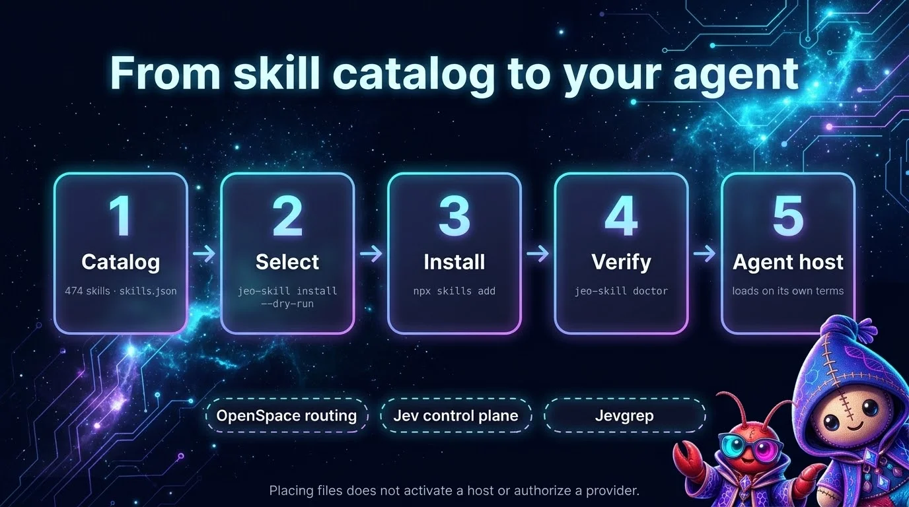
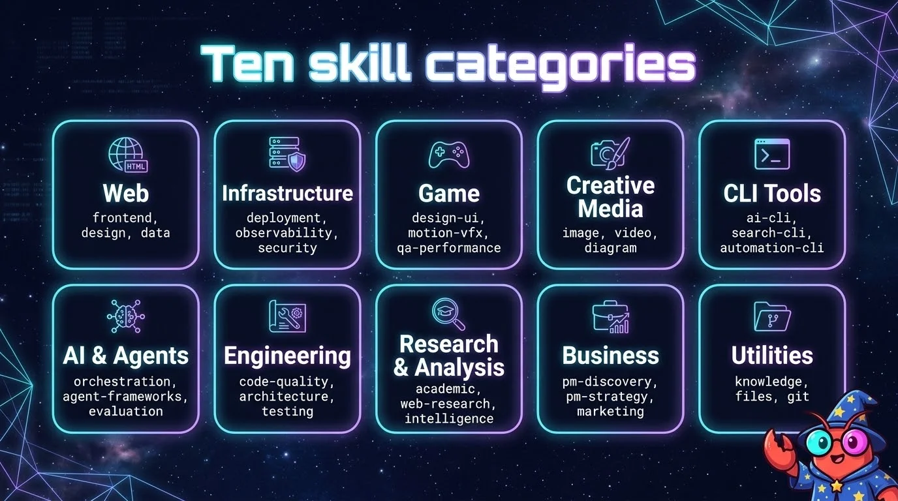
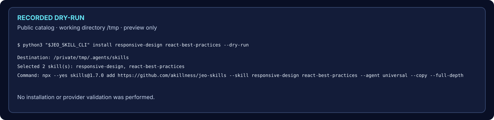
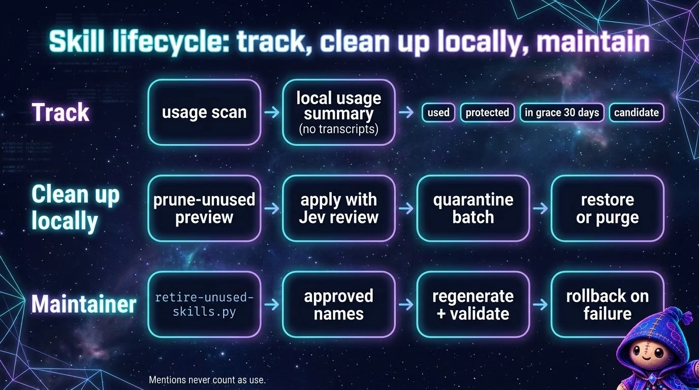

<div align="center">


# jeo-skills

**A library of agent skills and a guided setup for the coding agents you already use. Choose what to install, and keep optional integrations under your control.**

[](#-skills-list)
[](#-categories)
[](https://agentskills.io/specification)
[](https://github.com/akillness/jeo-skills/actions/workflows/ci.yml)
[](LICENSE)
[](https://www.buymeacoffee.com/akillness3q)

[Start](#-quick-start) · [How it works](#-how-it-works) · [Categories](#-categories) · [Install options](#-install-options) · [Runtimes](#-supported-runtimes) · [Router CLI](#-router-cli) · [Lifecycle](#-usage-tracking-and-cleanup) · [Integrations](#-optional-integrations) · [Catalog](#-skills-list)

**English** · [한국어](README.ko.md) · [Español](README.es-ES.md)

</div>

---

## License and attribution

Project-authored material is available under the [MIT License](LICENSE). When distributing copies or substantial portions, retain its copyright and permission notices. Third-party components may have different terms; see [upstream sources and licenses](docs/attribution.md) and their own license and notice files.

## ✨ At a glance

| Area | What you get |
|---|---|
| **Catalog** | One folder per skill: `.agent-skills/<name>/SKILL.md`, the open Agent Skills format |
| **Metadata** | Category, subcategory, interface, bundle and relationship data live once in `.agent-skills/skills.json` |
| **Router** | `jeo-skill` browses, searches and previews selections, then installs only what you pick |
| **Runtimes** | Shared and native install destinations, with explicit projections for GJC, Antigravity and Aside |
| **Lifecycle** | Local usage records identify skills with no observed loads; cleanup is previewed, reviewed and reversible |
| **Optional** | OpenSpace routing, Jev and Jevgrep have separate setup and approval boundaries; installing skills does not activate them |

## 🚀 Quick start

**Option A: let your agent install it.** Paste this into Claude Code, Codex, Antigravity CLI (`agy`), Kimi Code, Grok Build, OpenCode or another coding agent:

```text
Read https://raw.githubusercontent.com/akillness/jeo-skills/main/setup-all-skills-prompt.md in full and follow it to install the jeo-skills.
```

The guide detects your OS and agents. Its default full mode installs the catalog, seven pinned shared CLIs, and provisions the new `second-brain` vault (`~/vaults/jeo-second-brain`, opt-out via `JEO_SKILLS_SECOND_BRAIN=skip`) plus GitHub star (`JEO_SKILLS_STAR=true` default, `false` to skip) after confirming global/user scope; ask for "core only" or "minimal" to narrow it. Workspace activation, memory, context, database, provider and routing setup keep their opt-outs and host prerequisites, and existing vaults (such as `~/vaults/llm-wiki`) are never modified. See [the full setup guide](setup-all-skills-prompt.md) for exact boundaries.

**Option B: install the router, then pick skills.**

```bash
curl -fsSL https://raw.githubusercontent.com/akillness/jeo-skills/main/install.sh | bash
jeo-skill doctor                                    # check catalog and installer prerequisites
jeo-skill search "react performance"                # find skills
jeo-skill install react-best-practices --global --dry-run   # preview
jeo-skill install react-best-practices --global --yes      # install
```

> [!TIP]
> Add `$HOME/.local/bin` to `PATH` if `jeo-skill` is not found after installation. Selecting `context7` also provisions `ctx7@0.11.1` (Node.js 22.20+, non-Windows) and `install.sh` sets `JEO_SKILLS_STAR=true` by default — see [Install options](#-install-options) for boundaries and opt-outs.

## 🧭 How it works



<details>
<summary>Explore the path from catalog to host</summary>


1. **Catalog.** Skills stay flat as `.agent-skills/<name>/SKILL.md`. Taxonomy is metadata in `.agent-skills/skills.json`, not category folders.
2. **Router.** `jeo-skill` resolves names, bundles, categories and subcategories against `skills.json` and shows the exact selection before anything is written.
3. **Install.** Selections are delegated to `npx skills@1.7.0 add` and projected into each target runtime root using bounded-memory 256 KiB streaming copy+SHA-256 verification, iterative `os.scandir` traversal, and unchanged-file skip on re-runs.
4. **Load.** Each host discovers skills from its own root. Placement is not activation: loading, permissions, model choice and execution stay with the host.

</details>

## 🗂 Categories



| Category | Focus | Browse |
|---|---|---|
| 🌐 Web | frontend, backend, design, API, auth, data, testing, graphics | `jeo-skill list -c web` |
| 🏗 Infrastructure | deployment, environment, observability, security, cloud data | `jeo-skill list -c infrastructure` |
| 🎮 Game | client, web, design-ui, audio, motion-vfx, QA and release | `jeo-skill list -c game` |
| 🎬 Creative Media | image, video, motion, audio, presentation, diagram | `jeo-skill list -c creative-media` |
| ⌨️ CLI Tools | developer, AI, media, automation, search and benchmark CLIs | `jeo-skill list -c cli-tools` |
| 🤖 AI & Agents | orchestration, agent frameworks, evaluation, memory, planning | `jeo-skill list -c ai-agents` |
| 🧰 Engineering | code quality, testing, architecture, documentation, navigation | `jeo-skill list -c engineering` |
| 🔭 Research & Analysis | academic, web research, data analysis, experiments, intelligence | `jeo-skill list -c research` |
| 📣 Business | marketing, support, product discovery, strategy, execution, growth | `jeo-skill list -c business` |
| 🔧 Utilities | knowledge, files, git, workspace, project management | `jeo-skill list -c utilities` |

The full, generated list is in [Skills list](#-skills-list).

## 📦 Install options

| Goal | How |
|---|---|
| Everything, guided by your agent | Paste the setup prompt from [Quick start](#-quick-start) |
| Router only (default) | the one-liner as is |
| Router + `starter` bundle | one-liner with `JEO_SKILLS_SELECTION=bundle` |
| Full catalog, shared tools and workspace setup | one-liner with `JEO_SKILLS_SELECTION=all`; global/user scope is required for the shared tools, and project-only scope reports partial failure |
| Whole catalog without optional setup | `jeo-skill install --all --global --yes` (omit `--setup` and `--with-hooks`; includes Context7 CLI provisioning as described above) |
| Current project only | one-liner with `INSTALL_GLOBAL=false` |
| Preview without changes | one-liner with `JEO_SKILLS_DRY_RUN=true` |
| Specific skills | `jeo-skill install <name> [<name> ...] --global --yes` |
| Specific skills with setup/smoke | `jeo-skill install <name> ... --global --yes --setup` (add `--with-hooks` for supported hook steps only; see [setup guide](setup-all-skills-prompt.md#step-5--full-mode-shared-tools) for exact tool boundaries) |
| A bundle or category slice | `jeo-skill install --bundle <bundle> --global --yes` or `--category <id> [--subcategory <id>]` |
| Five program guides and one readiness report | `jeo-skill install --bundle github-five-programs --global --yes --setup`; the one-liner with `JEO_SKILLS_SELECTION=bundle JEO_SKILLS_BUNDLE=github-five-programs` prints the same report. Installation writes skill guidance; only the report is offline and read-only, and it does not install or run the upstream programs or ask for per-program approval |

Installer variables belong to `bash`, on the right side of the pipe:

```bash
URL=https://raw.githubusercontent.com/akillness/jeo-skills/main/install.sh
curl -fsSL "$URL" | JEO_SKILLS_SELECTION=bundle bash
curl -fsSL "$URL" | JEO_SKILLS_DRY_RUN=true INSTALL_GLOBAL=false bash
```

The shell dry run prints a bootstrap plan without installing files or tools; runtime support, account selection and catalog selections are validated during execution. After installing the router, use `jeo-skill install ... --dry-run` to resolve a catalog selection and preview its destinations. A preview does not verify host discovery or upstream readiness.

<details>
<summary><b>Bundles</b> — 18 curated starting sets</summary>
| Bundle | Skills |
|---|---|
| `starter` | jeo-skill, skill-standardization, codebase-search, git-workflow, debugging, testing-strategies, image-to-github-repo, obsidian-second-brain |
| `cli-core` | jeo-skill, rtk, semble, zvec-grep, graphify, scrapling, obsidian-second-brain |
| `web-frontend` | react-best-practices, responsive-design, web-accessibility, design-system, web-design |
| `web-backend` | api-design, authentication-setup, database-schema-design, backend-testing |
| `web-design` | web-design, design-system, responsive-design, web-accessibility |
| `infrastructure-core` | deployment-automation, environment-setup, monitoring-observability, security-best-practices |
| `game-client` | unity-gamedev-skill-pack, game-performance-profiler, awesome-gamedev-agent-skills, donchitos-game-studios |
| `game-web` | web-game-development, threejs-fundamentals, implement-fog-of-war |
| `game-art` | game-vfx, rfxgen, perfectpixel, open-design-game-ui-concept, unirig |
| `media-video` | video-production, video-shotcraft, video-motion-previs, shopping-shorts, filmcraft |
| `skill-authoring` | skill-standardization, write-a-skill, upskill |
| `product-management` | pm-skills, create-prd, user-stories, opportunity-solution-tree, north-star-metric |
| `langchain` | langchain-fundamentals, langgraph-fundamentals, deep-agents-core, langsmith |
| `knowledge-repositories` | 22 ontology, code-graph, memory and retrieval operators (`jeo-skill install --bundle knowledge-repositories --dry-run`) |
| `ui-design-repositories` | 10 source-pinned UI operators (`jeo-skill install --bundle ui-design-repositories --dry-run`) |
| `game-source-repositories` | 10 source-pinned game-dev tool operators (`jeo-skill install --bundle game-source-repositories --dry-run`) |
| `github-five-programs` | fabric, moneyprinter-v2, agent-s, google-maps-scraper, gitingest: five open-source program operators, four of them source-pinned (`jeo-skill install --bundle github-five-programs --dry-run`) |
| `coding-agent-ecosystem` | 19 curated coding-agent operators across context/memory, code intelligence/browser, methodologies, multi-agent orchestration, and telemetry (`rtk`, `thedotmack-mem`, `beads`, `context-mode`, `graphify`, `serena`, `context7`, `chrome-devtools-mcp`, `superpowers`, `spec-kit`, `gstack`, `official-agent-skills`, `ruflo`, `orca`, `wshobson-agents`, `happy`, `cc-switch`, `jarrodwatts-hud`, `ccusage`; excludes `oh-my-claudecode`) |

Most repository-operator skills are guides with pinned sources; installing them does not install, run or connect the upstream projects. Context7 CLI provisioning is the exception described below; activation and connections still need separate approval.

</details>

<details>
<summary><b>On-demand boundaries</b> — source-pinned operators, Context7 & GitHub star</summary>

| Skill / feature | Scope & boundary | Reference |
|---|---|---|
| `coding-agent-ecosystem` | 13 new source-pinned guides + 6 existing sibling operators from the 20-project coding-agent roundup (`oh-my-claudecode` excluded); catalog install copies docs & offline `preflight.py` only — plugin/MCP/daemon installs & live config switches need separate approval | [setup boundaries](setup-all-skills-prompt.md#coding-agent-ecosystem-on-demand-19-curated-repositories) · [licenses](docs/attribution.md) |
| `game-source-repositories` | 10 game-dev tool guides (physics, terrain, materials, VFX, nav, animation, meshes, noise); does not install or run upstream tools | [setup boundaries](setup-all-skills-prompt.md#game-development-source-guides-on-demand) · [licenses](docs/attribution.md) |
| [`rete`](.agent-skills/rete/SKILL.md) | Source-pinned operator for [`caviri/rete`](https://github.com/caviri/rete) `0.7.8` (single-file `.rete` RDF archives, SPARQL/SHACL, format `0x08`); `pip`/`npm` `rete-graph` excludes the native `rete` CLI, and `rete serve`, `--fetch-contexts`, S3/R2 CORS edits & hosted HF MCP calls on private graphs require explicit boundaries/approval | [setup guide](setup-all-skills-prompt.md#rete-single-file-rdf-archive--sparql-operator-on-demand) · [licenses](docs/attribution.md) |
| [`lightpanda`](.agent-skills/lightpanda/SKILL.md) | Guidance for Lightpanda 1.0.2 (fetch, CDP, MCP) + offline metadata doctor; browser install, site access, servers & credentials need separate approval | [setup guide](setup-all-skills-prompt.md#lightpanda-browser-operator-on-demand) |
| [`browser-use`](.agent-skills/browser-use/SKILL.md) | Guidance + offline preflight only; package/browser install, site access, cloud/model calls & accounts need separate approval | [setup guide](setup-all-skills-prompt.md#browser-use-operator-on-demand) |
| [`flide`](.agent-skills/flide/SKILL.md) | Decision-inference guide + offline preflight; model/package downloads, GPU use & server startup need separate approval | [setup guide](setup-all-skills-prompt.md#flide-decision-inference-on-demand) |
| [`impeccable`](.agent-skills/impeccable/SKILL.md) | Operator guide for `pbakaus/impeccable` 4.8.0 (shares `impeccable` folder name — run offline doctor first); npm, engine, hook, browser scans & live mode need separate approval | [setup guide](setup-all-skills-prompt.md#impeccable-design-operator-on-demand) |
| [`donchitos-game-studios`](.agent-skills/donchitos-game-studios/SKILL.md) | Pinned project-template operator (75 workflows + 3 aliases, offline 12-file check), not 78 global skills; cloning, `/adopt`, hooks & dependencies need separate approval | [research](.agent-skills/donchitos-game-studios/references/research.md) · [upstream](.agent-skills/donchitos-game-studios/references/upstream.md) · [setup](setup-all-skills-prompt.md#claude-code-game-studios-on-demand-project-template-not-global-skill-pack) |
| [`revfactory-harness`](.agent-skills/revfactory-harness/SKILL.md) | Source-pinned operator for [revfactory/harness v2.1.0](https://github.com/revfactory/harness/tree/92d9f1b29e7af81acebf51a9fcd1832e739a1414) (18-file hash preflight, `runtime_verified: false`); distinct from `harness2` & retired `harness` | [setup boundary](setup-all-skills-prompt.md#revfactory-harness-team-architecture-factory-on-demand) |
| [`elephant-goldfish-model`](.agent-skills/elephant-goldfish-model/SKILL.md) | Guides the [Google Elephant-Goldfish Model](https://github.com/google/elephant-goldfish-model) design/review flow; does not activate an upstream plugin, and fresh-context review requires isolated subagents | [setup boundary](setup-all-skills-prompt.md#elephant-goldfish-model-on-demand) |

**Context7 CLI (`ctx7@0.11.1`):** When a `jeo-skill install` selection includes `context7`, the router provisions `ctx7@0.11.1` via npm (Node.js 22.20+ required, unless `ctx7` already exists; unsupported on Windows and fails closed; `--dry-run` skips download). Project installs go under `.agents/context7`, global installs under `~/.local/share/jeo-skill/context7` (add its `node_modules/.bin` to `PATH`; incomplete occupied targets fail rather than overwriting). Direct `npx skills add` skips this; login, MCP registration, config writes and remote calls require separate approval.

**Default GitHub star (`JEO_SKILLS_STAR=true`):** `install.sh` stars `akillness/jeo-skills` by default via authenticated `gh` (PUT then GET readback; readback failures warn and continue). Set `JEO_SKILLS_STAR=false` to skip; `JEO_SKILLS_DRY_RUN=true` never writes to GitHub.

</details>

## 🖥 Supported runtimes

<details>
<summary>Find install roots and host-specific boundaries</summary>


| Runtime | Install target (`--agent`; router alias) | Global install destination | Project install destination |
|---|---|---|---|
| Jeo (`jeo-code`) | `jeo` (router alias → `universal`) | `~/.agents/skills` | `.agents/skills` |
| JeoPi | `jeopi` (router alias → `universal`) | `~/.agents/skills` | `.agents/skills` |
| Pi | `pi` | `~/.pi/agent/skills` | `.pi/skills` |
| OMP (`oh-my-pi`) | `omp` (router alias → `universal`) | `~/.agents/skills` | `.agents/skills` |
| GJC | `gjc` (router alias → `universal`; native projection follows) | `~/.gjc/agent/skills` (configuration overrides below) | `.gjc/skills` |
| Codex | `codex` | `~/.agents/skills` | `.agents/skills` |
| Claude Code | `claude-code` | `~/.claude/skills` (or `$CLAUDE_CONFIG_DIR/skills`) | `.claude/skills` |
| AGY (Antigravity CLI) | `agy` (`antigravity-cli` alias) | `~/.gemini/antigravity-cli/skills` | `.agents/skills` |
| Kimi CLI | `kimi` (registered target `kimi-code-cli`) | `~/.agents/skills` | `.agents/skills` |
| Grok Build | `grok` | `${GROK_HOME:-$HOME/.grok}/skills` | `.grok/skills` |
| OpenCode | `opencode` | `~/.agents/skills` | `.agents/skills` |
| Cursor | `cursor` | `~/.agents/skills` | `.agents/skills` |
| Crush | `crush` | `~/.config/crush/skills` | `.crush/skills` |
| Antigravity IDE | `antigravity` | `~/.gemini/config/skills` | `.agents/skills` (router destination; IDE discovery unverified) |
| Aside | `aside` + `--aside-account <id>` | `~/.aside/u/<id>/skills/user/` | — |

These are router install destinations, not proof that a host has discovered or loaded a skill. This guide uses **AGY** (`agy`) for the Antigravity CLI target; `antigravity-cli` is also accepted. Shared-root runtimes (Jeo, JeoPi, OMP, Codex, Kimi CLI, OpenCode and Cursor) use `~/.agents/skills` / `.agents/skills`; GJC, global Antigravity CLI/IDE and Aside receive explicit native projections after shared installation. GJC's global projection honors `GJC_CONFIG_DIR`, then `PI_CONFIG_DIR`, subject to the router's project `.env` trust and path guards, otherwise falling back to `~/.gjc/agent/skills`. Kimi Code also scans `${KIMI_CODE_HOME:-$HOME/.kimi-code}/skills`. The setup guide's Antigravity IDE procedure is global-only; a project destination alone does not establish IDE support.

Grok Build is the registry-native `grok` target and requires explicit setup selection: `JEO_SKILLS_AGENT=grok` for installation or `JEV_AGENT=grok` for a single Jev profile. The setup guide excludes it from host auto-selection by `PATH`, because a local `grok` binary may be the older Superagent/VibeKit CLI without an Agent Skill loader. Controller `detect` only reports binary inventory, not which implementation is installed. Confirm that separately; this guide does not replace or auto-upgrade that binary.

> [!NOTE]
> Installing writes skill files into a root. It does not sign in, start, or reload a runtime. Reload the host if a newly installed skill does not appear.

</details>

## 💻 Router CLI

<details>
<summary>Browse, install and inspect skills</summary>


| Command | What it does |
|---|---|
| `jeo-skill categories` | Categories and subcategory counts |
| `jeo-skill list -c <category> [-s <subcategory>]` | Skills in one slice |
| `jeo-skill search "<query>"` | Search names, descriptions and taxonomy |
| `jeo-skill related <name>` | Overlapping or sequential skills to consider together |
| `jeo-skill install ... --dry-run` | Preview a selection without writing files |
| `jeo-skill doctor` | Check the catalog, `npx`/Node.js prerequisites and the CLI link |
| `jeo-skill readiness [--global] [--json]` | Offline, read-only readiness report for fabric, moneyprinter-v2, agent-s, google-maps-scraper and gitingest |
| `jeo-skill usage scan` / `usage report` | Summarize observed skill-load and invocation events from supported local records |
| `jeo-skill prune-unused` / `restore` / `purge-quarantine` | Preview quarantine candidates, quarantine with `--apply`, restore or permanently purge quarantined copies |
| `jeo-skill prune-retired --global --dry-run` | Preview stale copies of retired catalog skills without removing them |
| `jeo-skill explore "<question>" --root <dir> --dry-run` | Preview optional Jevgrep document discovery over an existing source directory |

Set `JEO_SKILLS_CATALOG=/path/to/skills.json` to pin the catalog used by every command.

Recorded local dry-run example: this preview selected two skills and showed the destination and command. It did not install skills or validate a provider.



</details>

## 🧹 Usage tracking and cleanup



<details>
<summary>Review usage, quarantine and restore skills</summary>


`jeo-skill usage scan` reads supported local records (Claude, Codex, OpenCode, Gemini/Antigravity, Aside, jeo/jeopi/GJC/OMP/Pi sessions and the Jev injection ledger). It stores usage summaries and incremental scan metadata under `${XDG_STATE_HOME:-$HOME/.local/state}/jeo-skill`, not transcript bodies. It recognizes supported load, invocation and injection events rather than ordinary prompt mentions. Coverage depends on the host's retained records and supported event formats; it is not a complete history of every skill use.

| Status | Meaning |
|---|---|
| `used` | At least one recognized load, invocation or injection event was observed |
| `protected` | `jeo-skill`, the `starter`/`cli-core`/`infrastructure-core` bundles, `usage keep` pins and `usage relevance` protections |
| `in-grace` | No observed use yet, but within 30 days of tracking start or first install |
| `candidate` | No observed use after the grace period; eligible for quarantine |

```bash
jeo-skill usage scan
jeo-skill usage report --status candidate
jeo-skill prune-unused --global                                   # preview only
jeo-skill prune-unused --global --apply --skip-jev-review         # or --jev-profile <p> --allow-remote
jeo-skill restore --list
jeo-skill restore --batch <batch-id> --apply
jeo-skill purge-quarantine --older-than 30 --apply                # permanent
```

> [!IMPORTANT]
> Zero observed uses is not proof of lifetime non-use: runtimes may have deleted older history. `--apply` rescans first and refuses when a present record store cannot be read. Only copies that provably match this catalog are moved; third-party copies and symlinks are kept.

Removing a skill from the catalog itself is a separate maintainer step in a repository checkout. It previews by default; `--apply` needs comma-separated approved names plus a review choice, then regenerates the projections, validates and rolls back on failure:

```bash
jeo-skill usage report --json > report.json
python3 scripts/retire-unused-skills.py --usage-report report.json                     # preview
python3 scripts/retire-unused-skills.py --usage-report report.json --apply \
  --approve name-a,name-b --skip-jev-review          # or --jev-profile <p> --allow-remote
```

</details>

## 🔄 Keeping installed skills current

<details>
<summary>Refresh the shared root and reconcile symlinked hosts</summary>


For installations configured with per-skill host symlinks, refresh the **shared root only** (`~/.agents/skills`), then reconcile the host links. The [setup guide](setup-all-skills-prompt.md) also supports native copies, so not every full installation has this layout. Current per-host router installs reject symlink destinations rather than updating through them; do not replace linked host slots with copy installs.

```bash
bash scripts/skills-upgrade.sh              # pull → doctor → refresh → prune → reconcile → verify
bash scripts/skills-upgrade.sh --dry-run    # plan without writes
python3 scripts/refresh-host-links.py       # link plan only (read-only)
```

What each step does:

1. `git pull --ff-only` on the trusted checkout — any non-fast-forward stops the run
2. `jeo-skill doctor` reports catalog metadata, installer prerequisites and CLI-link status; it does not run the catalog-projection validators
3. `jeo-skill install --all --global --yes` rewrites the shared root with the latest catalog (and `scripts/skills-upgrade.sh` refreshes non-symlink `~/.agents/jev/skills.json` snapshots when present)
4. `jeo-skill prune-retired --global` removes retired catalog copies (the legacy-dedupe step)
5. `scripts/refresh-host-links.py --apply` creates links for newly added skills, removes dangling ones, and **never deletes host-local non-catalog skills**
6. verification: a broken-link scan of the helper's known host roots (skipped during dry run); the earlier doctor is informational and does not gate the upgrade

| Option | Effect |
|---|---|
| `--hosts <list>` | Override hosts (default `claude,pi,gjc,antigravity,cursor,aside-user,opencode-config`) |
| `--skip-pull` | Skip the checkout update; later install steps may still need network access |
| `--replace-copies` | Also convert stale real-dir copies into links (quarantined first) |
| `SKILLS_UPGRADE_HOSTS` | Default hosts via environment |

Replaced directory copies are quarantined under `~/.local/state/jeo-skill/quarantine/upgrade-<UTC>/`. Stale symlinks are unlinked, and incorrect managed symlinks are recreated in place; those links are not quarantined. Reconciliation leaves healthy host links unchanged; the shared-root refresh still invokes the skill installer on each run.

### Scheduled refresh

`scripts/com.jeo-skills.skills-upgrade.plist` is a launchd template that runs the upgrade weekly (Monday 09:30) with logs under `~/.local/state/jeo-skill/upgrade.log`. If `npx` is missing from `PATH`, the script looks for an available nvm Node bin. Install it with:

```bash
cp scripts/com.jeo-skills.skills-upgrade.plist ~/Library/LaunchAgents/
launchctl bootstrap gui/$(id -u) ~/Library/LaunchAgents/com.jeo-skills.skills-upgrade.plist
```

</details>

## 🔌 Optional integrations

<details>
<summary>Choose an optional routing or discovery integration</summary>


| Integration | Purpose | Setup |
|---|---|---|
| **OpenSpace** | Optional local prompt-time skill finder and routing | [OpenSpace setup](setup-all-skills-prompt.md#openspace-skill-finder-and-prompt-time-skill-routing) |
| **Jev** | Decision harness: hybrid BM25+metadata skill routing (optional `bge-m3` + `bge-reranker-v2-m3` v3 backends, hierarchical `SKILL.toon`/section assist), context/memory pruning, action & tool gating, moderation, and run evaluation | `bash jev/jev-setup.sh --profile <name> ...` · [jev/README.md](jev/README.md) |
| **Jevgrep** | Remote discovery over selected skill or wiki documents | `jeo-skill explore "<question>" --root <dir> --dry-run` · [jevgrep](.agent-skills/jevgrep/SKILL.md) |

These integrations are independent of catalog installation and of each other. Jev and Jevgrep can send data to a configured backend. In `jeo-skill`, commands that call them (`prune-unused --apply`, `usage relevance`, `explore`) refuse remote use without `--allow-remote`; the standalone Jev harness sends to its configured backend directly, so approve a hosted profile before using it. OpenSpace setup and host activation also require their own approval.

### Jev profiles follow the current coding agent

After a separate backend opt-in, the [setup guide](setup-all-skills-prompt.md#jev-control-plane-harness-system-one) configures each detected host independently. After each successful host setup, it calls the existing controller in config-only mode to create or update the canonical `~/.agents/jev/agents.json` binding while preserving native/scope/custom assignments and mappings for other hosts; this does not register hooks. See the [detailed host map](jev/jev-control-plane.rule.md#activation-and-profiles) for the authoritative boundaries.

| Host | Default profile | Standalone setup destination | Jev boundary |
|---|---|---|---|
| `jeo` | `jeo` | `jeo` | adapter-only unless separately verified |
| `gjc` | `gjc` | `gjc` | adapter-only |
| `jeopi` | `jeopi` | `jeopi` | native session extension |
| `pi` | `pi` | `pi` | native session extension |
| `omp` | `omp` | `omp` | native session extension |
| `codex` | `codex` | `codex` | native hooks |
| `claude` | `claude` | `claude-code` | native lifecycle |
| `agy` | `agy` | `agy` | manual harness only; no Jev hooks |
| `kimi` | `kimi` | `kimi-code-cli` | manual harness only; no Jev hooks |
| `grok` | `grok` | `grok` | explicit-selection-only manual harness; no Jev hooks |
| `opencode` | `opencode` | `opencode` | adapter-only; no native hooks |
| `cursor` | `cursor` | `cursor` | hook runner installed by `hooks-install --agent cursor` (advisory skill names, optional review); not live-verified |
| `crush` | `crush` | `crush` | manual harness only; no Jev hooks |
| `antigravity` | `antigravity` | `antigravity` | manual harness only; no Jev hooks |
| `aside` | `aside-u<account>` | `aside` | adapter-only; account-specific, no native hooks |

Host selection is `JEV_AGENT` > `JEO_SKILLS_AGENT`; an absent selector or `universal` means all detected hosts. For one selected host, profile precedence is `JEO_SKILLS_JEV_PROFILE` > `JEV_PROFILE` > the existing canonical `agents.json[host].profile` mapping > the same host ID. Aside requires a selected account and uses `aside-u<account>` by default. A custom profile requires one selected host; setup preserves existing assignments and rejects invalid or shared mappings.

Standalone setup takes the skill-install destination as `--agent`; the controller takes the canonical host ID. The Jev harness itself has no `--agent` option or host autodetection. Profile configuration enables explicit harness use only unless the table above says a verified native boundary exists.

Inspect the selected profile with this safe read-only status command; it may probe configured local backends but does not run inference:

```sh
: "${JEV_PROFILE:?Select the current agent profile first}"
node ~/.agents/jev/jev-harness.mjs --profile "${JEV_PROFILE:?Select the current agent profile first}" status
```

</details>

## 📚 Skills List

> Generated from `.agent-skills/skills.json` · 488 skills · expand a category to see its skills.

### 🌐 Web (78)

Subcategories: `frontend` (16), `backend` (3), `design` (17), `api` (2), `auth` (1), `data` (13), `testing` (5), `accessibility` (1), `performance` (1), `graphics` (12), `capture` (7)

<details>
<summary>Show Web skills</summary>

| Skill |
|---|
| `ax` |
| `react-best-practices` |
| `react-bits` |
| `state-management` |
| `amrouter` |
| `colibri` |
| `pydantic-ai` |
| `astryx` |
| `build-daily-inspiration-sites` |
| `daily-ui-inspiration-capture` |
| `design-first-ui-prompting` |
| `design-system` |
| `devup-ui` |
| `html-to-interaction-prompts` |
| `lazyweb` |
| `responsive-design` |
| `stitch-skills` |
| `web-design` |
| `api-design` |
| `api-documentation` |
| `authentication-setup` |
| `database-schema-design` |
| `payloadcms` |
| `supabase-agent-skills` |
| `typesense` |
| `backend-testing` |
| `browser-harness` |
| `playwriter` |
| `web-accessibility` |
| `optimize-web-animations` |
| `threejs-animation` |
| `threejs-fundamentals` |
| `threejs-geometry` |
| `threejs-interaction` |
| `threejs-lighting` |
| `threejs-loaders` |
| `threejs-materials` |
| `threejs-postprocessing` |
| `threejs-shaders` |
| `threejs-textures` |
| `agentation` |
| `react-grab` |
| `slides-grab` |
| `stitched-full-page-capture` |
| `chatbot-template` |
| `airship` |
| `moli` |
| `lightpanda` |
| `design-taste-frontend` |
| `impeccable` |
| `higgsfield-websites` |
| `stagehand` |
| `helix-foundry` |
| `pg-jev` |
| `orionbelt-ontology-builder` |
| `open-ontologies` |
| `semantica` |
| `utopia` |
| `pixeltable` |
| `turbovec` |
| `pixelrag` |
| `superdesign` |
| `better-design` |
| `design-taste` |
| `canvas-ui` |
| `paper-shaders` |
| `ui-layouts` |
| `hyperiux` |
| `motion-primitives` |
| `cursify` |
| `trickle-ui` |
| `browser-use` |
| `modern-web-guidance` |
| `affectui` |
| `open-intelligent-ui` |
| `solid-glass` |
| `vercel-agent-ui` |
| `chrome-devtools-mcp` |

</details>

### 🏗 Infrastructure (22)

Subcategories: `deployment` (2), `environment` (2), `observability` (4), `security` (4), `cloud-data` (9), `automation` (0), `tooling` (1)

<details>
<summary>Show Infrastructure skills</summary>

| Skill |
|---|
| `deployment-automation` |
| `vercel-deploy` |
| `environment-setup` |
| `system-environment-setup` |
| `log-analysis` |
| `monitoring-observability` |
| `openocta` |
| `security-best-practices` |
| `strix` |
| `firebase-cli` |
| `unity-cli` |
| `genkit` |
| `looker-studio-bigquery` |
| `zurp` |
| `ai-knowledge-management-platform` |
| `knowledge-catalog` |
| `cocoindex` |
| `pmtiles` |
| `vespa` |
| `langfuse` |
| `artex` |
| `rete` |

</details>

### 🎮 Game (55)

Subcategories: `client` (10), `web` (5), `server` (1), `design-ui` (7), `audio` (1), `animation` (5), `motion-vfx` (4), `sprite-image` (3), `art-resources` (4), `storytelling` (0), `tooling` (8), `qa-performance` (5), `release` (2)

<details>
<summary>Show Game skills</summary>

| Skill |
|---|
| `implement-fog-of-war` |
| `unity-gamedev-skill-pack` |
| `agentic-gamedev-skills` |
| `web-game-development` |
| `bmad-gds` |
| `open-design-game-ui-concept` |
| `open-design-game-ui-handoff` |
| `open-design-game-ui-takeover` |
| `rfxgen` |
| `animato` |
| `unirig` |
| `dalamud-vfx-editor` |
| `game-vfx` |
| `perfectpixel` |
| `underworld-overseer-save-mapper` |
| `godogen` |
| `game-build-log-triage` |
| `game-demo-feedback-triage` |
| `game-performance-profiler` |
| `wai-play` |
| `game-ci-cd-pipeline` |
| `steam-store-launch-ops` |
| `unity-technologies-skills` |
| `multiplayer-game-architecture` |
| `game-design-theory` |
| `game-feel` |
| `game-ui-ux` |
| `awesome-gamedev-agent-skills` |
| `jolt-physics` |
| `terrain3d` |
| `material-maker` |
| `effekseer` |
| `godot-voxel-tools` |
| `recast-navigation` |
| `ozz-animation` |
| `the-forge` |
| `meshoptimizer` |
| `fastnoise2` |
| `donchitos-game-studios` |
| `gamefactory-3a` |
| `arnis` |
| `unity-skills` |
| `blender-skills` |
| `scenario-skills` |
| `threejs-game-skills` |
| `mengto-game-skills` |
| `video-to-game` |
| `threejs-ability-casting` |
| `isometric-voxel-builder` |
| `game-perf` |
| `sprite-gen` |
| `mono-pix` |
| `motion2mixamo` |
| `unimate` |
| `3d-vibe-coding` |

</details>

### 🎬 Creative Media (42)

Subcategories: `image` (10), `video` (18), `motion` (2), `audio` (2), `presentation` (1), `diagram` (2), `design` (5), `capture` (0), `storytelling` (2)

<details>
<summary>Show Creative Media skills</summary>

| Skill |
|---|
| `aura-asset-images` |
| `generate-reference-inspired-brand-worlds` |
| `god-tibo-imagen` |
| `paperbanana` |
| `unsplash-asset-images` |
| `browser-video-recording` |
| `gbro-collage-broll` |
| `opencut` |
| `video-production` |
| `filmcraft` |
| `video-shotcraft` |
| `video-to-superprompt` |
| `vox-director` |
| `video-motion-previs` |
| `elevenlabs-tts` |
| `presentation-builder` |
| `drawio` |
| `open-design` |
| `blender-mcp` |
| `webtoon-harness` |
| `palmier-pro` |
| `openstory` |
| `drama-skills` |
| `openmontage` |
| `open-generative-ai` |
| `higgsfield-generate` |
| `higgsfield-marketplace-cards` |
| `higgsfield-product-photoshoot` |
| `higgsfield-soul-id` |
| `higgsfield-youtube-thumbnail` |
| `higgsfield-video-explainer` |
| `higgsfield-brandkit` |
| `shopping-shorts` |
| `video-use` |
| `autoclip` |
| `moneyprinter-turbo` |
| `opencreator` |
| `voicestudio` |
| `diagram-design` |
| `artcraft` |
| `motionmaxxing` |
| `3dviz-pro-max` |

</details>

### ⌨️ CLI Tools (51)

Subcategories: `developer-cli` (12), `ai-cli` (21), `media-cli` (1), `automation-cli` (8), `search-cli` (8), `benchmark-cli` (1)

<details>
<summary>Show CLI Tools skills</summary>

| Skill |
|---|
| `context7` |
| `soup` |
| `caveman` |
| `ccpi-marketplace` |
| `cli-anything` |
| `ghgrab` |
| `jeo-skill` |
| `pretext` |
| `aider-cli-workflow` |
| `claudekit` |
| `fabric` |
| `ooo` |
| `open-code-review` |
| `zeude` |
| `compresso` |
| `codeflow` |
| `graphify` |
| `headroom` |
| `npm-git-install` |
| `okf` |
| `rtk` |
| `tokhub` |
| `scrapling` |
| `agent-reach` |
| `scrapingant-web-fetch` |
| `semble` |
| `zvec-grep` |
| `x-twitter-scraper` |
| `hyperfine-benchmarking` |
| `codeburn` |
| `mole` |
| `mcp-server-sv-number` |
| `zeroshot` |
| `k-skill-setup` |
| `jevgrep` |
| `openrig` |
| `uzu` |
| `context-mode` |
| `rea` |
| `llmfit` |
| `hyper-extract` |
| `leann` |
| `google-maps-scraper` |
| `gitingest` |
| `craft-anything` |
| `connectonion` |
| `flide` |
| `indra` |
| `happy` |
| `jarrodwatts-hud` |
| `ccusage` |

</details>

### 🤖 AI & Agents (88)

Subcategories: `orchestration` (24), `agent-frameworks` (22), `skill-authoring` (6), `evaluation` (10), `memory` (8), `planning-review` (13), `discovery` (3), `prompting` (2)

<details>
<summary>Show AI &amp; Agents skills</summary>

| Skill |
|---|
| `bmad` |
| `deep-dive` |
| `deepinit` |
| `spec-kit` |
| `ecc` |
| `microsoft-agent-framework` |
| `openai-agents-python` |
| `goalflow` |
| `openexecutive` |
| `article-prompts-to-skills` |
| `skill-standardization` |
| `upskill` |
| `write-a-skill` |
| `langsmith` |
| `opik` |
| `skill-autoresearch` |
| `nvidia-skill-evaluator` |
| `kadath` |
| `mex` |
| `bmad-idea` |
| `grill-me` |
| `grill-with-docs` |
| `plannotator` |
| `survey` |
| `to-tickets` |
| `to-spec` |
| `triage` |
| `openspace` |
| `agentic-skills` |
| `prompts-chat` |
| `find-skills` |
| `mcp-builder` |
| `ask-matt` |
| `grilling` |
| `setup-matt-pocock-skills` |
| `to-questionnaire` |
| `wayfinder` |
| `writing-for-agents` |
| `agent-guardrails` |
| `agent-system-design` |
| `agent-tool-routing` |
| `reflexion-pattern` |
| `agent-manager` |
| `langchain-fundamentals` |
| `langchain-middleware` |
| `langchain-rag` |
| `langchain-dependencies` |
| `langgraph-fundamentals` |
| `langgraph-persistence` |
| `langgraph-human-in-the-loop` |
| `deep-agents-core` |
| `deep-agents-memory` |
| `deep-agents-orchestration` |
| `langchain-bmad` |
| `a2a-protocol` |
| `agent-benchmarking` |
| `agent-observability` |
| `multi-agent-eval-harness` |
| `agent-memory-architecture` |
| `okf-agent-memory` |
| `agent-workflow` |
| `agent-principles` |
| `paperclip` |
| `jev-control-plane` |
| `anyjev` |
| `typesafe-computer-use` |
| `jev-ultrafast` |
| `agentic-graphrag-blueprint` |
| `memmachine` |
| `memori` |
| `memsearch` |
| `harness2` |
| `ruflo` |
| `agent-beacon` |
| `agent-s` |
| `aidlc-workflows` |
| `revfactory-harness` |
| `elephant-goldfish-model` |
| `kagent` |
| `trulens` |
| `fastmcp` |
| `canyonos` |
| `agent-substrate` |
| `thedotmack-mem` |
| `superpowers` |
| `gstack` |
| `official-agent-skills` |
| `wshobson-agents` |

</details>

### 🧰 Engineering (29)

Subcategories: `code-quality` (14), `testing` (4), `architecture` (6), `documentation` (2), `code-navigation` (3)

<details>
<summary>Show Engineering skills</summary>

| Skill |
|---|
| `audit-reference-originality` |
| `audit-verify-explain-grade-5` |
| `code-refactoring` |
| `code-review` |
| `debugging` |
| `diagnosing-bugs` |
| `github-repo-candidate-quality-gate` |
| `migrate-to-shoehorn` |
| `performance-optimization` |
| `performance-profiling` |
| `scaffold-exercises` |
| `tdd` |
| `testing-strategies` |
| `improve-codebase-architecture` |
| `zoom-out` |
| `nightrun` |
| `changelog-maintenance` |
| `technical-writing` |
| `codebase-search` |
| `codebase-design` |
| `domain-modeling` |
| `implement` |
| `prototype` |
| `codebase-memory-mcp` |
| `ponytail` |
| `rust-anything` |
| `fast-anything` |
| `mobile-agent-testers` |
| `serena` |

</details>

### 🔭 Research & Analysis (19)

Subcategories: `academic` (3), `web-research` (5), `data-analysis` (2), `experimentation` (3), `benchmarking` (2), `intelligence` (4)

<details>
<summary>Show Research &amp; Analysis skills</summary>

| Skill |
|---|
| `academic-research` |
| `research-paper-writing` |
| `scientific-agent-skills` |
| `deep-research` |
| `heretic` |
| `data-analysis` |
| `pattern-detection` |
| `autoresearch` |
| `scientific-llm-benchmarks` |
| `agent-pulse` |
| `research` |
| `korean-patent-search` |
| `fineenvs` |
| `mi-orchestration` |
| `image-to-github-repo` |
| `minimind` |
| `new-term-radar` |
| `last30days` |
| `opencompass` |

</details>

### 📣 Business (71)

Subcategories: `marketing` (5), `support` (2), `publishing` (1), `pm-toolkit` (5), `pm-discovery` (13), `pm-strategy` (12), `pm-execution` (12), `pm-market-research` (7), `pm-analytics` (3), `pm-go-to-market` (6), `pm-growth` (5)

<details>
<summary>Show Business skills</summary>

| Skill |
|---|
| `marketing-automation` |
| `write-like-meng-on-x` |
| `x-bookmark-quote-posts` |
| `customer-email-draft-threads` |
| `customer-support-verification` |
| `yuwen-publish-precheck` |
| `youtube-growth-playbook-2026` |
| `pm-skills` |
| `draft-nda` |
| `grammar-check` |
| `privacy-policy` |
| `review-resume` |
| `analyze-feature-requests` |
| `brainstorm-experiments-existing` |
| `brainstorm-experiments-new` |
| `brainstorm-ideas-existing` |
| `brainstorm-ideas-new` |
| `identify-assumptions-existing` |
| `identify-assumptions-new` |
| `interview-script` |
| `metrics-dashboard` |
| `opportunity-solution-tree` |
| `prioritize-assumptions` |
| `prioritize-features` |
| `summarize-interview` |
| `ansoff-matrix` |
| `business-model` |
| `lean-canvas` |
| `monetization-strategy` |
| `pestle-analysis` |
| `porters-five-forces` |
| `pricing-strategy` |
| `product-strategy` |
| `product-vision` |
| `startup-canvas` |
| `swot-analysis` |
| `value-proposition` |
| `brainstorm-okrs` |
| `create-prd` |
| `dummy-dataset` |
| `job-stories` |
| `outcome-roadmap` |
| `pre-mortem` |
| `prioritization-frameworks` |
| `stakeholder-map` |
| `summarize-meeting` |
| `test-scenarios` |
| `user-stories` |
| `wwas` |
| `competitor-analysis` |
| `customer-journey-map` |
| `market-segments` |
| `market-sizing` |
| `sentiment-analysis` |
| `user-personas` |
| `user-segmentation` |
| `ab-test-analysis` |
| `cohort-analysis` |
| `sql-queries` |
| `beachhead-segment` |
| `competitive-battlecard` |
| `growth-loops` |
| `gtm-motions` |
| `gtm-strategy` |
| `ideal-customer-profile` |
| `marketing-ideas` |
| `north-star-metric` |
| `positioning-ideas` |
| `product-name` |
| `value-prop-statements` |
| `moneyprinter-v2` |

</details>

### 🔧 Utilities (33)

Subcategories: `knowledge` (9), `files` (5), `git` (4), `workspace` (3), `project-management` (5), `productivity` (4), `general` (3)

<details>
<summary>Show Utilities skills</summary>

| Skill |
|---|
| `lapian-notes` |
| `llm-wiki` |
| `repo-knowledge-wiki` |
| `notebooklm` |
| `obsidian-mind` |
| `obsidian-second-brain` |
| `opencontext` |
| `file-organization` |
| `git-guardrails-claude-code` |
| `git-submodule` |
| `git-workflow` |
| `game-sounds` |
| `sprint-retrospective` |
| `standup-meeting` |
| `task-estimation` |
| `task-planning` |
| `google-workspace` |
| `watermarks-remover` |
| `solo-skills` |
| `eli5` |
| `handoff` |
| `resolving-merge-conflicts` |
| `teach` |
| `wait-what` |
| `wizard` |
| `hwp` |
| `rhwp-advanced` |
| `rhwp-edit` |
| `rowboat` |
| `mroffice` |
| `beads` |
| `orca` |
| `cc-switch` |

</details>


---

## 🛠 For maintainers

| Path | Contents |
|---|---|
| `.agent-skills/` | Skill folders, `skills.json` (source of truth) and the generated `skills.toon` |
| `install.sh` · `setup-all-skills-prompt.md` | One-line installer and the agent-led setup guide |
| `scripts/` | Catalog validation, projection generation, changelog and regression tests |
| `jev/` | Optional Jev control-plane source |
| `changelog/` | Monthly release notes (English and Korean) |
| `assets/` | README visuals (Gemini-generated; provenance in `assets/readme-visuals.json`) |

```bash
PYTHONDONTWRITEBYTECODE=1 python3 scripts/generate-catalog-projections.py
PYTHONDONTWRITEBYTECODE=1 python3 scripts/generate-catalog-projections.py --check
PYTHONDONTWRITEBYTECODE=1 python3 scripts/validate-catalog-projections.py --strict-links
PYTHONDONTWRITEBYTECODE=1 python3 scripts/repair-skill-frontmatter.py --check
PYTHONDONTWRITEBYTECODE=1 python3 flatten_skills.py --dry-run
PYTHONDONTWRITEBYTECODE=1 python3 scripts/changelog.py check
```

The manifest `.agent-skills/skills.json` is authoritative. Edit metadata there, never hand-edit README category projections; regenerate them and run the checks above with `PYTHONDONTWRITEBYTECODE=1` (`python3 -B`) so `.agent-skills/` never retains `__pycache__` or `.pyc` artifacts. The flat skill layout must remain `.agent-skills/<name>/SKILL.md`. Upstream sources and licenses for adapted skills are listed in [docs/attribution.md](docs/attribution.md).

## 🤝 Related projects

| Project | Role |
|---|---|
| [jeo-code](https://github.com/akillness/jeo-code) | Coding agent that loads skills from the shared root |
| [gajae-code (GJC)](https://github.com/akillness/gajae-code) | Agent runtime with its own native skills root |

---

<!-- WHATS-NEW:START -->

## 🆕 What's New in v2026-11-27

| Change | Details |
|--------|---------|
| **`rete` single-file RDF archive & SPARQL operator (`488 skills total`)** | Adds `.agent-skills/rete` (`infrastructure` / `cloud-data`), source-pinned to [`caviri/rete`](https://github.com/caviri/rete) `0.7.8` (`c38b7ffb304dfaeb9c8ad3a37dd6416678e198e0`, Apache-2.0), covering single-file `.rete` RDF builds (`0x08` format, `0x05`–`0x08` read compatibility), HTTP Range SPARQL/openCypher/SHACL/OWL 2 QL querying, Python/JS-WASM `rete-graph` libraries vs native `rete-cli`, offline JSON-LD `@context` mapping, S3/R2 CORS boundaries, and local `rete.mcpb` vs public hosted MCP isolation. Includes `SKILL.toon`, `references/upstream.md`, `references/source.json` (10 verified SHA-256 digests), offline `scripts/preflight.py`, `evals/evals.json`, and `scripts/test_rete_skill.py`. |
| **Coding agent ecosystem bundle (`coding-agent-ecosystem`, 487 skills total)** | Adds 13 source-pinned operator skills from the curated coding-agent GitHub roundup (`thedotmack-mem`, `beads`, `serena`, `chrome-devtools-mcp`, `superpowers`, `gstack`, `official-agent-skills`, `orca`, `wshobson-agents`, `happy`, `cc-switch`, `jarrodwatts-hud`, `ccusage`) alongside six existing catalog siblings (`rtk`, `context-mode`, `graphify`, `context7`, `spec-kit`, `ruflo`), excluding `oh-my-claudecode` as requested. Each new skill includes `SKILL.md`, `SKILL.toon`, `references/upstream.md`, `references/source.json` with verified SHA-256 digests, offline `scripts/preflight.py`, and `evals/evals.json`, with synchronized READMEs, `setup-all-skills-prompt.md`, and `docs/attribution.md`. |

## 🆕 What's New in v2026-11-24

| Change | Details |
|--------|---------|
| **README visuals regenerated with the Gemini app** | Replaced the cover and the three diagrams with 16:9 Gemini (Image mode) artwork in the same deep-indigo/cyan/violet palette, using `jeo-code` and `jeopi` hero art as character references: `assets/readme-cover.webp`, plus `assets/how-it-works.webp`, `assets/catalog-map.webp` and `assets/skill-lifecycle.webp` (the hand-authored `.svg` versions were removed). Labels were checked against `README.md`, `skills.json` categories and `jeo-skill` commands; provenance is recorded in `assets/readme-visuals.json`. Documentation only. |
| **Catalog grows to 474 skills** | Adds `fast-anything`, `opencompass`, `vespa`, `mobile-agent-testers`, `langfuse`, `artex`, `vercel-agent-ui` and `mroffice`, and the 15 game, 3D and creative AI skills that took the catalog to 466. Three README inventories, `skills.json` and `SKILL.toon` are regenerated from the manifest (`validate-catalog-projections.py` reports 474 skills, 10 categories). |
| **Jev hybrid skill routing v3** | Adds `bge-m3` embedding plus `bge-reranker-v2-m3` reranking as launchd-managed local backends (`jev/com.jeo-skills.bge-m3-embed.plist`, `jev/com.jeo-skills.bge-reranker-v2-m3.plist`), `scripts/build-skill-routing-index.mjs`, a golden prompt set with recorded baselines under `jev/routing-eval/`, setup automation in `jev-setup.sh`, and an abstention-aware prompt hook: with no confident catalog match the hook says so instead of forcing a skill. |
| **Installer: ctx projection and knowledge wiring** | `jeo-skill install` wires host context projection, the `ctx` lifecycle CLI and portable hooks; second-brain and ontology CRUD, search, embeddings and MCP registration are wired on install; the pinned `install.sh` sha256 matches the committed installer again. |

## 🆕 What's New in v2026-11-19

| Change | Details |
|--------|---------|
| **`jev-gateway` & client serving hardening (zero-leak single-flight, DRR fast-forward, keep-alive pooling & deadline alignment)** | Hardens bottleneck-free Jev serving across the gateway, harness, plugin, controllers, and setup scripts: fixes `jev/jev-gateway.mjs` `inFlight` leak/deadlock on `abortedBeforeDispatch`, zombie `AbortController` poisoning on waiter disconnect, DRR `guard` livelock on `>32 KiB` (`costBytes <= 36000`) payloads via O(sessions) deficit fast-forward, swallowed `upstreamErrors`, overwritten `avgWaitMs` on aging, P0 lane promotion on single-flight coalesce + P0 queue reserve (`--p0-reserve`), byte-bounded LRU (`32 MiB`, `cacheBytes`), `http.Agent` keep-alive pooling with 1 safe loopback reset retry, 500ms `/health` single-flight cache, IPv6 `[::1]` URL formatting, and deterministic `/v1/chat/completions` + `stream: true` coalescing guards. Adds transient `503 Retry-After` jittered retry, `JEV_DEADLINE_MS`/`X-Jev-Agent`/`X-Jev-No-Cache` headers, concurrent `loadCatalog`+`fetchOpenspacePrior`, and bounded parallel `pruneContext` batches in `jev-harness.mjs`; deduplicates `saveSessionTask` writes + stamp-throttled GC, parallelizes `hook()` calls, forwards `JEV_SESSION_ID` on direct `PreToolUse` paths, and extends `jev-controller.mjs` `JEV_DEADLINE_MS` + `jev-only` `context` memoization across all 7 controller bundles. Fixes standalone `com.jeo-skills.qev-server.plist` download and safe macOS launchd `--stop` in `jev-setup.sh`, `jev-plugin.mjs status` in `setup-all-skills-prompt.md`, and full asset sync in `scripts/skills-upgrade.sh`. |
| **`jev-gateway` multi-session localhost queue & coalescing proxy (`:8017` → `:18017`)** | Adds `jev/jev-gateway.mjs` + `jev/com.jeo-skills.qev-gateway.plist` and wires `jev-setup.sh` (`launchd` + `--stop`), `scripts/skills-upgrade.sh`, `jev-harness.mjs`, and `jev-plugin.mjs` so concurrent multi-session Jev requests share a bounded `llama-server` backend cleanly: 3-lane priority scheduling (`P0` `PreToolUse` > `P1` turn-start > `P2` background + aging), per-session Deficit Round Robin (DRR) fairness (`X-Jev-Session-Id`), cross-session single-flight coalescing + RAM LRU cache, deadline/disconnect cancellation before dispatch, `P2` backpressure shedding (`503 Retry-After`), and `GET /jev/queue-metrics` (`jev/gateway.test.mjs`). |
| **Five AI UI, CPU OCR & term-intelligence operator skills (449 total)** | Adds `affectui` (`flohoeller/affectui` @ `60308e4e`), `open-intelligent-ui` (`thesysdev/open-intelligent-ui` @ `dd45370b`), `solid-glass` (`deeplethe/solid-glass` @ `6e8903e4`), `indra` (`datalab-to/indra` @ `ca81e18f`), and `new-term-radar` (`zhuyansen/new-term-radar` @ `6ae52fc0`), each with `SKILL.md`, compact `SKILL.toon`, curated `references/` + `sources.md`, behavioral `evals/evals.json`, offline stdlib `scripts/preflight.py` helpers, and regression tests (`scripts/test_five_new_skills_preflight.py`). The 449-skill catalog, three README inventories, and `setup-all-skills-prompt.md` are synchronized. |
| **Jev hook deduplication, benign prefiltering & `qev-0.8b` 32K context tuning** | Cuts redundant local/API Jev backend calls across high-frequency loops without weakening enforcement: `jev-plugin.mjs` adds TTL caches in `~/.agents/jev/cache/` for prompt routing (`route-v1`, 10m default via `JEV_PROMPT_CACHE_TTL_MS`), `jeo-preprompt`, and `advisory` `PreToolUse` (`pretool-v1`, 60s default via `JEV_PRETOOL_CACHE_TTL_MS`, disabled in `enforce`), plus benign prefiltering in `PostToolUse`/`jeo-posttool` (skipping short/non-suspicious outputs unless `JEV_UNTRUSTED_MODERATION=strict`). Extension controllers (`jev-controller.mjs` across `jeopi`, `omp`, `pi`, `gjc`) skip `tool_call` subprocesses when `reviewMode === 'off'` and deduplicate `tool_call`/`before_tool_call` by `toolCallId` and unchanged `context` blocks. `jev-harness.mjs` expands Korean verb-ending/prompt-writing BM25 bridging (`jev-index-v4`), raises the `qev` `local` `maxStateChars` cap from `12,000` to `36,000` (`JEV_QEV_MAX_STATE_CHARS`), and aligns `com.jeo-skills.qev-server.plist` and `jev-setup.sh` to `-c 32768` (`JEV_QEV_CTX`). |
| **`setup-all-skills-prompt.md` `jeo` hook & MCP parity** | Consolidates `setup.md` into `setup-all-skills-prompt.md`, adds `jeo` (`hooks-install --agent jeo`, `jev/plugins/`, `jev-setup.sh`, `com.jeo-skills.qev-server.plist`, and `setup-mcp-hosts.py` host coverage), and documents the new Jev tuning variables in `jev/README.md`. |

## 🆕 What's New in v2026-11-17

| Change | Details |
|--------|---------|
| **Rust Anything incremental codebase rewrite & differential verification skill** | Adds `rust-anything`, pinned to upstream `075335cf4b05f51c82fcf389acd3003266a32fc6`, with Strangler Fig incremental FFI bridging (PyO3, napi-rs, C-ABI), golden behavioral record-and-replay verification across CLI and HTTP services, tolerance calibration, and an offline workspace preflight helper. The 444-skill catalog, three README inventories, and setup guide are synchronized. |
| **Arnis real-world OpenStreetMap to Minecraft voxel generation skill** | Adds `arnis`, pinned to upstream `95594dbb5164d67d9a25a410a74c16f3c99b0d0d`, with OpenStreetMap vector feature parsing, DEM elevation scaling, building and roof extrusion, custom JSON block palette mappings, Anvil region (`.mca`) and WorldEdit schematic (`.schem`) export, and an offline bounding box preflight helper. The 442-skill catalog, three README inventories, and setup guide are synchronized. |
| **MiniMind from-scratch LLM training & alignment skill** | Adds `minimind`, pinned to upstream `233d00fa068ec2b8c0d4f07b703934d6391a5a73`, with compact Transformer and MoE architectures (26M–104M parameters), causal pretraining, full and LoRA instruction fine-tuning, Direct Preference Optimization (DPO), reasoning distillation (`<think>` tokens), GGUF export, and an offline parameter estimation preflight helper. The 441-skill catalog, three README inventories, and setup guide are synchronized. |
| **Jev SSOT metadata indexing, BM25+IDF prefiltering & 3-tier `assist` injection** | Preserves `AGENTS.md` SSOT taxonomy rules (`category`, `subcategory`, `tags`, `relationships` live solely in `.agent-skills/skills.json`) while expanding `loadCatalog` and `resolveExcerptRoot` to index all 440 skills' `category`, `subcategory`, `tags`, `keyword`, `platforms`, and top-level `relationship_groups` alongside auxiliary `SKILL.md` frontmatter (`compatibility`, `permissions`, `allowed-tools`, `triggers`, plus inline description triggers). `skillMetadataAndExcerpt` prefers compact sibling `SKILL.toon` summaries (`extractToonExcerpt`, keeping `U`/`R`/`S` sections and trimming duplicate headers) or fenced-code-aware `SKILL.md` headings (`Triggers` / `When to Use` / `Route-outs` / `Non-goals` / `Constraints`), packed within backend state limits by `budgetCandidates`. Under `--prefilter auto`, catalogs with `>= 64` skills run bilingual KO/EN BM25+IDF field-weighted compression (`name > tags/triggers > category/subcategory > description/relationships`) unified with OpenSpace's local BM25 prior (`openspace/scripts/route_prompt.py --json`, `OPENSPACE_PRIOR_WEIGHT = 3.0`, opt-out `--no-openspace-prior` / `JEV_OPENSPACE_PRIOR=0`) before single-pass Jev `which` + `fits::<name>` verification (with metadata-annotated `sharded` fallback when lexical hits are empty and `shards <= 4`). `route-skills` `topK` returns `subcategory`, `tags`, `relationships`, `permissions`, resolved `path`, and optional `toonPath`/`allowedTools`/`compatibility`. `jev-plugin.mjs` `assist` injection (`selectedSkillContext` via `echo-turn-jeopi` / `jev-setup.sh`) uses 3 tiers (`SKILL.toon` → key metadata/sections + `Source:` escalation for `> 1,536`-byte `SKILL.md` → full body for compact skills) with OpenSpace fallback on Jev backend outages, and `scripts/skills-upgrade.sh` keeps non-symlink `~/.agents/jev/skills.json` snapshots current. |
| **Jev System One 7-use-case CLI expansion & tier-gating** | Adds `decide-action` (bounded UI/browser action choice, tier-gated from `execute` to `confirm` when `backend.tier !== 'validated'`), `route-model` (complexity scoring + `needs_reasoning` model-tier routing), `gate-tool` (`choiceCap`-bounded pre-tool safety gate, tier-gated from `allow` to `confirm` on unvalidated/mock backends), `moderate --scope untrusted` (indirect prompt-injection checks), `evaluate-run --detailed` (`qualityGrade` + `failureCategory`), `calibrate-judge` (TPR/TNR confusion matrix on labeled examples), `manage-memory --score-importance`, and hybrid BM25 + graded `rerank`. |

## 🆕 What's New in v2026-11-16

| Change | Details |
|--------|---------|
| **Catalog-wide NVIDIA SkillEvaluator security audit & remediation (440 skills)** | Ran `skillevaluator security-scan` (`0.8.0` / `SkillSpector 2.13.3`) across all 440 skills in `.agent-skills/` and remediated findings via parallel subagent batches (`RemediateBatch01–10`, `PolishBatchA–C`, `LiveScan1–4`) plus `agy` (`gemini-4-carbon-high`) coordinated with Jev (`jev-harness.mjs` review & evaluation). **Measured BEFORE → AFTER (`skillevaluator-security.json`, 440/440)**: passing skills **221 → 366** (+145, 83.2%), failing **192 → 63** (-67.2%), incomplete **27 → 11** (-59.3%); zero-`CRITICAL`/`HIGH` skills **248 → 377 / 440 (85.7%)**; `CRITICAL`/`HIGH`-finding skills **192 → 63** (-67.2%); `CRITICAL` findings **4 → 0**; `HIGH` **956 → 290** (-69.7%); `MEDIUM` **1,296 → 647** (-50.1%); `LOW` **61 → 12** (-80.3%), with `LP1` (109 → 0), `E2` (21 → 0), `AE1` (114 → 0), `LP3` (10 → 0), and `SC8`/`SC9` (52 → 0) eliminated. Post-audit review also repaired `agent-manager/scripts/install.sh` (`fi`), `agent-manager/evals/evals.json`, `lightpanda/evals/evals.json`, and `animato/SKILL.md` + `animato_agent.py` docstring span (`animato` now `passed` with 0 `HIGH`/`AE1`). Concrete fixes include HTTPS/host allowlisting without auto-redirects in `animato`, `gbro-collage-broll`, `scientific-llm-benchmarks`, and `elevenlabs-tts`; minimal allowlisted subprocess env passing (`E2`, incl. `obsidian-second-brain` & `zvec-grep`); truthful `permissions:` capability declarations across 51 skills (`LP1`/`LP3`); pure-stdlib `percent_encode` across all 32 byte-identical `scripts/preflight.py` helpers; `__pycache__`/`.pyc`/`.DS_Store`, `\u200b` zero-width, and whitespace-padding cleanup (`SC8`/`SC9`/`P2`/`P9`); pinned `npx`/`uvx` versions (`RP1`); download-inspect-run replacing `curl \| sh` (`SC2`/`TM2`); safe DOM/prompt wording (`P1`/`P6`/`AR2`/`OH1`); `static_parse_limit` fixes (`AE1`); and synchronized `skills.json`/`skills.toon`/README projections. |
| **CanyonOS, `jeox` code graph, and setup guide sync** | Synchronizes `canyonos` (440th catalog skill for `.canyon` multi-agent deployment) and `jeox` (`scripts/jeox.py` SQLite/FTS5 fallback code graph + `scripts/setup-workspace.py` `step_jeox`) across `README.md`, `README.ko.md`, `README.es-ES.md`, and `setup-all-skills-prompt.md` (Step 5B, Step 7, and the on-demand NVIDIA SkillEvaluator section). |

> 📜 Older entries: [`changelog/en/`](changelog/en/) (monthly files, newest first).

<!-- WHATS-NEW:END -->

---

<div align="center">

If jeo-skills helps you, please ⭐ the repository.

</div>
